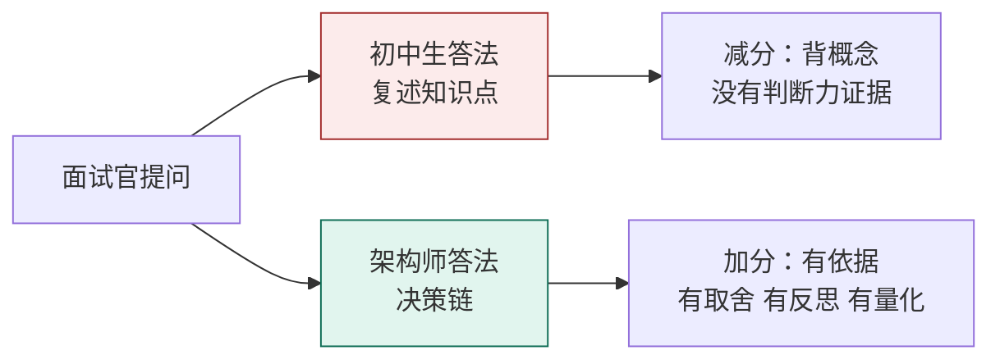
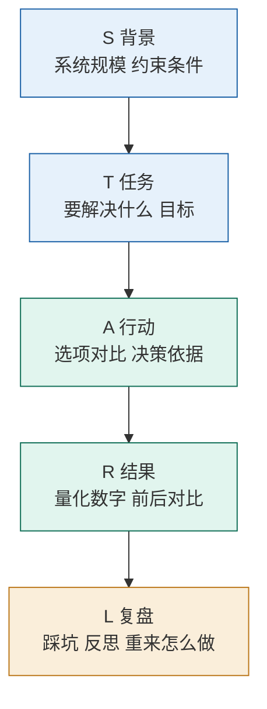
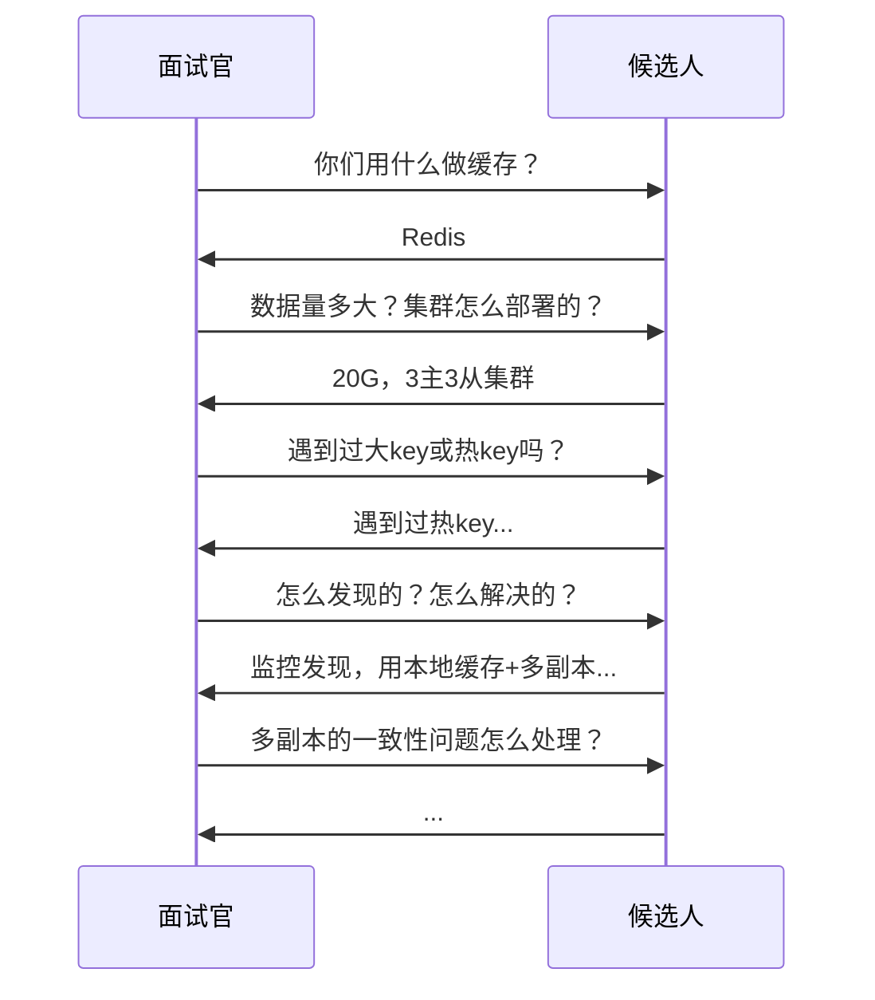

# 架构师面试的底层逻辑

> 定位：这一篇不教你任何技术知识点，它教的是**架构师面试的应答方式**。为什么很多人技术不差却过不了高级/架构面试？因为他还在用初中级的方式答题——背概念、复述原理。架构师面试考的是另一套东西：决策、权衡、取舍、复盘、量化。读懂这一篇，后面所有场景题才有意义。

## 一、先看清一个残酷事实

初中级面试和架构师面试，**是两种完全不同的考试**。

| 维度 | 初中级面试 | 架构师 / 高级面试 |
|---|---|---|
| 问法 | "什么是 CAP？" | "你们系统遇到过 AP 和 CP 的取舍吗？怎么选的？" |
| 考点 | 知识有没有记住 | 决策有没有依据、坑有没有踩过 |
| 理想答案 | 准确复述定义 | 讲清背景→约束→选项→取舍→结果→反思 |
| 减分项 | 答错概念 | 只会背概念、答"看场景"却说不出场景 |
| 面试官心理 | "这人基础行不行" | "这人能不能独立扛事、能不能信" |

看个真实例子。同样是问 Redis 分布式锁：

- **初中级答法**："用 SETNX 加锁，设过期时间，用 Lua 脚本保证原子性删除就够了。"
- **架构师面试期待的答法**："我们没直接用 SETNX——它没法优雅处理锁续期和主从切换时的锁丢失。评估过三种方案：Redlock 争议大、ZK 锁性能低、Redisson 的看门狗续期 + Redlock 多实例相对稳。最后选了 Redisson，但加了一层兜底：关键业务在DB层面用唯一索引再做一道幂等，防止锁失效导致的重复执行。代价是多一次DB写入，用性能换 correctness。上线后确实遇到过一次主从切换，锁重复了，幂等兜底救了回来——复盘后把锁的过期时间从 30s 调到 10s 并强化了续期。"

第二个答案里有六个要素：**背景、约束、选项对比、明确取舍、真实结果、复盘改进**。面试官招架构师，招的就是能给出这种答案的人。

## 二、架构师面试到底在考什么

面试官不是真的想知道"你会不会用 Redis"，他在用技术问题做载体，考察五件事：

### 2.1 决策能力：能不能在信息不全时做判断

架构的本质是取舍。面试官最爱问"为什么选 A 不选 B"。答不出取舍理由，说明你只是照搬了别人的方案，没有自己的判断。

**考察信号**：你能不能说出"当时有几个选项、各自的代价、我为什么这么选"。

### 2.2 权衡意识：知不知道天下没有免费午餐

初级工程师说"我用 Redis 缓存，性能就好了"。架构师知道缓存带来了一致性问题、穿透击穿雪崩、运维成本。**每个技术选择都有代价，说不出代价就是没真正用过。**

**考察信号**：你讲完方案，会不会主动说"这个方案的代价是什么、什么情况下我不推荐它"。

### 2.3 量化意识：有没有数字感

"性能提升了""QPS 很高""数据量很大"——这些是废话。架构师的表达里应该有数字：QPS 从多少到多少、P99 从 200ms 降到 50ms、数据量 3 亿、缓存命中率 98.7%。**数字是经验密度的证明。**

**考察信号**：你能否给出具体的、前后对比的、可验证的数字。

### 2.4 复盘能力：踩过坑没有，学到了什么

没踩过坑的架构师不可信。面试官会追"遇到过什么问题吗""出过事故吗"。关键不是"没出过事"，而是出了事你怎么定位、怎么止血、怎么防止再次发生。

**考察信号**：你能不能讲出一个完整的"事故 → 定位 → 止血 → 根因 → 改进"闭环。

### 2.5 影响力与推动：能不能让方案落地

架构师不是画图纸的人，是要推动团队把方案落地的人。面试官会问"你怎么说服业务方/团队接受你的方案"。这考的是沟通、权衡业务与技术、处理分歧。

**考察信号**：你能否讲清"方案不是技术上最优就行，还要考虑业务节奏、团队能力、迁移成本"。

## 三、万能应答框架：STAR-L

把上面五点浓缩成一个可复用的答题结构，我叫它 **STAR-L**（在经典 STAR 基础上加了 L——Lessons & Numbers）：

| 字母 | 含义 | 你要回答的问题 | 常见缺失 |
|---|---|---|---|
| **S** | Situation 背景 | 什么系统、什么规模、什么约束 | 上来就讲方案，没有背景 |
| **T** | Task 任务 | 你要解决什么问题、目标是什么 | 目标模糊，不知道要解决啥 |
| **A** | Action 行动 | 有哪些选项、你选了什么、为什么 | 只讲选了什么，不讲为什么 |
| **R** | Result 结果 | 效果如何、有数字吗 | 没有量化，"效果挺好" |
| **L** | Lessons 复盘 | 踩了什么坑、学到了什么、重来怎么做 | 完全没有反思 |

一个架构师级别的回答，五段都要有。缺任何一段，面试官都会追问出来。

## 四、最重要的一节：如何诚实地回答"你做过吗"

这里必须讲清楚一个原则，因为它决定了你怎么用这套题库。

**不要虚构你没有的经历。** 如果面试官问"你做过秒杀系统吗"，你没做过却硬编，一个有经验的面试官三个追问就能把你问穿：

- "峰值 QPS 多少？"（你答不出具体数字）
- "库存扣减怎么保证不超卖？"（你只能背 Redis + Lua）
- "Redis 挂了怎么办？"（你开始含糊）
- "压测是怎么做的？瓶颈在哪？"（彻底露馅）

**正确的做法是分层表达**：

1. **做过就直接讲**（背景、数字、决策、坑），这是你的真实弹药。
2. **没做过但懂原理**，就说"我没有直接做过，但我系统研究过，如果让我设计我会这么做……"，然后展示你的决策链和权衡意识。坦诚 + 清晰的思路，比心虚的编造强一百倍。
3. **把知识库的原理变成你的思考素材**。这套知识库 77 篇的原理、坑点、选型对比，就是让你在第 2 种情况下也能答得有深度——你没做过，但你知道所有关键决策点在哪、坑在哪、业界怎么解的。

> 这套题库的正确用法：**不是背答案去糊弄面试官，而是用它训练你的决策思维**。每道场景题，你都问自己"如果这是我真实负责的项目，我会怎么做、我需要考虑什么"。想清楚了，面试时才能把真实经历讲得有条理、有深度。

## 五、面试官的追问链：为什么你总觉得"问不完"

架构师面试很少一问一答就结束。面试官会用**剥洋葱式追问**层层深入：

每一层追问都在验证：**你是真的做过，还是只背了第一层**。

应对方法：
1. **主动把话往深了说**。讲完方案，主动说代价和坑，把面试官想追问的先说了——这叫"抢占追问权"，反而显得你经验足。
2. **准备三层深度**。任何知识点，你都要准备"是什么→怎么用→坑和调优"三层。面试官问第一层，你答到第三层，他通常会满意地跳过。
3. **不知道就说不知道，但给出思路**。"这个我没实操过，但我的判断是……因为……"。诚实 + 推理，远好于编造被戳穿。

## 六、翻车信号：这些回答会当场减分

| 翻车回答 | 为什么减分 | 应该怎么说 |
|---|---|---|
| "看场景" | 万能废话，没有判断力 | 说出具体场景和对应的选择 |
| "用缓存就好了" | 只说方案不说代价 | 说清一致性、穿透、雪崩怎么处理 |
| "效果挺好的" | 没有数字 | "P99 从 200ms 降到 50ms" |
| "我们用的 XX，挺好的" | 没有为什么 | 说出选型对比和取舍 |
| "没出过什么问题" | 不可信，或没深入用 | 讲一个真实的坑和复盘 |
| "这个我不会" | 直接放弃 | "没做过，但我的思路是……" |

## 七、这套题库怎么用

后面的场景题都按统一结构组织：

- **题目**：真实的高阶面试问法
- **考察什么**：面试官想验证的能力
- **答题骨架**：STAR-L 各段该填什么
- **追问链**：可能被怎么层层追问
- **翻车点**：哪里容易减分
- **调用知识**：回扣本知识库哪些篇目做原理支撑

**不要背答案**。每一题都问自己："如果我真的负责过这个项目，我会怎么答？"——用真实项目去套框架，把框架内化成你的思维习惯。

## 八、一个小提醒

面试官也是人。除了技术，他们还在评估：**这个人靠不靠谱、能不能合作、遇到分歧怎么处理**。所以答题时：

- 承认别人的方案也有优点，不踩一捧一
- 讲失败时担责，不甩锅
- 讲成绩时说清团队贡献和你自己的贡献
- 遇到不会的，态度坦诚、思路清晰

技术上到了架构师水平，这些"软性"细节往往才是最后的胜负手。

## 小结

- 架构师面试考的不是知识，是决策、权衡、量化、复盘、影响力五件事。
- 用 STAR-L 框架组织回答：背景→任务→行动→结果→复盘，缺一段就会被追问。
- 没做过就坦诚说没做过，但用清晰的决策链证明你有判断力——不要编造经历。
- 准备三层深度，主动说代价和坑，抢占追问权。
- "看场景""效果挺好""用缓存就好"是三大翻车回答。
- 这套题库是训练思维的，不是背答案的——用真实项目去套框架。
