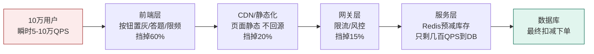
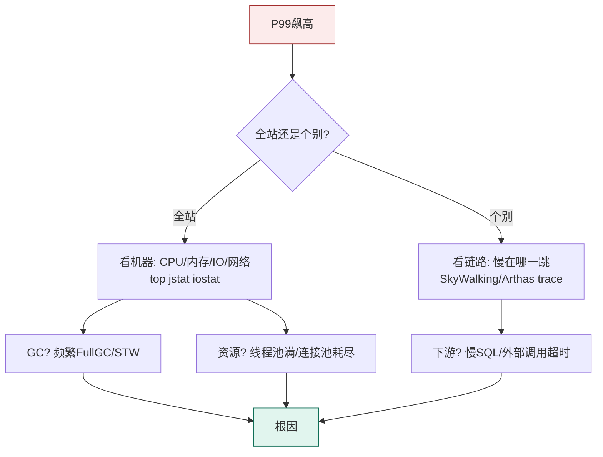

# 高并发场景面试

> 定位：高并发是架构师面试的必考区，也是最容易露馅的地方——因为面试官会用数字和细节一路追到你没做过的深度。这一篇用 5 道真实场景题，示范如何把「限流、缓存、削峰、扩容」这些人人会说的词，答成有决策、有取舍、有复盘的架构师级回答。

## 题 1：秒杀系统怎么设计？怎么保证不超卖？

### 题目

"让你设计一个秒杀系统，10 万人抢 1000 件商品。从用户点按钮到下单成功，整条链路你怎么设计？怎么保证不超卖？"

### 考察什么

这题几乎不考你知不知道 Redis，考的是：
- **削峰思维**：能不能把 10 万并发挡在数据库之外
- **分层设计**：每一层各自解决什么问题
- **正确性**：不超卖、不少卖的具体机制
- **量化能力**：每一层能扛多少、瓶颈在哪

### 答题骨架

**S（背景）**：先问清约束——峰值 QPS 预估多少（10 万人同时点，瞬时可能 5-10 万 QPS）、商品数（1000 件）、是否允许排队、可接受的下单延迟。

**A（行动）**：讲分层拦截的思路，每层挡掉多少流量：

关键话术：**"每一层的目标是把流量砍掉一个数量级，绝不能让 10 万 QPS 打到数据库。"**

**不超卖的正确机制**（这是面试官最想听的细节）：

1. **Redis 预减库存**：活动开始前把库存 1000 预热到 Redis。`decr` 原子扣减，扣到 `<0` 直接返回"已抢完"。
2. **异步下单**：Redis 扣减成功的请求发到 MQ，消费者再真正落库创建订单。**削峰**——把瞬时 5 万 QPS 摊平到数据库能承受的速度。
3. **数据库最终一致性兜底**：消费端用 `update stock set count=count-1 where id=? and count>0`，影响行数为 1 才建单。**这是防超卖的最后一道防线**——即使 Redis 出问题，数据库这关也拦得住。
4. **幂等**：MQ 可能重复投递，用 `用户ID+商品ID` 做唯一索引，防止重复下单。

**R（结果）**：给出数字——"这套设计下，真正打到 DB 的 QPS 降到几百，数据库毫无压力；1000 件商品 2 秒内抢完，无超卖。"

**L（复盘）**：主动说坑——
- "Redis 扣减成功但 MQ 发送失败怎么办？"→ 需要补偿，定时任务对账 Redis 扣减记录和订单表
- "用户付了款但订单超时释放了，库存要不要加回？"→ 要，且加回也要防超卖（不能超过原始库存）
- "如果 Redis 挂了？"→ 降级到数据库直接扣减 + 限流，宁可慢也不能超卖

### 追问链

| 面试官追问 | 你要接住的点 |
|---|---|
| Redis 扣减和 DB 扣减不一致怎么办？ | 最终一致性 + 定时对账 + 以 DB 为准 |
| 为什么不用数据库事务直接扣？ | 数据库扛不住 5万 QPS，会拖垮整个库 |
| MQ 积压了怎么办？ | 消费者扩容、监控积压告警、准备降级预案 |
| 有人用脚本刷怎么办？ | 网关风控、用户维度限频、答题、黑名单 |
| 1000 件够抢，如果 10 万件呢？ | 库存分片、分库分表、按用户分桶 |

### 翻车点

- ❌ "用 Redis 分布式锁锁住库存" —— 秒杀用锁是性能灾难，正确做法是用 Redis 原子递减
- ❌ "加个 synchronized" —— 单机锁，分布式系统无效
- ❌ 只讲 Redis 不讲数据库兜底 —— 面试官会追"Redis 挂了怎么办"
- ❌ 不提异步削峰 —— 说明你没意识到数据库才是瓶颈

### 调用知识

- [分布式锁](../08-分布式理论与共识/02-分布式锁.md)：为什么不推荐用锁做秒杀
- [MQ 生产问题](../07-缓存与中间件/06-MQ生产问题.md)：削峰、消息丢失、重复消费
- [分布式限流](../08-分布式理论与共识/06-分布式限流.md)：网关层限流策略

## 题 2：线上接口突然变慢，P99 从 50ms 涨到 2s，你怎么排查？

### 题目

"凌晨三点报警，核心接口 P99 从 50ms 飙到 2s，但没报错。你被叫起来，说说你的排查思路。"

### 考察什么

这题考的是**系统性排查能力**——不是背命令，而是有没有一套从现象到根因的推理路径，以及面对压力时的条理。

### 答题骨架

**S（背景）**：先问清——是所有接口慢还是个别？是突然还是渐变的？最近有没有发布、变更、流量突增？（**先问这三个，比直接查更有价值**——体现你不会盲目动手）

**A（行动）**：分层排查，从外到内、从宏观到微观：

**分层说清排查手段**：

1. **先看趋势和变更**（最重要）：监控看是渐变还是突变；查最近有没有发布、配置变更、数据变更。80% 的线上问题跟最近一次变更有关。
2. **看机器资源**：`top` 看 CPU（是不是某个线程 100%）、`jstat -gcutil` 看 GC（是不是频繁 Full GC / STW 变长）、`iostat` 看磁盘 IO。
3. **看调用链**：用 SkyWalking / Arthas `trace` 定位慢在哪一跳——是自身逻辑、还是调了慢 SQL、还是下游超时。
4. **看线程池/连接池**：线程池队列是否堆积、数据库连接池是否耗尽（这是"没报错但慢"的常见原因——请求在排队）。
5. **看日志**：慢 SQL 日志、异常日志（被吞掉的异常也会导致慢）。

**R（结果）**：给一个具体的收尾——"最后定位到是某次发布引入的 N+1 查询，连接数被占满导致请求排队。回滚 + 加索引，10 分钟恢复。"

**L（复盘）**：
- "为什么监控没有提前发现？"→ 补充连接池使用率、慢 SQL 数的告警
- "为什么发布没发现？"→ 压测场景没覆盖这个查询路径
- "止血后做了什么？"→ 加索引、补监控、写复盘文档、加回归测试

### 追问链

| 面试官追问 | 你要接住的点 |
|---|---|
| CPU 100% 具体怎么定位到线程？ | `top -H -p` 找线程 → `jstack` 看线程栈 → 转十六进制匹配 |
| GC 怎么看是不是问题？ | `jstat -gcutil` 看 YGC/FGC 频率和耗时，GC 日志分析 STW |
| 连接池耗尽怎么确认？ | 看连接池监控、线程 dump 里大量线程卡在 getConnection |
| 如果是偶发的慢呢？ | 看 GC 日志、看是否有定时批量任务、看锁竞争 |
| 你怎么防止再次发生？ | 监控告警 + 发布卡点 + 压测覆盖 |

### 翻车点

- ❌ 上来就说"看日志" —— 没有排查路径，显得没有章法
- ❌ 只说工具不说思路 —— 面试官要的是推理过程，不是命令列表
- ❌ 不先问"有没有变更" —— 暴露你没处理过线上问题的经验
- ❌ 定位到就结束，不说复盘 —— 架构师要有防再次发生的意识

### 调用知识

- [GC 调优与线上排查](../02-Java底层与并发/03-GC调优与线上排查.md)：jstat/jmap/dump 分析
- [线上故障排查与复盘](../12-高可用与稳定性/05-线上故障排查与复盘.md)：CPU 飙高、连接池耗尽的排查手册
- [Arthas 线上诊断](../13-可观测性/05-Arthas线上诊断.md)：trace/watch 实战

## 题 3：缓存和数据库一致性怎么保证？

### 题目

"你们用缓存，怎么保证缓存和数据库的数据一致？先更新缓存还是先更新数据库？删除缓存还是更新缓存？延迟双删靠谱吗？"

### 考察什么

这题是**"看场景"诈骗重灾区**。很多人答"看场景"，但说不出什么场景怎么选。考的是你有没有真正理过这几种方案的边界和坑。

### 答题骨架

**A（行动）**：先把方案和它的适用边界讲清楚——

**四个基本方案对比**：

| 方案 | 做法 | 问题 | 适用 |
|---|---|---|---|
| 先更新DB再更新缓存 | 写完库写缓存 | 并发写导致缓存脏数据；缓存写入失败 | 不推荐 |
| 先更新缓存再更新DB | 写完缓存写库 | DB失败缓存就脏了 | 不推荐 |
| 先删缓存再更新DB | 删缓存后写库 | 并发读会把旧值回填缓存 | 有并发问题 |
| **先更新DB再删缓存** | **写库后删缓存** | **删缓存失败导致脏读** | **主流推荐** |

**核心结论**：主流是 **Cache Aside（先更新数据库，再删除缓存）**。为什么删缓存而不是更新缓存？因为更新缓存可能有并发写导致的脏数据，而且很多缓存值是要计算的，删了让它下次重建更简单。

**然后讲清楚它仍有的问题，以及你怎么处理**：

1. **删缓存失败** → 用消息队列重试删除，或者订阅 binlog（Canal）异步删除，保证最终一致。
2. **并发读写导致的旧值回填**（读线程读到旧DB值，在写线程删缓存后才写回缓存）→ 概率很低（要求读恰好在写之前、回填在删之后），可以**延迟双删**（删一次、sleep 几百毫秒、再删一次），但要承认延迟双删不完美，只是降低概率。
3. **强一致性场景**（如金融余额）→ 缓存方案本身就扛不住，要么不缓存、要么走分布式锁串行化、要么用支持事务的缓存方案。

**R（结果）**：讲清"我们最终用了什么、为什么"。比如："普通业务用 Cache Aside + 失败重试；核心数据订阅 binlog 异步删缓存；金融类不走缓存。"

**L（复盘）**：主动说——"缓存一致性没有银弹，本质是**最终一致**。要接受短暂不一致，关键是要有一致性监控（定时抽样比对DB和缓存），发现不一致能告警和自愈。"

### 追问链

| 面试官追问 | 你要接住的点 |
|---|---|
| 为什么是删缓存不是更新缓存？ | 并发写脏数据 + 计算成本 + 简单性 |
| 延迟双删的 sleep 时间怎么定？ | 看主从延迟 + 读耗时，经验值几百毫秒，不完美 |
| binlog 订阅方案有什么坑？ | 延迟、顺序性、消费失败重试、初次全量同步 |
| 能不能做到强一致？ | 缓存方案做不到，要强一致就别用缓存或加锁串行 |
| 缓存穿透/击穿/雪崩怎么防？ | 布隆过滤器/互斥锁/过期时间打散 |

### 翻车点

- ❌ "看场景" 然后没下文 —— 送命题
- ❌ 说"先更新缓存" —— 没想过 DB 失败的情况
- ❌ 说"延迟双删就解决了" —— 显得没意识到它不完美
- ❌ 说"加锁就能强一致" —— 没考虑性能和死锁

### 调用知识

- [缓存三大问题与一致性](../07-缓存与中间件/03-缓存三大问题与一致性.md)：四种更新模式、延迟双删、binlog
- [CAP、BASE 与一致性](../08-分布式理论与共识/01-CAP-BASE与一致性.md)：为什么缓存只能最终一致

## 题 4：接口限流的阈值怎么定？拍脑袋吗？

### 题目

"你们网关限流，QPS 阈值怎么定的？定高了没用，定低了误伤，你怎么找到这个值？"

### 考察什么

这题考的是**量化意识和工程方法**。面试官想听的不是"用 Sentinel 配个规则"，而是你有没有一套确定阈值的科学方法。

### 答题骨架

**A（行动）**：讲清确定阈值的三步——

1. **压测摸出系统容量**：对单接口做压测，逐步加压，找到 CPU/RT/错误率的拐点。这个拐点对应的 QPS 就是系统的**容量上限**。
2. **设阈值 = 容量上限 × 安全系数**：通常取 70%-80%，留出余量给突发和下游波动。比如压测出单实例 1000 QPS，10 个实例，容量 1 万，阈值设 7000-8000。
3. **分级 + 动态调整**：
   - 不同接口不同阈值（核心接口优先保障）
   - 按用户/租户维度做精细化限流（防止单个用户打爆）
   - 结合系统保护（Sentinel 的系统规则，根据 Load/CPU 自适应）

**关键话术**："阈值不是拍脑袋，是压测出来的。而且它不是一成不变——每次大促前重新压测，业务量增长后重新评估。"

**R（结果）**：给数字——"我们核心接口压测容量 8000 QPS，生产阈值设 6000，配了 Warm Up 预热，防止冷启动瞬间被打垮。大促期间限流触发过几次，扛住了。"

**L（复盘）**：
- "限流触发了怎么办？"→ 返回友好提示 + 排队/降级，不能直接 500
- "限流误伤了正常用户怎么办？"→ 按用户维度限流 + 白名单 + 监控误伤率
- "集群限流怎么做？"→ 单机限流简单但不准（流量不均），集群限流用 Redis 或 Sentinel Token Server，但有性能开销

### 追问链

| 面试官追问 | 你要接住的点 |
|---|---|
| 压测怎么做的？ | 基准→负载→压力→稳定性压测，找拐点 |
| 单机限流和集群限流选哪个？ | 单机简单、集群准，看流量是否均匀 |
| 限流算法用哪个？ | 令牌桶（允许突发）vs 漏桶（恒定速率），Sentinel 用滑动窗口 |
| 限流和降级什么关系？ | 限流挡入口，降级保核心，配合用 |
| 突发流量怎么平滑？ | Warm Up 预热、排队等待 |

### 翻车点

- ❌ "设个大概的值" —— 没有量化方法
- ❌ "用 Sentinel 默认配置" —— 没有根据系统容量调
- ❌ 只说限流不说被限流后怎么办 —— 缺用户体验考虑

### 调用知识

- [分布式限流](../08-分布式理论与共识/06-分布式限流.md)：限流算法、集群限流
- [容量规划与压测](../12-高可用与稳定性/04-容量规划与压测.md)：怎么压测、怎么找拐点
- [Sentinel 限流熔断](../09-微服务体系/03-Sentinel限流熔断.md)：流控效果、系统保护

## 题 5：系统要抗 10 倍流量，你说三个最关键的动作

### 题目

"现在系统撑 1 万 QPS，双十一要撑 10 万。给你有限的时间和资源，你说三个最关键的动作，按优先级排。"

### 考察什么

这是**架构师的决策力和取舍题**——资源有限，你不可能什么都做，先做什么后做什么，体现了你的判断力。没有标准答案，但有好答案和坏答案。

### 答题骨架

**A（行动）**：先说判断原则——"我会先摸清瓶颈在哪，然后按**投入产出比**和**风险**排序，而不是一上来就堆机器。"

然后给出三个动作（示范一种答法，重点是取舍逻辑）：

**动作一：先扩容 + 优化，榨干现有架构（最快见效，风险最低）**
- 压测找出瓶颈点（DB？缓存？线程池？）
- 加机器、调参数、加索引、优化慢 SQL
- 很多系统 10 倍容量靠这步就能解决大半，成本最低

**动作二：削峰 + 缓存 + 异步（投入中等，收益大）**
- 能把流量挡在 DB 外的都挡掉：CDN、缓存、MQ 削峰
- 把同步调用改异步，拉长可承受的时间窗口

**动作三：预案 + 降级 + 限流（保命，必须做）**
- 容量再怎么规划也可能估错，必须有兜底
- 核心链路保障、非核心降级、限流防护、熔断隔离
- 做压测和演练，确保预案真的能生效

**关键话术**："我不会一上来就说拆微服务、上 Redis Cluster 这些大动作——那是重构成，不是应急。10 倍流量先用扩容和优化顶住，同时准备降级预案保命，重构留到平时慢慢做。"

**L（复盘）**：主动说取舍——"如果时间充裕，我会做架构级优化（分库分表、服务拆分）；但如果只有一个月，我会把 80% 精力放在扩容调优和预案上，因为这两个最确定、风险最低。"

### 追问链

| 面试官追问 | 你要接住的点 |
|---|---|
| 为什么先扩容不先重构？ | 应急场景确定性优先，重构周期长风险高 |
| 扩容到多少够了？ | 压测摸容量，留 30% 余量 |
| 如果成本有限不能无限加机器呢？ | 那就必须做缓存和异步削峰，减少后端压力 |
| 怎么知道瓶颈在哪？ | 全链路压测 + 监控 + 链路追踪定位 |
| 带宽/连接数会不会先扛不住？ | 会，要考虑 CDN、连接池、LVS 层 |

### 翻车点

- ❌ 上来就说"拆微服务""上 K8s" —— 重构成，不是容量方案，显得脱离实际
- ❌ 只说"加机器" —— 没考虑成本和 DB 瓶颈（DB 不是加机器就能解决的）
- ❌ 三个动作没有优先级 —— 面试官要的就是你的排序判断
- ❌ 不考虑兜底预案 —— 容量规划一定会估错，没有预案是致命的

### 调用知识

- [性能优化分层](../12-高可用与稳定性/02-性能优化分层.md)：SQL→缓存→业务→JVM→网络
- [高可用架构设计](../12-高可用与稳定性/01-高可用架构设计.md)：冗余、无状态、故障转移
- [限流降级熔断隔离](../12-高可用与稳定性/03-限流降级熔断隔离.md)：保命手段

## 小结

- 高并发面试考的是削峰分层、正确性机制、量化能力，不是背"用 Redis"。
- 秒杀的核心：每层砍一个数量级 + Redis预减/MQ削峰/DB兜底三道防线 + 幂等。
- 排查问题先问"有没有变更"，再分层（机器→链路→资源→日志），最后一定要复盘。
- 缓存一致性没有银弹，主流是 Cache Aside + 失败重试，本质是最终一致。
- 限流阈值压测定，不是拍脑袋；被限流后要有友好处理。
- 10 倍流量的取舍：先扩容调优（确定）→ 再削峰缓存（划算）→ 必做降级预案（保命），重构留到平时。
