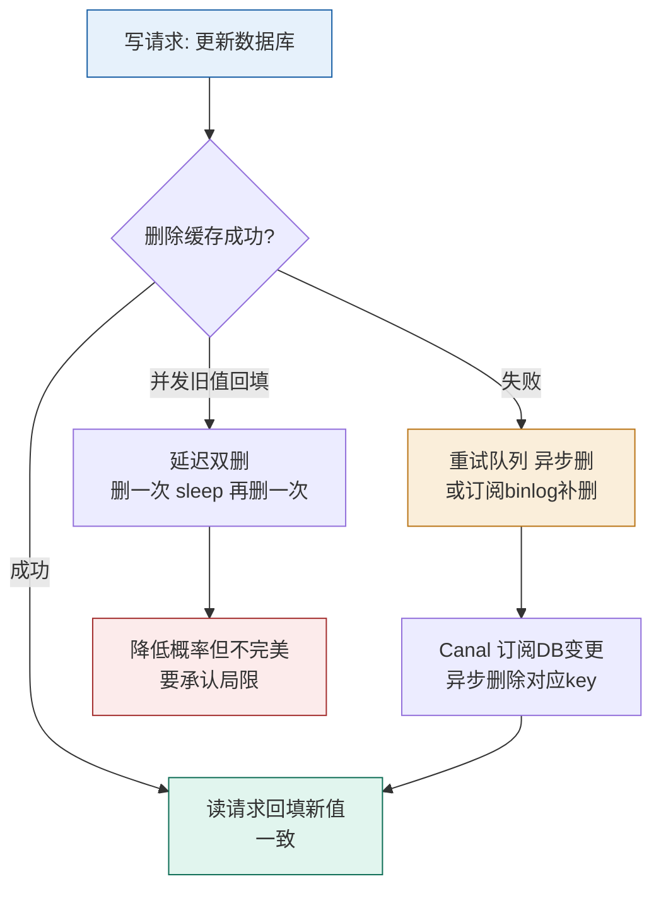
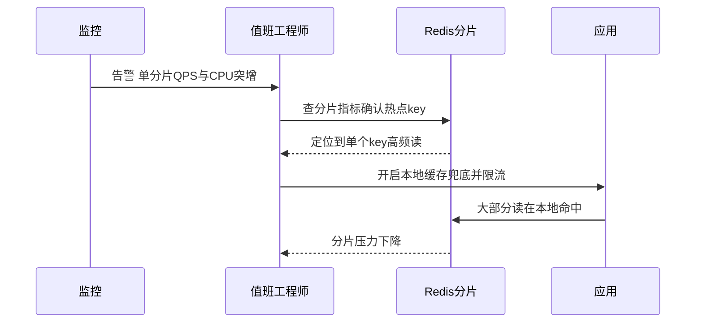
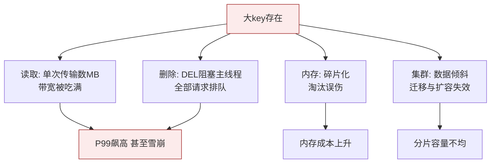
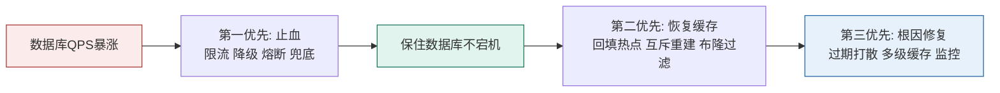
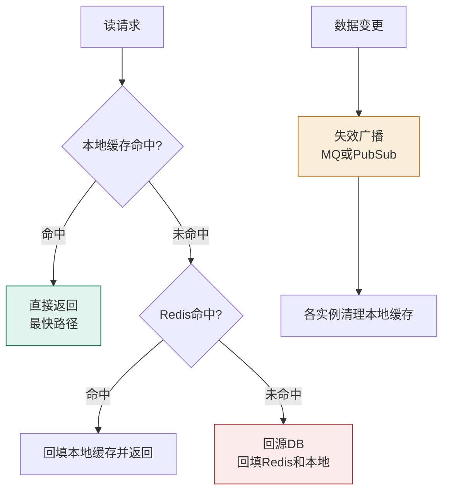

# 缓存场景面试

> 定位：缓存是面试高频区，也是最容易答得「正确但浅」的地方——人人都会说「删缓存、布隆过滤器、过期时间打散」，但面试官要听的是失败路径、发现手段、应急顺序和治理工程化。这一篇用 5 道场景题，示范怎么把缓存答出架构师的深度。**常见露馅点**：一致性只会背 Cache Aside、热 key 大 key 说不出怎么发现、三种缓存问题混为一谈、多级缓存不算一致性的账。文末的「坑点」清单是高频翻车区，建议先自答再对照。

## 题 1：缓存和数据库一致性怎么保证？你真的能从删缓存失败讲到 binlog 订阅吗？

### 题目

"你们用 Redis 做缓存，怎么保证和数据库一致？先更新缓存还是先更新库？删除还是更新？延迟双删靠谱吗？删缓存失败了怎么办？你能从最普通的方案一路讲到订阅 binlog 吗？"

### 考察什么

- **方案边界**：是不是真的理过四种更新模式的边界，而不是背「看场景」。
- **失败路径**：正常流程谁都会说，面试官要听的是「删缓存失败」「并发回填」这些异常路径你怎么兜。
- **最终一致的坦诚**：敢不敢承认缓存一致性没有银弹，本质是最终一致。

### 答题骨架

**S（背景）**：先问清四个约束——

1. 一致性要求到什么程度？是「短暂不一致可接受」还是「余额级强一致」？
2. 读写比大概多少？（填入你项目的读写比）——读多写少才适合缓存。
3. 缓存值是简单字段还是要计算聚合？计算成本高的更适合「删」而非「更新」。
4. 有没有主从延迟？延迟双删的 sleep 时间跟它直接相关。

面试官想听的是：**先问约束，再选方案**。张口就说「Cache Aside」而不问业务，是在背答案。

**A（行动）**：先给四种模式对比表，再往深处讲失败路径。

| 方案 | 做法 | 核心问题 | 适用 |
|---|---|---|---|
| 先更新 DB 再更新缓存 | 写完库写缓存 | 并发写导致缓存脏数据；缓存写入失败 | 不推荐 |
| 先更新缓存再更新 DB | 写完缓存写库 | DB 失败缓存就脏了 | 不推荐 |
| 先删缓存再更新 DB | 删缓存后写库 | 并发读把旧值回填缓存 | 有并发问题 |
| **先更新 DB 再删缓存** | 写库后删缓存 | 删缓存失败导致脏读 | **主流推荐：Cache Aside** |

核心结论：**主流是 Cache Aside（先更新数据库，再删除缓存）**。为什么删而不是更新？因为更新缓存可能有并发写导致的脏数据，且很多缓存值需要计算，删了让下次读时重建更简单。

但这只是起点。面试官要的是你继续往下讲三条失败路径：

1. **删缓存失败** → 两条兜底：把删除动作丢进 MQ 异步重试（要有死亡队列和告警）；或者**订阅 binlog**（如用 Canal）异步删除，把缓存当成数据库的「下游副本」来维护。后者更彻底，但要处理延迟、顺序和初次全量同步。
2. **并发读写导致旧值回填** → 读线程读到旧 DB 值，在写线程删缓存之后才写回缓存。概率很低（要求读恰好在写之前、回填在删之后），可用**延迟双删**（删一次、sleep 几百毫秒、再删一次）降低概率，但要**明确承认它不完美**——sleep 时间依赖主从延迟和读耗时，无法精确。
3. **强一致场景（如余额）** → 缓存方案本身就扛不住。要么不缓存，要么走分布式锁串行化，要么用支持事务的存储。这时候要坦诚说「这类数据我不做缓存」。

关键话术：**"缓存一致性没有银弹，本质是最终一致。能做的是把不一致窗口压到最小，并且有一致性监控——定时抽样比对 DB 和缓存，发现不一致能告警和自愈。"**

**R（结果）**：填入真实数字——"我们普通业务用 Cache Aside + 失败重试；核心数据订阅 binlog 异步删，不一致窗口 P99 控制在（填入毫秒数）毫秒；抽样对账显示不一致率（填入比例），通过自愈任务在（填入时长）内收敛。"

**L（复盘）**：主动说——

- "binlog 订阅方案有什么坑？"→ 延迟、顺序性、消费失败重试、初次全量同步，一个都不能少。
- "延迟双删的 sleep 怎么定？"→ 看主从延迟 + 读耗时，经验值几百毫秒，但这是「降概率」不是「保正确」。
- "缓存和 DB 长时间不一致怎么办？"→ 一致性监控告警 + 强制删除兜底，关键业务要有手动清缓存的运维入口。

#### 公开案例

据 **微软 Azure 官方架构中心的《Cache-Aside pattern》文档**对 Cache-Aside 模式的定义：应用从缓存读数据，未命中时回源数据库并回填缓存；数据更新时**使缓存失效（删除）而非更新**，因为更新可能引入竞态。另据 **阿里开源的 Canal 项目文档**，可通过订阅 MySQL binlog 捕获数据变更，业界公开实践中常见的做法是：**用 CDC 变更流异步清理缓存**，把一致性从「应用代码里手写删除」升级为「数据变更驱动的自动失效」。**可借鉴点**：业务代码里的删缓存总会漏，binlog 订阅是兜底的好位置，但要为「延迟」和「初次同步」买单。

### 追问链

| 面试官追问 | 你要接住的点 |
|---|---|
| 为什么删缓存而不是更新缓存？ | 并发写脏数据 + 计算成本 + 简单性 |
| 延迟双删的 sleep 时间怎么定？ | 看主从延迟和读耗时，经验几百毫秒，不完美 |
| binlog 订阅删缓存有什么坑？ | 延迟、顺序、消费失败重试、初次全量同步 |
| 能不能做到强一致？ | 缓存做不到，要强一致就别缓存或加锁串行 |
| 缓存里是聚合计算结果，删了重建很贵怎么办？ | 评估更新缓存的并发风险，或用消息队列串行化重建 |

### 翻车点

- ❌ "看场景" 然后没下文 —— 送命题，必须说出什么场景怎么选。
- ❌ "先更新缓存" —— 没想过 DB 失败后缓存就脏了。
- ❌ "延迟双删就解决了" —— 显得没意识到它只是降概率。
- ❌ "加锁就能强一致" —— 没考虑性能雪崩和死锁，缓存场景加锁通常是错的方向。

### 调用知识

- [缓存三大问题与一致性](../07-缓存与中间件/03-缓存三大问题与一致性.md)：四种更新模式、延迟双删、binlog 订阅
- [CAP、BASE 与一致性](../08-分布式理论与共识/01-CAP-BASE与一致性.md)：为什么缓存只能最终一致
- [读写分离与主从复制](../06-数据库体系/06-读写分离与主从复制.md)：主从延迟对延迟双删的影响

## 题 2：线上出现热 key 把 Redis 单个分片打满，怎么发现、怎么救、怎么防？

### 题目

"线上报警，Redis 集群某个分片 CPU 100%、QPS 暴涨，其他分片很闲。业务侧是某明星上热搜，几千万人同时刷同一个 key。你被叫起来：怎么确认是热 key？怎么在五分钟内止血？事后怎么防止再发生？"

### 考察什么

- **可观测性**：知不知道有哪些手段能定位热 key，而不是只会「看监控」。
- **应急能力**：止血动作有没有优先级，能不能在高压下想清楚先做什么。
- **架构防御**：能不能把「事后救火」变成「事前探测 + 自动兜底」。

### 答题骨架

**S（背景）**：先问清——Redis 是集群还是主从？分片数多少？热点 key 的业务语义是什么（明星动态、秒杀商品、热门榜单）？读热点还是写热点？（填入你项目的分片数和单分片容量）——这些信息决定止血手段。

面试官想听的是：**先判断是读热点还是写热点**。读热点可用本地缓存扛，写热点只能拆分或限流，两者解法完全不同。

**A（行动）**：按「发现 → 止血 → 防御」三段讲。

**一、怎么发现**：

- 服务端：`redis-cli --hotkeys`（需要 `maxmemory-policy` 为 allkeys-lfu）、`INFO commandstats` 看命令分布、慢日志；
- 监控看分片维度 QPS/CPU/延迟是否明显倾斜（这是最快的信号）；
- 客户端埋点：统计 key 访问频次（注意采样，别把采集本身做成瓶颈）；
- 慎用 `MONITOR`——它会把全局命令都打出来，生产高峰用可能把 Redis 拖垮。

**二、怎么救（五分钟止血）**：

止血动作按优先级：

1. **本地缓存兜底**（最快）：给热点 key 加一层进程内缓存（Caffeine），设极短 TTL（如 1 秒），挡掉 90% 以上的重复读。
2. **多副本打散**：把同一个逻辑 key 复制成 N 个带随机后缀的 key（`key:1`~`key:100`），客户端随机读一个，把压力摊到不同分片。
3. **限流降级**：对热点 key 的访问做频率限制，超出的返回兜底数据或旧值。
4. **临时扩容/迁移**：如果热点可预期（如大促），提前把热点 key 单独迁到专属分片。

**三、怎么防**：

- **热点探测**：客户端或代理层统计 key 访问频次，超过阈值自动升级为本地缓存热点；
- **多级缓存**：把热点挡在 Redis 之前（见题 5）；
- **读写分离**：读多写少的热点走只读副本；
- **预案**：大促/热点事件前，提前识别可能的热点 key 并预热。

关键话术：**"热 key 的本质是流量倾斜，Redis 集群的槽位设计不认业务热点。发现靠分片级监控，止血靠本地缓存，根治靠热点探测 + 多级缓存。"**

**R（结果）**：填入真实数字——"止血后单分片 QPS 从（填入峰值）降到（填入恢复值），应用 P99 从（填入毫秒数）回落到（填入毫秒数）；本地缓存命中率（填入比例），热点探测覆盖（填入比例）%的读请求。"

**L（复盘）**：主动说——

- "本地缓存的一致性怎么管？"→ 短 TTL + 失效广播，接受秒级延迟（见题 5）。
- "多副本打散的副本数怎么定？"→ 看分片数和热点强度，太少没效果、太多占内存；要能动态调整。
- "为什么不在代码里提前识别热点？"→ 热点常常不可预测（突发事件），要靠运行时探测而非静态配置。

#### 公开案例

据 **Redis 官方文档**，`--hotkeys` 是官方提供的热点 key 发现工具，但依赖 `LFU` 淘汰策略；官方文档同时警告 **`MONITOR` 命令在高负载下可能显著影响性能**，不适合生产高峰排障。另据 **Caffeine 官方 GitHub 文档**，其基于 W-TinyLFU 的淘汰策略在热点集中场景下命中率显著优于传统 LRU。**可借鉴点**：热点治理要「探测 + 兜底」组合——本地缓存用 Caffeine 这类高性能库，探测靠官方工具或客户端埋点，别指望单一手段。

### 追问链

| 面试官追问 | 你要接住的点 |
|---|---|
| `--hotkeys` 为什么要求 allkeys-lfu？ | 它基于 LFU 计数统计访问频次，没有 LFU 元数据就统计不出来 |
| 本地缓存挡住了热点，一致性怎么保证？ | 短 TTL + 失效广播，接受秒级最终一致 |
| 写热点怎么办？本地缓存还能用吗？ | 写热点不能用本地缓存兜底，要拆分 key 或限流排队 |
| 多副本打散怎么让客户端知道有哪些副本？ | 下发副本列表 + 客户端随机选择，或让代理层做路由 |
| 怎么提前发现突发热点？ | 客户端频次统计 + 阈值告警 + 自动升级本地缓存 |

### 翻车点

- ❌ "加机器扩容" —— 单个热点 key 在固定分片，盲目扩容无效，这是最常见误答。
- ❌ "生产上开 MONITOR 看一下" —— 会把 Redis 拖垮，暴露你没在高负载下排过障。
- ❌ "只要加大 Redis 内存就行" —— 热 key 问题是 CPU 和带宽瓶颈，不是内存。
- ❌ 只说发现不说止血 —— 应急场景下，面试官要的是「你被叫起来先干什么」。

### 调用知识

- [Redis 持久化与集群](../07-缓存与中间件/02-Redis持久化与集群.md)：集群槽位分片原理，为什么热点会倾斜
- [缓存三大问题与一致性](../07-缓存与中间件/03-缓存三大问题与一致性.md)：热 key 与缓存击穿的区别
- [限流降级熔断隔离](../12-高可用与稳定性/03-限流降级熔断隔离.md)：热点场景的降级预案

## 题 3：大 key 有什么危害，怎么治理？

### 题目

"你们 Redis 里有个 Hash 存了 200 万个字段，还有个 String 有 10MB。同事说『反正内存够用，先放着』。你怎么说服他这是问题？大 key 到底有什么危害？发现之后怎么安全地删掉它？"

### 考察什么

- **原理深度**：能不能讲清大 key 为什么会阻塞主线程、造成数据倾斜、拖慢集群迁移。
- **治理工程化**：发现、拆解、删除、预防，是不是一套完整流程，而不是「删了就完事」。
- **说服力**：能不能把技术风险翻译成同事和老板听得懂的话（资损、故障时长）。

### 答题骨架

**S（背景）**：先给大 key 一个可操作的定义——业界公开实践中常见的经验阈值是：**String 类型超过 10KB，Hash/List/Set/ZSet 元素数超过 5000**（具体阈值要按业务和 Redis 版本调整）。先确认这个 key 的类型、大小、访问频率、是否可拆。

面试官想听你先定义清楚「多大算大」，而不是笼统说「很大」。

**A（行动）**：先讲危害，再讲治理四步。

**大 key 的四层危害**：

| 层面 | 危害 | 后果 |
|---|---|---|
| 网络 | 单次读取传输几 MB | 带宽打满，其他请求变慢 |
| 主线程 | `DEL` 大 key 阻塞主线程数百毫秒 | Redis 单线程模型下全部请求排队，甚至触发超时雪崩 |
| 内存 | 内存碎片、淘汰不友好 | 内存利用率低，`maxmemory` 触发淘汰时误伤 |
| 集群 | 数据倾斜，某分片内存远超其他 | 迁移卡住、扩容无效、槽位不均衡 |

**治理四步**：

1. **发现**：`redis-cli --bigkeys` 扫描、慢日志（大 key 操作必然进慢日志）、`MEMORY USAGE key` 精确看内存、RDB 文件离线分析。
2. **拆解**：String 拆成多个小 key（业务层拼接）；Hash/Set 按业务维度分桶（如按用户 ID 取模拆成 N 个）；大 List 分段。
3. **安全删除**：**绝对不要直接 `DEL` 大 key**。Redis 4.0+ 用 `UNLINK` 异步删除；或用 `SCAN` + 小批量删除；或配置 `lazyfree-lazy-expire yes` 让淘汰异步化。
4. **预防**：写规范（上线卡点限制单个 key 大小） + 监控告警（key 大小超过阈值告警） + code review 检查。

关键话术：**"内存够用不是理由。大 key 真正的问题是它把 Redis 的单线程模型变成了单点故障放大器——一次 DEL 就能让整个实例卡住几百毫秒，上游全部超时。"**

**R（结果）**：填入真实数字——"治理后，最大的 String 从（填入大小）降到（填入大小），大 Hash 从（填入元素数）拆成（填入数量）个桶；慢查询数量下降（填入比例），某次大 key 删除导致的主线程阻塞从（填入毫秒数）降到接近 0。"

**L（复盘）**：主动说——

- "拆 key 之后业务代码改动大吗？"→ 要有统一的访问层封装分片逻辑，否则散落在业务代码里必然出错。
- "UNLINK 真的不阻塞吗？"→ 它把回收放到后台线程，但极小的 key 仍可能同步删；大 key 才走异步。
- "历史遗留的大 key 删不掉怎么办？"→ 设过期时间让它自然淘汰，配合 lazyfree，不要在业务高峰动它。

#### 公开案例

据 **Redis 官方文档**，`--bigkeys` 是官方提供的 key 体积分析工具，`MEMORY USAGE` 可精确查看单个 key 的内存占用；Redis 4.0 引入的 **`UNLINK`** 命令能以非阻塞方式异步回收大对象，配套的 `lazyfree-lazy-eviction`、`lazyfree-lazy-expire` 配置可让淘汰和过期也走异步回收。**可借鉴点**：大 key 治理的「发现」和「安全删除」都有官方工具支撑，别用 `DEL` 硬删——这是官方明确给出的规避手段。业界公开实践中常见的做法是：**String 控制在 10KB 内、集合元素控制在 5000 内**，并通过上线前卡点防止新增。

### 追问链

| 面试官追问 | 你要接住的点 |
|---|---|
| 为什么 DEL 大 key 会阻塞？ | Redis 单线程模型，释放大对象内存是同步操作，耗时随对象大小线性增长 |
| UNLINK 和 DEL 的区别？ | UNLINK 把回收交给后台线程异步执行，DEL 同步释放 |
| 大 key 会导致集群扩容失败吗？ | 会，单个大 key 无法在节点间迁移，槽位搬不动，容量无法均衡 |
| 怎么在业务高峰安全地删？ | 用 UNLINK 或设过期时间 + lazyfree，避开高峰，分批操作 |
| 拆 key 后跨桶查询怎么办？ | 业务层聚合或冗余一份索引，按场景取舍 |

### 翻车点

- ❌ "内存够用就不用管" —— 没认识到阻塞和倾斜问题，这是本题要纠正的核心误区。
- ❌ "直接 DEL 掉" —— 生产大 key 用 DEL 会阻塞主线程，是典型事故操作。
- ❌ "重启实例释放" —— 重启加载大 RDB 更慢，且没解决根因。
- ❌ 只说拆解不说预防 —— 治标不治本，过段时间又会出现新的大 key。

### 调用知识

- [Redis 数据结构与底层](../07-缓存与中间件/01-Redis数据结构与底层.md)：不同数据结构的内存编码与大对象回收原理
- [Redis 持久化与集群](../07-缓存与中间件/02-Redis持久化与集群.md)：大 key 对 RDB 和槽位迁移的影响
- [性能优化分层](../12-高可用与稳定性/02-性能优化分层.md)：把大 key 纳入常态化治理

## 题 4：缓存穿透、击穿、雪崩同时发生，你的应急顺序是什么？

### 题目

"大促零点到，缓存大面积过期，同时有一批爬虫在查根本不存在的商品 ID。监控显示数据库 QPS 暴涨、快扛不住了。穿透、击穿、雪崩好像同时发生了——你先做哪一个？说出你的应急顺序和理由。"

### 考察什么

- **概念区分**：能不能先分清三者，而不是混为一谈——这是很多人的真实状态。
- **应急决策**：高压下有没有清晰的优先级，先保命还是先治本。
- **权衡意识**：知不知道应急时改代码是最慢的路径，止血手段必须是「配置级」的。

### 答题骨架

**S（背景）**：先把三个概念钉死——

| 问题 | 本质 | 典型场景 |
|---|---|---|
| 穿透 | 查**不存在**的数据，缓存永远不命中 | 爬虫、恶意攻击、脏 ID |
| 击穿 | 单个**热点 key** 过期，大量请求同时回源 | 热门商品缓存到期 |
| 雪崩 | **大面积 key** 同时过期或缓存服务宕机 | 大促零点批量过期 |

关键话术：**"先把问题定性，再谈解决。三者混着答，说明你只是背了三个名词。"**

**A（行动）**：应急顺序分三层——**先止血、再恢复、后根因**。

**第一优先：止血（分钟级，配置即可生效）**

- 网关/应用层**限流**：把打到 DB 的请求量压到 DB 能扛的范围；
- **降级**：非核心功能直接返回兜底数据（空列表、默认值、静态页）；
- **熔断**：DB 连接耗尽时快速失败，别让请求全部堆积拖垮整个服务；
- 必要时**扩容只读副本**承接读流量。

**第二优先：恢复缓存**

- 击穿：用**互斥锁**（如 `SETNX`）只放一个请求回源重建，其他等待；或对热点 key 设**逻辑过期**（物理不过期，后台异步续期）；
- 穿透：加**布隆过滤器**在缓存前挡掉不存在的 ID；空结果也缓存（设短 TTL）；
- 雪崩：紧急**回填**核心 key，过期时间加**随机值**打散。

**第三优先：根因修复（事后慢慢做）**

- 过期时间加随机抖动，避免同时过期；
- 上多级缓存，让本地缓存兜住 Redis 抖动；
- 补监控告警：缓存命中率、DB QPS 联动告警。

关键话术：**"应急时绝对不要先去改代码——改代码、测试、发布至少要十几分钟，数据库早就挂了。先用限流降级止血，把时间买回来，再从容恢复和修复。"**

**R（结果）**：填入真实数字——"止血后 DB QPS 从（填入峰值）压到（填入安全值），缓存命中率从（填入比例）恢复到（填入比例）；数据库没宕机，核心接口可用性（填入比例）；事后通过过期时间打散把同类风险降到 0。"

**L（复盘）**：主动说——

- "布隆过滤器误判怎么办？"→ 它可能存在假阳性（不存在的 ID 被误判为存在），但不会假阴性；要接受这个误差并配合空值缓存。
- "互斥锁重建，拿锁的实例挂了怎么办？"→ 锁要有过期时间，且重建要有兜底（如返回旧值），不能死锁等待。
- "限流误伤正常用户怎么办？"→ 核心接口优先保障，按用户维度精细化限流，配白名单。

#### 公开案例

业界公开实践中常见的做法是：**用布隆过滤器防穿透、用互斥锁或逻辑过期防击穿、用过期时间随机化 + 多级缓存防雪崩**——这三者是缓存高可用领域的通用解法，在大量技术博客与公开分享中被反复验证。据 **Redis 官方文档**对过期删除策略和内存淘汰的说明，过期 key 的清理并非实时触发，因此「大量 key 设相同 TTL」确实会形成集中回源压力，随机化 TTL 是官方思路的自然延伸。**可借鉴点**：三种问题的解法要「对号入座」，但应急顺序要「先止血后治本」——这是工程经验，不是技术知识点。

### 追问链

| 面试官追问 | 你要接住的点 |
|---|---|
| 布隆过滤器的原理和误判率怎么控制？ | 位图 + 多个哈希函数，位数越大误判越低但内存越高，按容量和误判率估算 |
| 逻辑过期和物理过期怎么选？ | 逻辑过期不物理删除，靠后台续期，适合热点 key；物理过期简单但有击穿风险 |
| 限流阈值定多少？ | 压测摸 DB 容量，取安全系数，见「高并发场景」篇 |
| 雪崩是缓存服务挂了怎么办？ | 本地缓存兜底 + 服务降级 + 快速恢复 Redis，不能让请求全打 DB |
| 为什么不能先改代码？ | 改代码到上线至少十几分钟，止血必须靠配置级手段先买时间 |

### 翻车点

- ❌ 把穿透、击穿、雪崩混为一谈 —— 概念不清，后面全乱。
- ❌ "先加布隆过滤器" —— 应急时改代码来不及，顺序错了。
- ❌ "先扩容数据库" —— 扩容也要时间，且缓存问题不解决，扩多少打满多少。
- ❌ 不提降级和兜底 —— 数据库扛不住时，没有快速失败就是全站雪崩。

### 调用知识

- [缓存三大问题与一致性](../07-缓存与中间件/03-缓存三大问题与一致性.md)：穿透、击穿、雪崩的原理与解法
- [限流降级熔断隔离](../12-高可用与稳定性/03-限流降级熔断隔离.md)：应急止血的配置级手段
- [Sentinel 限流熔断](../09-微服务体系/03-Sentinel限流熔断.md)：快速失败与系统保护

## 题 5：要不要上多级缓存（本地 + Caffeine + Redis）？一致性怎么管？

### 题目

"有人说『加一层本地缓存，性能还能再上一个数量级』。你信吗？什么情况下你会上多级缓存（本地 Caffeine + Redis + DB）？上了之后本地缓存和 Redis 的一致性怎么管？别只说好处，把代价也讲清楚。"

### 考察什么

- **收益与复杂度权衡**：能不能说出「什么时候上、什么时候不上」，而不是人云亦云。
- **一致性设计**：多级缓存的一致性比单级难得多，能不能给出可落地的策略。
- **团队视角**：有没有考虑调试、运维、内存成本这些「隐性代价」。

### 答题骨架

**S（背景）**：先问清——当前 QPS 和瓶颈在哪？（填入你项目的真实 QPS 和 P99） Redis 是不是已经成为瓶颈？一致性要求多高？团队有没有能力维护多级缓存的复杂性？

面试官想听的是：**先确认「Redis 真的扛不住」再谈多级缓存**。如果 Redis 还很轻松，上多级缓存是给自己找麻烦。

**A（行动）**：先算收益，再算代价，最后给一致性策略。

**收益**：

| 收益 | 说明 |
|---|---|
| 性能 | 本地缓存读是内存访问，比走网络到 Redis 快一个数量级 |
| 抗抖动 | Redis 慢了或抖了，本地缓存能兜住大部分读 |
| 降成本 | 打穿到 Redis 的 QPS 降一个数量级，Redis 集群规模可以缩小 |

**代价**：

| 代价 | 说明 |
|---|---|
| 一致性变难 | 数据要同时管本地、Redis、DB 三份，本地缓存失效广播复杂 |
| 内存成本 | 每个应用实例都缓存一份全量热点数据，N 个实例 = N 倍内存 |
| 调试复杂 | 问题可能在任一层，排查链路变长 |
| 运维复杂 | 失效广播通道（MQ/PubSub）本身也要维护和高可用 |

**什么时候上**：读多写极少（写比例低于 1%）、热点集中、Redis 已成瓶颈、能接受秒级不一致。反之，写多或强一致场景不要上。

**一致性策略**（这是本题的重点）：

1. **本地缓存短 TTL**：这是最朴素也最有效的兜底——本地缓存 TTL 设得很短（1~10 秒），即使失效广播丢了，最多不一致几秒。
2. **失效广播**：数据变更时通过 MQ 或 Redis Pub/Sub 通知所有实例清理本地缓存。要处理广播丢失（配合短 TTL 兜底）和重复（幂等）。
3. **版本号 / 戳记**：本地缓存的值带版本号，读时对比 Redis 里的版本号，不一致就失效重建。
4. **接受最终一致**：**明确告诉业务方「本地缓存会带来秒级不一致」**，强一致的数据（余额、库存）不走本地缓存。

关键话术：**"多级缓存是用一致性换性能。我的原则是：本地缓存只放允许秒级延迟的读多写少数据，TTL 必须短，并且一定要配失效广播兜底。强一致数据坚决不进本地缓存。"**

**R（结果）**：填入真实数字——"上了多级缓存后，热点读的 P99 从（填入毫秒数）降到（填入毫秒数），Redis QPS 下降（填入比例）；本地缓存命中率（填入比例）；通过短 TTL + 失效广播把不一致窗口控制在（填入秒数）秒内。"

**L（复盘）**：主动说——

- "本地缓存内存爆炸怎么办？"→ 限制容量 + 合适的淘汰策略（Caffeine 用 W-TinyLFU），只缓存热点而非全量。
- "失效广播通道挂了怎么办？"→ 短 TTL 兜底，广播恢复后全量清理一次；广播本身要监控告警。
- "刚上线时缓存冷启动怎么办？"→ 预热 + 限流保护，防止冷启动瞬间全部回源打爆 DB。

#### 公开案例

据 **Caffeine 官方 GitHub 文档**，其采用 **W-TinyLFU** 淘汰算法，在热点集中、读多写少的场景下命中率显著优于传统 LRU，是本地缓存的高性能代表；这也是 Java 生态多级缓存方案中本地层的常见选择。业界公开实践中常见的做法是：**本地层用 Caffeine 并配短 TTL，分布式层用 Redis，通过 MQ 或 Pub/Sub 做失效广播**，在「性能收益」和「一致性延迟」之间取平衡。**可借鉴点**：多级缓存不是「加一层就完事」，一致性靠「短 TTL 兜底 + 失效广播 + 版本号校验」三件套，缺一件就会在异常时露馅。

### 追问链

| 面试官追问 | 你要接住的点 |
|---|---|
| Caffeine 为什么比 LRU 好？ | W-TinyLFU 兼顾频率与新鲜度，对抗扫描式访问，命中率更高 |
| 本地缓存和 Redis 不一致怎么办？ | 短 TTL + 失效广播 + 版本号校验，接受秒级延迟 |
| 失效广播用 MQ 还是 Redis Pub/Sub？ | MQ 可靠但重、Pub/Sub 轻但可能丢；按一致性要求选，都要短 TTL 兜底 |
| 每个实例都缓存一份，内存不够怎么办？ | 限容量 + 淘汰策略，只缓存热点；或按业务分片 |
| 强一致数据能不能进本地缓存？ | 不能，余额库存这类必须直读权威源 |

### 翻车点

- ❌ "加一层本地缓存肯定更快" —— 只说收益不说代价，典型的「技术 DSL 思维」。
- ❌ "本地缓存 TTL 设 10 分钟" —— 不一致窗口太长，业务不可接受。
- ❌ "失效广播发了就一定一致" —— 广播会丢、会重复，必须有短 TTL 兜底。
- ❌ 强一致数据也放本地缓存 —— 业务事故级错误。

### 调用知识

- [缓存三大问题与一致性](../07-缓存与中间件/03-缓存三大问题与一致性.md)：多级缓存的一致性问题根源
- [Redis 数据结构与底层](../07-缓存与中间件/01-Redis数据结构与底层.md)：为什么本地内存访问比 Redis 网络访问快
- [MQ 生产问题](../07-缓存与中间件/06-MQ生产问题.md)：失效广播通道的可靠性

## 小结

- 缓存一致性没有银弹，主流是 **Cache Aside（先更库再删缓存）**；异常路径要靠失败重试和 binlog 订阅兜底，并坦诚「本质是最终一致」。
- 热 key 的本质是**流量倾斜**：发现靠分片级监控和官方工具，止血靠本地缓存，根治靠热点探测 + 多级缓存；生产别开 `MONITOR`。
- 大 key 的危害是**把单线程模型变成故障放大器**：发现、拆解、用 `UNLINK` 安全删除、上线卡点预防，四步缺一不可。
- 穿透、击穿、雪崩要**先分清再解**：应急顺序永远是「先限流降级止血 → 再恢复缓存 → 后根因修复」，不要应急时改代码。
- 多级缓存是**用一致性换性能**：只放读多写少且允许秒级延迟的数据，靠「短 TTL + 失效广播 + 版本号」三件套管一致性。
- 面试官要的是**失败路径、发现手段、应急顺序和代价意识**——把「怎么发现、出了事先干什么、这个方案代价是什么」讲清楚，才是架构级的回答。
