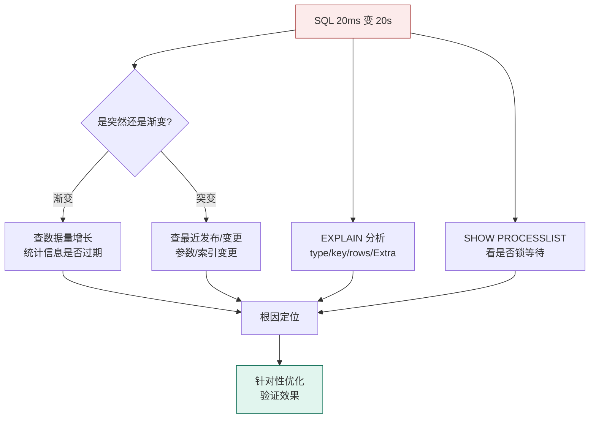
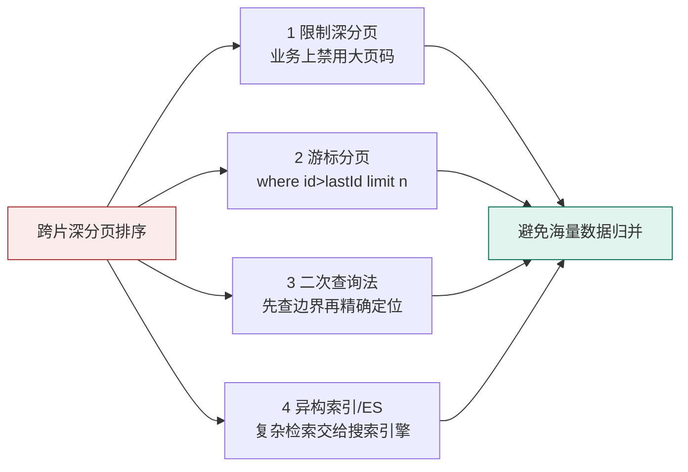
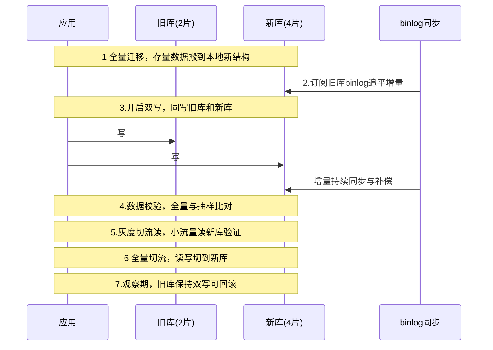
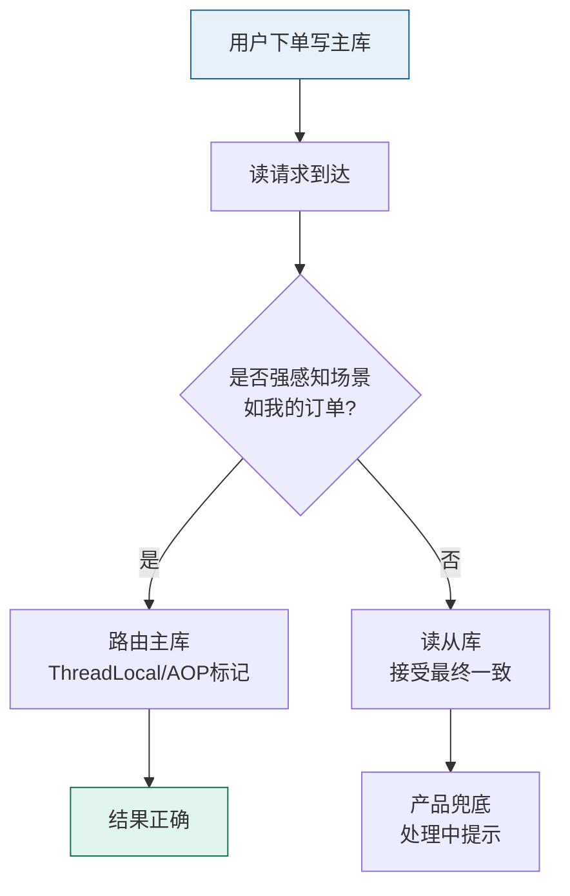
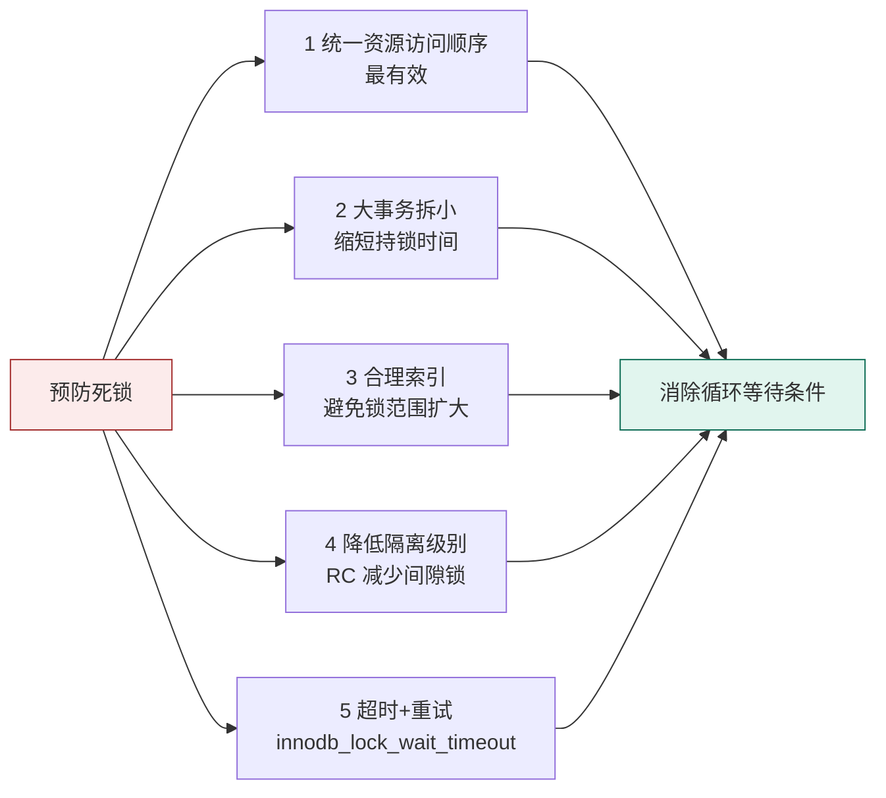

# 数据库场景面试

> 定位：数据库是架构师面试的「照妖镜」——这里的问题代价极高（数据错乱、P0 事故、通宵回滚），面试官会用细节一路追到你没做过的深度。会背「加索引」「分库分表」的人一抓一大把，能讲清「为什么这么选、代价是什么、线上怎么兜底」的才是架构师。这篇用 5 道题，示范怎么把数据库经验答成有决策、有量化、有复盘的回答。**面试高频**追问集中在执行计划、分片键、迁移一致性、主从延迟和死锁上，本文逐题把这些**坑点**拆透。

## 题 1：一条 SQL 从 20ms 变 20 秒，你怎么定位？执行计划怎么看？

### 题目

"线上有条查询原来 20ms，最近变成 20 秒，没报错。你怎么定位？EXPLAIN 出来你重点看哪几个字段？"

### 考察什么

- **系统性定位**：是不是一上来就「加索引」？面试官要的是排查路径，不是开药方。
- **执行计划真功夫**：不是背 EXPLAIN 有哪些列，而是能从 `type`/`key`/`rows`/`Extra` 读出问题并行动。
- **归因能力**：能区分「SQL 自身退化」「数据/统计信息变化」「锁等待」「环境变化」四类根因。
- **量化与复盘**：有没有数字感，有没有把慢 SQL 治理变成机制。

### 答题骨架

**S（背景）**：先问清约束再动手——是突然变慢还是一直慢（渐变多因数据量/统计信息，突变多因发布/变更）？最近有没有发布、数据增长、统计信息更新？是稳定复现还是偶发？表数据量多大、返回多少行？**先问这几个，比直接 EXPLAIN 更值钱**——体现你不会盲目下手。

**A（行动）**：按「确认现象 → 收集证据 → 读执行计划 → 针对性验证 → 上线验证」走，先定位再开药。

**读执行计划，重点看这几列**：

| 字段 | 看什么 | 危险信号 |
|---|---|---|
| `type` | 访问类型 | 出现 `ALL`（全表扫描）要警惕；至少到 `range` |
| `key` / `possible_keys` | 实际用的索引 vs 可用索引 | `key` 为 NULL、或用错索引 |
| `rows` | 预估扫描行数 | 实际只需几行却预估扫几十万行 |
| `Extra` | 附加信息 | `Using filesort`、`Using temporary` 是大忌 |

`type` 从好到坏大致是：`system > const > eq_ref > ref > range > index > ALL`。面试官想听你能说出「至少到 range，避免 ALL」这条底线。

**「20ms 变 20 秒」最常见的四类根因，讲清楚怎么区分**：

1. **数据量增长把隐藏问题暴露了**：以前靠表小硬扛全表扫描，量一上来就退化。看 `rows` 突增。
2. **索引失效**：隐式类型转换、对列做函数/运算、`LIKE '%xx'` 前置通配、`OR` 连接、违反最左前缀。看 `key` 是否变 NULL。
3. **统计信息过期导致优化器选错执行计划**：数据分布变了但统计信息没更新，优化器基于错误的成本估算选了差计划。`ANALYZE TABLE` 后可恢复——这是「同样 SQL 突然变慢」的高频原因。
4. **根本不是 SQL 慢，是在等锁**：`SHOW PROCESSLIST` 里 `State = Waiting for lock`，这时 EXPLAIN 再漂亮也没用。

> **公开案例**：据美团技术团队博客《MySQL 索引原理及慢查询优化》披露，其通过 EXPLAIN 分析一条带排序分页的慢查询，发现因未建立合适的联合索引导致全表扫描 + filesort，建立覆盖索引后查询从秒级降到毫秒级；阿里《Java 开发手册》也明确规约「业务上具有唯一特性的字段必须建成唯一索引」「利用覆盖索引来避免回表」。可借鉴点：**慢 SQL 治理的答案是「用执行计划说话 + 建对索引」，不是凭感觉加索引**。

**R（结果）**：引导填你自己的真实数字——「优化前 20s，优化后我这边是多少 ms；扫描行数从 X 降到 Y；上线后接口 P99 从多少降到多少」。没有数字，这段就是空的。

**L（复盘）**：主动说——「为什么一开始没建对索引？统计信息为什么没人维护？我后来推动建立了慢查询日志告警 + SQL 审核 + 上线前 EXPLAIN 卡点，把事后救火变成事前防控」。

### 追问链

| 面试官追问 | 你要接住的点 |
|---|---|
| `type=ALL` 一定不好吗？ | 不一定：小表、或要取全表大部分数据时，全表扫描可能比回表更划算 |
| 索引失效有哪些典型情况？ | 隐式转换、函数/运算、`LIKE '%x'`、最左前缀、OR、优化器估错成本 |
| 为什么优化器会选错索引？怎么干预？ | 统计信息过期/区分度低；`ANALYZE TABLE`、`FORCE INDEX`、建更合适的索引 |
| `Using filesort` 一定在磁盘排吗？ | 不一定，可能内存排序（看 sort_buffer_size）；但它意味着无法用索引顺序，要警惕 |
| 覆盖索引为什么快？ | 索引已含所需字段，避免回表随机 IO |
| EXPLAIN 看着正常但实际还慢？ | 用 `EXPLAIN ANALYZE` 看真实执行、看锁等待、看返回量、看 buffer pool 命中率 |

### 翻车点

- ❌ 上来就「加个索引」—— 没定位就开药，万一是锁等待或统计信息问题，索引加了也白加
- ❌ 只会背 EXPLAIN 字段含义，不会据此判断和行动 —— 暴露「背过但没用过」
- ❌ 把「慢」等同于「SQL 写得差」，不看数据量变化和锁 —— 归因单一
- ❌ 只说「我调了索引，快了」—— 没有前后数字，不可信

### 调用知识

- [SQL 优化与执行计划](../06-数据库体系/04-SQL优化与执行计划.md)：EXPLAIN 各字段、索引失效场景、优化手段
- [InnoDB 与索引](../06-数据库体系/01-InnoDB与索引.md)：B+ 树、聚簇索引、覆盖索引、回表原理
- [线上故障排查与复盘](../12-高可用与稳定性/05-线上故障排查与复盘.md)：慢 SQL 引发线上问题的排查闭环

## 题 2：数据量上亿要分库分表，分片键怎么选？跨分片分页排序怎么做？

### 题目

"单表两亿订单，要分库分表。分片键你怎么选？按买家查、按订单号查、按时间范围查都要支持，怎么取舍？分完之后 `ORDER BY create_time LIMIT 100000,20` 这种深分页怎么搞？"

### 考察什么

- **决策力**：分片键选错全盘皆输，面试官要听你有没有一套选择标准，而不是「按 ID 取模」。
- **对代价的认知**：分库分表解决了什么、又引入了什么（跨片 join、排序、事务、分布式 ID）。
- **工程细节**：深分页、全局排序、异构索引、基因法等真实落地手段。
- **公开案例**：能不能把业界实践转化成自己的判断依据。

### 答题骨架

**S（背景）**：先问清——单表多少行、日增多少、读写比例、核心查询模式（按买家？按商户？按时间？）、有没有跨片聚合排序、单条记录大小。没有这些，分片键就是拍脑袋。

**A（行动）**：分两块讲——分片键怎么选，以及跨片查询怎么破。

**分片键选择标准（按优先级）**：

1. **高频查询条件优先**：让 80% 的查询能路由到单片，这是最重要的原则。查询模式决定分片键，不是反过来。
2. **分布均匀、区分度高**：避免数据倾斜和热点（按性别、按状态分片是灾难）。
3. **尽量不跨片 join / 事务**：关联紧密的数据放同一片。
4. **取值稳定**：不频繁变更，否则迁移成本高。

| 分片算法 | 优点 | 缺点 | 适用 |
|---|---|---|---|
| Hash 取模 | 分布均匀 | 扩容要迁移大量数据 | 点查为主、片数稳定 |
| 范围分片 | 扩容友好、支持范围查 | 易热点（新数据集中写一片） | 时间序列、日志 |
| 一致性 Hash | 扩容迁移量小 | 实现复杂、需虚拟节点 | 频繁扩缩容 |

**跨分片分页排序——这是重头戏，先把难点说透**：

`LIMIT 100000,20` 在分片后，中间件要让**每个分片都返回 100020 条**，在内存里做 k 路归并再取第 100000~100020 条。分片越多，回传数据量成倍放大，这是深分页慢的根源。讲清四种破解手段：

1. **业务上限制深分页**——最简单有效，大多数场景用户不会翻到第 5000 页。
2. **游标分页**：`WHERE id > lastMaxId ORDER BY id LIMIT n`，用上一页最大 ID 作锚点，彻底消除 offset。
3. **二次查询法**：先查各片满足排序条件的边界值，算出全局偏移量落在哪个范围，再精确查询——避免每片都回传 10 万条。
4. **异构索引 / 搜索引擎**：按不同查询维度冗余一份数据（如按商户维度建索引表），复杂排序检索交给 ES，DB 只做点查。
5. **分布式 ID**：分片后 `AUTO_INCREMENT` 失效，要用雪花算法 / Leaf / 号段模式生成全局唯一 ID（见调用知识）。Order by 用全局有序的雪花 ID 也能部分缓解排序问题。

> **公开案例**：业界公开资料中，阿里电商订单库的分库分表常被作为案例引用：**按买家 ID 哈希分片**支撑买家维度查询，同时维护一份**按卖家 ID 分片的异构索引表**来支撑卖家维度查询——这正是「一个分片键无法覆盖所有查询维度时，用冗余异构索引补齐」的经典实践（见阿里技术团队公开分享及《大型网站技术架构》相关内容）。ShardingSphere 官方文档也明确说明了跨分片 `ORDER BY` 需归并排序、深分页会放大的机制。可借鉴点：**分片键只能优化主查询维度，其他维度靠异构冗余，不要幻想一个键解决所有查询**。

**R（结果）**：填你自己的数字——「分片后单表降到 X 万行，买家查询 P99 从 Xms 降到 Yms；深分页从超时改成游标分页后稳定在 Zms」。

**L（复盘）**：主动说坑——「分片键一旦选错，后期迁移代价极大，所以前期一定要把查询模式问透；数据倾斜后来是怎么发现的、怎么治理的」。

### 追问链

| 面试官追问 | 你要接住的点 |
|---|---|
| 分片键按买家 ID，那按订单号查怎么办？ | 订单号里编码买家 ID（基因法），或建订单号→买家的异构映射 |
| 什么是数据倾斜，怎么处理？ | 数据集中到少数片；换高区分度键、加盐打散、单独处理热点 |
| 分库分表后跨片事务怎么办？ | 尽量设计成单片事务；必要时 Seata / 最终一致 + 补偿 |
| 分片数怎么定？ | 算单表容量和三年增长，留余量；通常 2 的幂便于扩容 |
| 什么是「基因法」？ | 把分片键信息编码进订单号末几位，订单号本身就能路由到分片 |
| 扩容为什么要迁数据？ | 取模规则变了，大部分记录的路由要重算 |

### 翻车点

- ❌ 只说「按 ID 取模」—— 不问查询模式、不说为什么，等于没答
- ❌ 以为分完片 `ORDER BY ... LIMIT` 天然支持 —— 不懂归并和深分页放大
- ❌ 忽略分布式 ID 问题 —— 分片后主键冲突是必现问题
- ❌ 忽略数据倾斜和热点 —— 分片不等于均匀

### 调用知识

- [分库分表](../06-数据库体系/05-分库分表.md)：分片策略、分片键选择、跨片查询、扩容
- [分布式 ID](../08-分布式理论与共识/03-分布式ID.md)：雪花算法、Leaf、号段模式
- [Seata AT 模式](../09-微服务体系/04-Seata-AT模式.md)：跨片分布式事务的落地与代价

## 题 3：分库分表后要扩容/迁移，整个过程怎么不停机？

### 题目

"现在 2 个分片扛不住了，要扩到 4 个，数据量 5 亿。迁移过程中不能停机，你怎么设计？怎么保证数据不丢不错？中途出问题怎么回滚？"

### 考察什么

- **工程落地与风险意识**：数据迁移是高危操作，面试官看的是你有没有「每一步可回滚」的严谨。
- **对成熟套路的掌握**：双写 + binlog 增量同步 + 校验 + 灰度切流这套流程是不是真懂。
- **细节**：双写不一致怎么办、校验怎么做、扩容怎么减少迁移量。

### 答题骨架

**S（背景）**：先问清——从几片扩到几片、总量多大、允许的不一致窗口、有无停服窗口、业务低峰时段、读写 QPS。

**A（行动）**：讲清「双写迁移」的标准流程，**核心原则：全程可回滚，每一步都能退回去**。

七个阶段逐层说清：

1. **准备新库**：按新分片规则建表结构。
2. **存量全量迁移**：分批搬数据，记录同步位点，避免一次性压垮库。
3. **开启双写**：应用同时写新旧库。**关键**：新库写失败要记录并补偿，绝不能因为新库失败影响主流程（旧库才是当前真相）。
4. **binlog 增量追平**：用 Canal 订阅旧库 binlog 写入新库，把迁移期间的新数据补齐，追平延迟。
5. **数据校验**：全量 checksum + 抽样业务比对，差异要能定位并修复。
6. **灰度切流**：先小流量读新库，对比错误率和结果一致性，验证后逐步放量到全量读写。
7. **观察期 + 回滚预案**：旧库继续保持双写一段时间，确认无误才下线。**这是「可回滚」的兜底**。

**扩容技巧（加分项）**：从 2 片扩到 4 片这类「倍数扩容」，可以用一致性 Hash 或预分片策略，**让旧数据只需迁移约一半**，而不是全量重算——这是 ShardingSphere 等中间件和业界公开实践里降低迁移成本的常用做法。

> **公开案例**：业界公开实践中，分库分表扩容普遍采用「双写 + binlog 增量同步 + 数据校验 + 灰度切流」的流程——据美团技术团队、蘑菇街技术团队等公开分享的数据库迁移/扩容案例，均强调「先双写追平、再校验、后灰度切流、保留回滚窗口」这套方法论；Canal 作为阿里开源的 binlog 订阅组件，官方文档给出的典型场景就是「数据迁移与同步」。可借鉴点：**迁移的核心不是「搬数据」，而是「保证切换瞬间数据一致且随时能退回去」**。

**R（结果）**：填你自己的数字——「迁移 5 亿数据耗时 X 小时，切流窗口 X 分钟，校验差异率 X%，全程零故障/零数据丢失」。

**L（复盘）**：主动说——「双写期间出现过短暂不一致，是靠 Canal 补偿解决的；校验时发现的差异是什么、怎么补的；回滚演练做过没有（没演练过的回滚预案等于没有）」。

### 追问链

| 面试官追问 | 你要接住的点 |
|---|---|
| 双写时新库写失败怎么办？ | 记录失败日志 + 补偿，不能影响写旧库的主流程 |
| 迁移中怎么保证读到的数据一致？ | 切流前一律读旧库，以旧库为准 |
| 数据校验具体怎么做？ | 全量 checksum、抽样业务比对、差异定位与修复任务 |
| 切流后发现新库有问题怎么回滚？ | 切回旧库；旧库一直双写所以数据是完整的 |
| 倍数扩容为什么能少迁数据？ | 新路由下部分数据落在原片，只需迁需要改变归属的部分 |
| 双写期间怎么避免重复？ | 用全局唯一 ID + 幂等写入 |

### 翻车点

- ❌ 说「停机迁移」—— 架构师场景通常明确要求不停机，直接出局
- ❌ 不知道双写 + binlog 增量同步这套组合 —— 等于没做过迁移
- ❌ 没有数据校验和回滚预案 —— 拿线上数据赌运气
- ❌ 直接全量切流 —— 没有灰度验证，风险不可控

### 调用知识

- [分库分表](../06-数据库体系/05-分库分表.md)：分片规则、扩容策略、数据迁移
- [读写分离与主从复制](../06-数据库体系/06-读写分离与主从复制.md)：binlog 复制原理，是增量同步的基础
- [数据库高可用](../06-数据库体系/07-数据库高可用.md)：切换、故障转移、回滚设计
- [可靠消息与分布式事务](../08-分布式理论与共识/05-可靠消息与分布式事务.md)：双写一致性与补偿思路

## 题 4：主从延迟导致用户刚下单查不到，怎么解？

### 题目

"读写分离架构，主从延迟严重时用户下完单立刻查『我的订单』查不到，投诉了。你怎么解决？半同步复制能不能搞定？"

### 考察什么

- **对读写分离一致性的真实理解**：不是背「半同步复制」四个字。
- **分场景决策能力**：哪些场景必须强一致、哪些可以最终一致，能不能给出可落地方案。
- **权衡意识**：每种方案的代价（主库压力、延迟、改造成本）说得清。

### 答题骨架

**S（背景）**：先问清——延迟多大（毫秒还是秒级）、是「我的订单」这种强感知场景还是普通列表、读写比例、能不能接受业务改造、从库有几台。

**A（行动）**：先讲根因，再按场景给方案。

**根因（简短讲清）**：主从复制是「主库写 binlog → dump 线程发给从库 → 从库 relay log → SQL 线程回放」。延迟主要来自**单线程回放能力不足**（大事务、批量更新尤其严重）、主从性能/配置差异、网络抖动。半同步（semi-sync）只保证「至少一个从库收到 binlog」，**不保证从库已经回放完成**，所以它并不能消除「查不到」——这句话说出来，面试官就知道你真懂。

**六种方案，按场景取舍（这是重点）**：

| 方案 | 做法 | 代价 | 适用 |
|---|---|---|---|
| **写后读走主库** | 短时间内的读强制路由主库 | 主库压力增加 | 「我的订单」强感知场景（首选） |
| 延时双查 | 先查从库，查不到再查主库 | 主库压力、两次查询 | 中等一致要求 |
| 缓存标记 | 写后打标，标记期内该用户读主库 | 缓存成本、边界复杂 | 高并发精细化控制 |
| 等待位点追平 | 读前 `WAIT_FOR_EXECUTED_GTID_SET` | 增加读延迟 | 强一致读且能容忍等待 |
| 提升复制能力 | 并行复制 MTS、增强从库硬件、拆大事务 | 硬件/配置成本 | 通用治本手段 |
| 产品兜底 | 提示「订单处理中」、前端乐观展示 | 体验折中 | 可接受最终一致的场景 |

**关键话术**：「没有一种方案能既强一致又不付代价。核心是**识别场景**——强感知的走主库，其余接受最终一致并用产品手段兜底，同时用并行复制和拆大事务从根上压缩延迟。」

> **公开案例**：据 MySQL 官方文档，半同步复制（semi-synchronous replication）保证的是「事务提交前至少一个从库已接收并写入 relay log」，并不保证从库已完成回放；MySQL 5.7+ 提供的基于组提交的并行复制（MTS，`slave_parallel_type=LOGICAL_CLOCK`）正是官方给出的降低延迟方案。据公开分享，主流电商系统在「下单后立即查看订单」这类场景普遍采用**写后读走主库**策略，这也是业界的常见做法。可借鉴点：**先用路由策略解决用户可感知的问题，再用复制能力优化做治本**。

**R（结果）**：填你自己的数字——「改造后『我的订单』查不到的投诉从每天 X 起降到 0；走主库的比例只增加 X%，主库负载可控；平均主从延迟从 Xs 降到 Xms」。

**L（复盘）**：主动说——「哪些查询场景一开始漏了走主库、后来怎么补齐的；主库压力上升后怎么控制的；有没有加上主从延迟监控和告警」。

### 追问链

| 面试官追问 | 你要接住的点 |
|---|---|
| 半同步能保证不丢数据吗？ | 不能绝对保证；且异常时可能退化为异步，它不解决「回放延迟」 |
| 并行复制的原理是什么？ | 基于组提交，按事务依赖关系并行回放（LOGICAL_CLOCK） |
| 写后读走主库怎么实现不侵入业务？ | ThreadLocal + AOP、MyBatis 拦截器、中间件 hint |
| 走主库比例高了主库扛不住怎么办？ | 缩短标记时间、缓存标记、只覆盖强感知场景 |
| 大事务为什么导致延迟？ | 产生大量 binlog 且从库回放慢、持锁久，串行回放更慢 |
| 从库延迟怎么监控？ | `Seconds_Behind_Master`、GTID 差值、监控告警 |

### 翻车点

- ❌ 只说「用半同步复制」—— 半同步不解决回放延迟，答了等于没答
- ❌ 说「读主库就行了」—— 不考虑主库压力和场景区分
- ❌ 一刀切所有读走主库 —— 读写分离的意义没了，暴露缺乏权衡
- ❌ 不知道延迟根因 —— 方案就无从谈起

### 调用知识

- [读写分离与主从复制](../06-数据库体系/06-读写分离与主从复制.md)：复制原理、半同步、并行复制、延迟治理
- [事务隔离与 MVCC](../06-数据库体系/02-事务隔离与MVCC.md)：一致性读与当前读的区别
- [缓存三大问题与一致性](../07-缓存与中间件/03-缓存三大问题与一致性.md)：多级架构下的一致性思路
- [数据库高可用](../06-数据库体系/07-数据库高可用.md)：主从切换与故障转移

## 题 5：线上出现死锁/锁等待，怎么排查、怎么从设计上避免？

### 题目

"生产环境偶发死锁报警，错误码 1213，还有大量 1205 锁等待超时。你怎么定位到具体是哪两条 SQL 在互相等？又怎么从设计上让死锁不再发生？"

### 考察什么

- **对 InnoDB 锁机制的真理解**：行锁锁的是索引不是数据行、RR 的间隙锁、死锁检测机制。
- **排查方法论**：`SHOW ENGINE INNODB STATUS`、系统表、processlist 的组合使用。
- **架构师价值**：不是「出了事去查」，而是「设计上让它不发生」——统一顺序、拆小事务、索引设计。

### 答题骨架

**S（背景）**：先问清——偶发还是频发、什么业务（转账/扣库存/批量更新）、隔离级别（RR 还是 RC）、事务大小、并发量。

**A（行动）**：分「排查」和「预防」两层，重点是预防。

**排查三板斧**：

1. `SHOW ENGINE INNODB STATUS\G` 看 **`LATEST DETECTED DEADLOCK`** 段——谁和谁互相等、各自持有哪些锁、在等哪把锁、InnoDB 回滚了哪个事务。**这是定位死锁最直接的证据**。
2. 看系统表：MySQL 8.0 用 `performance_schema.data_locks` / `data_lock_waits`，5.7 用 `information_schema.INNODB_TRX` + `INNODB_LOCK_WAITS`，关联 `processlist` 找到具体 SQL 和线程。
3. `SHOW PROCESSLIST` 看 `State = Locked`，配合定位是谁持锁不放。

**死锁成因四要素**：互斥、占有且等待、不可剥夺、循环等待。InnoDB 用 **wait-for graph** 检测环路，自动回滚代价（undo 量）较小的事务。

**从设计上避免（架构师的重点，按有效性排序）**：

1. **统一访问顺序**：所有业务按同一顺序（如按主键升序）更新多行——直接破坏「循环等待」，最有效。
2. **大事务拆小**：事务越短，持锁时间越短，冲突概率越低。批量操作分批提交。
3. **合理索引**：**InnoDB 行锁锁的是索引记录，没有索引会升级为锁全表**，锁范围一大死锁概率飙升。
4. **降低隔离级别**：RC 基本没有间隙锁，比 RR 死锁概率低——但要权衡幻读风险，不是无脑改。
5. **兜底机制**：设置 `innodb_lock_wait_timeout`，业务层捕获 1213/1205 后**带幂等重试**。

> **公开案例**：据 MySQL 官方文档，InnoDB 采用 wait-for graph 进行死锁检测，会自动选择回滚「代价较小」的事务，并提示通过「保持一致的更新顺序」「避免大事务」「为表建合适索引」来减少死锁；阿里《Java 开发手册》也建议控制事务范围、避免长事务。可借鉴点：**死锁不可完全消灭，但「统一访问顺序 + 短事务 + 好索引」能把概率压到极低，业务层带幂等重试是最后的安全网**。

**R（结果）**：填你自己的数字——「改造后死锁报警从每天 X 次降到接近 0；锁等待超时从 X 降到 Y；重试成功率 X%」。

**L（复盘）**：主动说——「为什么当初没统一更新顺序？大事务是怎么拆的？重试加了幂等防止重复扣减；后来加了死锁数监控」。

### 追问链

| 面试官追问 | 你要接住的点 |
|---|---|
| 行锁锁的是索引还是数据行？ | 锁索引记录；无索引时会锁全表/锁范围扩大 |
| RR 和 RC 的间隙锁区别？ | RR 用间隙锁防幻读，锁范围大；RC 基本无 gap lock，死锁少 |
| 1213 和 1205 区别？ | 1213 是死锁被立即检测回滚；1205 是锁等待超时 |
| 业务层怎么处理死锁？ | 捕获异常、带退避重试、必须保证幂等 |
| 怎么定位是哪条 SQL 持锁不放？ | system 表关联 processlist / data_locks 找到持锁事务 |
| 死锁一定不好吗？需要避免吗？ | 偶发死锁 InnoDB 自动回滚可接受，关键是别让它影响核心链路 |

### 翻车点

- ❌ 只会说「show processlist」—— 定位死锁必须看 `SHOW ENGINE INNODB STATUS` 的死锁段
- ❌ 把死锁理解成「加锁就完了」—— 不知道统一顺序才是根治
- ❌ 不知道大事务和无索引是死锁元凶
- ❌ 业务层重试不加幂等 —— 重试导致重复扣减，引入更严重的数据问题

### 调用知识

- [MySQL 锁机制](../06-数据库体系/03-MySQL锁机制.md)：共享锁/排他锁、间隙锁、行锁与索引、死锁检测
- [事务隔离与 MVCC](../06-数据库体系/02-事务隔离与MVCC.md)：隔离级别、幻读、间隙锁的关系
- [SQL 优化与执行计划](../06-数据库体系/04-SQL优化与执行计划.md)：索引设计与锁范围

## 小结

- 慢 SQL 先定位再开药：看执行计划的 `type/key/rows/Extra`，区分数据量、索引失效、统计信息、锁等待四类根因。
- 分片键由查询模式决定：高频查询优先、分布均匀、避免跨片事务；其他查询维度靠异构索引补齐，深分页用游标分页/限制页码破解。
- 不停机迁移的标准套路：全量迁移 → 双写 → binlog 追平 → 校验 → 灰度切流 → 观察期，全程可回滚是底线。
- 主从延迟没有银弹：强感知场景写后读走主库，其余最终一致 + 产品兜底，再用并行复制和拆大事务治本。
- 死锁排查看 `SHOW ENGINE INNODB STATUS`，根治靠统一访问顺序 + 短事务 + 合理索引，业务层重试必须带幂等。
- 所有回答都要落到你自己的真实数字上——「效果挺好」在数据库场景里是最没有说服力的答案。
