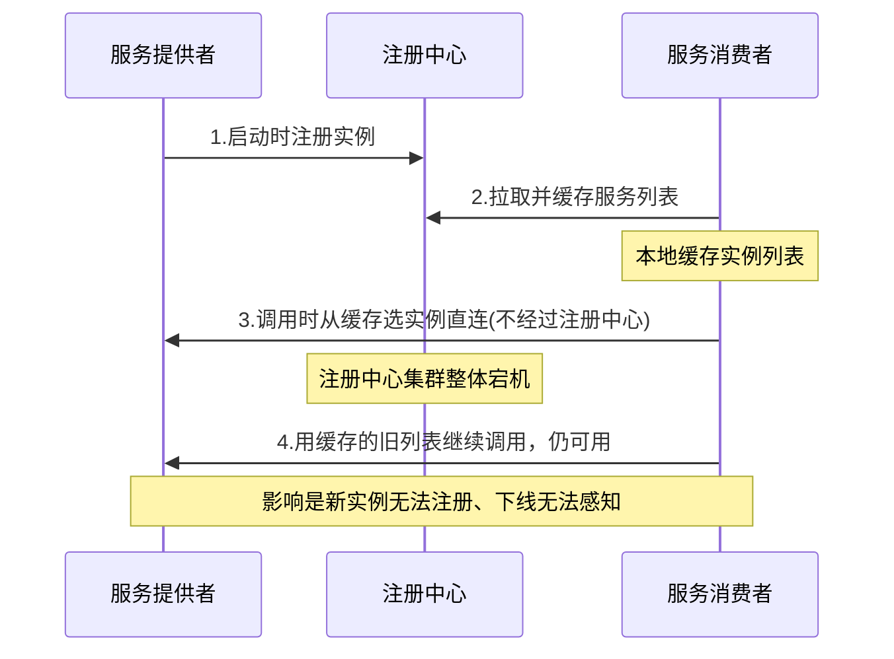
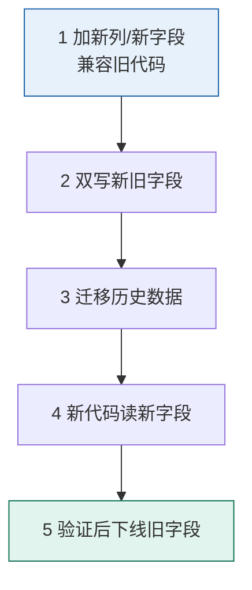
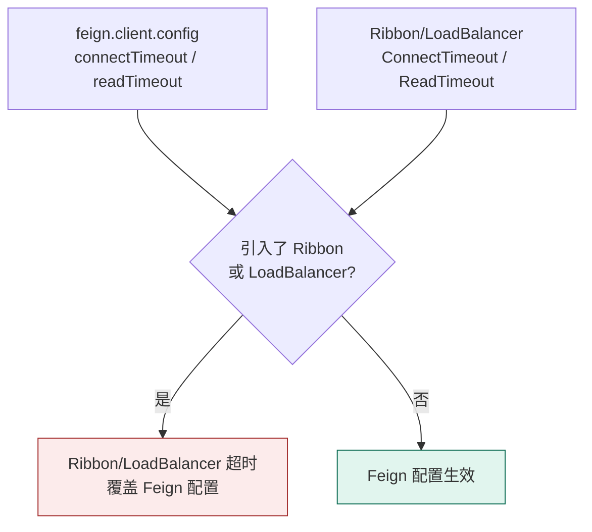

# 微服务治理场景面试

> 定位：微服务面试的坑在于——「限流、熔断、降级、隔离」人人会说，但面试官只要往下追一层「先后顺序是什么、参数怎么定、配置为什么不生效」，大半人当场露馅。这一篇用 5 道题，把这些词答成有顺序、有参数、有取舍、有翻车复盘的回答。记住：**能说出默认值的人很多，能说出「我为什么不用默认值」的人才是架构师。** **面试高频**追问集中在超时重试配置、服务拆分边界、注册中心故障影响面和版本兼容上，本文逐题把这些**坑点**拆透。

## 题 1：一个下游服务变慢，怎么防止整个系统雪崩？你说清超时/重试/熔断/隔离的先后和配置

### 题目

"你的服务调一个下游，下游 P99 从 200ms 涨到 5s，但没挂。怎么防止它把整个系统拖垮？超时、重试、熔断、隔离、降级——说清楚先后顺序，每个参数怎么定。"

### 考察什么

- **顺序感**：面试官最想听的不是「有哪些手段」，而是**先用哪个、后用哪个、为什么这个顺序**。
- **参数量化**：超时设多少、重试几次、熔断阈值多少——能不能给出依据而不是「默认值」。
- **代价意识**：重试会放大故障、隔离有开销，说不出代价就是没真用过。

### 答题骨架

**S（背景）**：先问清——调用链有多长、下游的 SLA 是多少、这个下游能不能降级、峰值 QPS 多大、是不是幂等操作。

**A（行动）**：先把雪崩机理讲清楚，再按「先保命、再隔离、再止损」的逻辑排手段。

**雪崩怎么发生的**：下游慢 → 调用方线程/连接被长时间占用 → 线程池耗尽 → 上游也跟着阻塞 → 层层传导，最后整个系统不可用。**根因是资源耗尽，不是下游本身。**

**顺序和参数，逐层说清（这是本题的核心）**：

| 手段 | 解决什么 | 配置要点 | 代价 |
|---|---|---|---|
| **超时**（第一道，必须有） | 防止线程被无限占用 | 略大于下游 P99，如 P99=200ms → 超时 300~500ms | 设太长拖垮自己，设太短误杀 |
| **隔离**（第二道） | 防止一个下游耗尽全部资源 | 线程池隔离（彻底但开销大）/ 信号量隔离（轻量但不隔超时） | 线程数、队列 sizing 复杂 |
| **熔断**（第三道） | 下游故障时快速失败、定期探测恢复 | 滑动窗口、错误率阈值（如 50%）、最小请求数、熔断时长（如 5s）、半开探测 | 误熔断会误伤 |
| **重试**（克制使用） | 应对瞬时抖动 | 只对幂等操作；1~2 次；指数退避 + 抖动 | **放大流量，可能引发重试风暴** |
| **限流降级**（兜底） | 保护入口、保证核心链路 | 限流阈值压测定；降级返回兜底数据而非抛异常 | 牺牲部分体验 |

**关键话术**：「顺序是——**先超时**（不让线程挂死）→ **再隔离**（不让一个下游拖垮全部）→ **再熔断**（不让请求反复打故障点）→ **重试极度克制且只对幂等** → **最后限流降级兜底**。参数不是默认的，是根据下游 SLA 和链路预算压测出来的。」

> **公开案例**：Netflix 开源的 Hystrix 官方文档把「舱壁隔离（bulkhead）+ 熔断 + 降级」作为分布式系统容错的核心模式，这也是这套方案的业界源头（Hystrix 虽已停止维护，理念被 Sentinel、Resilience4j 继承）；Martin Fowler 的 Circuit Breaker 模式文章系统阐述了「熔断 + 半开探测恢复」的设计；阿里 Sentinel 官方文档给出了慢调用比例、异常比例、异常数三种熔断策略及推荐配置。可借鉴点：**熔断一定要有「半开探测」恢复机制，否则下游恢复了你也永远恢复不了**。

**R（结果）**：填你自己的数字——「改造后下游故障期间系统整体可用率保持 X%，错误率从 X% 降到 X%，MTTR 从 X 分钟降到 X；超时/熔断阈值是压测后定的，具体是……」。

**L（复盘）**：主动说——「重试风暴踩过坑（一次重试把下游打挂）、误熔断误伤过正常请求、超时设太短导致高峰期大量误杀，后来怎么调的」。

### 追问链

| 面试官追问 | 你要接住的点 |
|---|---|
| 超时时间到底设多长？ | 略大于下游 P99，并满足整条链路的超时预算递减 |
| 重试会不会放大故障？ | 会；必须配合熔断 + 退避 + 只对幂等，否则重试风暴 |
| 线程池隔离 vs 信号量隔离怎么选？ | 线程池隔离彻底但开销大、能隔离慢调用；信号量轻量但不能中断超时 |
| 熔断的半开状态怎么回事？ | 熔断一段时间后放少量探测请求，成功则闭合、失败则继续熔断 |
| 降级返回什么？ | 兜底数据/默认值/空结果/友好提示，绝不能抛异常 |
| 隔离的线程池大小怎么定？ | 按 QPS × 平均耗时（Little's Law）估算，留余量 |

### 翻车点

- ❌ 只会罗列「限流熔断降级」五个词 —— 说不出先后顺序和参数，等于背概念
- ❌ 一上来就「加重试」—— 不懂重试会放大故障，反而加速雪崩
- ❌ 超时时间「用默认的」—— 没有链路预算和量化意识
- ❌ 熔断没有半开探测 —— 下游恢复了流量也回不来

### 调用知识

- [Sentinel 限流熔断](../09-微服务体系/03-Sentinel限流熔断.md)：熔断策略、慢调用比例、线程池/信号量隔离
- [限流降级熔断隔离](../12-高可用与稳定性/03-限流降级熔断隔离.md)：四种手段的定位与配合
- [微服务痛点治理](../09-微服务体系/07-微服务痛点治理.md)：雪崩、调用链治理、容错设计
- [高可用架构设计](../12-高可用与稳定性/01-高可用架构设计.md)：故障隔离与冗余设计

## 题 2：微服务怎么拆？你按什么边界拆，拆完了怎么验证拆得对？

### 题目

"让你把一个单体拆成微服务，你按什么边界拆？怎么判断拆得对不对？很多人拆完变成『分布式单体』，你怎么避免？"

### 考察什么

- **领域边界判断力**：是不是按 DDD 限界上下文拆，而不是按技术层或数据库表拍脑袋。
- **验证标准**：拆完「怎么算成功」——发布独立、数据自治、故障隔离、团队对齐。
- **反模式意识**：知不知道「分布式单体」比单体更糟。

### 答题骨架

**S（背景）**：先问清——业务复杂度、团队规模（康威定律）、当前痛点是什么（发版慢？耦合重？还是性能瓶颈？）、数据规模。**不为拆而拆，先明确要解决的问题。**

**A（行动）**：分「怎么拆」和「怎么验证」两块，重点是验证标准。

**拆分边界（按优先级）**：

1. **按业务能力 / DDD 限界上下文拆**，而不是按技术层拆（不是「controller 服务 / service 服务 / dao 服务」这种切法）。每个服务对应一个清晰的业务能力。
2. **数据自治**：**每个服务拥有自己的数据（Database per Service），服务间不共享库表**——这是判断「真微服务 vs 分布式单体」的金标准。
3. **高内聚低耦合**：业务内聚（同一领域的能力放一起），服务间通过明确契约协作。
4. **团队对齐（康威定律）**：服务边界和团队边界一致，一个团队能独立负责一个服务。
5. **渐进拆分**：从粗到细，用绞杀者模式（Strangler Fig）逐步替换，不搞大爆炸式重构。

**拆完怎么验证拆得对（这是区分架构师的关键）**：

| 验证维度 | 判断标准 |
|---|---|
| 发布独立 | 一个服务发布不需要其他服务一起发 |
| 数据自治 | 服务间不直接访问对方的库表 |
| 故障隔离 | 一个服务挂了不全站不可用 |
| 团队自治 | 一个团队能独立交付，不需要跨团队协调 |
| 调用拓扑 | 服务间调用不成网状、无循环依赖 |
| 度量指标 | 部署频率、变更前置时间、故障爆炸半径是否改善 |

**反模式警示**：拆了服务但共享数据库、一堆强同步调用串成一条链、每次发版要 N 个服务一起发——这是**分布式单体**，比单体还糟（既有分布式的复杂度，又没有分布式的收益）。

> **公开案例**：Martin Fowler 2014 年的经典文章《Microservices》把微服务定义为「围绕业务能力组织、服务拥有自己的数据、可独立部署」——这正是「按领域边界拆 + 数据自治」的权威出处。据 Amazon 公开分享，其从单体转向服务化时采用「two-pizza team」（两张披萨能喂饱的小团队），每个团队独立拥有一个服务并拥有端到端交付能力——这是「团队边界与服务边界对齐（康威定律）」的经典公开案例。可借鉴点：**微服务的边界首先是业务和组织的边界，其次才是技术的边界**。

**R（结果）**：填你自己的数字——「拆成 X 个服务后，发布频率从每月 X 次提升到每周 X 次，变更前置时间从 X 降到 X，单次发布影响范围从全站缩小到单服务」。

**L（复盘）**：主动说——「拆过头导致调用链过长、排障困难；拆完发现服务间还有循环依赖；共享库没拆干净导致数据耦合——后来怎么治理的」。

### 追问链

| 面试官追问 | 你要接住的点 |
|---|---|
| 服务拆太细有什么问题？ | 分布式事务、网络调用开销、运维复杂度、排障困难 |
| 怎么避免分布式单体？ | 数据自治、异步解耦、避免共享库、独立发布 |
| 共享数据库算不算微服务？ | 不算，那是分布式单体 |
| 拆分顺序怎么定？ | 先拆最痛的模块，按业务边界渐进，绞杀者模式 |
| DDD 限界上下文怎么识别？ | 事件风暴、统一语言、找领域边界和聚合根 |
| 服务间通信选同步还是异步？ | 能用异步就异步（MQ 解耦），降低耦合和雪崩风险 |

### 翻车点

- ❌ 按技术分层拆（controller 服务、service 服务）—— 典型反模式，拆完每个「服务」都不是完整业务能力
- ❌ 一上来就全拆 —— 不看业务复杂度和团队能力，复杂度失控
- ❌ 服务间共享数据库 —— 假微服务，数据无法自治
- ❌ 拆完用一堆同步调用串起来 —— 分布式单体，雪崩风险更高

### 调用知识

- [DDD 领域驱动设计](../10-架构设计能力/01-DDD领域驱动设计.md)：限界上下文、聚合根、统一语言、事件风暴
- [架构模式](../10-架构设计能力/03-架构模式.md)：微服务模式、绞杀者模式、领域拆分
- [微服务痛点治理](../09-微服务体系/07-微服务痛点治理.md)：分布式单体、调用链治理
- [API 设计](../10-架构设计能力/04-API设计.md)：服务间契约设计

## 题 3：注册中心（Nacos/Eureka）整个挂了，已运行的系统还能不能互相调用？

### 题目

"注册中心（Eureka 或 Nacos）整个集群挂了，已经跑着的服务之间还能不能互相调用？新服务还能上线吗？为什么？"

### 考察什么

- **职责边界认知**：知不知道注册中心只是「服务目录/电话簿」，不是「通话线路」——调用根本不经过它。
- **客户端容错机制**：本地缓存、缓存持久化、失效回退。
- **架构意识**：能不能把系统分成「控制面」和「数据面」来看问题。

### 答题骨架

**S（背景）**：先问清——用的哪个注册中心、客户端有没有本地缓存、是已有调用还是新调用、挂了多久、有没有实例变更。

**A（行动）**：**先把结论抢先说出来**——「注册中心挂了，已经运行且有本地缓存的服务之间**仍然可以互相调用**，因为调用方本地缓存了服务实例列表，调用时直连实例、不经过注册中心。真正受影响的是新服务注册和实例变更感知。」这句话一出口，面试官就知道你懂了。

**三层讲清原理**：

1. **调用路径不经过注册中心**：注册中心负责「服务注册 + 服务发现（下发实例列表）」，调用方拿到列表后按负载均衡**直连实例**，数据面调用和注册中心（控制面）是解耦的。
2. **挂了之后谁能用谁不能用**：
   - 调用方：用本地缓存的旧列表继续调用（列表可能过期——下线实例还在、新实例找不到）。
   - 服务方：已注册实例继续运行；新实例无法注册；实例下线无法被感知。
   - 结论：**已有调用基本不受影响，扩缩容/发布/故障转移的感知失效**。
3. **各组件差异**：Eureka 是 AP 设计，客户端缓存注册表，官方明确「即使所有 Server 宕机，客户端仍可基于缓存调用」；Nacos 区分临时实例（AP，客户端缓存 + 推送）和永久实例（CP，Raft），行为有差异——但核心结论一致。

**架构建议（主动往深了说）**：

| 措施 | 目的 |
|---|---|
| 客户端本地缓存 + 缓存持久化 | 注册中心挂了、甚至调用方重启后仍能找到实例 |
| 注册中心集群化部署 | 避免单点，本身就要高可用 |
| 配合 DNS / 负载均衡兜底 | 多一层发现手段 |
| 关键调用方保留静态实例配置 | 极端情况下的保底 |

> **公开案例**：据 Netflix Eureka 官方 Wiki 与 Spring Cloud 官方文档，Eureka 采用 AP 设计，客户端会缓存服务注册表，**即使所有 Eureka Server 宕机，只要客户端缓存还在、服务实例还活着，服务间调用仍可进行**——这是 Eureka 设计哲学「宁可保留旧数据也不拒绝服务」的直接体现。Nacos 官方文档也说明了临时实例/永久实例与 AP/CP 模式的差异。可借鉴点：**把注册中心定位成「控制面」而非「数据面」，用客户端缓存把调用链路和注册中心的可用性解耦**。

**R（结果）**：填你自己的数字——「注册中心故障 X 分钟期间，核心链路调用成功率保持 X%；受影响的是 X 个新发布实例无法注册；恢复后 X 秒内全量实例重新被发现」。

**L（复盘）**：主动说——「缓存过期导致调用到已下线实例、怎么处理；调用方重启后本地缓存丢失的兜底；后来把注册中心做了 X 节点集群 + 客户端缓存持久化」。

### 追问链

| 面试官追问 | 你要接住的点 |
|---|---|
| Eureka 和 Nacos 表现一样吗？ | 理念类似（都靠客户端缓存），但 Nacos 的 CP/AP 模式、临时/永久实例有差异 |
| 客户端缓存多久更新一次？ | Eureka 默认约 30s 拉取 + 增量；Nacos 用长轮询推送 |
| 注册中心恢复后客户端怎么更新？ | 重新拉取全量/增量列表，刷新本地缓存 |
| 调用方重启了、缓存没了怎么办？ | 缓存持久化、DNS/负载均衡兜底、静态配置保底 |
| 挂了期间新服务上线怎么办？ | 无法被发现——这是真正的影响面，需要人工介入或降级发现手段 |
| 怎么避免注册中心成为单点？ | 集群化部署 + 客户端容错 |

### 翻车点

- ❌ 说「注册中心挂了系统就全完了」—— 根本没理解控制面/数据面分离
- ❌ 说「注册中心负责转发请求」—— 根本性概念错误，调用是直连的
- ❌ 不知道客户端缓存机制 —— 答不出「为什么还能调用」
- ❌ 不提注册中心集群化 —— 缺乏高可用设计意识

### 调用知识

- [Nacos 原理](../09-微服务体系/01-Nacos原理.md)：注册发现机制、临时/永久实例、AP/CP 切换
- [CAP、BASE 与一致性](../08-分布式理论与共识/01-CAP-BASE与一致性.md)：Eureka 的 AP 设计取舍
- [高可用架构设计](../12-高可用与稳定性/01-高可用架构设计.md)：控制面与数据面、故障隔离
- [微服务痛点治理](../09-微服务体系/07-微服务痛点治理.md)：注册中心故障的影响与容错

## 题 4：灰度发布怎么做？版本不兼容怎么过渡？

### 题目

"要上线一个可能有风险的新版本，灰度发布怎么做？如果新版本和旧版本接口不兼容、数据库字段还要改，新旧版本并存期间怎么过渡？"

### 考察什么

- **灰度的完整性**：是不是有策略、可观测、可回滚，而不是「随便切 10% 流量」。
- **版本兼容设计（深层）**：API 兼容 + **数据 schema 兼容**——很多人只想到接口，忘了数据库。
- **稳健发布意识**：滚动发布期间新旧代码同时跑，这一步最容易出事。

### 答题骨架

**S（背景）**：先问清——变更类型（新功能还是破坏性变更）、流量规模、是否有状态、数据库 schema 要不要改、回滚要求、可接受的影响面。

**A（行动）**：分「灰度策略」和「兼容性过渡」两块，后者是重点。

**灰度策略（分层设计）**：

| 维度 | 做法 |
|---|---|
| 灰度对象 | 按用户白名单/百分比、内部员工先、按地域/设备 |
| 流量路由 | 网关/Nginx 标签路由（header/cookie）、服务网格权重路由（Istio）、Gateway + 元数据 |
| 发布方式 | **蓝绿**（两套环境整体切换，回滚快但资源翻倍）、**金丝雀**（1%→5%→50%→100% 逐步放量）、**滚动**（K8s 默认，逐步替换实例） |

**灰度必须配套三件事**（少一个都不完整）：

1. **可观测**：灰度版本的错误率、P99、业务指标必须和基线对比（链路追踪的 trace 要带版本标签）。
2. **快速回滚**：开关/配置中心一键切回，且回滚要包括数据变更的可回滚。
3. **观察窗口**：每个灰度阶梯观察足够长时间，不能一路放到 100%。

**版本不兼容怎么过渡（重点，架构师的前瞻性）**：

- **API 兼容**：向后兼容（只新增字段、不改语义）、接口版本号（URL/header 版本）、废弃流程（先加新接口 → 双跑 → 下线旧接口）。
- **数据兼容（最容易被忽略）**：**扩展-收缩（Expand-Contract）模式**——先加新列（此时旧代码仍能跑）→ 双写新旧列 → 迁移历史数据 → 新代码读新列 → 验证无误后下线旧列。**绝不「删列改列」一步到位**，因为滚动发布期间新旧代码同时跑，直接改列必出事故。
- **服务兼容**：新旧版本并存时用兼容的序列化（如 Protobuf 靠字段编号兼容），避免强耦合的多个服务同时发布。

**关键话术**：「灰度不是简单切流量，关键是**新旧共存期间系统整体可用**——API 向后兼容、数据用扩展-收缩、每一步都可回滚。」

> **公开案例**：据 Martin Fowler 的蓝绿部署文章与 Kubernetes 官方文档，蓝绿部署与金丝雀发布是业界主流的渐进式发布模式，K8s 原生支持 Rolling Update 滚动发布；数据库层面的「扩展-收缩（Expand/Contract，也称并行变更）」是公开资料中广泛推荐的 schema 变更模式，核心就是「先扩展兼容、后收缩清理」，专门解决滚动发布期间新旧版本并存的兼容问题。可借鉴点：**发布策略和 schema 变更必须一起设计，只考虑应用层灰度而忽略数据兼容，是灰度事故的头号来源**。

**R（结果）**：填你自己的数字——「金丝雀按 1%→5%→20%→100% 放量，每档观察 X 分钟；灰度期间错误率与基线持平；一次异常通过开关 X 秒内回滚，影响用户 X 人」。

**L（复盘）**：主动说——「灰度没覆盖到的边界场景、版本不兼容导致的故障、schema 变更没用扩展-收缩踩的坑、回滚演练有没有做过」。

### 追问链

| 面试官追问 | 你要接住的点 |
|---|---|
| 蓝绿和金丝雀有什么区别？ | 蓝绿整体切换、回滚快但资源翻倍；金丝雀逐步放量、影响面小 |
| 灰度期间怎么保证会话粘滞？ | 基于 userID/ cookie 做一致性哈希，同一用户始终命中同一版本 |
| 数据库字段要改怎么办？ | 扩展-收缩模式，先加新列双写，再迁移，最后下线旧列 |
| 灰度发现异常怎么回滚？ | 权重/开关切回；但数据变更要提前设计成可回滚 |
| 版本不兼容一定要停机吗？ | 不一定，用兼容中间版本 + 扩展-收缩可平滑过渡 |
| 灰度对缓存有什么影响？ | 新旧数据格式差异，缓存 key 要带版本、注意序列化兼容 |

### 翻车点

- ❌ 把灰度等同于「切 10% 流量」—— 没有可观测和回滚，不是完整灰度
- ❌ 忽略数据 schema 兼容 —— 滚动发布时直接改列，新旧代码同时跑必出事
- ❌ 强制一步切换 —— 没有兼容中间版本，用户会话跳变
- ❌ 不做会话粘滞 —— 同一用户在新旧版本间反复跳，体验错乱

### 调用知识

- [CICD 与发布策略](../14-容器与云原生/04-CICD与发布策略.md)：蓝绿、金丝雀、滚动发布的落地
- [Kubernetes 核心](../14-容器与云原生/02-Kubernetes核心.md)：Rolling Update、标签与路由
- [API 设计](../10-架构设计能力/04-API设计.md)：版本化、向后兼容、废弃流程
- [Gateway 原理](../09-微服务体系/02-Gateway原理.md)：灰度路由、标签路由实现

## 题 5：OpenFeign 调用超时和重试，怎么配才不会踩坑？

### 题目

"Spring Cloud 里用 OpenFeign 调下游，我配了超时但好像不生效，还出现了重复下单。Feign 的超时和重试到底怎么配？注意哪些坑？"

### 考察什么

- **对配置的精确理解**：Feign 有两层超时，Ribbon/LoadBalancer 会覆盖 Feign——这是最经典的坑。
- **重试与幂等的关系**：无脑重试导致重复下单，说明没想过幂等。
- **真实踩坑经验**：配置不生效、重试风暴、链路超时错配。

### 答题骨架

**S（背景）**：先问清——Spring Cloud 版本（不同版本差异极大）、用的是 Ribbon 还是 Spring Cloud LoadBalancer、下游是否幂等、遇到过什么现象（配置不生效？重复数据？）。

**A（行动）**：先讲清楚两层超时和覆盖关系，再讲重试的坑。

**第一层坑：Feign 的两层超时，谁覆盖谁**

- Feign 自身：`feign.client.config.<name>.connectTimeout`（连接超时）、`readTimeout`（读取超时）。
- Ribbon / Spring Cloud LoadBalancer：也有 `ConnectTimeout`、`ReadTimeout` 配置。**关键坑：如果 Ribbon/LoadBalancer 也配了，它的值会覆盖 Feign 的**——很多人「配了不生效」就是这个原因。
- 版本差异：新版 Spring Cloud 用 LoadBalancer 替代 Ribbon，配置属性和前缀都变了，照抄老配置必然踩坑。

**第二层坑：重试的三大风险**

1. **非幂等请求重试会重复写**：POST 下单类接口重试可能重复扣款/下单——所以**默认应关闭重试或对非幂等强制关闭**。
2. **重试放大流量、引发重试风暴**：`重试次数 × 下游实例数` 会把流量成倍放大，必须配合熔断。
3. **总耗时超标**：`超时时间 × 重试次数` 可能超过上游超时，上游已经返回了，下游还在徒劳重试。

**推荐配置思路（没有万能值，按 SLA 定）**：

| 项 | 建议 | 理由 |
|---|---|---|
| connectTimeout | 短（1~2s） | 建连通常很快，太长没意义 |
| readTimeout | 略大于下游 P99（如 2~5s） | 兼顾成功率与快速失败 |
| 重试 | 关闭或最多 1 次，仅幂等 GET | 避免重复和风暴 |
| 兜底 | 必须配 fallback + 熔断 | 下游挂了自己不能跟着挂 |
| 连接池 | 用 HttpClient/OkHttp 连接池 | 否则每次建连、性能差 |

> **公开案例**：据 Spring Cloud OpenFeign 官方文档，Feign 的超时由 `feign.client.config` 下的 `connectTimeout`/`readTimeout` 控制；同时 Spring Cloud 官方文档与社区 issue 中反复出现一个典型坑——**当引入 Ribbon 时，Ribbon 的超时配置会覆盖 Feign 的配置**，导致「明明配了却不生效」；Spring Cloud 官方迁移文档也说明了从 Ribbon 迁移到 Spring Cloud LoadBalancer 时配置属性的变化。可借鉴点：**配超时一定要确认「谁最终生效」，并配合链路追踪验证真实耗时，不能只看配置文件**。

**R（结果）**：填你自己的数字——「统一配置后超时控制在 Xms；重复下单问题通过关闭非幂等重试 + 幂等键彻底解决；下游抖动时调用成功率从 X% 提升到 X%」。

**L（复盘）**：主动说——「配置被 Ribbon 覆盖排查了多久、重试导致重复的教训、后来怎么做了配置统一治理和超时监控」。

### 追问链

| 面试官追问 | 你要接住的点 |
|---|---|
| Feign 超时配了不生效怎么回事？ | 大概率被 Ribbon/LoadBalancer 的同名配置覆盖 |
| 重试一定要关吗？ | 看幂等性；非幂等必须关或用幂等键兜底 |
| 超时时间怎么定？ | 建连短、读超时看下游 P99 + 链路预算递减 |
| Feign vs RestTemplate vs WebClient 怎么选？ | Feign 声明式易用；WebClient 异步非阻塞，适合高吞吐 |
| 怎么监控 Feign 调用？ | Micrometer 指标、链路追踪、Feign 日志级别、超时率告警 |
| 为什么要配连接池？ | 默认每次新建连接，开销大；用 HttpClient/OkHttp 复用连接 |

### 翻车点

- ❌ 只说「配 connectTimeout 和 readTimeout」—— 不知道 Ribbon 覆盖这个经典坑
- ❌ 无脑开重试 —— 不懂幂等和流量放大，导致重复下单/重试风暴
- ❌ 超时时间拍脑袋 —— 没有链路预算，要么误杀要么拖垮
- ❌ 不配 fallback —— 下游挂了自己也跟着挂，失去隔离意义

### 调用知识

- [微服务痛点治理](../09-微服务体系/07-微服务痛点治理.md)：Feign 调用超时、重试、雪崩治理
- [Sentinel 限流熔断](../09-微服务体系/03-Sentinel限流熔断.md)：Feign 整合熔断与降级
- [限流降级熔断隔离](../12-高可用与稳定性/03-限流降级熔断隔离.md)：超时重试与熔断的配合
- [链路追踪](../13-可观测性/02-链路追踪.md)：验证真实调用耗时、定位超时

## 小结

- 防雪崩有严格顺序：超时 → 隔离 → 熔断 → 克制重试 → 限流降级兜底；参数按 SLA 和压测定，不用默认值。
- 服务拆分按业务能力/DDD 限界上下文，数据自治是试金石；拆完用「发布独立、数据自治、故障隔离、团队对齐」验证，警惕分布式单体。
- 注册中心是控制面不是数据面：挂了已运行服务靠本地缓存仍可调用，受影响的是新实例注册和变更感知；客户端缓存 + 集群化是关键。
- 灰度不只是切流量，要有可观测、可回滚、观察窗口；版本兼容必须 API 向后兼容 + 数据用扩展-收缩模式。
- Feign 最大的坑是「两层超时互相覆盖」和「无脑重试导致重复」——确认谁生效、只对幂等重试、必配 fallback。
- 所有回答都要落到你自己的真实配置值和踩坑经历上——面试官追的就是「默认值之外的那个数字」。
