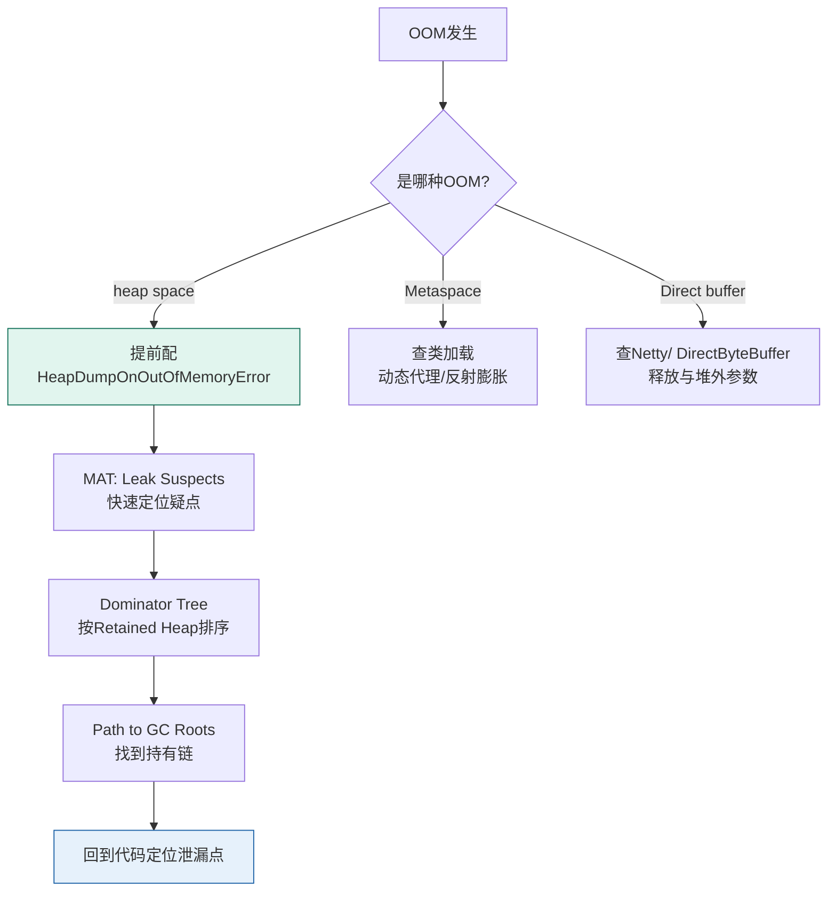
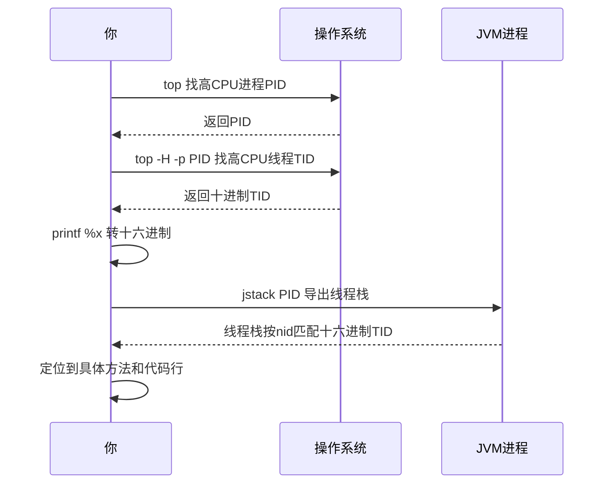
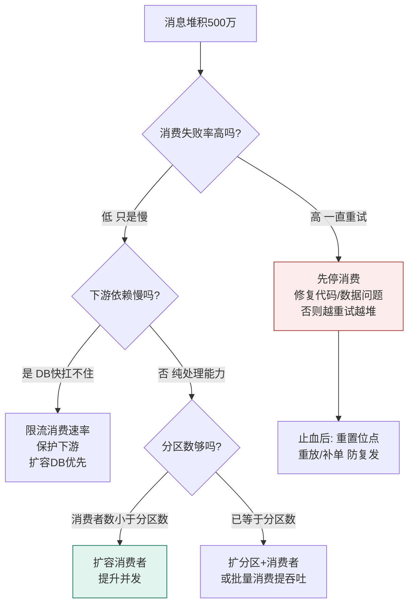
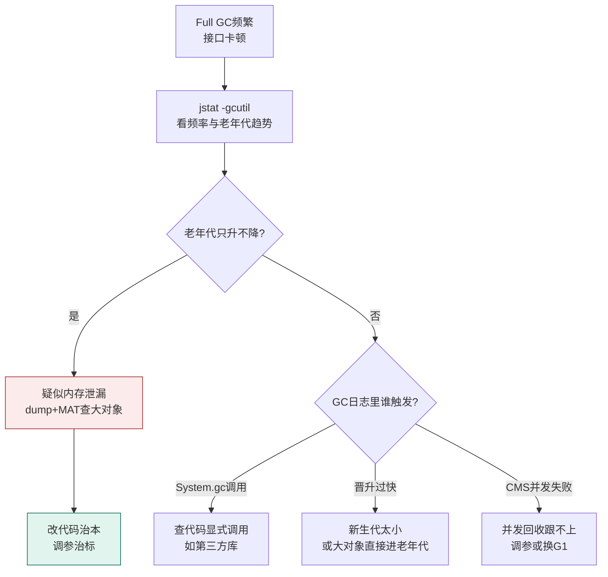
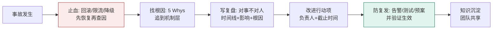

# 线上故障排查场景面试

> 定位：线上故障排查是架构师面试里最「见真章」的板块——因为它没法靠背原理蒙混过关。面试官会用「OOM 了你怎么拿 dump」「CPU 100% 怎么定位到那行代码」「消息堆了几百万条怎么应急」这种带数字、带现场感的题，一路追到你的真实经验边界。本章 5 道题，全部按真实面试现场拆：真实问法 → 考察什么 → STAR-L 骨架 → 剥洋葱追问 → 翻车点 → 回扣知识库原理与公开案例。**常见露馅点**：只会背命令没有排查路径；定位到根因就结束、不做止血和复盘；把事故讲成「甩锅大会」。面试高频的故障题归纳成一句话——**面试官要的不是你会不会用工具，而是你在凌晨三点、信息不全、老板盯着的时候，有没有一条清晰的推理路径和一套可执行的止血动作**。记住：能止血是及格，能找根因是良好，能防再次发生才是架构师。

## 题 1：服务 OOM 了，dump 怎么拿、MAT 怎么看？

> **面试官问法**：「线上服务挂了，日志里是 `java.lang.OutOfMemoryError: Java heap space`。你被叫起来——first，dump 文件怎么拿？是等它再挂一次还是有什么配置？second，dump 拿到手，你用 MAT 怎么看出是谁在吃内存？别给我说『用 jmap 导一下』就完了。」

### 考察什么

- **预案意识**：OOM 现场是「一次性」的，挂掉的进程不能再 dump。你有没有提前配置自动 dump，暴露你有没有真正的线上经验。
- **工具链掌握**：知不知道 MAT 的核心能力——支配树、GC Roots 引用链、Leak Suspects 报告，而不是只会打开看一堆对象。
- **OOM 分类能力**：能不能区分 heap space、Metaspace、Direct buffer、unable to create new native thread 这几种 OOM，它们的根因完全不同。
- **复盘闭环**：找到大对象之后，怎么回到代码、怎么防再次发生。

### 答题骨架

**S（背景）——先问清现场**：「先看是什么 OOM（heap / Metaspace / Direct / native thread），不同 OOM 排查方向完全不同；再问什么时候开始的、最近有没有发布或流量变化、内存是缓慢上涨还是突然打满。」——**先分类，比直接上手 dump 更重要**。

**A（行动）——从拿 dump 到分析的完整链路**：

**第一步：dump 怎么拿**——关键话术是「**不能等它再挂一次**」：

1. **提前配置自动 dump（核心）**：JVM 启动参数加 `-XX:+HeapDumpOnOutOfMemoryError -XX:HeapDumpPath=/data/dump/`，OOM 发生时 JVM 自动把堆快照落盘。这是线上必须常备的预案，没配就是裸奔。
2. **OOM 已发生但没配**：如果进程还活着（只是某次 OOM 被捕获），用 `jmap -dump:format=b,file=heap.hprof <pid>`；但 `jmap` 会 STW，线上大堆执行要谨慎，最好在流量低谷或摘流量后做。
3. **不想停机的轻量手段**：用 Arthas 的 `heapdump` 命令，或 `jcmd <pid> GC.heap_dump`，同样有 STW 代价。

**第二步：MAT 怎么看**——面试官想听的是「路径」，不是「打开看看」：

- 先看 **Leak Suspects Report**：MAT 自动生成的泄漏疑点报告，直接给出最可能泄漏的对象和引用链，这是最快的第一刀。
- 再看 **Dominator Tree（支配树）**：按 Retained Heap 排序，找出「一旦被回收能释放最多内存」的对象——这就是内存大户。
- 然后 **GC Roots 引用链**：对可疑大对象点 `Path to GC Roots`（排除弱引用/软引用），看它被谁持有——是静态集合、ThreadLocal、还是未关闭的资源。
- 最后联系代码：把可疑对象对应到业务类，回到源码看它的生命周期。

**R（结果）——引导填真实数字**：「（填入你真实的项目经历：是什么 OOM、dump 多大、MAT 定位到哪个类、Retained Heap 多少）我们那次是 x GB 的堆，MAT 显示某个静态 Map 持有了 y 万个对象、占了 z% 的堆，最终定位到是缓存只增不删。」

**L（复盘）——常见泄漏模式要能脱口而出**：

- 「静态集合无界增长：static Map/List 只 put 不 remove，生命周期跟类一样长，最常见的泄漏源。」
- 「ThreadLocal 未清理：线程池复用线程，ThreadLocal 不 remove 会导致 value 一直被线程持有。」
- 「资源未关闭 / 连接泄漏：流、连接、监听器注册后未释放。」
- 「堆外内存：DirectByteBuffer、Netty 的池化内存，不出现在 heap dump 里，要用 NMT（`-XX:NativeMemoryTracking`）排查——**这是面试官爱追的深水区**。」

**公开案例（标注来源）**：Eclipse MAT 是 Eclipse 基金会官方的堆分析工具，其官方文档明确说明了 Leak Suspects Report、Dominator Tree 和 GC Roots 路径分析是定位内存泄漏的三大核心视图；而 `-XX:+HeapDumpOnOutOfMemoryError` 是 Oracle/OpenJDK 官方 JVM 参数文档中列出的标准诊断选项，属于生产环境应常备的配置。关于常见泄漏模式，《深入理解 Java虚拟机》（周志明著，公开出版）一书对静态集合泄漏、ThreadLocal 泄漏等场景有系统归纳。可借鉴点：**把自动 dump 配置写进所有服务的 JVM 模板——OOM 现场不可复现，预案比技术更重要**。

### 追问链

| 面试官追问 | 你要接住的点 |
|---|---|
| `jmap` 会有什么影响？ | 会 STW、大堆时卡顿明显，线上慎用，最好摘流量后做 |
| dump 文件很大怎么办？ | 用 MAT 的 Memory Analyzer 加载时排除不可达对象，或用轻量工具先扫 |
| 为什么 heap dump 里看不到堆外内存？ | heap dump 只含 Java 堆，Direct buffer 要靠 NMT 或 `MaxDirectMemorySize` 排查 |
| Metaspace OOM 常见原因？ | 动态代理/CGLIB 生成大量类、反射膨胀、类加载器泄漏 |
| 怎么防止再次 OOM？ | 修复泄漏 + 加堆内存监控告警 + 合理设置 JVM 参数 + 限流降级兜底 |
| 你能保证 dump 一定能拿到吗？ | 不能，所以更要在 JVM 参数里提前配自动 dump，这是预案的价值 |

### 翻车点

- ❌ 「等它再挂一次我用 jmap 导」——OOM 现场不可复现，这句话一说出口就暴露没有线上经验。这是典型坑点。
- ❌ 「MAT 打开看看哪个对象大」——没有 Leak Suspects / 支配树 / GC Roots 的方法论，显得只会点鼠标。
- ❌ 所有 OOM 都往 heap 上查——不区分 Metaspace / Direct buffer / native thread，方向一开始就错。
- ❌ 找到大对象就结束，不说怎么回到代码、怎么防再次发生——缺闭环。

### 调用知识

- [GC 调优与线上排查](../02-Java底层与并发/03-GC调优与线上排查.md)：jmap/jstat/dump、MAT 分析、JVM 参数
- [JVM 内存区域](../02-Java底层与并发/01-JVM内存区域.md)：堆、Metaspace、直接内存的结构
- [线上故障排查与复盘](../12-高可用与稳定性/05-线上故障排查与复盘.md)：故障应急与复盘方法论

## 题 2：CPU 飙到 100%，怎么一步步定位到那行代码？

> **面试官问法**：「服务 CPU 突然 100%，接口全超时。你登录机器，从 `top` 开始，说说怎么一步步定位到具体是哪个线程的哪行代码。我要听完整命令链和每一步的判断依据，不要只说『用 jstack』。」

### 考察什么

- **完整工具链**：`top -H` → 线程 ID 转十六进制 → `jstack` 匹配，这条链能不能一口气说出来并解释每步为什么。
- **判断力**：知不知道「CPU 100%」分两种——计算密集型死循环/正则回溯，和 GC 线程疯狂回收，方向完全不同。
- **效率意识**：能不能用 Arthas 等工具更快定位，而不是只会 jstack 大海捞针。
- **闭环**：定位之后怎么止血、怎么防。

### 答题骨架

**S（背景）——先看现象**：「先确认是单个核 100% 还是所有核都高（多线程都忙通常是流量或 GC）；再看是不是伴随 GC 频繁、是不是最近有发布。」——**先分清 CPU 是谁吃的，再动手**。

**A（行动）——完整命令链，每一步带依据**：

1. **`top`**：找到 CPU 最高的**进程 PID**，看是 %CPU 还是 load 高。
2. **`top -H -p <pid>`**：看这个进程里哪个**线程** CPU 最高，记下线程 ID（十进制的 TID）。
3. **TID 转十六进制**：`printf "%x\n" <tid>`——因为 jstack 里线程 ID 是十六进制的。**这一步是面试官最爱考的细节**。
4. **`jstack <pid> | grep -A 30 <十六进制tid>`**：在线程栈里找到对应线程，看它当前停在哪个方法的哪一行。

**关键话术**：「`top -H` 找到高 CPU 线程，TID 转十六进制，再去 jstack 里按 nid 匹配——这条链是 Java CPU 排查的基本功，每一步都不能跳。」

**更高效的现代工具**——主动加分：

- **Arthas**：`thread -n 3` 直接列出最 busy 的 3 个线程及其栈，不用手动转十六进制；`profiler start/stop` 生成火焰图，一眼看出热点方法；`watch` 看方法入参和耗时。
- **async-profiler 火焰图**：低开销的采样分析，CPU 热点一目了然——**主动提火焰图，说明你的工具箱是现代的**。

**两种完全不同的根因**：

- **业务代码死循环 / 正则灾难性回溯 / 加解密计算**：jstack 停在业务方法，看代码就能定位。
- **GC 线程吃 CPU**：jstack 里看到大量 GC 线程，或者 `jstat -gcutil` 显示频繁 Full GC——这时候根因是内存问题不是 CPU 问题，要转去查 OOM/GC 那条线。**能做出这个区分，是面试官想看到的判断力。**

**R（结果）——引导填真实数字**：「（填入你真实的排查经历：CPU 高的是哪个线程、定位到哪行代码、根因是什么）我们那次是一个正则在特殊输入下 catastrophic backtracking，单线程打满一个核，改成字符串处理就好了。」

**L（复盘）**：

- 「为什么监控没提前发现？→ 补充单核 CPU 使用率、线程数、GC 频率的告警。」
- 「为什么代码没发现？→ 那个正则边界用例压测没覆盖，补充单测和压测样本。」
- 「止血手段？→ 先摘流量/重启实例恢复，再改代码发布，不要边查边让故障扩大。」

**公开案例（标注来源）**：`top -H` + TID 转十六进制 + `jstack` 匹配，是 Java 线上 CPU 排查的经典四步法，在大量公开技术分享与官方文档中被反复验证，是业界公开实践中常见的标准做法。工具层面，Arthas 是阿里巴巴开源的 Java 诊断工具，其官方文档对 `thread`、`profiler`、`watch` 等命令有明确说明，可显著降低定位成本；async-profiler 则是开源的低开销采样分析器，其火焰图能力被广泛用于 CPU / 分配剖析。可借鉴点：**传统命令链要会（体现基本功），现代工具也要熟（体现效率），两条腿走路**。

### 追问链

| 面试官追问 | 你要接住的点 |
|---|---|
| 为什么 jstack 里要用十六进制匹配？ | 线程栈里 `nid` 是十六进制表示，top 里是十进制，要转换 |
| 如果 jstack 执行不下来呢？ | 进程假死/CPU 打满时 jstack 可能超时，可加 `-F` 强制，或用 Arthas |
| 火焰图怎么看？ | 横轴是采样占比，越宽的栈帧越是热点，从宽处向下找代码路径 |
| CPU 100% 一定是代码问题吗？ | 也可能是 GC 线程、JNI、系统其他进程，要先定位是谁 |
| 定位到是哪行代码了，怎么止血？ | 摘流量/限流/重启恢复，再修复发布，避免故障扩大 |
| 怎么防止再次发生？ | 补告警、补压测样本、代码评审关注高风险模式 |
| 正则回溯这种怎么提前发现？ | 用 ReDoS 检测工具、避免复杂嵌套量词、输入长度限制 |

### 翻车点

- ❌ 只会说「用 jstack」——没有 top → top -H → 转十六进制 → jstack 的完整链条，Detail 全丢。
- ❌ 不知道 TID 要转十六进制——这个细节答不出，基本功直接扣分。这是典型坑点。
- ❌ 所有 CPU 100% 都往业务代码查——不区分 GC 线程，方向可能全错。
- ❌ 定位到就结束，不说止血和防复发——缺闭环，不是架构师视角。

### 调用知识

- [GC 调优与线上排查](../02-Java底层与并发/03-GC调优与线上排查.md)：jstack、GC 日志、诊断命令
- [Arthas 线上诊断](../13-可观测性/05-Arthas线上诊断.md)：thread/profiler/watch 实战
- [线上故障排查与复盘](../12-高可用与稳定性/05-线上故障排查与复盘.md)：CPU 飙高排查手册

## 题 3：MQ 消息堆积几百万条，你怎么应急？

> **面试官问法**：「线上告警，某个 topic 堆积了 500 万条消息，消费组 lag 一路涨，下游数据库快扛不住了。你第一步做什么？别上来就说『扩容消费者』——给我一个分场景的应急决策，还要说清楚扩容到底有没有用。」

### 考察什么

- **先定性再动手**：能不能第一时间区分「消费者处理慢」和「消费者失败一直重试」——这两种堆积的处理方式完全相反。
- **硬约束认知**：知不知道「消费者实例数不能超过分区/队列数」这条铁律——盲目扩容无效是常见误区。
- **应急 vs 根治**：能不能分清「先止血、再查根因、最后防复发」三个层次。
- **数据取舍**：敢不敢在极端情况下「丢弃/转移非重要消息」保住核心链路。

### 答题骨架

**S（背景）——先问清三件事**：「堆积是**突然**的还是**渐进**的？消费失败率高不高（看错误日志/死信队列）？下游数据库/外部依赖是不是也慢了？」——**这三问决定应急方向**：失败率高走「修复逻辑」，下游慢走「限流保护」，单纯处理能力不够走「扩容」。

**A（行动）——分场景应急决策**：

**核心判断——扩容到底有没有用**（面试官最想听的点）：「**消费者实例数 ≤ 分区/队列数，这是硬约束**。一个分区同一时刻只能被一个消费者消费，如果你已经有 8 个消费者、topic 也是 8 个分区，再加消费者是**完全无效**的——多出来的实例空转。所以扩容前先看分区数：不够就先扩分区，或者提高单消费者的吞吐（批量拉取、批量处理、异步化）。一句话：**盲目扩容是这道面试题的标准错误答案**。」

**止血手段分层**：

1. **先保下游**：如果下游 DB 已经吃紧，先把消费速率降下来（限流），宁可让消息多堆一会，也不能把数据库打挂——**保住系统整体可用比清空积压重要**。
2. **临时扩容**：分区够的情况下加消费者实例；开批量消费提升单实例吞吐。
3. **非常手段**：极端情况下，非核心消息可以先转移或丢弃、事后补单；核心消息一条不能丢。

**R（结果）——引导填真实数字**：「（填入你真实的经历：堆积多少、消费速率、分区数、扩到多少消费者、多久消化完）我们那次从 500 万降到 0 用了 x 小时，根因是 y。」

**L（复盘）**：

- 「为什么没早点发现？→ 补 lag 增长率告警，而不是等堆到几百万才报。」
- 「为什么消费慢？→ 是代码里有慢调用、还是下游批量写没开、还是消息体太大？找到真实瓶颈。」
- 「怎么防复发？→ 消费能力压测 + 分区数预留 + 死信队列 + 限流保护下游 + 一键扩缩容预案。」

**公开案例（标注来源）**：Apache RocketMQ 官方用户指南明确指出，同一个 ConsumerGroup 内消费者的并发度受订阅的队列数限制——消费者实例数超过队列数时，多余实例无法分担消费，这一约束在 Kafka 的分区消费模型中同样成立（一个分区同时只被消费组内一个消费者消费）。这是「扩容前先看分区数」这一判断的官方依据。可借鉴点：**任何「加机器解决问题」的方案，先确认瓶颈是不是真能被加机器缓解——MQ 消费的瓶颈就是分区数。**

### 追问链

| 面试官追问 | 你要接住的点 |
|---|---|
| 消费者加到比分区还多会怎样？ | 多余消费者空转，浪费资源，无法提升消费能力 |
| 消费失败一直重试怎么导致堆积？ | 消息反复重试不进死信，消费位点不前进，越堆越多 |
| 怎么快速知道是哪种堆积？ | 看消费失败率/错误日志、死信队列、下游 RT、lag 增长曲线 |
| 扩容消费者能立刻生效吗？ | 会有 Rebalance 停顿，且要先确认分区数够 |
| 消息能丢吗？ | 核心消息不能丢；非核心可转移或事后补单，是权衡 |
| 怎么防止下游被打挂？ | 消费端限流、批量但控速、必要时暂停消费保下游 |

### 翻车点

- ❌ 上来就说「扩容消费者」——不看分区数，这是最常见也最致命的坑点，面试官就等你踩。
- ❌ 不区分「消费慢」和「消费失败」——两种堆积处理方式相反，不先定性就动手是莽撞。
- ❌ 只顾清空积压、不管下游——把数据库打挂是更大的事故，顺序错了。
- ❌ 不说防复发——应急完就结束，没有 lag 告警和消费能力压测。

### 调用知识

- [MQ 生产问题](../07-缓存与中间件/06-MQ生产问题.md)：消息堆积、重复消费、顺序性、死信队列
- [Kafka 架构与原理](../07-缓存与中间件/05-Kafka架构与原理.md)：分区与消费者组的并发约束
- [限流降级熔断隔离](../12-高可用与稳定性/03-限流降级熔断隔离.md)：保护下游的限流手段

## 题 4：Full GC 频繁导致接口卡顿，怎么定位是哪来的？

> **面试官问法**：「监控显示 Full GC 从一天几次变成几分钟一次，每次 STW 好几秒，接口跟着卡顿。你怎么一步步定位是谁在触发 Full GC、是什么对象在进老年代？别只说『看 GC 日志』。」

### 考察什么

- **GC 日志阅读能力**：能不能从日志里读出「谁触发、回收多少、耗时多少、老年代增长趋势」。
- **根因分类**：知不知道 Full GC 频繁的几大类原因——内存泄漏、大对象、新生代晋升过快、CMS 并发失败、`System.gc()` 显式调用、元空间不足。
- **工具组合**：`jstat` + GC 日志 + GCeasy/GCViewer + `jmap`，能不能串成排查路径。
- **方案意识**：定位之后是调参数还是改代码，能不能说清「调参是治标，改代码是治本」。

### 答题骨架

**S（背景）——先确认现象**：「先问 Full GC 是突然变频繁还是渐变、每次 STW 多久、老年代占用是不是只升不降（这是内存泄漏的信号）、最近有没有发布或流量变化。」——**老年代「只升不降」是内存泄漏的强信号，先看这个趋势**。

**A（行动）——排查路径**：

1. **`jstat -gcutil <pid> 1000`**：每秒打印一次，看 YGC/FGC 频率和耗时、老年代 OU 占比。老年代占用在 Full GC 后降不下来，基本锁定内存泄漏。
2. **GC 日志**：开启 `-XX:+PrintGCDetails -XX:+PrintGCDateStamps -Xloggc:...`（JDK9+ 用 `-Xlog:gc*`），看每次 GC 的回收量和耗时。
3. **GC 分析工具**：把 GC 日志丢进 GCeasy / GCViewer，看趋势图——**主动提工具，提升效率**。
4. **`jmap -histo` 或 dump + MAT**：确认是什么对象在堆积，这和 OOM 那题的工具链接上了。

**常见根因分类（面试官想听的清单）**：

- **内存泄漏**：对象只增不减，Full GC 后老年代不降 → dump 查泄漏链。
- **大对象 / 短命大对象**：超过阈值的对象直接进入老年代 → 调大对象阈值或改代码。
- **新生代太小 / 晋升过快**：对象过早进入老年代 → 调整新生代比例。
- **`System.gc()` 显式调用**：某些框架或代码主动触发 → 用 `-XX:+DisableExplicitGC` 或排查调用方。
- **CMS 并发模式失败**：并发回收速度跟不上分配 → 调参或换 G1。
- **G1 的 Humongous 对象**：超大对象分配在 Humongous 区，频繁触发 GC → 调整 region 大小或改对象设计。

**R（结果）——引导填真实数字**：「（填入你真实的经历：FGC 从几次涨到几次、STW 多久、老年代趋势、最终根因）我们那次定位到是某个缓存 Map 泄漏，修复后 FGC 降到一天一两次，接口 P99 从 2 秒回到 50 毫秒。」

**L（复盘）**：

- 「先止血：调大堆/切 G1 争取时间，但这是治标；根因是代码泄漏，必须修。」
- 「防复发：加 GC 频率和 STW 时长告警，发布前做内存增长压测，代码评审盯住静态集合和 ThreadLocal。」
- 「区分治标治本：调 JVM 参数见效快但掩盖问题，改代码才是根治——面试官很看重这个判断。」

**公开案例（标注来源）**：`jstat -gcutil` 观察老年代趋势、GC 日志配合 GCViewer/GCeasy 分析，是 JVM 调优与线上排查的公开标准方法，Oracle/OpenJDK 官方文档与《深入理解 Java虚拟机》（周志明著，公开出版）均有系统阐述；G1 收集器的 Humongous 对象问题、CMS 并发模式失败等，也是官方文档明确记录的已知行为。可借鉴点：**GC 排查看「趋势 + 分类」，先判断是泄漏还是参数问题，再决定是改代码还是调参数，别一上来就调参**。

### 追问链

| 面试官追问 | 你要接住的点 |
|---|---|
| 怎么判断是内存泄漏还是参数没调好？ | 看 Full GC 后老年代是否回落，只升不降是泄漏的强信号 |
| `System.gc()` 会引发 Full GC 吗？ | 会，显式调用触发 FGC，可排查调用方或用 DisableExplicitGC |
| CMS 和 G1 的 Full GC 有什么不同？ | G1 设计上减少 FGC，但 Humongous 对象/晋升失败仍会退化 |
| 调大堆能解决吗？ | 只能延缓，泄漏不修迟早还满，治标不治本 |
| STW 时间长对接口的影响？ | 所有应用线程暂停，表现为接口卡顿/超时，是用户可感知的 |
| 怎么防再次发生？ | GC 告警 + 内存增长压测 + 代码评审 + dump 预案 |

### 翻车点

- ❌ 只说「看 GC 日志」不说怎么读、读什么——没有方法论，命令罗列减分。坑点在此。
- ❌ 一上来就调 JVM 参数——治标不治本，面试官会追「根因是什么」。
- ❌ 不区分泄漏和参数问题——方向错了，越调越糟。
- ❌ 不联系 OOM 那套工具链——GC 和内存问题是相通的，答不出说明知识割裂。

### 调用知识

- [GC 调优与线上排查](../02-Java底层与并发/03-GC调优与线上排查.md)：GC 日志分析、jstat、调优参数
- [JVM 垃圾回收算法与收集器](../02-Java底层与并发/02-JVM垃圾回收算法与收集器.md)：CMS/G1 的 Full GC 触发条件
- [线上故障排查与复盘](../12-高可用与稳定性/05-线上故障排查与复盘.md)：卡顿类问题排查手册

## 题 5：讲一次你印象最深的事故——怎么止血、找根因、写复盘、防再次发生

> **面试官问法**：「讲一次你印象最深、或者最惨的线上事故。按这个顺序说：当时什么现象、你怎么止血的、根因是什么、事后怎么写复盘、怎么保证不再发生。我想听的是一个完整的闭环，还有你在里面到底做了什么。」

### 考察什么

这题是**压轴题**，考的是综合素养：

- **诚实与担当**：敢不敢讲真实事故、敢不敢承认自己的责任，而不是甩锅或编故事。
- **闭环完整**：止血 → 根因 → 复盘 → 防复发，四个环节一个不能少，缺哪个面试官追哪个。
- **复盘质量**：复盘是不是「对事不对人」，有没有形成可落地的改进行动项。
- **影响力**：能不能推动改进真正落地，而不只是写了个文档。

### 答题骨架

**S（背景）——用 STAR 讲真实故事**：「**这里必须填你自己的真实经历，不要编。** 按这个框架讲：什么系统、什么时间、什么现象（用数字：影响多少用户、持续多久、损失多大）；你在里面是什么角色。」——记住底层逻辑篇的原则：**没做过就坦诚说没做过，但用清晰的复盘思路证明你懂**。

**A（行动）——四段式闭环，每段都给方法**：

1. **止血（第一优先级）**：「先恢复服务，再查根因——顺序不能反。手段：回滚、重启、限流、降级、切流量，哪个最快用哪个。止血时记录现场（日志、dump、监控快照），别为了恢复把证据全清了。」
2. **找根因**：「用 5 Whys 或鱼骨图，一层层追到最底层——不是『代码有 bug』就停，而是追到『为什么这个 bug 没被测出来、为什么上线没被发现』。**根因往往在流程和机制，不只在代码。**」
3. **写复盘**：「复盘要对事不对人，包含：时间线、影响面、根因、做对的和做错的、改进行动项（含负责人和截止时间）。**没有 action item 的复盘是应付差事。**」
4. **防复发**：「改进要落地：加监控告警、加回归测试、加发布卡点、补预案演练，并且验证它真的生效——**改进不验证等于没做**。」

**R（结果）——引导填真实数字**：「（填入你的真实事故：影响面多大、恢复用了多久、复盘产出了几条 action item、后来有没有再发生）那次事故影响约 x 用户、持续 y 分钟，复盘产出 z 条改进，全部按期落地，同类问题之后再没发生过。」

**L（复盘）——主动拔高**：「我会主动说一句：**最好的事故是别人的事故**。所以除了讲自己的，我也会研究公开的事故复盘——看别人踩过的坑，给自己的系统做体检。真正的架构师不是没出过事故，而是出过事故后把整个团队的抗风险能力提上去了。」

**公开案例（标注来源）**：业界有大量公开的权威事故复盘可供学习——例如 GitLab 官方发布的 postmortem《GitLab.com Database Incident》披露，2017 年一次数据库误操作导致 GitLab.com 服务中断十余小时，其复盘坦诚披露了备份验证不足、恢复流程不熟等问题，并推动了备份自动化与恢复演练的改进；亚马逊 AWS 官方也发布过 2015 年 US-EAST-1 区域 DynamoDB 服务中断的事故分析报告，公开了根因与后续改进措施。这些公开案例的共同价值在于：**顶级公司也出事故，关键在于复盘是否彻底、改进是否落地**。可借鉴点：**用公开事故练手——拿它的场景问自己「如果是我的系统，我会怎么止血、会不会踩同一个坑」**。

### 追问链

| 面试官追问 | 你要接住的点 |
|---|---|
| 为什么先止血不先查根因？ | 故障中每多一分钟都是损失，先恢复服务，现场记录好再查 |
| 你怎么保证根因找对了？ | 用 5 Whys 追到机制层，能复现、能解释所有现象，而不是一个猜测 |
| 复盘里你怎么界定自己的责任？ | 担当，不甩锅，讲清自己做了什么、哪里可以做得更好 |
| 改进怎么保证真的落地？ | action item 有负责人和截止时间，并验证生效，不是写文档交差 |
| 如果改进和业务排期冲突怎么办？ | 用事故影响面和数据说服，把稳定性改进纳入排期优先级 |
| 从这次事故你最大的收获是什么？ | 讲一个认知层面的升级，而不是「以后更小心」这种空话 |

### 翻车点

- ❌ 编造事故或把团队的事说成自己的——有经验的面试官三个追问就能问穿，诚实底线不能破。这是最大坑点。
- ❌ 讲成「甩锅大会」——「都是上游/运维/某同事的问题」，暴露担当缺失。
- ❌ 只有「止血 + 根因」，没有复盘和防复发——闭环缺一半，架构师视角不足。
- ❌ 复盘只有「以后注意」——没有可落地的 action item，等于没复盘。

### 调用知识

- [线上故障排查与复盘](../12-高可用与稳定性/05-线上故障排查与复盘.md)：应急流程、5 Whys、复盘模板
- [架构师面试的底层逻辑](./01-架构师面试的底层逻辑.md)：诚实表达、讲成绩与担责的原则
- [监控告警 Prometheus-Grafana](../13-可观测性/03-监控告警Prometheus-Grafana.md)：用告警缩短发现时间

## 小结

- 故障排查面试考的是**路径 + 判断 + 闭环**，不是命令背诵：先分类定性，再动手，最后止血和防复发。
- OOM 的核心是**预案**：提前配 `-XX:+HeapDumpOnOutOfMemoryError`，MAT 用 Leak Suspects / 支配树 / GC Roots 三层法定位。
- CPU 100% 完整链：`top` → `top -H` → TID 转十六进制 → `jstack` 匹配；要区分业务代码与 GC 线程，善用 Arthas/火焰图。
- MQ 堆积先分「消费慢」还是「消费失败」，扩容前先看分区数——**消费者数不能超过分区数**是硬约束。
- Full GC 频繁看老年代趋势：只升不降是泄漏信号；先止血再治本，调参治标、改代码治本。
- 事故题讲**四段式闭环**：止血 → 找根因 → 写复盘 → 防复发；诚实担责、对事不对人、改进要落地验证。
