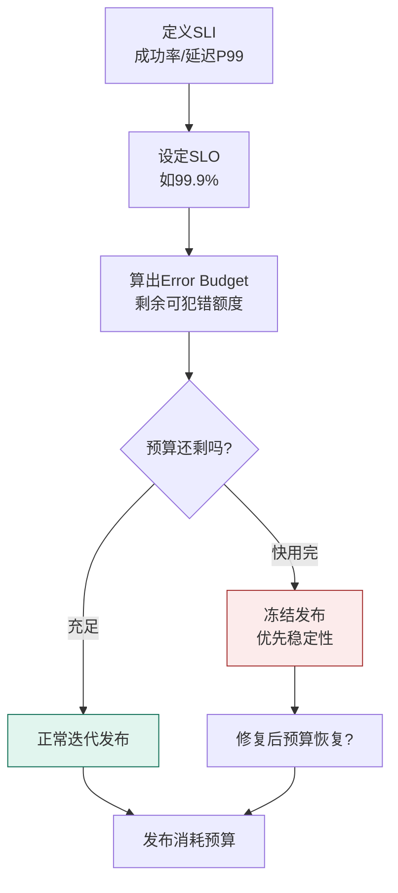
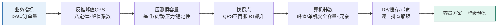
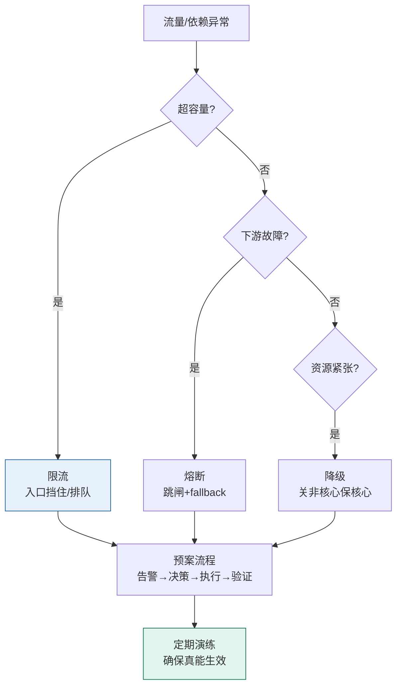
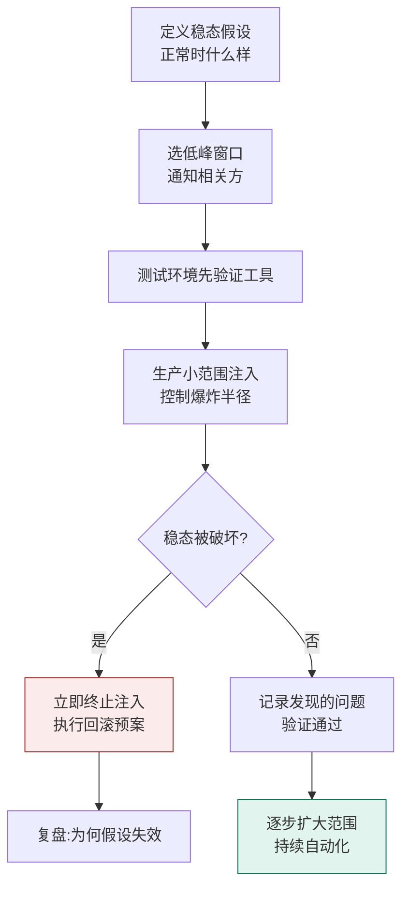
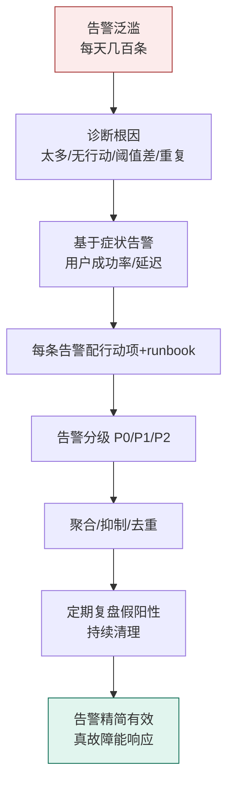

# 稳定性与容量规划场景面试

> 定位：稳定性是架构师的"保命题"——答不好，面试官会直接怀疑你能不能扛住生产。这一篇的 5 道题覆盖 SLA、容量规划与压测、限流降级预案、混沌工程、告警治理。面试官要的不是"多买机器""加个限流"这种人人会说的词，而是你能不能把"几个 9"换算成分钟和架构代价、能不能把容量"算"出来和"压"出来、能不能讲清降级开关和故障演练的真实细节。常见露馅点：张口"我们定 5 个 9"却不知道意味着年停机几分钟；把限流降级熔断混为一谈；说做过混沌工程却讲不出怎么控制爆炸半径。
>
> 面试高频：以下是稳定性面试反复出现的高频考点，本系列按真实面试现场拆题——用数字说话，讲清每个坑点与取舍。

---

## 题 1：你们系统的 SLA 定几个 9？为了达标做了什么？

### 题目

"你们核心系统的可用性目标是多少——几个 9？为了达成这个目标，你们具体做了哪些事？如果某个月没达标，你们怎么处理？"

### 考察什么

- **概念准确度**：能不能分清 SLA / SLO / SLI，而不是把这三层混着说。
- **量化能力**：能不能把"几个 9"直接换算成"一年/一个月允许停机多久"。
- **成本意识**：知不知道 9 越多成本指数级上升，"越高越好"是错的。
- **管理机制**：有没有错误预算（Error Budget）这类把稳定性和迭代速度平衡起来的方法。

### 答题骨架

**S（背景）**：先问清——"系统是什么类型（支付/电商/内部工具）？业务对停机的容忍度是多少？当前实际可用性是多少？故障时的影响面有多大？"

> 面试官想听的第一件事，是你先算账。**"几个 9"不是口号，是可以用算术当场换算的时间。**

**先算一笔账**（这是数学事实，面试时可以当场推给面试官看）：

| 可用性 | 三个9 | 四个9 | 五个9 |
|---|---|---|---|
| 年允许停机 | 8.76 小时 | 52.6 分钟 | 5.26 分钟 |
| 月允许停机 | 43.8 分钟 | 4.38 分钟 | 26 秒 |

**关键话术**："面试官问我几个 9，我第一反应是把它换算成时间——'四个 9 意味着一年只能挂 52 分钟'。然后再算：为了把故障时间压到这个数，我需要哪些架构手段、花多少钱。**拍脑袋定 5 个 9 是不负责任的，因为 9 每多一个，成本是指在涨的。**"

**分清三层概念**（很多人在这里露馅）：

| 概念 | 含义 | 例子 |
|---|---|---|
| **SLI**（指标） | 怎么衡量服务好不好 | 请求成功率、延迟 P99 |
| **SLO**（目标） | 指标要达到什么水平 | 成功率 ≥ 99.9% |
| **SLA**（协议） | 对外承诺，达不到有后果 | 合同中承诺 99.9%，否则赔偿 |

**A（行动）**：讲清"为了达标做了什么"，按层次说——

1. **冗余与无状态**：消除单点，服务无状态才能随便扩缩和故障转移。
2. **故障转移**：主备、多可用区（Multi-AZ），主挂了备能秒级接管。
3. **错误预算机制**：把 SLO 的"剩余额度"当成发布阀门——预算没用完就正常发版，用完了就冻结发布、优先修稳定性。**这把"稳定 vs 速度"的吵架变成了数字决策。**
4. **可观测性 + 快速恢复**：监控告警能及时发现、预案和演练能保证快速止血（MTTR 比"永不故障"更现实）。

**R（结果）**：填真实数字——"我们核心接口 SLO 定的是（填），实际做到（填）。有一次因（填原因）没达标，消耗了（填）错误预算，我们按机制（填处理），当月（填结果）。"

**L（复盘）**：主动说——
- **SLO 不是越高越好**：内部服务 99.9% 够用就别定 99.99%，多出来的 9 要拿机器和人力换。
- **均值会骗人**：99.9% 是平均值，一次 30 分钟的全站故障就能吃掉一个月的预算——要看最差情况。
- **SLA 是对外承诺，要留余量**：对客户承诺的 SLA 要低于内部 SLO，否则内部一波动就违约。

> **公开案例**：Google 在公开出版的《Site Reliability Engineering》（sre.google 官网免费在线阅读）中系统阐述了 **SLO 与 Error Budget（错误预算）**：先定义 SLI，再设 SLO，剩下的额度就是允许犯错的预算；预算没用完可以放心发布，用完了就冻结发布优先稳定性——这是把"稳定性 vs 迭代速度"矛盾量化的经典公开方法。另据 **AWS 官方 SLA 文档**，EC2 单可用区实例的月度可用性承诺是 **99.5%**，多可用区部署可达 **99.99%**。**可借鉴点**：几个 9 不是喊出来的，是用架构冗余（多 AZ）买来的；且必须配套错误预算机制，否则 SLO 只是墙上的数字。

### 追问链

| 面试官追问 | 你要接住的点 |
|---|---|
| 四个 9 一年能停多久？ | 约 52.6 分钟（当场算：365×24×60×0.01%） |
| SLA / SLO / SLI 区别？ | 指标 / 目标 / 对外协议（违约有后果） |
| 错误预算用完了怎么办？ | 冻结非必要发布，优先稳定性修复，恢复后再放开 |
| 怎么做到 99.99%？ | 冗余、无状态、多AZ、故障转移、快速恢复、减少人为变更 |
| 提升一个 9 的成本有多大？ | 指数级上升，从 99.9% 到 99.99% 可能需要全新的高可用架构 |

### 翻车点

- ❌ "我们定 5 个 9" 却算不出年停机时间 —— 说明只是背了个数字，没真正理解。
- ❌ SLA/SLO/SLI 混着用 —— 概念不清，面试官会立刻追死你。
- ❌ "9 越高越好，越高越牛" —— 没有成本意识，不懂权衡。
- ❌ "达标了就没事了" —— 没有错误预算和失败处理机制，管理维度缺失。

### 调用知识

- [高可用架构设计](../12-高可用与稳定性/01-高可用架构设计.md)：冗余、无状态、故障转移
- [可观测性三大支柱](../13-可观测性/01-可观测性三大支柱.md)：监控、日志、链路追踪
- [容量规划与压测](../12-高可用与稳定性/04-容量规划与压测.md)：容量与稳定性的关系
- [监控告警 Prometheus-Grafana](../13-可观测性/03-监控告警Prometheus-Grafana.md)：SLI 指标采集

---

## 题 2：大促前怎么做容量规划？压测怎么压、瓶颈怎么看、机器怎么算？

### 题目

"双十一要来了，老板说今年流量预计翻 3 倍，让你做容量规划。你怎么估算需要多少台机器？压测怎么做？怎么知道瓶颈在哪？"

### 考察什么

- **估算能力**：能不能从业务指标（DAU、订单量）反推出系统容量（QPS、机器数）。
- **压测方法**：会不会区分基准/负载/压力/稳定性压测，会不会全链路压测。
- **瓶颈定位**：压测中怎么找到拐点和瓶颈，是看 CPU 还是看 RT 还是看错误率。
- **兜底意识**：知不知道容量规划一定会估错，预案和弹性方案才是保命的。

### 答题骨架

**S（背景）**：先问清——"去年大促峰值 QPS/订单量是多少？今年业务预估增长多少、依据是什么？当前系统单机容量多少？有哪些依赖（DB、缓存、第三方）？预算能加多少机器？"

> 关键话术：**"容量不是拍脑袋估的，是'算'出来再'压'出来的。"** 估算给方向，压测给真相。

**A（行动）**：分三步。

**第一步：从业务指标反推技术容量。** 用二八定律和峰值系数：假设日订单 1000 万，80% 集中在 4 小时，峰值系数再乘 2 → 峰值订单约 1100 单/秒；一个下单请求平均触发 10 次内部调用 → 核心链路 QPS 约 1.1 万。把业务语言翻译成 QPS，这是容量估算的第一步。

**第二步：压测摸出真实容量。** 四种压测要分清：

| 压测类型 | 目的 | 做法 |
|---|---|---|
| 基准压测 | 摸单接口/单机容量 | 单接口逐步加压，找性能基线 |
| 负载压测 | 验证预期流量下表现 | 模拟预估峰值，看是否达标 |
| 压力压测 | 找系统极限和拐点 | 持续加压直到系统崩溃，找到容量上限 |
| 稳定性压测 | 验证长时间运行 | 峰值流量跑几小时到几天，看内存泄漏、连接耗尽 |

**瓶颈怎么看**：压测时同时监控 QPS、响应时间（P99）、错误率、CPU、内存、IO、连接池、GC。**拐点就是"QPS 不再增长、RT 开始飙升、错误率开始上升"的那个点**——对应的 QPS 就是系统容量上限。

**第三步：算机器数。** `机器数 = 预估峰值 QPS / 单机安全容量 × 冗余系数`。单机容量取压测拐点的 70%-80%（留余量），冗余系数考虑故障和流量不均（通常 1.2-1.5）。**别忘了数据库——DB 往往才是瓶颈，加机器解决不了 DB 问题，要提前分库分表、加缓存、做读写分离。**

**R（结果）**：填真实数字——"我做过一次（填场景）容量规划，预估峰值（填）QPS，压测摸出单机（填）QPS，最终申请（填）台机器，大促实际峰值（填）QPS，系统（填表现）。"

**L（复盘）**：主动说——
- **容量一定会估错**：所以必须有降级预案和弹性扩容能力，别把宝全押在"估准了"。
- **压测环境要接近真实**：环境不一致，压测结果就是自欺欺人。能全链路压测最好。
- **全链路压测有风险**：影子流量、影子表要做好隔离，绝不能污染真实数据。

> **公开案例**：据阿里技术团队在 QCon/ArchSummit 等公开技术大会的分享，阿里双 11 采用**全链路压测**——在接近真实的生产环境上构造影子流量，把下单、支付、库存等核心链路按预估峰值整体压一遍，提前暴露瓶颈。据阿里官方历年公开披露的数据，其交易创建峰值达到数十万笔/秒量级（如 2019 年公开数据约 54.4 万笔/秒）。**可借鉴点**：大促容量不是估出来的，是全链路压测"压"出来的；而且必须重点压 DB 等有状态瓶颈，无状态服务加机器容易，DB 才是真正的硬骨头。

### 追问链

| 面试官追问 | 你要接住的点 |
|---|---|
| 1000 万订单怎么算出 QPS？ | 二八定律算峰值时段 + 峰值系数 + 单请求扇出倍数 |
| 压测时怎么判断到瓶颈了？ | QPS 平台期、RT 飙升、错误率上升、资源利用率饱和 |
| 单机容量怎么测准？ | 单接口基准压测找拐点，取 70%-80% 作安全容量 |
| 数据库是瓶颈怎么办？ | 缓存、读写分离、分库分表、SQL 优化——加机器不管用 |
| 预估流量和实际差 10 倍怎么办？ | 弹性扩容 + 降级预案 + 限流保核心，别硬扛 |

### 翻车点

- ❌ "加机器就行" —— DB、带宽、连接池都不是加机器能解决的，暴露思维单一。
- ❌ "按去年峰值乘 3 估个 QPS" —— 没有拆解方法，没有压测验证，拍脑袋。
- ❌ 压测只看平均响应时间 —— 应该看 P99/P999，"平均"会掩盖长尾问题。
- ❌ 不算 DB 和带宽 —— 只看应用服务器，典型的新手盲区。

### 调用知识

- [容量规划与压测](../12-高可用与稳定性/04-容量规划与压测.md)：压测方法、拐点、容量估算
- [性能优化分层](../12-高可用与稳定性/02-性能优化分层.md)：SQL→缓存→JVM→网络的瓶颈定位
- [分库分表](../06-数据库体系/05-分库分表.md)：DB 瓶颈的解决手段
- [高可用架构设计](../12-高可用与稳定性/01-高可用架构设计.md)：弹性与冗余

---

## 题 3：限流、降级、熔断、预案，你实际怎么配的？降级开关怎么设计、怎么演练？

### 题目

"你们生产上限流、降级、熔断具体怎么配的？别只说用了 Sentinel——阈值多少、依据是什么？降级开关怎么设计、谁来管？配完了怎么保证真出事时能生效？"

### 考察什么

- **概念区分**：能不能讲清限流/降级/熔断各自解决什么问题、有什么不同。
- **配置细节**：阈值怎么定、规则怎么配、依据是什么——而不是"默认配置"。
- **开关设计**：降级开关的动态生效、默认值安全、权限与审计。
- **演练机制**：配了不等于能用，有没有演练保证关键时刻生效。

### 答题骨架

**S（背景）**：先问清——"核心链路有哪些、依赖哪些外部服务？历史上因为下游故障、流量突增出过什么事？哪些功能可以降级、哪些绝对不能？配置怎么下发——有没有配置中心？"

**先把四个概念讲清**（很多人在这里混为一谈，一句话就减分）：

| 手段 | 解决什么 | 作用位置 | 类比 |
|---|---|---|---|
| **限流** | 流量超过系统容量 | 入口/调用方 | 景区限流，放不进来就排队/拒绝 |
| **降级** | 资源不足保核心 | 自身非核心功能 | 飞机备降，先保命 |
| **熔断** | 下游故障防止雪崩 | 对下游的调用 | 保险丝跳闸，防止烧毁整个电路 |
| **预案** | 各种异常的应对流程 | 组织流程 | 消防预案，出事按流程走 |

**A（行动）**：讲配置和设计细节。

**限流阈值**：不是拍脑袋，是压测出来的——单接口容量 × 安全系数（70%-80%）。分级限流：核心接口优先保障、按用户/租户维度精细化限、配系统规则（CPU/Load 高时自适应）。用 Warm Up 防冷启动被打垮。

**降级开关设计**（面试官最爱抠的细节）——五条硬要求：

1. **动态可配、热生效**：通过配置中心（Nacos/Apollo）下发，改了立即生效，不用发版重启。
2. **默认值即安全**：开关的默认值必须是"安全状态"——配置中心挂了、开关读不到时，走最保守的逻辑（如默认降级），而不是裸奔。
3. **开关粒度合适**：按功能/用户群/渠道维度，能精确控制降级范围，别一降全降。
4. **权限与审计**：谁能改开关要有权限控制，每次改动有日志可追溯，防止误操作。
5. **降级逻辑本身要简单可靠**：别让降级逻辑依赖可能已经挂掉的外部服务，否则降级自己先挂了。

**熔断**：用 Sentinel/Hystrix，关键是配好"慢调用比例/异常比例"阈值、熔断时长、半开探测。熔断后要有 fallback（返回兜底数据/空结果），不能直接抛异常。

**预案 + 演练**：每个预案写成文档——触发条件、操作步骤、负责人、验证方式。**关键是演练**：定期在预发/低峰期实际触发开关，验证降级逻辑、熔断是否真生效。

**R（结果）**：填真实数字——"我配过（填）个降级开关，覆盖（填）个非核心功能；限流阈值压测定为（填）QPS；熔断阈值（填）；每季度演练（填）次，大促期间触发过（填）次，效果（填）。"

**L（复盘）**：主动说——
- **降级开关不演练等于没有**：长期不触发，逻辑可能早就坏了，真出事时按下去没反应。
- **降级要有"度"**：降级后核心功能必须可用，别把用户能感知的核心体验也降级了。
- **熔断误触发**：阈值太敏感会误伤，要结合业务容忍度调，并配半开探测自动恢复。

> **公开案例**：**Netflix Hystrix**（Netflix 技术博客公开开源）是熔断隔离的经典实现，提供了线程池隔离、熔断器、fallback 降级等机制；国内阿里开源的 **Sentinel**（官方文档）是更现代的替代，提供限流、熔断、系统自适应保护。**Facebook 公开介绍的 Gatekeeper 系统**（工程博客/论文）是其功能发布与 kill switch（一键关闭）的基础设施——新功能先对小比例用户开放，出问题可快速关闭，这是 feature flag / 降级开关在大规模生产环境的公开实践。**可借鉴点**：开关和熔断不是配完就完，必须有配置中心下发、默认值安全、权限审计，并纳入常态化演练。

### 追问链

| 面试官追问 | 你要接住的点 |
|---|---|
| 限流和熔断区别？ | 限流挡自己的入口流量，熔断断的是对故障下游的调用 |
| 降级开关默认值怎么定？ | 默认走安全态，配置中心不可用时也不能裸奔 |
|  Sentinel 熔断规则怎么配？ | 慢调用比例/异常比例阈值、熔断时长、半开探测次数 |
| 降级逻辑自己挂了怎么办？ | 降级逻辑要极简、不依赖外部、有本地兜底 |
| 怎么保证开关真能生效？ | 定期演练 + 配置下发链路监控 + 开关生效可观测 |

### 翻车点

- ❌ 把限流降级熔断混为一谈 —— 概念不清，面试官会判定你没真正用过。
- ❌ "用了 Sentinel 默认配置" —— 没有根据系统容量和业务容忍度调，等于没配。
- ❌ "降级开关配好就不用管了" —— 没有演练，关键时刻可能失效。
- ❌ 降级后核心功能也不可用 —— 降级的前提是保住核心，本末倒置。

### 调用知识

- [限流降级熔断隔离](../12-高可用与稳定性/03-限流降级熔断隔离.md)：四种手段的原理与配合
- [Sentinel 限流熔断](../09-微服务体系/03-Sentinel限流熔断.md)：规则配置细节
- [配置管理与环境治理](../16-项目治理/03-配置管理与环境治理.md)：配置中心与开关下发
- [分布式限流](../08-分布式理论与共识/06-分布式限流.md)：限流算法与阈值

---

## 题 4：怎么做故障演练 / 混沌工程？怎么避免演练搞出真故障？

### 题目

"你们做故障演练吗？具体怎么做的？往生产注入故障，万一搞出真的线上事故怎么办？你怎么控制风险？"

### 考察什么

- **理念理解**：知不知道混沌工程的核心原则和"主动发现未知问题"的价值。
- **流程方法**：有没有一套规范的实验流程（假设→稳态→注入→验证→恢复）。
- **风险控制**：怎么控制爆炸半径、怎么保证能随时终止和回滚——这是这题的命门。
- **务实程度**：是"在生产乱搞"的莽夫，还是从测试环境逐步走向生产的稳健派。

### 答题骨架

**S（背景）**：先问清——"系统成熟度如何、监控告警完不完善？这次演练想验证什么假设？业务低峰窗口在哪？回滚和止血预案准备好了吗？相关方通知到位了吗？"

> 关键原则：**"混沌工程不是'制造故障'，是'在可控条件下验证系统的容错能力'。"** 没有护栏的注入是爆破，不是演练。

**A（行动）**：先讲原则，再讲流程，最后重点讲风险控制。

**混沌工程的核心原则**（业界公开共识，源自 Netflix 的实践）：
1. 建立稳态假设（系统正常情况下什么样）；
2. 用真实世界的事件作为变量（网络延迟、机器宕机、依赖故障）；
3. 在生产环境实验（测试环境证明不了生产问题）——**但要控制爆炸半径**；
4. 持续自动化运行；
5. 最小化爆炸半径（先小范围、可随时停止）。

**实验流程**：定义稳态 → 提出假设 → 注入故障 → 观察验证假设 → 恢复 → 复盘并记录发现的问题。

**怎么避免搞出真故障**（面试官最想听的）——五道护栏：

1. **爆炸半径控制**：从单个实例、单个用户、单个机房开始，确认可控再逐步扩大。**绝不一开始就全量。**
2. **可随时终止**：注入工具要有"一键停止"开关，出问题立刻终止注入。
3. **业务低峰 + 通知相关方**：选凌晨/低峰窗口，提前通知运维、客服、业务方，避免误判成真故障。
4. **预案和回滚就绪**：演练前确认监控告警可用、回滚脚本就绪、值班人员在场。
5. **从测试环境起步**：先在预发/测试环境验证流程和工具，成熟后再谨慎上生产。

**R（结果）**：填真实经历——"我参与过（填）次故障演练，注入了（填：宕机/延迟/断网）等故障，发现了（填）个此前未知的问题（如填一个真实发现），修复后同类真实故障率（填）。"

**L（复盘）**：主动说——
- **演练发现问题是好事**：发现了就修，别怕暴露问题；怕的是真实故障才第一次发现。
- **演练本身要能随时叫停**：没有"一键终止"的机制，不准上生产注入。
- **不是所有系统都适合立刻上生产演练**：监控不完善、没有熔断降级的系统，先补基础能力再演练。

> **公开案例**：混沌工程由 **Netflix** 公开实践并发扬光大。据 Netflix 技术博客披露，其 **Simian Army（猴子军团，含 Chaos Monkey 等）** 会在生产环境随机关停实例，主动制造故障以验证系统容错能力；Netflix 还公开了混沌工程的原则（稳态假设、真实事件、生产实验、持续自动化、最小化爆炸半径）。国内阿里开源的 **ChaosBlade** 是公开的混沌工程工具，支持对 CPU、内存、网络、磁盘、JVM 等注入故障。**可借鉴点**：混沌工程的价值在于"主动发现未知"，但它的前提是有成熟的监控、熔断、回滚能力——先筑牢地基，再主动"搞破坏"。

### 追问链

| 面试官追问 | 你要接住的点 |
|---|---|
| 混沌工程和普通测试区别？ | 测试验证已知预期，混沌工程探索未知的脆弱点 |
| 生产注入怎么保证不影响用户？ | 控制爆炸半径、低峰窗口、可随时终止、回滚预案 |
| 演练发现系统扛不住怎么办？ | 这正是目的——记录问题、修复、再验证，别掩盖 |
| 监控不完善能做混沌工程吗？ | 不能，先补监控和可观测性，否则你连故障发生都不知道 |
| 怎么让演练持续做下去？ | 自动化定期运行、纳入 CI/CD、形成文化和制度 |

### 翻车点

- ❌ "没做过，但应该没问题吧" —— 不严谨，混沌工程是有规范流程的工程实践。
- ❌ "直接在生产随机关机器" —— 没有护栏、没有爆炸半径控制，是制造事故。
- ❌ 把演练出问题当成失败 —— 演练就是用来发现问题的，发现了不修才是问题。
- ❌ 没有预案和终止机制就上生产 —— 致命，演练变真故障往往就是这么来的。

### 调用知识

- [高可用架构设计](../12-高可用与稳定性/01-高可用架构设计.md)：容错、冗余、故障转移是演练的基础
- [线上故障排查与复盘](../12-高可用与稳定性/05-线上故障排查与复盘.md)：止血、回滚、复盘流程
- [限流降级熔断隔离](../12-高可用与稳定性/03-限流降级熔断隔离.md)：注入故障时的保护手段
- [监控告警 Prometheus-Grafana](../13-可观测性/03-监控告警Prometheus-Grafana.md)：演练的前提是可观测

---

## 题 5：监控告警为什么形同虚设？你怎么治理"告警疲劳"？

### 题目

"我们系统有上千条告警规则，每天几百条告警，结果大家对告警麻木了——真出事反而没人看。这种'告警疲劳'你怎么治理？"

### 考察什么

- **对告警本质的理解**：告警的目的是"驱动人采取行动",不是"把所有异常都报出来"。
- **问题诊断能力**：能不能说清告警疲劳的根因（太多、无行动项、阈值不合理、重复）。
- **治理方法**：有没有具体手段——分级、聚合、抑制、基于 SLO 告警、runbook。
- **持续性**：知不知道告警治理是持续过程，不是一次性清理。

### 答题骨架

**S（背景）**：先问清——"现在有多少条告警规则、每天触发多少？误报率大概多少？告警发到哪里、谁响应？有没有处置手册（runbook）？真故障时告警有没有起到作用？"

> 核心洞察：**"告警不是越多越安全。每条告警都在消耗 on-call 同学的注意力，当狼来了喊太多，真狼来了没人信。"**

**A（行动）**：先诊断根因，再系统治理。

**告警疲劳的四个根因**：
1. **告警太多太碎**：机器级指标（CPU 高、内存高）全报，但很多不影响用户。
2. **没有明确行动项**：告警响了，没人知道该干什么、也不确定要不要管。
3. **阈值不合理**：阈值太敏感，正常波动也报；或阈值写死，业务量变化后失效。
4. **重复和风暴**：一个根因触发一片告警，淹没真正重要的信息。

**治理方法**：

1. **基于症状告警，不基于原因告警**：优先告警"用户成功率下降、延迟升高"这类用户可感知的症状，而不是"某台机器 CPU 高"。CPU 高但用户没影响，不该半夜叫人。
2. **每条告警都要有行动项**：Google SRE 的原则——"每条告警都应该要求人工干预"。如果一条告警响了你什么都不用做，就该删掉或降级为通知。
3. **告警分级**：按紧急程度分 P0/P1/P2——P0 电话叫醒、P1 即时消息、P2 工作时间处理/只记录。
4. **聚合、抑制、去重**：同一根因的告警合并成一条；依赖关系做抑制（上游挂了就别报一堆下游）；相同告警设置静默期。
5. **配 runbook**：每条告警附上"这是什么、怎么定位、怎么止血"，让响应者不用临时猜。
6. **定期复盘假阳性**：每周看哪些告警是误报、哪些没人处理，该删的删、该调的调。

**R（结果）**：填真实数字——"治理前每天（填）条告警、误报率（填）%；治理后降到每天（填）条，误报率（填）%；真正故障的响应和发现时间从（填）降到（填）。"

**L（复盘）**：主动说——
- **治理是持续过程**：业务在变、系统在变，告警规则要定期回顾，不是清理一次就一劳永逸。
- **别把告警全删了**：治理的目标是"每条告警都有价值",不是"告警越少越好"——该报的必须报。
- **告警要能闭环**：从告警到响应到处理到复盘，形成闭环，才能持续改进。

> **公开案例**：Google 在公开出版的《Site Reliability Engineering》（sre.google）中明确提出告警设计原则——**"每一条告警都应该要求人工干预（Every alert should require human action）"**，并且应该**基于症状（symptom）而非原因（cause）告警**——关注"用户是否受影响"，而不是"某台机器 CPU 高"。**Prometheus 官方文档**（prometheus.io）在 alerting 最佳实践里也强调：告警规则要精简、要有清晰的 runbook、按严重程度分级、用 group 和抑制减少告警风暴。**可借鉴点**：告警的价值在于"可行动的异常信号"，治理的核心是让每条告警都值得被响应——宁可少而准，不要多而滥。

### 追问链

| 面试官追问 | 你要接住的点 |
|---|---|
| 基于症状告警具体指什么？ | 告警用户可感知的 SLI（成功率、延迟），而非机器资源指标 |
| 误报太多怎么办？ | 调阈值、加持续时间条件、设静默期、删无行动项的告警 |
| 告警分级怎么分？ | P0 电话叫醒、P1 IM 通知、P2 工单/工作时间处理 |
| runbook 写什么？ | 告警含义、影响、定位步骤、止血操作、升级路径 |
| 怎么避免告警越加越多？ | 新增告警需评审、定期清理无行动项告警、纳入治理制度 |

### 翻车点

- ❌ "告警越多越安全，全都配上" —— 恰恰相反，这是告警疲劳的根源。
- ❌ 只基于 CPU/内存等资源指标告警 —— 资源高不等于用户受影响，会制造大量噪声。
- ❌ "告警响了再说，不用写处置手册" —— 没有 runbook，响应者只能临时猜， MTTR 拉长。
- ❌ "清理一次就好了" —— 告警治理是持续过程，不回顾就会再次泛滥。

### 调用知识

- [监控告警 Prometheus-Grafana](../13-可观测性/03-监控告警Prometheus-Grafana.md)：告警规则、分级、抑制
- [可观测性三大支柱](../13-可观测性/01-可观测性三大支柱.md)：指标、日志、链路追踪如何配合
- [线上故障排查与复盘](../12-高可用与稳定性/05-线上故障排查与复盘.md)：故障响应与复盘闭环
- [高可用架构设计](../12-高可用与稳定性/01-高可用架构设计.md)：SLO 与稳定性目标

---

## 小结

- SLA 先算账：四个 9 ≈ 年停机 52.6 分钟；分清 SLI/SLO/SLA，9 越多成本指数级上升；用错误预算平衡稳定与迭代。
- 容量规划是"算"出来再"压"出来的：业务指标反推 QPS → 压测摸拐点 → 算机器数，DB 等有状态瓶颈才是硬骨头，且一定要留降级预案。
- 限流挡入口、降级保核心、熔断防雪崩、预案管流程——四者职责不同别混为一谈；降级开关要热生效、默认值安全、有权限审计，并常态化演练。
- 混沌工程的价值是主动发现未知，但前提是监控和容错能力成熟；控制爆炸半径、可随时终止、低峰通知，是避免演练变真故障的护栏。
- 告警治理的核心是"每条告警都值得响应"：基于症状而非原因、每条配行动项、分级聚合抑制、定期清理假阳性——宁可少而准，不要多而滥。
- 稳定性题的共同套路：先量化（算时间、算 QPS、算阈值）、再讲机制（用什么手段）、最后讲复盘和兜底（预案、演练、持续治理）。
