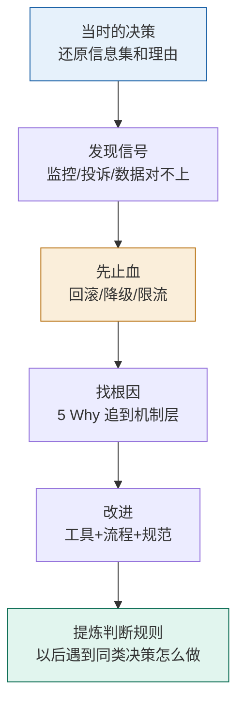
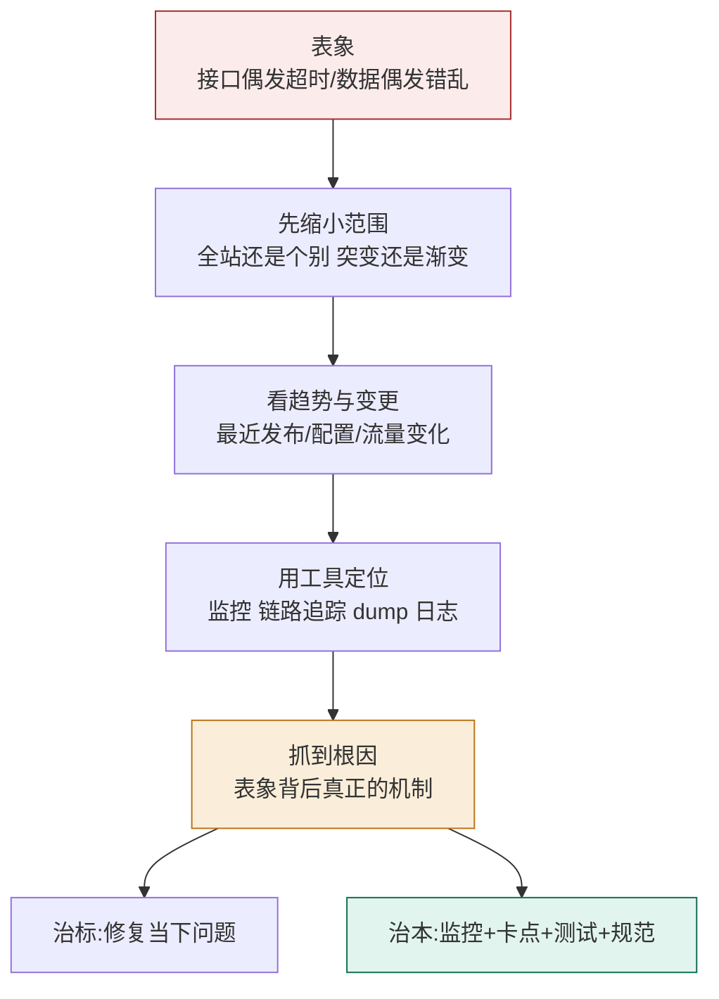
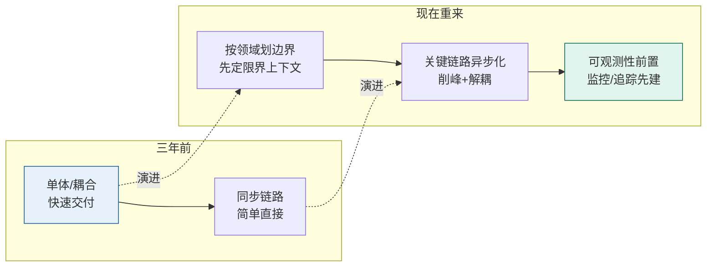
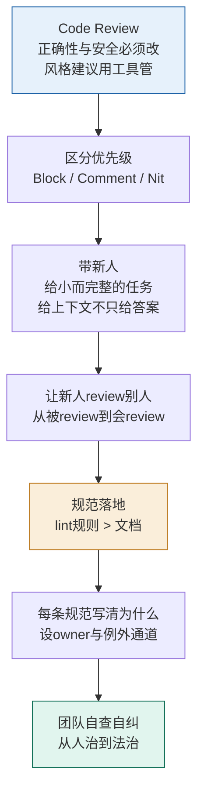
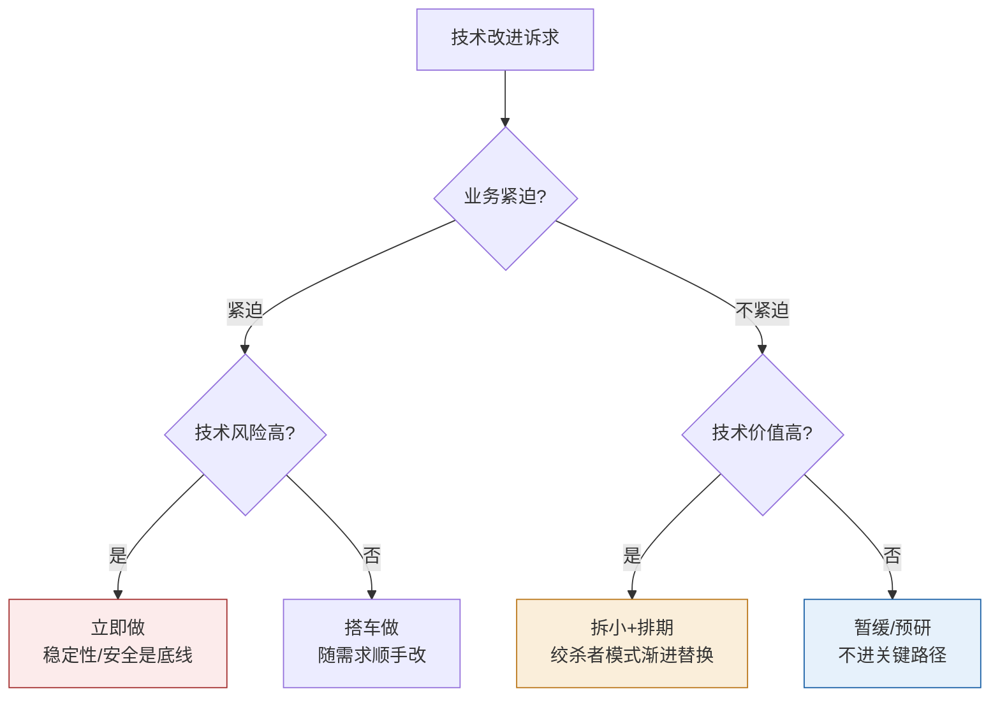

# 失败复盘与职业成长场景面试

> 定位：这一篇考的是架构师的"人"——失败、踩坑、重来、带人、平衡。面试官用这些问题验证三件事：你有没有真的扛过事（细节骗不了人）、你有没有从失败里提炼出规则（而不是"下次注意"）、你能不能让别人变好（影响力）。露馅点很集中：讲失败时甩锅、讲坑时只有现象没有根因、讲重来时把标准答案背一遍、讲带人时只会"我帮他改了"。

## 题 1：讲一个你做过最失败的技术决策，后来怎么收拾的？

### 题目

"说说你做过最失败的一个技术决策。当时为什么那么定？什么时候发现错了？怎么收拾的？如果重来一次你会怎么做？——注意，我要听真事，不要听'我太追求完美'这种假失败。"

### 考察什么

- **诚实与担责**：敢不敢认自己的判断失误，还是把锅甩给业务、上游、历史遗留。
- **复盘闭环**：有没有"发现信号 → 止血 → 根因 → 改进"的完整链条，而不是一句"后来修好了"。
- **决策水平**：失败本身不值钱，值钱的是你从失败里提炼出的**可复用判断规则**。
- **情境还原能力**：能不能还原"当时的信息集"——好的失败复盘，会证明这个决策在当时并不蠢。

### 答题骨架

**S（背景）**：**这里必须填你自己的真实经历，不要套用任何模板编故事。** 面试官要的不是"我蠢"，而是"在当时的信息下，这个决策合理吗"。按这个框架还原：

- 当时的系统规模、业务阶段、团队状况（填入真实数字）；
- 你掌握的信息和不掌握的信息（**关键信息缺失往往是失败的根因**）；
- 当时有哪些选项、你为什么选了这个（还原当时的决策逻辑，而不是用今天的认知倒推）；
- 谁参与了决策、你承担什么角色（如实说清是"我拍板"还是"我建议"）。

**A（行动）**：用一条完整的复盘链来讲，别跳步：

四步要害：

1. **发现信号要具体**。"后来发现不行"是废话；"上线第 3 天，对账任务发现 0.7% 的订单状态不一致，客服工单当天涨了 4 倍"——这才叫信号。**面试官想听的是"你怎么知道错了"，因为能发现错，本身就是能力。**
2. **先止血，再查因**。生产事故里先恢复服务（回滚、降级、限流、切流量），再慢慢查根因。把止血和查因的顺序讲反，暴露你没处理过线上问题。
3. **根因要追到机制层**。用 5 Why 追问：为什么数据不一致 → 为什么消息重复消费 → 为什么没做幂等 → 为什么评审没发现 → 为什么我们的评审清单里没有幂等检查项。**根因通常是流程缺失，不是某行代码写错了。**
4. **改进要机制化**。"下次注意"等于没改；"在发布清单里加了幂等检查项、给核心链路补了对账任务、写了故障复盘文档并同步全组"——这才叫改进。

**公开案例（标注来源）**：讲失败复盘，有两个公开的经典样本值得对照。

- **Knight Capital（美国骑士资本）2012 年 8 月事故**：据美国证券交易委员会（SEC）公开的调查/处罚文件及当时公开报道，因新部署的交易程序存在缺陷、且部署流程未能正确生效，公司在约几十分钟内产生了巨额错误交易，**公开报道普遍引用约 4.4 亿美元的损失**。事后复盘指向的不是"某段代码写错"这么简单，而是**变更部署流程、回滚机制和上线验证的系统性缺失**。
- **GitLab 2017 年数据库误删事故**：据 GitLab 官方博客公开的完整复盘（"GitLab.com Database Incident"），一次运维误操作删除了生产数据库，而**备份流程当时并未被验证可用**，最终靠较旧的快照和其他数据源拼凑恢复。

**借鉴点**：这两个案例的共同教训是——**失败往往不是单点技术错误，而是"变更流程 + 可回滚性 + 备份有效性"这些你以为有、其实没验证过的机制同时失效**。回答自己的失败时，也要往这个深度挖，而不是停在代码层。

**R（结果）**：填你自己的真实数字——"这次失败造成 __（损失/影响时长/影响用户数），止血用了 __，恢复用了 __，改进后同类问题 __ 个月没再发生"。**如果损失很小，就如实说"因为发现早，损失控制在 __"**——不要为了显得深刻而夸大。

**L（复盘）**：这是本题的**得分点**，必须提炼成一条可复用的判断规则，例如："从那以后，我做任何涉及数据的方案，都会先问'出问题怎么回滚、怎么对账'——**先想退路再想功能**。这条规则后来至少帮我避开了两次同类事故。"面试官要的就是这种"失败 → 规则"的升华。

### 追问链

| 面试官追问 | 你要接住的点 |
|---|---|
| 你说是你决策失误，具体错在哪一步？ | 还原当时的信息集，说清是"信息缺失""评估错误"还是"执行走样" |
| 为什么不早点发现？ | 承认监控/对账/评审的缺失，说清后来补了什么 |
| 你为这个失败承担了什么后果？ | 如实说——担责的态度比结果本身更被看重 |
| 如果当时有 X 信息，你还会这么选吗？ | 诚实回答；如果会，说明那不是失败而是合理赌注，讲清赌注思维 |
| 这个教训你怎么传递给团队？ | 写复盘文档、纳入评审清单、做分享——体现影响力 |

### 翻车点

- ❌ "我最大的失败就是太追求完美/太拼了" —— 假失败，面试官一听就知道你在回避真问题。
- ❌ "都是业务方临时改需求/上游不给力" —— 全程甩锅，暴露你不会担责。
- ❌ "后来我加班改好了" —— 只有补救没有根因和机制改进，等于没复盘。
- ❌ 讲了一个失败，但提炼不出任何规则 —— 说明你只是经历过，没有从中学习。

### 调用知识

- [线上故障排查与复盘](../12-高可用与稳定性/05-线上故障排查与复盘.md)：故障复盘方法、5 Why、止血与根因
- [架构文档与技术风险](../16-项目治理/04-架构文档与技术风险.md)：技术风险登记与复盘文档沉淀
- [测试体系](../16-项目治理/02-测试体系.md)：用测试与对账机制防止同类问题复发

## 题 2：你踩过最坑的一个技术坑是什么？现在怎么避免？

### 题目

"讲一个你印象最深的技术坑——不是那种一眼能看出来的，是那种让你怀疑人生的。当时现象是什么、你怎么定位的、现在团队怎么防止它再发生？"

### 考察什么

- **真实性**：真踩过的人有细节，听来的人只有结论——两三个追问就能分辨。
- **定位能力**：能不能讲清从"表象"到"根因"的推理路径，而不是"我查日志发现的"。
- **升华能力**：能不能从"我修了 bug"走到"团队加了机制"——这是资深和初级的分界。

### 答题骨架

**S（背景）**：填自己真实的坑，并交代出没发现的原因。先做一个分类，帮你和面试官都把问题框清楚：

| 坑的类型 | 典型例子 | 为什么难发现 |
|---|---|---|
| 认知盲区 | 时区/编码/浮点精度、闰秒 | "它不可能出错"的假设让人不设防 |
| 偶发性坑 | 连接池耗尽、并发下的竞态 | 只在特定时序/压力下复现 |
| 边界坑 | 空值、极值、分页越界 | 测试数据没覆盖边界 |
| 基础设施坑 | 时间同步、DNS、证书过期 | 超出应用代码视野，没人盯 |

**A（行动）**：讲清楚三件事——表象 vs 根因、定位路径、从修 bug 到修机制。

1. **先分清表象和根因**。表象是"接口偶发超时"，根因可能是"连接池耗尽导致请求排队"；表象是"数据偶发错乱"，根因可能是"本地缓存没失效"。**只讲表象的候选人，面试官会追问"那为什么超时"。**
2. **定位路径要具体**。按"先问变更 → 看监控趋势 → 链路追踪定位哪一跳 → 抓堆栈/日志证据 → 复现验证"的顺序讲。可以说"用 Arthas trace 定位到某个方法耗时异常"，但别只堆工具名。
3. **从治标到治本**（这是关键升华）。给一张对照表：

| 层面 | 治标 | 治本 |
|---|---|---|
| 监控 | 临时加日志 | 补上该指标的长期告警（如连接池使用率） |
| 测试 | 手测通过 | 加一条能复现该 bug 的自动化回归用例 |
| 流程 | 这次注意了 | 纳入发布清单/评审 checklist |
| 规范 | 口头提醒 | 写进团队规范并配 lint 规则自动检查 |

**公开案例（标注来源）**：一个公开的"反直觉基础设施坑"是 **Cloudflare 2017 年 1 月 1 日的闰秒故障**。据 Cloudflare 官方博客的公开复盘，闰秒事件导致其部分服务依赖的 NTP 时间出现异常，进而触发 DNS 记录构建的异常，造成部分客户流量中断——**"时间"这种被认为是绝对可靠的基础设施，反而成了坑**。Cloudflare 官方在 2019 年 7 月 2 日另一次故障复盘中（公开），也披露了一条正则规则导致 CPU 飙高、影响范围波及全球。

**借鉴点**：这两个案例说明，**最坑的问题往往出在你默认"不可能错"的地方——时间、DNS、配置、正则、依赖的基础设施**。回答你的坑时，试着把它归到这类"隐含假设崩塌"上，比单纯讲"我写错了一行代码"更接近架构师视角。同时注意：**公开案例要标注来源，不要把它说成"我经历过的事"**。

**R（结果）**：填真实数字——"这个问题当时影响了 __，定位花了 __，修复后 __"。如果是你主导的机制改进，说清"加了什么之后，同类问题从每月 __ 次降到 0"。

**L（复盘）**：主动说——"这个坑给我最大的教训是：**不要相信任何没有监控和告警的假设**。现在我设计系统时会专门问一句'哪些东西我认为理所当然不会出问题'——时区、时间同步、DNS、依赖版本、配置中心——然后逐个加防御或降级。"

### 追问链

| 面试官追问 | 你要接住的点 |
|---|---|
| 你怎么确认是根因，而不是巧合？ | 说清复现验证的过程，能稳定复现或注入验证才算确认 |
| 当时为什么没监控到？ | 承认监控盲区，说清后来补了什么指标和告警 |
| 这个坑是偶发的，你怎么复现的？ | 讲压测、时序构造、日志回溯等手段，体现耐心和方法 |
| 团队其他人会踩同样的坑吗？ | 讲你怎么沉淀成文档/规范/lint 规则，让别人不再踩 |
| 如果重来，你第一步会做什么？ | "先问变更"或"先看监控趋势"，体现你的排查纪律 |

### 翻车点

- ❌ "我那次是内存溢出，加了 -Xmx 就好了" —— 只有表象和粗暴处理，没有定位路径和根因。
- ❌ "后来重启就好了" —— 没有找到根因，等于埋了下一颗雷。
- ❌ 把听来的案例说成自己踩的 —— 追问细节立刻露馅，诚实底线不能破。
- ❌ 只讲自己怎么修的，不讲团队怎么避免 —— 停留在个人英雄阶段，没有影响力。

### 调用知识

- [线上故障排查与复盘](../12-高可用与稳定性/05-线上故障排查与复盘.md)：排查手册、根因分析方法
- [Arthas线上诊断](../13-可观测性/05-Arthas线上诊断.md)：trace/watch 等定位手段
- [监控告警Prometheus-Grafana](../13-可观测性/03-监控告警Prometheus-Grafana.md)：把监控盲区补成长期告警
- [测试体系](../16-项目治理/02-测试体系.md)：用回归测试固化坑的修复

## 题 3：如果让你重新设计三年前那个系统，你会改什么？

### 题目

"你简历上写着三年前主导过 XX 系统。现在回头看，如果推倒重来，你会改哪三件事？别说'技术选型更好'这种空话——说具体的，改什么、为什么、代价是什么。"

### 考察什么

- **演进视角**：能不能区分"当时的正确"和"现在的正确"——三年前合适的选择，今天可能不合适，因为约束变了。
- **取舍反思**：改什么、不改什么，都要有理由，而不是把当年的方案全盘否定。
- **真实反思**：真反思过的人有具体细节，背标准答案的人只会说"我会上微服务、上中台"。

### 答题骨架

**S（背景）**：先定调——**"三年前的选择在当时的约束下是合理的；我现在要改的，是那些约束变了之后暴露出来的问题。"** 这句话既体现了对过去团队的尊重，也表明你理解架构决策的时效性。填真实背景：当时规模、团队、业务阶段、技术选型理由。

**A（行动）**：给一张"改造清单"表，再上一张演进对比图。重点不是罗列技术，而是每项都写清"当时的理由 / 现在为什么改 / 代价"。

| 改造项 | 当时的理由 | 现在为什么改 | 代价 | 值不值 |
|---|---|---|---|---|
| （填真实项，如数据模型/边界） | 快、团队熟 | 业务边界变化导致耦合严重 | 迁移成本 __ | 填判断 |
| （如同步调用改异步） | 简单直接 | 峰值时链路过长、不可用扩散 | 引入最终一致和补偿 | 填判断 |
| （如补可观测性） | 先活下来 | 排障靠猜、MTTR 长 | 建设成本 | 填判断 |

三个值得重点讲的反思方向（示范，读者填自己的）：

1. **先定边界再写代码**。早期按数据库表设计系统，导致后期一个需求要改五六个模块。重来会先做领域建模、划清限界上下文——**这是成本最低、收益最持久的改动**。
2. **可观测性前置**。早期"先上线再说"，结果每次排障都靠猜、MTTR 很长。重来会在第一版就把日志规范、指标、链路追踪建好——**这是补课成本最高的一项**。
3. **关键链路异步化，但不全面微服务化**。把真正的高峰链路改异步、解耦；但**不是所有模块都拆成服务**。

**关键话术**：**"我不会说'全拆成微服务'。微服务解决的是组织扩展和独立交付问题，不是性能银弹。如果团队就 8 个人，强行拆分只会增加运维和排障负担——这是很多公开分享反复强调的教训。"**

**公开案例（标注来源）**：**Netflix 技术博客（Netflix Technology Blog，公开）** 记录了其从早期单体 DVD 租赁系统向云原生微服务演进的过程，核心特征是：拆分是为了可用性和团队独立交付，且**伴随大量自动化、容错和监控设施的建设**，是持续多年的渐进工程，而非一次性重写。另一个权威来源是 **James Lewis 与 Martin Fowler 2014 年的公开文章《Microservices: a definition of this new architectural term》**：文章明确微服务的核心特征是"围绕业务能力组建、独立部署、去中心化治理"，并同时指出其代价是分布式系统复杂性——**拆分前必须先问"组织和基础设施准备好了吗"**。**借鉴点：重来一次，我会更早做领域边界划分，但微服务化要跟组织能力和基础设施成熟度匹配，而不是把"拆"本身当目标。**

**R（结果）**：填真实情况——"这些改动有些后来在新项目里实践了，效果 __；有些因为成本太高没做，我承认那是权衡后的妥协"。**没做的也要说，这体现你不是在背完美答案。**

**L（复盘）**：主动说——"最大的反思是：**架构决策要带保质期**。三年前我没写 ADR，导致后来没人说得清当初为什么这么定，改造时束手束脚。现在我会在决策文档里写明'复审日期'和'后悔信号'，到期重新评估——**重来一次，我会先把决策过程记录下来。**"

### 追问链

| 面试官追问 | 你要接住的点 |
|---|---|
| 你说的边界具体怎么划？ | 用真实业务场景说明限界上下文怎么定，而不是一句"按 DDD" |
| 全面重写风险太大，你怎么落地改造？ | 用绞杀者模式渐进替换，新旧并存、逐步切流，不大爆炸 |
| 如果业务不给你时间重构呢？ | 把改造拆小，附着在需求里做；先做收益最高、风险最低的 |
| 你怎么证明新的设计更好？ | 给出改造前后的量化对比（MTTR、发布频率、耦合度） |
| 有没有哪次改造反而改坏了？ | 如实说，讲清教训——坦诚比完美更可信 |

### 翻车点

- ❌ "我会全拆成微服务、上中台、上 K8s" —— 把技术名词当答案，没有约束和代价分析。
- ❌ "把以前的全否定了" —— 说明你不尊重过去的决策，也不会承认当时的合理性。
- ❌ 只说"会改什么"不说"代价和值不值" —— 这不是架构师的反思，是许愿。
- ❌ 讲的"三年前系统"细节经不起追问 —— 大概率是编的，一追就穿。

### 调用知识

- [DDD领域驱动设计](../10-架构设计能力/01-DDD领域驱动设计.md)：限界上下文与领域边界划分
- [架构模式](../10-架构设计能力/03-架构模式.md)：演进式架构与绞杀者模式
- [微服务痛点治理](../09-微服务体系/07-微服务痛点治理.md)：拆分的代价与常见痛点
- [架构文档与技术风险](../16-项目治理/04-架构文档与技术风险.md)：决策记录与保质期管理

## 题 4：你怎么带新人、做 Code Review、沉淀团队规范？

### 题目

"你带过几个人？新人提交的代码你 review 出一堆问题，第二天同样的错又犯，你怎么处理？团队规范怎么落地才不会变成'写在 Confluence 里没人看'？"

### 考察什么

- **影响力**：不靠职权，也能让别人变好——这是架构师最核心的软技能。
- **反馈技巧**：对事不对人，区分"必须改"和"建议改"，不打击积极性。
- **机制化能力**：从"我帮你改"升级到"团队自己会改"——能否把个人能力变成组织能力。

### 答题骨架

**S（背景）**：填真实情况——团队规模、新人比例、当前痛点（review 流于形式？规范没人执行？）。先给一个判断：**"带人不是把我的能力复制给别人，而是搭一套让团队自己变好的机制。"**

**A（行动）**：分三条线讲——Code Review、带新人、规范落地。

**Code Review 三条原则**：

1. **分层**。把机器能查的（格式、命名、简单坏味道）交给 Checkstyle / SonarQube 自动检查，人只 review 设计、正确性、边界、安全。**把人力浪费在格式上，是 review 流于形式的头号原因。**
2. **分级**。评论分三级：Block（正确性问题，必须改）、Comment（建议，可讨论）、Nit（吹毛求疵，可不改）。新人最怕"一堆红色评论"分不清轻重——**分级能保护积极性，也能提高改的效率**。
3. **对事不对人**。写"这里并发下可能丢失更新，建议用原子操作"，而不是"你怎么又写错了"。

**带新人的四步**：给小而完整的任务（有始有终，能看到价值）→ 给上下文而不是只给答案（"为什么这么设计"比"照这个写"重要）→ 让新人 review 别人的代码（从被 review 到会 review，成长最快）→ 定期一对一反馈。

**规范落地的真相**（表格）：

| 规范类型 | 有效做法 | 无效做法 |
|---|---|---|
| 代码风格 | lint 规则强制，IDE 插件自动提示 | 写进文档靠人自觉 |
| 设计约束 | Code Review checklist + ADR 模板 | 口头传达 |
| 流程规范 | CI/CD 卡点（不通过不能合并） | 靠人盯 |
| 经验教训 | 复盘文档 + 分享 + 纳入模板 | 只在出事时提一次 |

**公开案例（标注来源）**：Google 在 GitHub 上公开的 **《Google Engineering Practices Documentation》**（Google 工程实践文档，公开）中的 Code Review 指南明确：review 的两大目标是"提升代码质量"和"知识传递"，并要求评论**区分优先级、对事不对人、保持小变更（small CL）**——小变更 review 更快更彻底。另一来源是 **《Software Engineering at Google》（Titus Winters、Tom Manshreck、Hyrum Wright 著，2020 年公开出版）**：书中系统介绍了 Google 如何通过代码所有权、自动化工具和明确的评审标准，把工程文化规模化。国内公开实践方面，**阿里《Java 开发手册》** 是"公开规范 + P3C 插件自动检查"落地的典型例子——**规范之所以能执行，是因为它变成了工具，而不是因为它写得好**。**借鉴点：规范的生命力在自动化和工具化，不在文档质量。**

**R（结果）**：填真实成果——"带了 __ 个人，其中 __ 个能独立负责模块；review 引入分级后，评论的返工率从 __ 降到 __；规范接入 CI 后，违规从每周 __ 次降到接近 0"。

**L（复盘）**：主动说——"我以前犯过的错是：review 时把我的写法强加给别人，连风格都要改。后来才明白，**review 要保证的是正确性和一致性，不是把所有人变成我**。现在我会在评论里区分'这是问题'和'这是我的偏好'，后者我会明确说'可不改'。"

### 追问链

| 面试官追问 | 你要接住的点 |
|---|---|
| 新人反复犯同样的错怎么办？ | 不是重复批评，而是改机制：写 checklist、加 lint 规则、换任务设计 |
| Review 太花时间，工期紧怎么办？ | 分层 + 小变更 + 工具自动化，把人力聚焦在高风险代码 |
| 怎么判断哪些规范该强制？ | 能自动检查、且违反成本高的强制；偏好类的给建议 |
| 你怎么衡量带人的效果？ | 看新人能否独立负责模块、能否 review 别人，而不是看他写了多少代码 |
| 老员工不遵守规范怎么办？ | 用工具和流程卡点，不靠人情；同时让他参与规范制定 |

### 翻车点

- ❌ "我就帮他改了" —— 个人英雄，没有把能力传递出去，不可规模化。
- ❌ review 时连命名风格都要改、不留情面 —— 打击积极性，新人会更不敢提交。
- ❌ "规范写在文档里，大家应该会看" —— 没有工具和流程兜底，等于没有规范。
- ❌ 把带人说成"我教了他很多" —— 没有机制、没有结果，空泛不可信。

### 调用知识

- [代码规范与评审](../16-项目治理/01-代码规范与评审.md)：Review 分层分级、checklist 与工具化
- [测试体系](../16-项目治理/02-测试体系.md)：用自动化测试和 CI 卡点保障规范
- [架构文档与技术风险](../16-项目治理/04-架构文档与技术风险.md)：用 ADR 沉淀设计决策供团队参考

## 题 5：作为架构师，你怎么平衡技术追求和项目交付？

### 题目

"你想引入新框架、做重构、搞性能优化，业务方说'别整虚的，赶紧上线'。你怎么权衡？什么时候该坚持，什么时候该妥协？——别跟我说'技术也要为业务服务'这种正确的废话。"

### 考察什么

- **价值判断的成熟度**：技术追求不是自我感动，要能算清 ROI 和机会成本。
- **策略能力**：懂不懂"延迟满足"——把大改造拆小、藏在需求里做（绞杀者模式），而不是跟业务对着干。
- **底线意识**：哪些事不能妥协（安全、资金、数据不丢），哪些事可以让步。

### 答题骨架

**S（背景）**：先破题——**"架构师的价值不是'我用了多牛的技术'，是'在业务要的时间窗口里，把系统带到更健康的状态'。"** 填真实场景：你想做的技术改进是什么、业务压力是什么、当时矛盾点在哪。

**A（行动）**：用四象限分类，把"技术追求"从情绪变成可排序的工作项。

分类策略表：

| 技术改动类型 | 业务紧迫度 | 策略 |
|---|---|---|
| 救火型（稳定性、安全、数据风险） | 高 | 立刻做，这是底线，不跟业务商量要不要做 |
| 高 ROI 小改进 | 任意 | 搭车做：随需求发布顺手改，不单独占工期 |
| 大重构 / 架构升级 | 低 | 拆小 + 绞杀者模式，渐进替换，不大爆炸 |
| 技术尝鲜 / 新框架 | 低 | 放预研或业余时间，不进关键路径，不让业务买单 |

**关键话术**：**"重构要藏在需求里做，而不是跟业务对着干。"** 具体做法：当业务要一个新功能时，我说"好，我顺手把这块的数据访问层换了，不影响你的交付时间"——**用需求做载体，把技术改进夹带进去**。这比单独申请"给我两周做重构"的通过率高得多。

**什么时候坚持**：踩到底线（资金安全、数据不丢、合规、不可回滚的操作）时坚决说"不"，并给出替代方案——**坚持不是硬顶，而是提供另一条能达成业务目标的路径**。

**公开案例（标注来源）**：**Google SRE Book（公开，sre.google）** 的 Error Budget 机制前面已提及——它本质上就是"技术追求（可靠性）与业务追求（发布速度）如何量化平衡"的官方答案：把可靠性目标定成 SLO，用错误预算决定什么时候加速、什么时候刹车。另一来源是 **Martin Fowler 2004 年提出的 "Strangler Fig Application"（绞杀者模式，公开文章）**：不要推倒重写，而是在旧系统外围逐步建新功能、逐步切流，直到旧系统被"绞杀"——这是"大重构如何与持续交付共存"的经典公开方案。配合前面提过的 **Design Stamina Hypothesis（Fowler，2003）**：适度设计提升长期速度，但过度则收益递减。**借鉴点：平衡的技术不是"让一步"或"顶回去"，而是用机制（错误预算、绞杀者、搭车发布）把两者从对立变成协同。**

**R（结果）**：填真实案例——"我想做的 X，最后通过 __ 方式落地，业务交付没受影响，系统指标从 __ 改善到 __；有 __ 项我妥协了，推迟到 __，事后证明 __（影响不大/后悔没坚持）"。

**L（复盘）**：主动说——"我年轻时犯过'技术洁癖'的错：看代码不顺眼就想重写，觉得那是'专业'。后来才明白，**业务的耐心是有限资源，用光了你就没有机会做技术改进了**。现在我会在团队里维护一张'技术债台账'，按 ROI 排序，每次需求来就从中挑一项顺手还——积少成多，比一次性大重构现实得多。"

### 追问链

| 面试官追问 | 你要接住的点 |
|---|---|
| 业务就是不给时间做重构呢？ | 搭车发布、拆小、台账排序；先做收益最高的那一小块 |
| 你怎么说服业务相信技术改进有价值？ | 翻译成业务指标（故障率、交付速度），用数据而非术语 |
| 坚持底线时业务不听怎么办？ | 提供替代路径 + 书面风险提示 + 必要时升级决策 |
| 技术债台账怎么维护？ | 登记、按 ROI 排序、定期回看、还完就销项 |
| 你怎么判断"够好了"不用再优化？ | 看是否已达 SLO 和业务目标，避免过度优化 |

### 翻车点

- ❌ "技术也要为业务服务" 然后没下文 —— 正确的废话，面试官明确不想听。
- ❌ "我会坚持原则，决不让步" —— 没有策略的硬刚，说明你不懂协作。
- ❌ "业务说什么就是什么" —— 没有底线，架构师失去存在价值。
- ❌ "我会找时间重构" —— 没有具体机制的承诺，等于不会做。

### 调用知识

- [高可用架构设计](../12-高可用与稳定性/01-高可用架构设计.md)：稳定性底线与业务连续性的平衡
- [架构模式](../10-架构设计能力/03-架构模式.md)：绞杀者模式与演进式架构
- [性能优化分层](../12-高可用与稳定性/02-性能优化分层.md)：把优化按 ROI 分层排序
- [架构文档与技术风险](../16-项目治理/04-架构文档与技术风险.md)：用台账管理技术债

## 小结

- 讲失败要有完整闭环：还原当时的信息集 → 具体发现信号 → 先止血 → 追到机制层根因 → 提炼成可复用规则；失败本身不值钱，规则才值钱。
- 讲坑要分清表象与根因、给出定位路径，并从"我修了 bug"升华到"团队加了机制"；最坑的往往是"默认不会错"的隐含假设。
- 重来一次，强调"当时的正确"与"现在的正确"之别，每项改动都写清代价与值不值；先划边界、补可观测，但别把"全拆微服务"当答案。
- 带人靠机制不靠英雄：review 分层分级、工具管风格、规范进 CI；把个人能力变成组织能力。
- 平衡技术与交付靠机制而非口号：错误预算量化取舍、绞杀者模式渐进重构、搭车发布夹带改进，底线问题用替代方案坚持。
- 诚实底线贯穿全篇：公开案例标注来源，自己的经历引导读者填真实内容——编造的经历经不起架构师面试官的三个追问。
