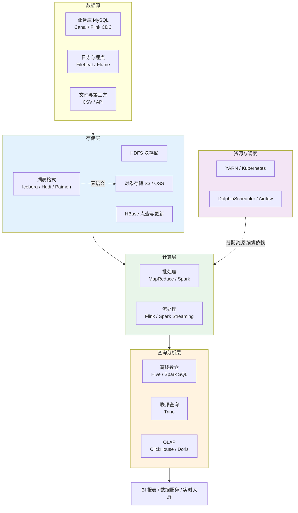
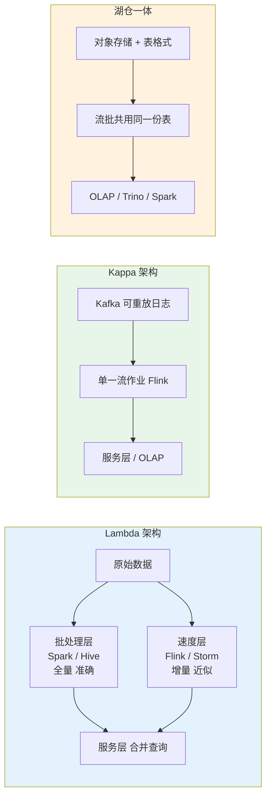
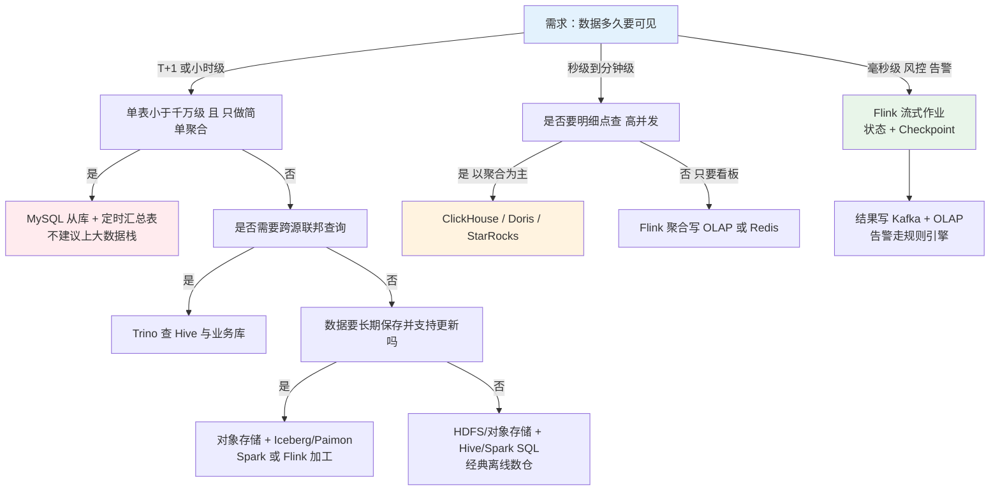

# Java 大数据技术全景

> 定位：当业务要「近 30 天各渠道 GMV 按小时趋势」「下单后 3 秒内判断刷单」「实时大屏」时，MySQL 加索引已经救不了你。这篇从 Java 工程师视角画一张全景图：每层有什么组件、各自解决什么问题、Lambda 与 Kappa 怎么演进、选型决策树怎么走，以及什么团队根本不该上大数据。

## 一、为什么需要它

三个真实需求，几乎覆盖了后端工程师被迫接触大数据的全部入口：

1. **运营要报表**：订单表 8000 万行，`GROUP BY` 一跑线上库 CPU 打满，DBA 直接找上门。OLAP 要扫大量行做聚合，和 OLTP 的点查模型天然冲突，不是加索引能解决的。
2. **风控要时效**：下单后 3 秒内判断刷单，要消费订单消息、关联近 7 天行为、滚动窗口统计，T+1 的离线任务根本来不及。
3. **老板要大屏**：GMV、支付成功率秒级刷新，且不能压业务库。

三类需求对应三类难题：

| 难题 | 本质 | 技术方向 |
|---|---|---|
| 单机装不下 | 要水平扩展的存储与并行计算 | HDFS/对象存储 + Spark |
| 计算是「扫全量做聚合」 | 要列存、向量化、分区裁剪 | Hive/Spark SQL/ClickHouse |
| 数据要秒级可见 | 要常驻作业与状态管理 | Kafka + Flink |

对 Java 工程师，门槛不在「会不会写 SQL」，而在三件事：**知道每个组件解决什么问题、边界在哪**；**知道 JVM 系组件为什么这么设计**（Spark、Flink、Hive、HBase、Trino 全是 JVM 栈，OOM、GC、依赖冲突只是换了名字）；**知道生产上会怎么翻车**（小文件、倾斜、反压、状态膨胀、口径不一致）。

后续四篇分别深入 [HDFS 与 MapReduce](02-HDFS与MapReduce原理.md)、[Hive 与 Spark SQL](03-Hive与Spark-SQL数仓开发.md)、[Spark 核心原理与调优](04-Spark核心原理与调优.md)、[Flink 流式计算与状态管理](05-Flink流式计算与状态管理.md)。版本基线：Hadoop 3.x、Spark 3.5、Flink 1.18/1.19、Hive 3.x。

## 二、核心原理

### 2.1 全景图：五层加一个数据湖

按职责只有五层：**存储、计算、查询、消息、调度**；近五年新增的第六块是**数据湖表格式**，横跨存储与计算，负责给对象存储补上「表」的语义。



读图要点：**存算分离是主线**——HDFS 时代存算一体，现在主流是对象存储加弹性计算，成本与弹性更好，代价是 list/rename 变慢；**计算层只有批和流两种模型**，所有引擎的差异最终都能归到这两类或其混合（微批、流批一体）。

### 2.2 存储层：先问访问模式，再问快慢

| 存储 | 数据模型 | 访问模式 | 强项 | 弱项 |
|---|---|---|---|---|
| **HDFS** | 文件（块 128MB、默认 3 副本） | 顺序读、追加写 | 高吞吐、便宜、成熟 | 不支持随机写、元数据受 NameNode 内存限制、小文件差 |
| **对象存储** | 对象（Key-Value） | GET/PUT、前缀列举 | 无限容量、按量付费、存算分离 | list/rename 慢、按请求计费、无目录语义 |
| **HBase** | 稀疏有序表（LSM） | 按 rowkey 点查、范围扫 | 百万级点查、随机写、可更新 | 非 rowkey 条件差、全表扫描慢、运维重 |
| **湖表格式** | 表（快照 + 元数据文件） | 批读、流读、增量读 | ACID、时间旅行、schema 演进 | 依赖引擎适配、需 compaction |

三个容易踩的认知：**HDFS 不是数据库**，没有索引、不能改文件中间的内容，只适合一次写多次读；**HBase 的全表扫描很慢**，擅长的是给定 rowkey 拿一行，复杂条件报表该换列存（rowkey 设计见 [NoSQL 选型：MongoDB 与 HBase](../07-数据库体系/08-NoSQL选型-MongoDB与HBase.md)）；**对象存储上直接堆 parquet 不叫数据湖**，没有表格式就没有原子提交，任务失败会留下半份脏数据。

### 2.3 计算层：MapReduce、Spark、Flink 的三角关系

| 维度 | MapReduce | Spark | Flink |
|---|---|---|---|
| 模型 | 两阶段 Map/Reduce，中间落盘 | DAG + 内存迭代 | 流式算子图，批是流特例 |
| 延迟 | 分钟级 | 秒到分钟级 | 毫秒到秒级 |
| 容错 | 任务重跑 | 血统重算 + checkpoint | Checkpoint，Exactly-Once |
| 状态 | 无 | 有界，靠外部存储 | 一等公民，大状态 |
| 今天的位置 | 教学与遗留系统 | 离线批处理与 SQL 主力 | 实时链路事实标准 |

**Spark 快不是因为「内存计算」四个字**，而是把多个 MapReduce 作业合并成一个 DAG，减少中间落盘与任务启动开销，并用线程级并行替代进程级并行。这个结论在 [Spark 核心原理与调优](04-Spark核心原理与调优.md) 里会拆到 Stage 与 Shuffle 级别。

### 2.4 查询层：三种引擎不是互相替代

| 引擎 | 存数据 | 擅长 | 不擅长 | 典型用法 |
|---|---|---|---|---|
| **Hive** | 否 | 超大数据离线 ETL、T+1 报表 | 交互式查询、高并发点查 | 数仓分层加工，凌晨跑批 |
| **Trino** | 否 | 跨源联邦查询、ad-hoc 探索 | 超大 Shuffle、内存易 OOM | 分析师临时查数、跨库关联 |
| **ClickHouse** | 是 | 单表大宽表聚合、日志分析 | 复杂 Join、高频更新 | 实时大屏、行为分析 |
| **Doris/StarRocks** | 是 | 多表 Join、明细聚合混合、主键更新 | 超大规模离线 ETL | 实时数仓服务层 |

记法：**Hive 是加工厂，Trino 是万能查询窗口，ClickHouse/Doris 是零售柜台**。加工厂把原始数据做成宽表，柜台让很多人快速查结果，窗口负责临时跨库看。

### 2.5 消息与调度：被低估的两层

Kafka 的分区、副本、ISR 在 [Kafka 架构与原理](../08-缓存与中间件/05-Kafka架构与原理.md) 已讲透。大数据场景额外关注两点：**分区数决定下游并行度上限**，**保留时长决定能不能重放历史**（Kappa 的前提）。调度则分两层，职责完全不同：

| 类别 | 组件 | 职责 |
|---|---|---|
| 资源调度 | YARN / Kubernetes | 分配 Container 或 Pod |
| 任务调度 | DolphinScheduler / Airflow / Azkaban | DAG、依赖、补数、告警 |

生产事故里，「任务失败没人知道」「补数覆盖生产表」通常出在任务调度层，而不是计算引擎。

### 2.6 数据湖：给对象存储补上「表」的语义

Iceberg、Hudi、Paimon 解决同一个问题：在廉价对象存储上，用开放格式实现数据库级别的表能力——ACID 提交、快照与时间旅行、schema 演进、增量读、隐藏分区。

| 维度 | Iceberg | Hudi | Paimon |
|---|---|---|---|
| 核心抽象 | 快照 + 元数据 + Manifest | 文件组 + 时间线 | LSM + 快照 |
| 流式写入 | 支持，偏批 | 起家于增量摄取 | 为流批一体设计，Flink 最顺 |
| 更新能力 | CoW / MoR | CoW / MoR | LSM，主键更新友好 |
| 生态 | Spark/Trino/Flink 覆盖最广 | Spark 为主 | Flink 原生，其他逐步完善 |

选型经验（以 2024—2025 生态为准）：要引擎中立、多家读同一张表，优先 **Iceberg**；以 Flink 实时入湖、频繁 upsert 为主，优先 **Paimon** 或 Hudi；已有 Hudi 存量且跑得稳，别为了「新」迁移。

### 2.7 批处理、流处理与实时数仓

| 概念 | 数据边界 | 延迟 | 计算方式 |
|---|---|---|---|
| 批处理 | 有界（一天/一小时切片） | 分钟到小时 | 一次调度跑完，资源释放 |
| 流处理 | 无界（持续到达） | 毫秒到秒 | 常驻作业，状态持续维护 |
| 实时数仓 | 无界 + 分层建模 | 秒级可见 | 流处理 + 可查询存储 |

「实时数仓」不是一个组件，而是一套架构：CDC/日志采集 → Kafka → Flink 分层加工（ODS/DWD/DWS）→ 写 OLAP 或湖表 → BI 查询。

### 2.8 架构演进：Lambda → Kappa → 湖仓一体



读图要点：**Lambda 的核心矛盾是两套代码、两套口径**，批层和速度层实现同一指标，结果经常对不上；**Kappa 把批当成流的历史重放**，只维护一套代码，前提是消息能长期保留且重放速度可接受；**湖仓一体**是最现实的折中——存储只有一份，流写增量、批做重算与修正，查询引擎读同一张表。

## 三、关键机制与选型方法

### 3.1 选型决策树



读图要点：**先问时效性，再问访问模式，最后才问数据量**。绝大多数选型错误在第一步——用实时架构解决 T+1 需求（成本翻几倍），或用离线架构硬扛秒级需求（怎么调都达不到）。

### 3.2 按团队阶段选栈

| 阶段 | 数据量（量级参考） | 建议栈 |
|---|---|---|
| 起步 | 百万到千万行 | MySQL 只读从库 + 定时汇总表，不引入大数据组件 |
| 成长 | 千万到十亿行，报表固定 | 对象存储 + Spark SQL + Hive Metastore + DolphinScheduler |
| 实时诉求出现 | 需分钟级看板 | 批链路 + Kafka + Flink + Doris/ClickHouse，实时只做核心指标 |
| 平台化 | 多团队、多数据源 | 湖仓（Iceberg/Paimon）+ Trino + 统一元数据 + K8s 弹性 |

### 3.3 Java 侧怎么接：消费入仓骨架

Java 后端对接大数据，最常见的方式不是写 Spark 作业，而是**把业务数据可靠地送进链路**：消费 Kafka，批量写进 OLAP，手动提交位点保证不丢。

```java
public class OrderKafkaToOlap implements AutoCloseable {

    private final KafkaConsumer<String, String> consumer;
    private final Connection conn;

    public OrderKafkaToOlap(String brokers, String jdbcUrl) throws Exception {
        Properties props = new Properties();
        props.put(ConsumerConfig.BOOTSTRAP_SERVERS_CONFIG, brokers);
        props.put(ConsumerConfig.GROUP_ID_CONFIG, "order-to-dw");
        props.put(ConsumerConfig.KEY_DESERIALIZER_CLASS_CONFIG,
                StringDeserializer.class.getName());
        props.put(ConsumerConfig.VALUE_DESERIALIZER_CLASS_CONFIG,
                StringDeserializer.class.getName());
        props.put(ConsumerConfig.ENABLE_AUTO_COMMIT_CONFIG, "false");
        props.put(ConsumerConfig.MAX_POLL_RECORDS_CONFIG, "500");
        this.consumer = new KafkaConsumer<>(props);
        this.conn = DriverManager.getConnection(jdbcUrl);
        this.conn.setAutoCommit(false);
        consumer.subscribe(List.of("order_binlog"));
    }

    public void run() {
        String sql = "INSERT INTO dwd_order(order_id, user_id, amount, ts) VALUES(?,?,?,?)";
        try (PreparedStatement ps = conn.prepareStatement(sql)) {
            while (true) {
                ConsumerRecords<String, String> records = consumer.poll(Duration.ofMillis(500));
                if (records.isEmpty()) {
                    continue;
                }
                for (ConsumerRecord<String, String> r : records) {
                    OrderEvent e = JsonCodec.parse(r.value());
                    ps.setLong(1, e.orderId());
                    ps.setLong(2, e.userId());
                    ps.setBigDecimal(3, e.amount());
                    ps.setLong(4, e.ts());
                    ps.addBatch();
                }
                ps.executeBatch();
                conn.commit();          // 先落库
                consumer.commitSync();  // 再提交位点
            }
        } catch (Exception ex) {
            throw new IllegalStateException("入仓失败，位点未提交，重启后重放", ex);
        }
    }

    @Override
    public void close() throws Exception {
        consumer.close();
        conn.close();
    }
}
```

三个刻意的取舍：**先 commit 数据库、再 commit 位点**（中间崩溃会产生少量重复，所以目标表要有唯一键做幂等；反过来先提交位点会丢数据）；**批量有上限**（`max.poll.records=500` 控制单次处理时长，避免超过 `max.poll.interval.ms` 被踢出消费组）；**Java 服务只负责搬，不承担重计算**（关联聚合交给 Flink/Spark，扩容与排障都简单）。

离线批任务的命令行通常长这样（以 Spark 3.5 为例）：

```bash
spark-submit --master yarn --deploy-mode cluster \
  --num-executors 20 --executor-cores 4 --executor-memory 8g \
  --conf spark.sql.adaptive.enabled=true \
  --class com.example.dw.DailyGmvJob dw-jobs.jar --dt 2026-11-23
```

参数不是越大越好，`--num-executors × --executor-cores` 才是总并行度，计算公式见 [Spark 核心原理与调优](04-Spark核心原理与调优.md)。

## 四、生产坑点与排查

### 坑点 1：小文件拖垮整个集群

**现象**：一个分区目录下几十万个小文件，查询启动要几分钟，NameNode 内存持续上涨，对象存储 GET 请求费飙升。
**原因**：每个任务分区至少写一个文件，并行度 200 就是 200 个；HDFS 每个文件在 NameNode 约占 150 字节元数据（量级参考），对象存储按请求计费。
**解法**：写入前 `repartition`/`coalesce` 到「文件 128MB~512MB」为目标；开启 `hive.merge.mapfiles`、Spark 的 AQE 合并；湖表定期 `rewrite_data_files` / `compact`。

### 坑点 2：把 OLAP/数据湖当在线点查库

**现象**：大屏接口 P99 从 200ms 涨到 5s，OLAP 集群 CPU 打满，查询排队。
**原因**：每次请求都扫千万行做聚合，或按用户 ID 逐条点查湖表。列存擅长批量聚合，不擅长高频小查询；湖表点查还要解析元数据、打开文件。
**解法**：高频看板走预聚合（Flink 算好分钟级指标写结果表）；点查交给 Redis/HBase/MySQL；给 OLAP 加并发上限与超时，避免单条慢查询拖垮集群。

### 坑点 3：实时与离线口径对不上

**现象**：大屏今日 GMV 1200 万，第二天离线报表 1180 万，运营质疑数据。
**原因**：实时用处理时间、离线用事件时间；实时没去重、离线按订单号去重；实时用 HyperLogLog 近似、离线精确 `count distinct`。
**解法**：指标字典唯一（口径、时间语义、去重键、过滤条件）；实时尽量精确去重，近似必须在展示层标注；上线前做影子比对，差异超阈值告警。

### 坑点 4：补数把生产表覆盖了

**现象**：任务失败后手动重跑，把分区写成空，或写出重复数据，第二天报表翻倍。
**原因**：任务不幂等——`INSERT INTO` 没先删分区，或补数参数没带对；调度平台补数并发执行。
**解法**：统一 `INSERT OVERWRITE` 指定分区，或用湖表的 overwrite 语义；调度配置串行与依赖；关键表开快照/时间旅行，出问题回滚。

### 坑点 5：成本失控

**现象**：月末账单暴涨，对象存储请求费占一半，集群 7×24 常驻但夜间闲置。
**原因**：全量重跑代替增量；查询不带分区过滤，扫整表；小文件导致 list/GET 爆炸；常驻集群无弹性。
**解法**：所有表强制分区并在查询侧拦截无分区扫描；CDC 增量入湖；计算用 K8s 弹性或夜间集中跑批；定期 compaction 与清理过期快照。

### 坑点 6：JVM 依赖地狱

**现象**：本地正常的 Spark 作业提交后报 `NoSuchMethodError`、`ClassNotFoundException`，或 Guava/Jackson 版本冲突。
**原因**：发行包自带一整套依赖（Scala、Guava、Jackson、Netty），业务 fat jar 又打了一份不同版本，类加载顺序不同导致行为不一致。
**解法**：引擎提供的依赖一律 `provided`；用 `maven-shade-plugin` 重定位易冲突包；对齐 Scala 版本（Spark 3.x 常用 2.12/2.13）；慎用 `userClassPathFirst`。

## 五、调优、选型与最佳实践

### 5.1 选型自检表

| 问题 | 如果「是」 | 建议 |
|---|---|---|
| 数据量千万行以内、只有几张报表 | 是 | 别上 Hadoop，MySQL 汇总表 + BI |
| 要毫秒级响应且查询模式固定 | 是 | Redis / 预聚合结果表 |
| 要频繁按主键更新明细 | 是 | HBase / Doris 主键模型 / Paimon |
| 要跨 MySQL、Hive、ES 联合查询 | 是 | Trino，而不是把数据搬一起 |
| 实时指标少于 20 个、团队无流经验 | 是 | 先做分钟级微批，别直接上大状态作业 |
| 数据存 5 年以上、很少访问 | 是 | 对象存储归档层 + 湖表 |

### 5.2 学习与落地路线

**第一阶段（1~2 周）跑通 SQL 数仓**：理解分区表、列存、`INSERT OVERWRITE`、调度依赖，能独立完成 ODS→DWD→ADS 一条链路。**第二阶段（2~4 周）理解执行细节**：读 Spark 的 Stage/Shuffle/AQE，看懂 UI 里的 skew、spill、GC 时间，能解释某任务为什么跑 3 小时（量级参考）并优化到 30 分钟量级。**第三阶段（1~2 月）上实时**：学事件时间、水位线、状态、Checkpoint，先做「订单实时统计」，再考虑维表 Join 与 Exactly-Once 落库，目标是稳定跑一周不重启。

### 5.3 什么团队不该上大数据

这段比选型表更重要，**错误的「上大数据」决策成本极高**：

- **数据量没到**：单表不到千万行、报表不超过 20 张，MySQL 从库 + 汇总表 + BI 完全够用。
- **需求是一次性的**：探索性分析用 pandas 或直接连从库更划算。
- **没有专人、也没有治理意愿**：元数据、权限、调度、存储清理、版本升级都要人力，没有 1~2 个专职平台工程师，集群半年内会变成「没人敢动的黑盒」；没有指标字典和数据 owner，上再好的引擎也只会产出更多互相矛盾的数字。
- **实时要求其实是分钟级**：微批或定时聚合就能满足，不必上 Flink 大状态作业。

## 六、面试高频问法

**Q1：画一下你理解的大数据技术栈，各层解决什么问题？**

**一句话结论**：分五层——存储（HDFS/对象存储/HBase）、计算（MR/Spark/Flink）、查询（Hive/Trino/OLAP）、消息（Kafka）、调度（YARN/K8s + DolphinScheduler），外加横跨存储与计算的数据湖表格式。

展开：存储解决「海量数据低成本可靠放下」，计算解决「批/流把数据算出来」，查询解决「用 SQL 高效问数据」，消息解决「解耦与重放」，调度解决「何时跑、在哪跑」。每层的关键取舍依次是：吞吐 vs 随机读写 vs 成本、延迟 vs 吞吐 vs 状态规模、扫描量 vs 并发 vs Join 能力、吞吐 vs 延迟 vs 语义、弹性 vs 稳定性。

加分点：点出「存算分离是近五年主线，对象存储 + 湖表 + 弹性计算替代了存算一体集群」，并说明代价是元数据操作变慢、需要 compaction。

**Q2：批处理和流处理的本质区别是什么？为什么流处理更难？**

**一句话结论**：批处理面对**有界数据**，跑完释放，失败重跑整个切片即可；流处理面对**无界数据**，必须常驻、维护状态、处理乱序与 Exactly-Once，难在「状态 + 时间 + 故障恢复」。

展开：**状态**跨事件记住「过去发生了什么」，可能到 TB 级，需要 RocksDB 与增量 checkpoint；**时间**上事件时间与处理时间不一致，靠水位线处理乱序与迟到数据；**恢复**时要能从 checkpoint 续跑，且不重复写下游（两阶段提交）。

加分点：说出「批是流的特例」——Flink 用有界流处理批，Spark 用微批模拟流，两家从不同方向收敛到流批一体。

**Q3：Lambda 和 Kappa 架构怎么选？**

**一句话结论**：Lambda 用批层保准确、速度层保实时，但两套代码两套口径；Kappa 只保留流链路、靠消息重放处理历史，代码一套但依赖保留时长与重放能力。今天更现实的选择是湖仓一体——一份存储，流写增量、批做修正。

展开：

| 维度 | Lambda | Kappa |
|---|---|---|
| 代码 | 两套 | 一套 |
| 口径 | 容易不一致 | 天然一致 |
| 历史重算 | 批层重跑 | 依赖 Kafka 保留/分层存储重放 |
| 运维 | 高（两套链路） | 中（大状态作业难） |
| 适合 | 批逻辑复杂 + 实时并存 | 实时为主、逻辑可用流表达 |

加分点：指出 Kappa 的隐含前提——消息存得够久、重放速度满足 SLA；如果历史在对象存储而非 Kafka 里，纯 Kappa 跑不通，湖仓更现实。

**Q4：数据湖和数据仓库有什么区别？Iceberg 解决了什么？**

**一句话结论**：数仓是 Schema 先行的封闭系统，数据湖是开放格式的低成本存储；Iceberg 在文件之上加了一层表元数据，补齐 ACID、快照隔离、schema 演进与增量读，让湖有了仓的能力。

展开：纯 Hive 表提交不是原子的（失败留下半份文件）、改 schema 要重写、没有快照、分区靠目录（分区爆炸）。Iceberg 每次提交生成新 metadata，manifest 记录「快照包含哪些文件」，用原子替换指针完成提交，于是有了时间旅行、可回滚、隐藏分区、多引擎同读一张表。

加分点：强调「湖表不是银弹」——它把复杂度从文件管理转移到 compaction 与元数据维护，不定期运维，小文件照样拖慢查询。

**Q5：HDFS 和对象存储怎么选？**

**一句话结论**：HDFS 适合存算一体、高吞吐顺序读写、能接受三副本成本；对象存储适合存算分离、容量近乎无限、成本低，代价是 list/rename 慢、按请求计费、没有真正目录。

展开：HDFS 扩展受 NameNode 与集群规模限制，三副本约 3 倍存储成本，但元数据操作快、有数据本地性；对象存储按量计费可分层归档，计算需拉取数据、靠高带宽弥补。

加分点：说出「对象存储的 rename 是 copy+delete 的伪操作」——这正是 Iceberg/Paimon 用元数据文件而非目录组织表的原因，也解释了 Hive 在对象存储上重命名分区为什么慢。

**Q6：Trino、ClickHouse、Doris 怎么选？**

**一句话结论**：Trino 是查询层（不存数据、擅长联邦与 ad-hoc），ClickHouse 是单表聚合之王（列存、宽表、日志），Doris/StarRocks 是带存储的 MPP（多表 Join 与更新更均衡）。

展开：数据分散在 MySQL/Hive/ES、要临时关联选 Trino；单表几十亿行、固定聚合指标、极高 QPS 选 ClickHouse；实时数仓服务层、要多表 Join 和主键更新选 Doris/StarRocks；超大规模离线 ETL 用 Spark，以上都不合适。

加分点：提醒「ClickHouse 的 Join 能力弱、更新代价高，不要拿它做需要频繁 upsert 的明细层」——这是最常见的误用。

**Q7：Spark 为什么比 MapReduce 快？**

**一句话结论**：不是「内存」两个字，而是用 DAG 把多个作业合并、减少中间落盘与任务启动开销，加上线程级并行、更好的执行计划与代码生成；内存只是让 shuffle 与缓存更高效。

展开：MR 每个作业只有两阶段，复杂逻辑要串多个作业，每段结果落 HDFS；Spark 编成 DAG，窄依赖流水线执行，只有宽依赖才 shuffle；任务以线程调度，启动开销远小于 MR 的 JVM 进程，Tungsten 做堆外内存与全阶段代码生成。

加分点：补充「Spark 在超大 Shuffle、超稳定批处理上并不总优于精心调优的 MR/Tez，优势主要在迭代计算与多阶段 DAG」。

**Q8：为什么小文件是大数据里的「癌症」？**

**一句话结论**：小文件让**元数据膨胀**（NameNode 内存、对象存储请求数）和**任务碎片化**（每个文件一个 split/task，启动开销淹没计算），读写两头都受伤。

展开：HDFS 每个文件、目录、块在 NameNode 占约 150 字节（量级参考），一亿小文件就是十几 GB 堆内存；每个小文件可能对应一个 task，启动与调度开销远大于读几 KB 的时间；对象存储每次 GET/LIST 都计费。

加分点：给出治理闭环——写入端控并行度、定期 compaction、湖表 rewrite、查询端避免全分区扫描，而不是只说「合并一下」。

**Q9：什么情况下你会建议团队不要上大数据？**

**一句话结论**：数据量没到、需求一次性、没有专职运维、实时要求其实是分钟级、组织没有治理意愿——这五种情况上大数据都是负收益。

展开：一套最小可用栈也要 5~10 台机器或等量云资源，外加 1~2 个专职人力；元数据、权限、调度、存储治理、版本升级每一块都能吃掉团队精力；替代方案是 MySQL 从库 + 汇总表、ClickHouse 单机、云托管数仓。

加分点：用「选型先算总拥有成本（TCO），而不是先比功能列表」收尾，并接到 [技术选型方法论](../11-架构设计能力/05-技术选型方法论.md)。

**Q10：实时数仓怎么保证和离线口径一致？**

**一句话结论**：指标定义唯一 + 时间语义统一 + 去重键统一 + 上线前影子比对，四件事缺一不可；湖仓一体能减少链路分裂，但不能替代口径治理。

展开：建指标字典写清过滤条件、去重键、时间字段、是否近似；实时与离线统一用事件时间并约定迟到数据策略；实时用状态或 `ROW_NUMBER` 精确去重；每天跑对账任务，差异率超阈值告警。

加分点：指出「口径问题本质是组织问题」——没有数据 owner 与指标评审，换任何引擎都会对不上。

## 小结

- 技术栈按职责分五层：存储、计算、查询、消息、调度；数据湖表格式横跨存储与计算，给对象存储补上表语义。
- 选型顺序是「时效性 → 访问模式 → 数据量」，不是先比性能。
- 批面向有界数据、流面向无界数据；流处理的难点在状态、时间语义与故障恢复。
- Lambda 的问题在两套口径，Kappa 的前提是消息可重放，湖仓一体是当前最现实的折中。
- 小文件、倾斜、口径不一致、成本失控、依赖冲突是五类高频事故，治理要落在写入端与调度层。
