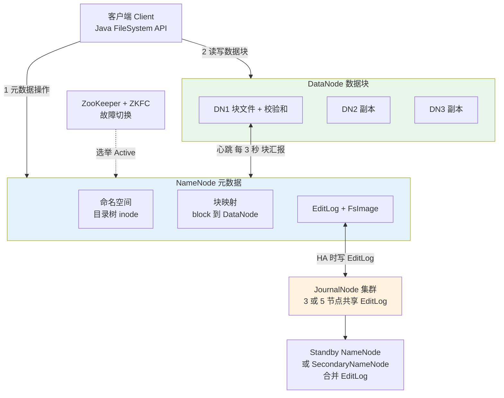
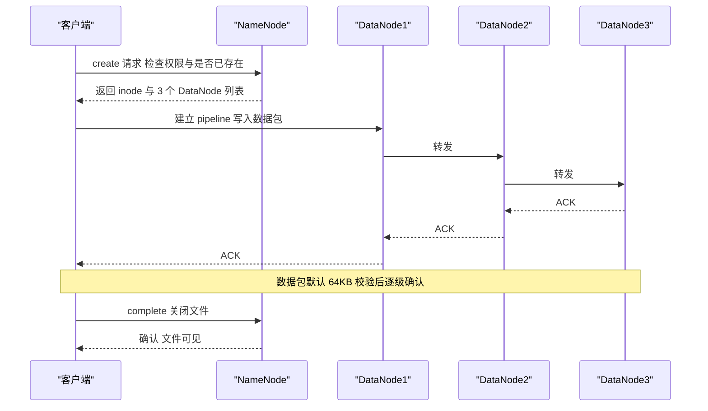
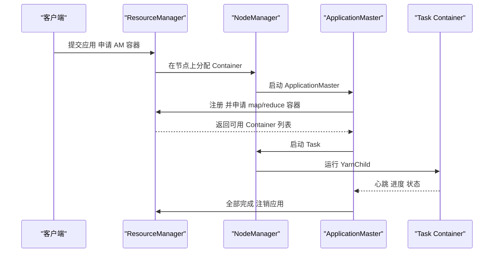

# HDFS 与 MapReduce 原理

> 定位：HDFS 和 MapReduce 是「过时但绕不开」的那一层——今天你写的是 Spark SQL 和 Flink，可数据还是落在 HDFS/对象存储上，离线任务还是在 YARN 上跑。这篇从 Java 工程师视角拆开这三块：HDFS 的读写管线与 NameNode 内存账、MapReduce 的 shuffle 细节、YARN 的资源模型，最后给出一个能跑的 WordCount 和 6 个生产坑点。

## 一、为什么需要它

场景很典型：你接手了一个离线数仓，凌晨任务大面积超时。打开集群监控发现：

- NameNode 堆内存常年在 90% 以上，每周要重启一次，重启后进入 safe mode 半小时；
- 一个分区目录里躺着 30 万个小文件，`hadoop fs -ls` 要跑几十秒；
- 某个 Reduce 任务卡在 99%，其他 199 个早跑完了，数据倾斜；
- 有人把 `mapreduce.map.speculative` 打开后，下游 MySQL 里出现重复数据。

这些问题都不是 Spark SQL 语法问题，而是 **HDFS 的元数据账、MapReduce 的执行模型、YARN 的资源调度**没算明白。你不需要会运维 Hadoop，但必须能回答四个问题：一个文件写进 HDFS 经过哪些步骤、哪一步失败会留下什么状态？NameNode 内存能撑多少文件、为什么小文件是「癌症」？Shuffle 为什么慢、环形缓冲区/溢写/归并各自解决什么？YARN 怎么把一个作业拆成 Container 跑起来？

这篇就回答这四类问题。全景位置见 [Java 大数据技术全景](01-Java大数据技术全景.md)。

## 二、核心原理

### 2.1 HDFS 架构：三个角色和一份元数据

HDFS 是「一个 NameNode + 多个 DataNode」的主从架构，Hadoop 3.x 生产环境通常是 HA（双 NameNode + JournalNode 集群）。



读图要点：**客户端只跟 NameNode 谈元数据，数据流直接跟 DataNode 走**，这是 HDFS 能线性扩展的关键；NameNode 内存里只有「目录树 + 块映射」，没有真实数据，所以它既是性能瓶颈，也是单点（HA 后是脑裂风险点）。

| 角色 | 存什么 | 关键行为 |
|---|---|---|
| **NameNode** | 命名空间、inode、块到 DataNode 的映射、EditLog/FsImage | 处理元数据请求；不存数据；内存受限 |
| **DataNode** | 数据块文件 + `.meta` 校验和 | 每 3 秒心跳、定期块汇报、参与读写管线 |
| **SecondaryNameNode** | 不是备胎 | 定期把 FsImage 与 EditLog 合并（checkpoint），降低 NN 重启耗时 |
| **Standby NameNode + JournalNode** | HA 方案 | 共享 EditLog，ZKFC 检测故障并切换 |

### 2.2 块、副本与机架感知

HDFS 把文件切成固定大小的块，Hadoop 3.x 默认 **128MB**（`dfs.blocksize`），每个块默认 **3 副本**（`dfs.replication`）。

块大的原因：**降低 NameNode 元数据量、减少寻址开销、让磁盘顺序读更充分**。块太小，元数据爆炸；块太大，最后一个块浪费、并行度不足、单点故障恢复慢。

副本放置策略（机架感知，`BlockPlacementPolicyDefault`）：第一份放在**写入端所在节点**（客户端在集群外则随机挑一个不太满的节点），第二份放在**另一个机架**的随机节点，第三份放在**第二份同机架的另一个节点**，更多副本在集群内随机但控制单机架副本数。这样能容忍「整个机架掉电」——两个副本在同一机架、一个在另一机架，仍有一份可用；代价是跨机架写入的网络开销，HDFS 写吞吐受机架带宽影响。

### 2.3 读流程：就近、校验、失败换副本

1. 客户端 `FileSystem.open(path)`，向 NameNode 请求**块位置列表**（按机架距离排序）。
2. 对每个块选择**最近的 DataNode**（同节点 > 同机架 > 跨机架）读取，并校验 `.meta` 里的 CRC。
3. 校验失败或连接异常时**换下一个副本**重试，上报 NameNode 标记坏块；NameNode 随后触发副本复制补齐。

可选优化：**短路读（Short-Circuit Read）** 让客户端直接读本地块文件，绕过 DataNode 的 Socket，适合与计算同机的场景（`dfs.client.read.shortcircuit=true`）。

### 2.4 写流程：pipeline 与「最小副本数」



读图要点：**写入是「流水线」而不是「客户端写三份」**，客户端只连第一个 DataNode，带宽不会被副本数放大；ACK 沿 pipeline 反向回传，任何一级失败都会重建 pipeline，并把失败节点从管线中移除。

关键细节：

- **数据包（packet）默认 64KB**，附带校验和；ACK 批量回传，不是每个包一个 RTT。
- **最小副本数** `dfs.namenode.replication.min` 默认 1：只要一个副本写成功，`complete` 就能成功，其余由后台异步补齐——这解释了「文件刚写完时副本数不是 3」。
- **租约（Lease）** 由客户端定期续约，崩溃后要等超时才回收，期间文件不可追加；`hflush` 保证数据对读者可见，`hsync` 还要求落盘，很多「写完立刻读不到」是只 `write` 没 `hflush`。

### 2.5 NameNode 内存账与小文件

NameNode 把整个命名空间放在堆里：每个文件、目录、块大约占 **150 字节**（量级参考，随版本与对象类型浮动）。粗算：

| 场景 | 对象数（量级参考） | NameNode 堆需求（量级参考） |
|---|---|---|
| 100 万个 128MB 文件 | 100 万文件 + 100 万块 | 数百 MB |
| 1 亿个小文件（平均 1MB） | 1 亿文件 + 1 亿块 | 数十 GB |
| 同样 100TB 数据，用 128MB 块 | 约 80 万块 | 数百 MB |

同样 100TB 数据，**文件数差 100 倍，NameNode 内存就差两个数量级**。这就是小文件问题的本质：不是「读得慢」那么简单，而是元数据先把 NameNode 压垮。

小文件的四重伤害：**NameNode 内存**（对象数暴涨、GC 变长、重启恢复慢）、**计算效率**（一个小文件就是一个 map task，启动开销远大于读几 KB）、**对象存储成本**（每次 GET/LIST 都计费）、**写入放大**（每个文件一次 create/complete 元数据事务，EditLog 膨胀）。治理按优先级：源头控并行度（`coalesce/repartition` 到 128MB~512MB）、合并存量（Hive CONCATENATE、`hive.merge.*`、`spark.sql.files.maxRecordsPerFile`）、归档（HAR，读时解包）、换存储模型（对象存储 + 湖表，用元数据文件管理数据文件并支持 compaction）。

### 2.6 NameNode 的扩展：HA 与联邦

- **HA（高可用）**：Active/Standby 两个 NameNode 共享 JournalNode 上的 EditLog，DataNode 同时向两者汇报。ZKFC 通过 ZooKeeper 抢锁，Active 挂掉后 Standby 接管，切换在几十秒量级，客户端靠重试与 `dfs.client.failover` 兜底。
- **联邦（Federation）**：多个独立 Namespace（各自有 NameNode 与 BlockPool），共用一批 DataNode。它解决「单 NN 内存上限」，不解决「单 NN 故障」——每个 NN 仍要自己做 HA；ViewFs 在联邦之上提供统一挂载视图。

选型判断：**对象数在几亿以内、单集群可控，HA 就够；到十亿级、多业务隔离诉求强，才考虑联邦**。更彻底的是存算分离（对象存储 + 湖表），把元数据压力转移出去。

### 2.7 MapReduce 编程模型：只有两个阶段

MapReduce 的模型极简：`map(K1,V1) -> list(K2,V2)`，`reduce(K2, list(V2)) -> list(K3,V3)`。所有复杂逻辑都要拆成这两步，中间由框架完成「分组 + 排序 + 传输」，也就是 shuffle。


读图要点：**Map 的输出不直接给 Reduce，而是先落本地磁盘再被拉取**——这是 MapReduce 慢的根源，也是 Spark 用 DAG 减少落盘的动机；`Combiner` 只在溢写和归并时「可能」执行，不能假设它一定跑。

几个必须记住的规则：**map 数由分片数决定**，`splitSize = max(minSize, min(maxSize, blockSize))` 默认等于块大小，所以「一个块一个 map」；**reduce 数由 `setNumReduceTasks` 决定**，不是自动推导，过多→小文件多、过少→单任务倾斜放大；**Combiner 必须满足结合律与交换律**（求和可以、求平均值不行），且框架不保证调用次数；**Partitioner 决定 key 去哪个 reduce**，默认 `HashPartitioner`，同时决定输出文件划分。

### 2.8 Shuffle 细节：缓冲区、溢写、归并

Map 端四步：map 输出先写入**环形缓冲区**（`mapreduce.task.io.sort.mb`，默认 100MB），同时记录分区号与排序索引；达到阈值（`mapreduce.map.sort.spill.percent`，默认 0.8）后后台线程**按分区排序溢写**到本地磁盘，溢写时可执行 Combiner、可压缩；溢写期间 map 继续写剩余 20% 空间，写满则阻塞——**这就是「map 端磁盘慢会拖累整个 map」的原因**；所有溢写文件做**多路归并**（`mapreduce.task.io.sort.factor`，默认 10），生成分区有序的最终文件。

Reduce 端三步：通过 HTTP **拉取自己分区的数据**（`mapreduce.shuffle.port`，默认 13562）；先写内存缓冲，超阈值溢写磁盘；多路归并后按 key 分组，逐个调用 `reduce()`。

慢在**磁盘 IO + 网络传输 + 排序**，优化方向只有三个：减少数据量（提前过滤、Combiner、压缩）、减少落盘（Spark 的 pipeline）、均衡分区（自定义 Partitioner 或 AQE）。

### 2.9 YARN 资源模型



读图要点：**RM 只管资源分配，不关心任务逻辑；AM 是每个作业自己的「调度器」**，负责申请容器、监控任务、失败重试；真正跑任务的是 NM 上的 Container（JVM 进程）。这三层解耦让 YARN 能同时跑 MapReduce、Spark、Flink。

| 组件 | 职责 | 关键点 |
|---|---|---|
| ResourceManager | 全局资源调度 | 有单点问题，生产要 HA |
| NodeManager | 单节点资源与容器管理 | 上报 CPU/内存，监控容器 |
| ApplicationMaster | 单个应用的调度与容错 | 与 RM 协商资源，与 NM 启动任务 |
| Container | 资源抽象（内存 + vCore） | 不是虚拟机，是一个受控进程 |

调度器（Scheduler）常见三种：**FIFO**（单队列，已少用）、**Capacity**（多队列按比例分配，Hadoop 默认生态常用）、**Fair**（按需动态分配，适合多用户共享）。

## 三、关键机制与参数

### 3.1 HDFS 关键参数

| 参数 | 默认值 | 说明 |
|---|---|---|
| `dfs.blocksize` | 128MB | 块大小，大文件场景可调到 256MB |
| `dfs.replication` | 3 | 副本数，跨机架容灾的最小配置 |
| `dfs.namenode.replication.min` | 1 | 写入成功所需最小副本数，其余异步补齐 |
| `dfs.datanode.du.reserved` | 0 | 每块盘预留空间，防止磁盘写满导致 DN 异常 |
| `dfs.namenode.checkpoint.period` | 3600s | SNN/Standby 合并 EditLog 的周期 |
| `dfs.client.read.shortcircuit` | false | 短路读，本地读免 Socket |
| `dfs.namenode.handler.count` | 10（随规模调大） | NN 处理 RPC 的线程数 |

### 3.2 WordCount：一个完整可跑的 Java 作业

```java
import org.apache.hadoop.conf.Configuration;
import org.apache.hadoop.fs.Path;
import org.apache.hadoop.io.*;
import org.apache.hadoop.mapreduce.*;
import org.apache.hadoop.mapreduce.lib.input.FileInputFormat;
import org.apache.hadoop.mapreduce.lib.output.FileOutputFormat;

import java.io.IOException;
import java.util.StringTokenizer;

public class WordCount {

    /** KEYIN 行偏移量，VALUEIN 一行文本；KEYOUT 单词，VALUEOUT 计数 1 */
    public static class TokenizerMapper
            extends Mapper<Object, Text, Text, IntWritable> {

        private static final IntWritable ONE = new IntWritable(1);
        private final Text word = new Text();

        @Override
        protected void map(Object key, Text value, Context context)
                throws IOException, InterruptedException {
            StringTokenizer itr = new StringTokenizer(value.toString());
            while (itr.hasMoreTokens()) {
                word.set(itr.nextToken());
                context.write(word, ONE);
            }
        }
    }

    public static class IntSumReducer
            extends Reducer<Text, IntWritable, Text, IntWritable> {

        private final IntWritable result = new IntWritable();

        @Override
        protected void reduce(Text key, Iterable<IntWritable> values, Context context)
                throws IOException, InterruptedException {
            int sum = 0;
            for (IntWritable v : values) {
                sum += v.get();
            }
            result.set(sum);
            context.write(key, result);
        }
    }

    public static void main(String[] args) throws Exception {
        Configuration conf = new Configuration();
        Job job = Job.getInstance(conf, "word count");
        job.setJarByClass(WordCount.class);

        job.setMapperClass(TokenizerMapper.class);
        // Combiner 与 Reducer 同类型时可直接复用，减少 shuffle 数据量
        job.setCombinerClass(IntSumReducer.class);
        job.setReducerClass(IntSumReducer.class);
        job.setOutputKeyClass(Text.class);
        job.setOutputValueClass(IntWritable.class);
        job.setNumReduceTasks(2);          // reduce 数要显式指定，输出文件数等于它

        FileInputFormat.addInputPath(job, new Path(args[0]));
        FileOutputFormat.setOutputPath(job, new Path(args[1]));
        System.exit(job.waitForCompletion(true) ? 0 : 1);
    }
}
```

这段代码对应三个可观察点：`TokenizerMapper` 里的 `word` 对象被复用（避免每条记录 new 一个），`Combiner` 直接复用 Reducer（因为求和满足结合律），`setNumReduceTasks(2)` 决定了输出是两个 `part-r-00000` 文件——**输出文件数永远等于 reducer 数**。

提交与观察：

```bash
hadoop jar wc.jar WordCount /input/words /output/wc
hdfs dfs -cat /output/wc/part-r-00000
yarn application -list
```

### 3.3 默认 Partitioner 的边界

`HashPartitioner` 只做 `hashCode % numReduceTasks`，不感知数据量与热点。按省份聚合而「广东」占 40% 数据时，可给热点 key 加随机后缀打散到多个分区，下游二次聚合——这就是「加盐」，代价是必须多跑一次合并。

## 四、生产坑点与排查

### 坑点 1：小文件把 NameNode 逼进 safe mode

**现象**：集群重启后 NameNode 长时间处于 safe mode，`hdfs dfsadmin -safemode get` 显示等待块汇报；日常 RPC 延迟变高，GC 日志里 Full GC 频繁。
**原因**：海量小文件让 NN 堆中对象数暴涨，块汇报与元数据加载变慢；重启后要等足够比例的块被汇报才退出 safe mode。
**解法**：先合并小文件（Hive CONCATENATE、Spark coalesce、湖表 compaction）；限制写入并行度；必要时扩容 NN 堆并做联邦/存算分离；日常监控 `NameNode` 的 `FilesTotal`、`BlocksTotal` 与堆使用率。

### 坑点 2：数据倾斜，一个 Reduce 跑一天

**现象**：199 个 reduce 半小时完成，最后一个跑了 6 小时，`reduce` 阶段卡在 99%。
**原因**：某个 key 的数据量远超其他（如默认值 `null`、大客户 ID），HashPartitioner 把它全部分到一个分区。
**解法**：先确认倾斜 key（采样统计 top N）；能过滤的脏数据先过滤；用加盐 + 二次聚合；开启 Combiner 降低传输；改用 Spark 并用 AQE 的 `skewedJoin` 处理。

### 坑点 3：speculative execution 导致重复写入

**现象**：开启推测执行后，下游 MySQL 出现重复记录，或者输出目录里出现 `_1`、`_2` 冲突文件。
**原因**：推测执行会为慢任务启动备份，**两个 attempt 可能都成功**，框架只保留一个的输出；但任务内部若有副作用（写数据库、调接口），副作用会执行两次。
**解法**：写外部系统必须幂等（唯一键、upsert、事务）；对非幂等作业关闭推测执行（`mapreduce.map.speculative=false`、`mapreduce.reduce.speculative=false`）；输出到 HDFS 时依赖框架的 commit 协议。

### 坑点 4：DataNode 磁盘写满，块损坏

**现象**：写入报 `Could not obtain block`、`Slow BlockReceiver`，部分块进入 missing 状态。
**原因**：数据盘没有预留空间，DN 写满后无法接收新块，甚至影响心跳；`dfs.datanode.du.reserved` 默认为 0。
**解法**：每块盘配置 `dfs.datanode.du.reserved`（如 20~50GB）；用 `hdfs fsck /path -blocks -locations` 定位损坏块；坏盘及时摘除；对 HDFS 容量做水位告警（70%/85%）。

### 坑点 5：EditLog 膨胀与 SecondaryNameNode 没跑

**现象**：NameNode 重启要几十分钟，`edits_inprogress` 文件特别大；SNN 的 checkpoint 目录长期没更新。
**原因**：SNN 进程挂了或被误停，EditLog 无人合并，FsImage 陈旧，重启时要回放海量日志。
**解法**：给 SNN/Standby 配独立监控与告警；HA 环境确认 JournalNode 三节点健康；定期检查 `dfs.namenode.checkpoint.period` 与 checkpoint 目录大小；重启前先做一次手动 checkpoint（HA 下可用 `hdfs dfsadmin -saveNamespace`，需谨慎）。

### 坑点 6：客户端不关流，文件一直不可见

**现象**：程序写完文件但下游读不到，或报 `LeaseExpiredException`、`file is being created`。
**原因**：没调用 `close()`，或进程崩溃后租约未回收；也可能只调了 `write` 没 `hflush`，数据还在客户端缓冲。
**解法**：`FSDataOutputStream` 必须用 try-with-resources；需要「写完即可读」时显式 `hflush()`；租约泄漏时用 `hdfs debug recoverLease -path <file>` 恢复。

## 五、调优、选型与最佳实践

### 5.1 参数与规模对照

| 目标 | 手段 | 说明 |
|---|---|---|
| 提升大文件写吞吐 | 块 256MB、pipeline 包大小、跨机架带宽 | 块变大要权衡并行度与恢复时间 |
| 降低 NN 内存压力 | 合并小文件、联邦、存算分离 | 先治理小文件，再谈扩容 |
| 提升 map 数合理性 | 调整 `mapreduce.input.fileinputformat.split.maxsize` | 避免「一个块一个 map」在超小文件上浪费 |
| 减少 shuffle 数据 | Combiner、提前过滤、压缩（Snappy/LZO） | 压缩提升 CPU 换 IO，要评估 |
| 控制输出文件数 | `setNumReduceTasks` 与分区策略 | 输出文件数 = reducer 数 |
| 避免重复副作用 | 关闭推测执行 + 幂等设计 | 写外部系统尤其重要 |

### 5.2 什么场景不该用

- **低延迟点查**：单次读几毫秒到几十毫秒、QPS 上不去，点查用 HBase/Redis/MySQL。
- **频繁随机写/更新**：HDFS 只支持追加，改一行要重写文件。
- **海量小文件**：先治理再存，否则 NameNode 先倒。
- **跨地域共享与纯实时**：HDFS 不是多活存储，跨机房走对象存储或同步；分钟级延迟也不适合流式，用 Flink。

## 六、面试高频问法

**Q1：HDFS 的架构是什么？SecondaryNameNode 是干什么的？**

**一句话结论**：HDFS 是一主多从——NameNode 存元数据（命名空间 + 块映射），DataNode 存数据块，SecondaryNameNode 只做 EditLog 与 FsImage 的定期合并，**不是备用的 NameNode**。

展开：NameNode 内存里放目录树和块位置，不存数据；DataNode 每 3 秒心跳、定期块汇报；SNN 定期 checkpoint（默认 3600s），把 EditLog 合并进 FsImage，缩短 NN 重启时的回放时间。HA 环境用 Standby NameNode + JournalNode 共享 EditLog，配合 ZKFC 做故障切换。

加分点：主动澄清「SNN 不能故障切换，只会 checkpoint」——这是最高频的误解；再补一句「生产上基本都用 QJM 的 HA 方案，SNN 只在伪分布式/教学环境出现」。

**Q2：HDFS 的写流程是怎样的？pipeline 中某个 DataNode 挂了怎么办？**

**一句话结论**：客户端向 NN 请求创建文件并拿到 DataNode 列表，然后建立**流水线**逐级写包、逐级 ACK；中间节点失败则**重建 pipeline**（移除故障节点、申请新节点），只要满足最小副本数，`complete` 仍可成功。

展开：`create` → NN 校验权限与是否存在 → 返回副本位置 → 客户端写第一个 DN，DN 转发给下一个 → 包默认 64KB，带 CRC，ACK 反向回传 → 全部写完 `complete`。失败时客户端会从 pipeline 中剔除坏节点，用剩余节点继续，并由 NN 异步补副本。

加分点：说出「`dfs.namenode.replication.min` 默认 1，所以文件刚写完时副本数可能不足 3，后台会补齐」——这解释了「写完立刻看副本数不对」的现象。

**Q3：HDFS 的读流程？为什么说它是「就近读」？**

**一句话结论**：客户端向 NN 取块位置列表（按网络距离排序），优先读**同节点 > 同机架 > 跨机架**的副本；校验失败自动换副本，并上报坏块。

展开：`open` → `getBlockLocations` → 按距离选择 DN → 读数据并校验 CRC → 失败换下一个副本 → NN 触发副本补齐。开启短路读后，本地副本可直接读文件，绕过 Socket。

加分点：补一句「HDFS 的副本放置策略是 1 份本地/同机架 + 1 份跨机架 + 1 份同机架，目的是容忍整机架故障」，把读写两侧的机架感知串起来。

**Q4：为什么 HDFS 的块是 128MB？小文件为什么是问题？**

**一句话结论**：大块是为了**减少元数据量、降低寻址开销、提高顺序读效率**；小文件的问题在于**每个文件都占 NameNode 内存、每个文件都可能变成一个 map task**，元数据和调度两头都被放大。

展开：NN 中每个文件/目录/块约 150 字节（量级参考）；1 亿小文件就是数十 GB 堆，GC 与重启都会出问题；计算侧一个小文件一个 split，任务启动开销远大于读数据本身；对象存储上还会放大 GET/LIST 费用。

加分点：给出治理闭环「源头控并行度 → 定期合并/归档 → 湖表 compaction → 监控 FilesTotal」，而不是只说「用 HAR 打包」。

**Q5：NameNode 内存不够了怎么办？HA 和联邦分别解决什么？**

**一句话结论**：HA 解决**单点故障**（Active/Standby + JournalNode），联邦解决**单 Namespace 的内存与扩展上限**（多个 NN 各管一个 BlockPool）；两者正交，联邦里每个 NN 仍要做 HA。

展开：HA 靠共享 EditLog 与 ZKFC 切换；联邦靠 ViewFs 提供统一挂载视图，客户端按挂载点访问不同 Namespace；更彻底的做法是存算分离，把元数据压力交给对象存储与湖表。

加分点：强调「先治理小文件，再谈扩容」——很多团队 NN 内存告警的根因是每天几十万小文件，扩容只是延缓。

**Q6：MapReduce 的完整执行流程是什么？Shuffle 具体做了什么？**

**一句话结论**：InputFormat 切片 → map → 环形缓冲区（默认 100MB）→ 达 80% 溢写（分区 + 排序 + Combiner）→ 磁盘多路归并 → reduce 通过 HTTP 拉取 → 归并分组 → reduce → 输出；Shuffle 就是「分区、排序、溢写、拉取、归并」这一整套。

展开：map 数 = 分片数（默认一个块一个 map），reduce 数由 `setNumReduceTasks` 决定；溢写阈值 `mapreduce.map.sort.spill.percent`，归并因子 `mapreduce.task.io.sort.factor`；reduce 端先内存缓冲再溢写，最后归并。

加分点：指出「map 输出必须落盘再拉取，这是 MR 慢的根因，也是 Spark DAG 优化的出发点」——把两代引擎的差异讲成一条因果链。

**Q7：Combiner 和 Partitioner 的区别？Combiner 一定能执行吗？**

**一句话结论**：Combiner 是 **map 端的预聚合**，减少 shuffle 数据量；Partitioner 决定 **key 去哪个 reduce**，决定输出划分。Combiner **不保证执行**，可能 0 次、1 次或多次。

展开：Combiner 必须满足结合律与交换律（求和可以，求平均不行）；Partitioner 默认 `HashPartitioner`，热点 key 会导致倾斜，需要自定义加盐。两者都在 map 端起作用，但解决的问题完全不同。

加分点：说出「Combiner 复用 Reducer 类是个常见写法，但只在输入输出类型一致时成立」，并提醒「Combiner 里不能做有副作用的操作」。

**Q8：MapReduce 里数据倾斜怎么解决？**

**一句话结论**：先定位热点 key，再按「能过滤就过滤、能预聚合就 Combiner、必须处理就加盐两阶段聚合、换引擎就用 AQE」的顺序处理。

展开：采样统计 top N key；空值/默认值单独处理；热点 key 加随机后缀打散到多个 reduce，输出后再跑一个作业合并；或者换 Spark，用 AQE 的倾斜 Join 与 `repartition` 动态处理。

加分点：提醒「加盐会带来二次聚合成本，且不改变单个 key 的绝对数据量——如果单 key 就是 1TB，任何 shuffle 方案都难受，要从业务上拆分」。

**Q9：YARN 是怎么跑起一个作业的？**

**一句话结论**：客户端向 RM 申请 ApplicationMaster 容器 → NM 启动 AM → AM 向 RM 申请 task 容器 → 在 NM 上启动 YarnChild 进程 → 任务心跳汇报 → 完成后 AM 注销应用。

展开：RM 只管资源、不管逻辑；NM 管单节点容器；AM 是每个应用自己的调度器，负责重试与进度；Container 是「内存 + vCore」的资源抽象。调度器有 FIFO/Capacity/Fair 三种。

加分点：说明「MapReduce、Spark、Flink 都能跑在 YARN 上，正是因为 AM 这层把『应用逻辑』和『资源分配』解耦了」，顺手对比 K8s 里 Pod 承担同样角色。

**Q10：HDFS 适合存什么、不适合存什么？和对象存储怎么选？**

**一句话结论**：适合**一次写多次读的大文件、顺序扫描、批处理**；不适合**低延迟点查、频繁随机更新、海量小文件**。能接受存算分离与请求计费时，对象存储通常更划算。

展开：HDFS 有三副本成本、受 NN 内存限制，但元数据快、有数据本地性；对象存储容量近乎无限、可分层归档，但 list/rename 慢、按请求计费。

加分点：点出「对象存储的 rename 是 copy+delete」，这正是湖表用元数据管理文件的原因，与 [Java 大数据技术全景](01-Java大数据技术全景.md) 的存储选型呼应。

## 小结

- HDFS 是元数据与数据分离的主从架构：NN 管命名空间与块映射，DN 存块，SNN 只做 checkpoint，HA 靠 Standby + JournalNode。
- 写入是 pipeline 逐级转发与 ACK，最小副本数默认 1，副本由后台异步补齐；读取按机架距离就近选副本并校验。
- 小文件的本质是 NameNode 内存账：每个对象约 150 字节（量级参考），1 亿文件就是数十 GB 堆。
- MapReduce 只有 map/shuffle/reduce，shuffle 的「缓冲区 → 溢写 → 归并 → 拉取」是性能核心；Combiner 不保证执行，Partitioner 决定倾斜。
- YARN 把资源与应用解耦：RM 管资源、AM 管作业、NM 管容器，这也是 Spark/Flink 能共用一套资源池的原因。
- 六类高频事故：小文件、倾斜、推测执行重复写、磁盘写满、EditLog 膨胀、租约泄漏。
