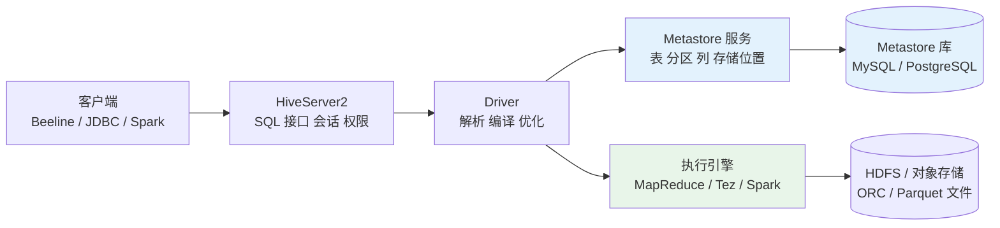
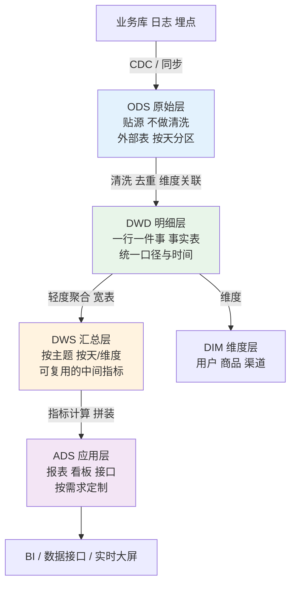
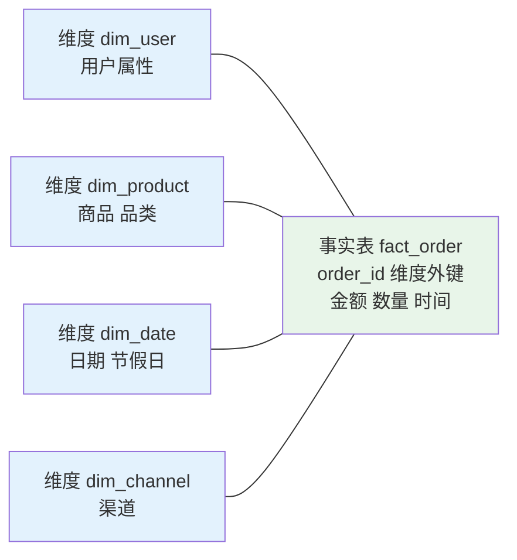
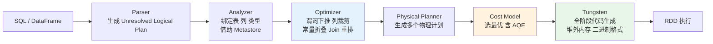

# Hive 与 Spark SQL 数仓开发

> 定位：数仓开发是 Java 工程师最容易「以为自己会」的领域——不就是写 SQL 吗？可当你把 Hive SQL 迁到 Spark 上，动态分区报错、小文件爆炸、某个 key 把任务拖到天亮，才发现两套引擎的脾气完全不同。这篇讲清 Hive 元数据与表设计、ORC/Parquet 的收益来源、ODS/DWD/DWS/ADS 分层与维度建模、Catalyst 到底做了什么，最后给出迁移清单与 6 个生产坑点。

## 一、为什么需要它

一个典型的数仓日常长这样：

- 运营问「昨天为什么 GMV 涨了 10%」，你要能拆到渠道、品类、城市，而原始数据散在订单表、支付流水、退款表里；
- 同一份「有效订单」口径，报表 A 用支付时间、报表 B 用下单时间，月底对账差了 20 万；
- 原来跑在 Hive on Tez 的 SQL，迁到 Spark 后 `INSERT OVERWRITE ... PARTITION` 报动态分区错误，或者跑得比以前还慢。

这三个问题对应三块知识：**表怎么设计**（分区、分桶、文件格式）、**数据怎么组织**（分层与维度建模）、**引擎怎么执行**（Hive 与 Spark SQL 的差异、Catalyst 优化了什么）。只会写 `select ... group by`，遇到上面任何一个都只能猜。

本篇面向「要负责一张数仓表」的 Java 后端或数据开发，版本基线为 Hive 3.x 与 Spark 3.5。集群与存储的基础见 [HDFS 与 MapReduce 原理](02-HDFS与MapReduce原理.md)，Spark 运行时内核见 [Spark 核心原理与调优](04-Spark核心原理与调优.md)。

## 二、核心原理

### 2.1 Hive 架构：Metastore 才是真正的资产

Hive 本身不存数据、也不算数据，它的价值是**一套 SQL 方言 + 一份元数据**。数据在 HDFS/对象存储上，元数据在关系库（通常是 MySQL）里。



读图要点：**Metastore 是跨引擎的契约**。Spark SQL、Trino、Flink 都能读同一张 Hive 表，靠的不是 Hive 引擎，而是它们都能连同一个 Metastore 并理解同一份文件格式。反过来说，**元数据一旦不一致**（比如有人手工 `hdfs dfs -mv` 挪了分区目录），所有引擎都会一起读错。

| 组件 | 职责 | 生产关注点 |
|---|---|---|
| HiveServer2 | 提供 JDBC/ODBC 与并发会话 | 连接数、会话内存、`hive.server2.thrift.max.worker.threads` |
| Driver | SQL 解析、编译、生成执行计划 | 编译耗时、执行计划是否合理 |
| Metastore 服务 | 表/分区/列/存储的元数据 API | 连接池、锁（并发写同一分区会冲突） |
| Metastore 库 | 持久化元数据 | 备份、版本升级、字符集 |
| 执行引擎 | 真正跑计算 | Tez/Spark/MR，决定性能上限 |

### 2.2 表类型：内部表、外部表、分区表、分桶表

| 类型 | 删除表时数据 | 适用 |
|---|---|---|
| **内部表（Managed）** | 一起删 | 数仓自己管理的中间表 |
| **外部表（External）** | 只删元数据，数据保留 | 原始数据、多引擎共享、数据不由 Hive 产生 |
| **分区表** | 按目录组织，可裁剪 | 所有大表的事实表，按 dt/region 分区 |
| **分桶表** | 按 hash 分成固定文件数 | 需要稳定 Join 或采样，但 Spark 场景已少用 |

两个实践原则：

1. **ODS 层一律用外部表**，因为原始数据是资产，不能因为一句 `drop table` 就没了；DWD 之后可以用内部表，由数仓统一生命周期管理。
2. **分区字段不要选高基数列**。按 `dt`（天）分区是标准做法；按用户 ID 或订单 ID 分区会直接产生百万级目录，就是「分区爆炸」。

分桶（`CLUSTERED BY (user_id) INTO 64 BUCKETS`）在 Hive on Tez 时代能避免 shuffle，但 Spark 对 Hive 分桶的利用有限，且分桶数一旦写入就不好改。**新项目优先用「分区 + 列存 + AQE」而不是分桶**。

### 2.3 ORC 与 Parquet：列存为什么快

两者都是列式存储，把「同一列的值连续存放」，带来三个直接收益：

- **只读需要的列**：查询 100 列里的 5 列，只读 5 列的数据。
- **压缩率高**：同类型数据连续存放，字典编码、RLE、Delta 编码更有效。
- **谓词下推**：每个文件/行组带统计信息（min/max、null 数），不满足条件的数据块直接跳过，连读都不用读。

| 维度 | ORC | Parquet |
|---|---|---|
| 出身 | Hive 生态 | Spark/Twitter 生态，事实标准更广 |
| 压缩 | ZLIB/SNAPPY/ZSTD | SNAPPY/GZIP/ZSTD |
| 索引 | 内置行组索引、Bloom Filter | 列块统计、Page 级统计 |
| 复杂类型 | 支持 Struct/List/Map | 支持，嵌套查询生态更好 |
| 建议 | Hive 为主、需要 Bloom Filter 点查 | 多引擎共享、Spark/Trino 为主 |

**谓词下推（Predicate Pushdown）** 是收益最大的一环。SQL 里的 `where dt='2026-11-23' and city='杭州'` 会被下推到存储层：先按分区目录裁剪，再用文件统计信息跳过不满足的行组。写 SQL 时把**分区字段放在最外层过滤**，是性价比最高的习惯。

### 2.4 数仓分层：ODS / DWD / DWS / ADS



读图要点：**分层的目的是「复用 + 隔离变化」**——ODS 贴源、DWD 统一口径、DWS 沉淀公共指标、ADS 面向具体报表。没有 DWS，每个报表都从明细重算一遍，口径必然分裂；有了 DWS，新报表多数时候只需在汇总层加一个指标。

| 层 | 数据特征 | 典型操作 | 常见错误 |
|---|---|---|---|
| ODS | 与源系统一致、只增不改 | 同步、补数 | 在 ODS 做业务清洗，导致源头不可回溯 |
| DWD | 明细、一行一事实、已去重 | 清洗、关联维度、脱敏 | 把聚合放在 DWD，失去明细能力 |
| DWS | 按主题/天/维度聚合 | 轻度聚合、宽表 | 指标口径不写文档，下游各自解释 |
| ADS | 面向具体应用 | 拼装、导出 | 直接让报表查 DWD，压力与口径双失控 |

### 2.5 维度建模：星型、雪花与退化维度



读图要点：**星型模型 = 一张事实表 + 一圈维度表**，事实表只存「度量 + 外键」，维度表存描述属性。它牺牲了一点存储冗余（维度不规范化），换来 Join 层数少、SQL 简单、引擎好优化。

| 模型 | 结构 | 优点 | 代价 |
|---|---|---|---|
| **星型** | 事实表 + 扁平维度 | Join 少、查询快、易理解 | 维度有冗余 |
| **雪花** | 维度再规范化成多层 | 省存储、维度一致性好 | Join 多、查询复杂 |
| **星座** | 多张事实表共享维度 | 适合多业务过程 | 一致性维度管理难 |

实践建议：**默认星型**，只在维度特别大且更新频繁时才拆雪花。`order_id` 这类「放在事实表里但不关联维度」的字段叫**退化维度**，直接留在事实表即可。

### 2.6 Spark SQL：Catalyst 与 Tungsten

Hive 把 SQL 翻译成 Tez/MR 作业；Spark SQL 则先经过 Catalyst 优化器，再生成 JVM 字节码执行。



读图要点：**Catalyst 是「规则 + 代价」两段式**——前半段用固定规则做等价变换（谓词下推、列裁剪、常量折叠），后半段按代价选物理计划（Join 顺序、广播还是 shuffle）；Tungsten 负责把执行计划变成紧凑的二进制与字节码，减少对象分配和虚函数调用。

几个能直接指导写 SQL 的结论：

- **谓词下推**：过滤条件尽量写在最内层子查询，别在最后套一层 `where` 把中间结果算完再过滤。
- **列裁剪**：`select *` 会让列存失去意义，尤其宽表。
- **Join 重排**：小表放右边、能被广播的尽量广播（`/*+ BROADCAST(t)*/` 或 AQE 自动判断）。
- **CBO 统计信息**：`ANALYZE TABLE ... COMPUTE STATISTICS` 不做，优化器只能猜，Join 顺序经常是错的。

## 三、关键机制与参数

### 3.1 Join 策略：广播、Shuffle、Sort-Merge

| 策略 | 触发条件 | 代价 | 适用 |
|---|---|---|---|
| **Broadcast Hash Join** | 小表小于 `spark.sql.autoBroadcastJoinThreshold`（默认 10MB） | 每个 executor 存一份 | 维表 Join，最常用 |
| **Shuffle Hash Join** | 一侧分区后能放进内存 | 一次 shuffle | 中等表，AQE 可自动选 |
| **Sort-Merge Join** | 两张大表 | 两次 shuffle + 排序 | 大表对大盘 |
| **Bucket Join** | 两侧同分桶 | 省 shuffle | Hive 分桶表，Spark 支持有限 |

Hive 侧的对应概念是 **MapJoin**：把小表放进每个 map 的内存做哈希连接。Hive 3 里由 `hive.auto.convert.join=true` 自动判断（阈值 `hive.auto.convert.join.noconditionaltask.size`），Spark 侧则看 `autoBroadcastJoinThreshold`。**同一个 SQL 在两套引擎里可能走完全不同的 Join 策略**，这是迁移后性能变化的常见原因。

### 3.2 动态分区与小文件控制

```sql
-- 开启动态分区，并允许非严格模式（不要求至少一个静态分区）
SET hive.exec.dynamic.partition=true;
SET hive.exec.dynamic.partition.mode=nonstrict;
-- 单任务最多创建多少分区，防止误操作产生百万分区
SET hive.exec.max.dynamic.partitions=2000;
SET hive.exec.max.dynamic.partitions.pernode=500;

INSERT OVERWRITE TABLE dwd_order PARTITION(dt)
SELECT order_id, user_id, amount, event_time, dt
FROM ods_order
WHERE dt = '2026-11-23';
```

Spark 侧的等价写法是 `INSERT OVERWRITE TABLE ... PARTITION(dt) SELECT ..., dt FROM ...`，但要额外注意两点：**Spark 3 默认开启动态分区覆盖**（`spark.sql.sources.partitionOverwriteMode=dynamic`），会把本次涉及的分区整体替换；以及**写入文件数 = 最后一个 Stage 的分区数**，不控制就会产生大量小文件。

### 3.3 数仓 SQL 的四个高频模式

```sql
-- 1 去重取最新一条：用窗口函数而不是 group by max
SELECT order_id, user_id, status, update_time
FROM (
  SELECT *, ROW_NUMBER() OVER (PARTITION BY order_id ORDER BY update_time DESC) AS rn
  FROM ods_order_binlog
  WHERE dt = '2026-11-23'
) t
WHERE rn = 1;

-- 2 累计指标：窗口范围聚合，注意按用户分区、按时间排序
SELECT user_id, dt, amount,
       SUM(amount) OVER (PARTITION BY user_id ORDER BY dt
                         ROWS BETWEEN UNBOUNDED PRECEDING AND CURRENT ROW) AS cum_amount
FROM dws_user_day;

-- 3 同比环比：自关联或 LAG，LAG 更省一次扫描
SELECT dt, gmv,
       LAG(gmv, 1) OVER (ORDER BY dt) AS gmv_last_day,
       ROUND(gmv / LAG(gmv, 1) OVER (ORDER BY dt) - 1, 4) AS dod
FROM ads_gmv_day;

-- 4 漏斗：按用户聚合各步骤时间，再用条件计数
SELECT dt,
       COUNT(DISTINCT IF(view_time IS NOT NULL, user_id, NULL)) AS uv_view,
       COUNT(DISTINCT IF(cart_time IS NOT NULL, user_id, NULL)) AS uv_cart,
       COUNT(DISTINCT IF(pay_time   IS NOT NULL, user_id, NULL)) AS uv_pay
FROM dwd_user_funnel
WHERE dt = '2026-11-23'
GROUP BY dt;
```

四个模式对应四类面试题：去重、累计、同环比、漏斗。注意窗口函数**不能写在 `where` 里**（要先算子查询再过滤），以及 `COUNT(DISTINCT ...)` 在大数据量下代价高，能用 `ROW_NUMBER` 去重就不要用 `count distinct`。

### 3.4 Java 侧访问：SparkSession 与 JDBC

批处理作业用 SparkSession（Java API）：

```java
import org.apache.spark.sql.Dataset;
import org.apache.spark.sql.Row;
import org.apache.spark.sql.SparkSession;
import static org.apache.spark.sql.functions.*;

SparkSession spark = SparkSession.builder()
        .appName("dws-order-daily")
        .enableHiveSupport()                 // 复用 Hive Metastore
        .config("spark.sql.adaptive.enabled", "true")
        .config("spark.sql.adaptive.coalescePartitions.enabled", "true")
        .getOrCreate();

spark.sql("SET spark.sql.shuffle.partitions=400");

Dataset<Row> dwd = spark.sql("""
        SELECT order_id, user_id, channel, amount, dt
        FROM dwd_order
        WHERE dt = '2026-11-23' AND status = 'PAID'
        """);

Dataset<Row> dws = dwd.groupBy("channel")
        .agg(sum("amount").as("gmv"), countDistinct("user_id").as("uv"));

dws.write().mode("overwrite")
        .partitionBy("channel")
        .parquet("hdfs:///warehouse/dws/dws_channel_day/dt=2026-11-23");

spark.stop();
```

业务系统取数则走 JDBC（HiveServer2 或 Trino）：

```java
import java.sql.Connection;
import java.sql.DriverManager;
import java.sql.PreparedStatement;
import java.sql.ResultSet;

try (Connection conn = DriverManager.getConnection(
        "jdbc:hive2://hs2:10000/default", "etl", "***");
     PreparedStatement ps = conn.prepareStatement(
        "SELECT channel, gmv FROM ads_channel_day WHERE dt = ?")) {
    ps.setString(1, "2026-11-23");
    try (ResultSet rs = ps.executeQuery()) {
        while (rs.next()) {
            System.out.println(rs.getString(1) + " -> " + rs.getBigDecimal(2));
        }
    }
}
```

注意：**不要让在线接口直接查 Hive**。HiveServer2 的查询启动开销是秒级到十秒级（量级参考），适合离线取数，不适合高并发接口；接口层应该查 OLAP 或预聚合结果表。

## 四、生产坑点与排查

### 坑点 1：分区爆炸

**现象**：`show partitions` 返回几十万行，Metastore 查询超时，`INSERT` 编译阶段就卡住。
**原因**：用高基数字段（用户 ID、订单 ID、时间戳到秒）做分区；或者动态分区没限制，一次写入产生百万分区目录。
**解法**：分区字段只保留「天/小时 + 少量枚举」；设 `hive.exec.max.dynamic.partitions` 上限；已爆炸的表用新表重建并迁移，或改用 Iceberg 的隐藏分区（按天/小时自动裁剪，不产生目录）。

### 坑点 2：小文件拖慢查询与写入

**现象**：一个分区下几千个几 MB 的文件，查询扫描慢、NameNode 压力大；下游任务读取时 task 数暴涨。
**原因**：Spark 每个输出分区写一个文件，`shuffle.partitions=2000` 就是 2000 个文件；每小时调度一次，一天就是几万个。
**解法**：写入前 `coalesce`/`repartition` 到合理文件大小（128MB~512MB）；开启 AQE 的 `coalescePartitions`；Hive 侧开 `hive.merge.mapfiles` 与 `hive.merge.size.per.task`；湖表定期 compaction。

### 坑点 3：数据倾斜让任务卡在 99%

**现象**：199 个 task 十分钟跑完，最后一个跑了 5 小时；Spark UI 里某个 task 的 shuffle read 是其他的几十倍。
**原因**：Join key 或 group by key 分布极不均（空值、默认值、大客户）；广播阈值设置不当导致大表被广播失败后回退 shuffle。
**解法**：先统计 key 分布定位热点；空值加随机后缀；热点 key 加盐两阶段聚合；开启 AQE 的 `skewedJoin.enabled`；维表足够小就强制广播（`/*+ BROADCAST(dim)*/`）。

### 坑点 4：元数据与文件不一致

**现象**：`select * from t limit 1` 报 `FileNotFoundException`，或者查出来是旧数据；Trino 和 Spark 看到的分区不一样。
**原因**：有人直接 `hdfs dfs -mv/-rm` 操作表目录，绕过了 Metastore；或者 `MSCK REPAIR TABLE` 没跑，新分区没登记；并发写同一分区导致元数据与文件错位。
**解法**：禁止手工改表目录，统一走 `ALTER TABLE ADD/DROP PARTITION`；外部表新增目录后执行 `MSCK REPAIR TABLE`；写入用 `INSERT OVERWRITE` 并保证同一分区串行；湖表用快照隔离，天然避免这类问题。

### 坑点 5：动态分区覆盖范围超出预期

**现象**：只想重跑一天的数据，结果把整月分区覆盖成了当天的数据。
**原因**：Hive 的 `INSERT OVERWRITE ... PARTITION(dt)` 在非严格模式下会把 SELECT 里出现的所有 dt 值对应分区都覆盖；Spark 3 的动态分区覆盖模式同样会替换「本次写入涉及的所有分区」；如果 SELECT 漏了过滤条件，涉及范围就是全表。
**解法**：写入前先 `SELECT DISTINCT dt` 确认范围；用静态分区 + 动态分区混合（`PARTITION(dt='2026-11-23', region)`）；关键表先在临时表验证行数再切换。

### 坑点 6：时区与数据类型踩坑

**现象**：报表按天统计，跨零点前后数据错位；`bigint` 与 `string` 比较导致谓词下推失效、全表扫描。
**原因**：Hive 的 `timestamp` 不带时区，Spark 会话时区（`spark.sql.session.timeZone`）与 Hive 不一致；隐式类型转换让分区裁剪或列统计失效。
**解法**：统一用「事件时间 + 明确时区」存储（如 `event_time_utc`）；全链路固定 `spark.sql.session.timeZone=Asia/Shanghai`；Join 与过滤字段类型保持一致，避免隐式转换。

## 五、调优、选型与最佳实践

### 5.1 Hive SQL 迁移到 Spark SQL 的检查清单

| 检查项 | Hive 习惯 | Spark 侧注意 |
|---|---|---|
| 动态分区 | `hive.exec.dynamic.partition.mode=nonstrict` | `partitionOverwriteMode=dynamic` 默认覆盖涉及分区 |
| Join | MapJoin 自动转换 | `autoBroadcastJoinThreshold` 默认 10MB，可调 |
| 并行度 | reducer 数 | `spark.sql.shuffle.partitions`，配合 AQE |
| 函数 | `concat_ws`、`nvl` 等 | 多数兼容，`datediff` 参数顺序等细节要验 |
| 数据类型 | 隐式转换宽松 | `ANSI` 模式下更严格，可能直接报错 |
| 小文件 | `hive.merge.*` | AQE + `maxRecordsPerFile` + 写入前 coalesce |
| 统计信息 | `analyze table` | CBO 依赖统计信息，迁移后要重建 |

迁移方法：**先跑通、再对平、最后调优**。跑通指语法与类型兼容；对平指同一时间窗两边结果一致（行数、金额汇总）；调优才是并行度、Join 策略、文件大小。跳过「对平」直接上生产，是口径事故的高发路径。

### 5.2 什么场景不该用 Hive/Spark SQL

- **毫秒级点查**：Hive 编译就要秒级；Spark 启动也要几秒，接口层应该用 OLAP/KV。
- **高频小批量写入**：每分钟写几百行，会制造海量小文件，应该先进 Kafka/湖表再合并。
- **强事务与行级更新**：Hive 表不支持 update/delete（ACID 表有限支持且代价高），需要更新的明细用 Hudi/Paimon/Doris。
- **单机就能算完的数据**：千万行以内、几张报表，用 MySQL/ClickHouse 更省事。

## 六、面试高频问法

**Q1：Hive 的内部表和外部表有什么区别？什么时候用哪个？**

**一句话结论**：内部表删表时**连数据一起删**，外部表只删元数据、数据保留；ODS 原始层用外部表保护数据资产，数仓自管理的中间表用内部表。

展开：外部表通过 `LOCATION` 指向已有目录，Hive 只负责元数据；内部表由 Hive 管理目录生命周期。生产中还有「外部表 + 分区」的标准组合，配合 `MSCK REPAIR TABLE` 登记新目录。

加分点：指出「外部表也不能防止误删文件，只是不替你删」——真正的数据保护要靠权限、回收站和快照。

**Q2：为什么数仓要分层？ODS/DWD/DWS/ADS 各做什么？**

**一句话结论**：分层是为了**复用与隔离变化**——ODS 贴源保留原始数据，DWD 统一口径做明细，DWS 沉淀公共指标，ADS 面向具体报表。

展开：ODS 只同步不清洗，保证可回溯；DWD 一行一事实、已去重、维度已关联；DWS 按主题和维度做轻度聚合，避免每个报表重复扫明细；ADS 按应用拼装。没有 DWS 的团队，口径一定分裂。

加分点：补一句「分层不是越多越好，小团队三层（ODS/DWD/ADS）就够，强行上 DWS 会增加维护成本」。

**Q3：星型模型和雪花模型怎么选？**

**一句话结论**：默认**星型**——事实表 + 扁平维度，Join 少、查询快、易理解；只有维度特别大且需要严格规范化时才拆雪花。

展开：星型的维度允许冗余（如商品表里直接存品类名），换来更少的 Join；雪花把维度再拆成多层，节省存储但查询要多 Join 几次；星座模型是多事实表共享维度，适合多个业务过程。

加分点：说明「现代列存 + 宽表引擎让冗余的成本很低，而 Join 的成本很高，所以星型更划算」——这是选型的底层逻辑。

**Q4：ORC 和 Parquet 有什么区别？列存为什么快？**

**一句话结论**：两者都是列存，快在**列裁剪、高压缩比、谓词下推**；ORC 出身 Hive、内置索引与 Bloom Filter，Parquet 生态更广、嵌套类型支持更好。

展开：列存把同列数据连续存放，只读查询涉及的列；同类型数据连续带来更高压缩率；文件/行组带 min/max 统计，过滤条件能跳过数据块。选型上，Hive 为主选 ORC，多引擎（Spark/Trino）共享选 Parquet。

加分点：强调「列存的前提是别 `select *`、别在分区字段上套函数」，否则列裁剪和分区裁剪都会失效。

**Q5：Spark SQL 的 Catalyst 优化器做了什么？**

**一句话结论**：Catalyst 分两段——**基于规则的等价变换**（谓词下推、列裁剪、常量折叠、Join 重排）和**基于代价的物理计划选择**；最后交给 Tungsten 做代码生成与堆外内存管理。

展开：SQL → Unresolved Logical Plan → Analyzer 绑定 Metastore 元数据 → Optimizer 应用规则 → Physical Planner 生成候选 → Cost Model 选一个 → Tungsten 生成字节码。CBO 依赖统计信息，没跑 `ANALYZE` 就只能靠猜。

加分点：指出「很多『SQL 慢』其实是统计信息缺失导致 Join 顺序错误，先 `ANALYZE TABLE` 再谈调参」。

**Q6：什么是谓词下推？什么情况下会失效？**

**一句话结论**：谓词下推是把过滤条件尽量推到**离数据最近的地方**（分区裁剪 → 文件统计 → 行组 → 存储层），减少读取量；在过滤列上套函数、隐式类型转换、子查询结构不当都会让它失效。

展开：`where dt='2026-11-23'` 能直接裁掉分区目录；`where date(create_time)='2026-11-23'` 会让分区/统计失效，应改成范围查询。Join 场景下，过滤条件放在 Join 前还是后，也会影响下推效果。

加分点：给出「先看执行计划的 `PushedFilters` 与 `PartitionFilters`」的排查方法，而不是凭感觉。

**Q7：MapJoin / Broadcast Join 的原理和风险是什么？**

**一句话结论**：把小表整体广播到每个 executor（或每个 map），在内存里建哈希表做连接，省掉大表的 shuffle；风险是**小表不小**时把 executor 内存打爆。

展开：Hive 用 `hive.auto.convert.join` 自动判断，Spark 用 `autoBroadcastJoinThreshold`（默认 10MB）；广播的表会进入每个 task 的内存，多个广播叠加会 OOM。AQE 能在运行时把 Sort-Merge Join 转成 Broadcast Join。

加分点：提醒「广播阈值调大要配合 executor 内存评估，10MB 的表乘上并发 task 数就是真实占用」。

**Q8：数仓里数据倾斜怎么定位和解决？**

**一句话结论**：先在 Spark UI 看 task 的 shuffle read 分布定位热点 key，再按「过滤脏 key → 加盐两阶段聚合 → 广播小表 → AQE 倾斜 Join」的顺序处理。

展开：空值/默认值先打散或单独处理；热点 key 加随机后缀做局部聚合再合并；维表小就广播避免 shuffle；Spark 3 开 `spark.sql.adaptive.skewedJoin.enabled` 自动拆分大分区。

加分点：说明「倾斜是数据分布问题，不是参数问题——调 `shuffle.partitions` 只能缓解，不能解决单 key 过大」。

**Q9：Hive SQL 迁到 Spark SQL，最容易出问题的地方是哪？**

**一句话结论**：**动态分区覆盖语义、Join 策略变化、隐式类型转换、小文件与并行度**这四块最容易翻车，迁移必须做「跑通 → 对平 → 调优」三步。

展开：Spark 3 动态分区默认覆盖本次涉及的所有分区，漏过滤就会误覆盖；Hive 的 MapJoin 在 Spark 里可能变成 Sort-Merge Join；ANSI 模式下类型更严格；`shuffle.partitions` 与 AQE 决定输出文件数。

加分点：强调「迁移的验收标准是同一时间窗两边结果对平，而不是『任务能跑完』」。

**Q10：数仓表设计时，分区、分桶、文件格式怎么定？**

**一句话结论**：**按时间分区 + 列存（ORC/Parquet）+ 控制文件大小**是默认答案；分桶只在明确的稳定 Join 场景用，且要评估 Spark 的支持程度。

展开：分区字段选低基数、查询必带的维度（天、区域）；分区粒度过细会导致分区爆炸；分桶按 Join key 哈希，能省 shuffle 但数量不好调整；文件格式优先列存，压缩选 Snappy/ZSTD。

加分点：给出「分区数控制在几千到几万量级、单文件 128MB~512MB」的经验区间，并说明这是量级参考而非硬标准。

## 小结

- Hive 的核心资产是 Metastore：表、分区、列、位置都在关系库里，多引擎共享同一份元数据，也因此共享同一份错误。
- ODS 用外部表保护原始数据；分区只放低基数字段，高基数字段分区就是分区爆炸。
- 列存快在列裁剪、压缩、谓词下推；写 SQL 时把分区过滤放最外层、避免在过滤列上套函数。
- 分层（ODS/DWD/DWS/ADS）解决复用与口径问题；建模默认星型，冗余换 Join。
- Spark SQL 的 Catalyst 做规则 + 代价两段优化，Tungsten 做代码生成；统计信息缺失会让优化器「瞎猜」。
- 迁移 Hive→Spark 的验收标准是「结果对平」，不是「任务跑通」。
