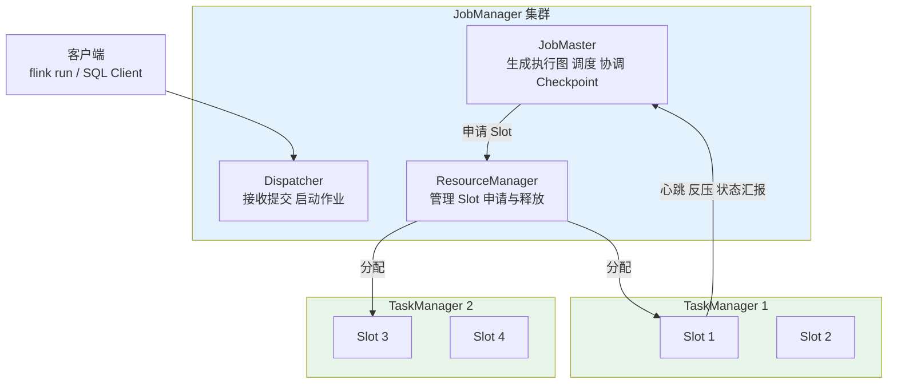
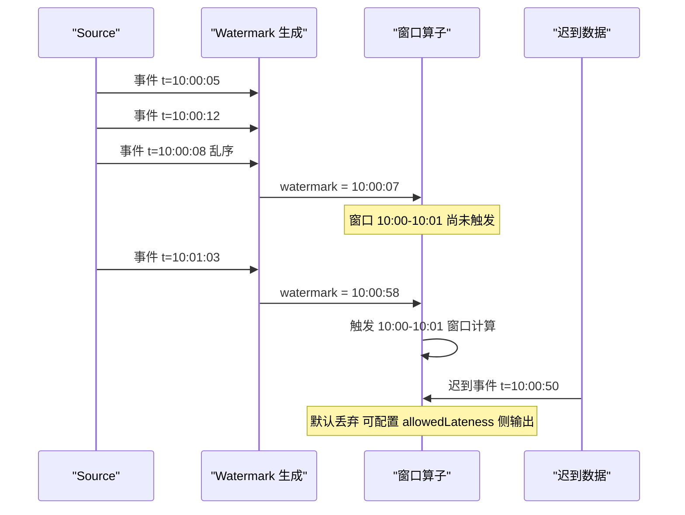
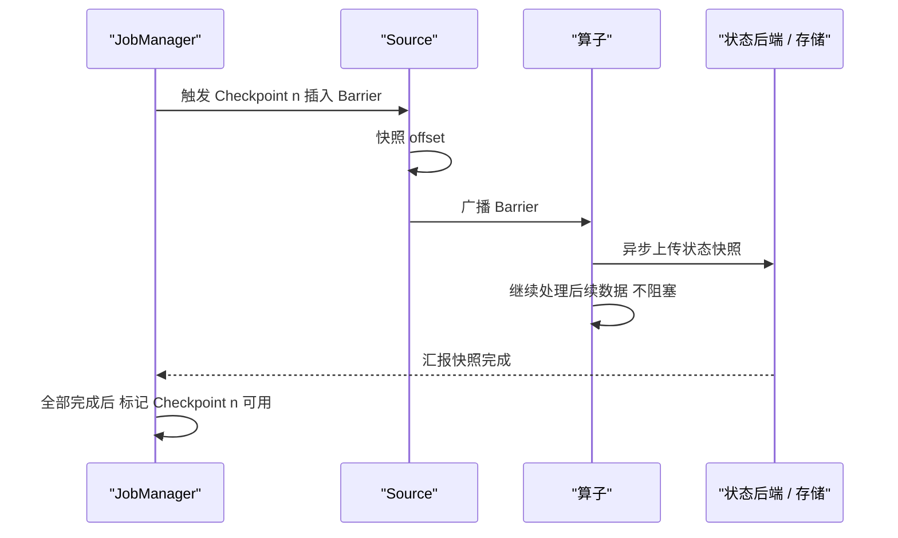

# Flink 流式计算与状态管理

> 定位：实时链路里最难的不是「写个 map」，而是**状态**——作业跑了一周状态涨到几百 GB、Checkpoint 一直超时、反压让整个作业吞吐归零、下游出现重复数据。这篇从 Flink 运行时讲起，把事件时间与水位线、Keyed State 与状态后端、Checkpoint/Savepoint 与两阶段提交、反压排查拆开，最后给出可跑的 Java 作业与 6 个生产坑点。

> **版本提示（2026-11）**：Flink 2.0（2025-03）引入分离式状态管理与物化表，2.3 于 2026-06 发布；本篇 1.19 的状态后端与 Checkpoint 机制仍是理解 2.x 的基础。

## 一、为什么需要它

一个实时订单统计作业上线两周后的典型状态：

- 状态总量从 2GB 涨到 400GB，Checkpoint 从 30 秒变成 20 分钟，最后超时失败；
- 大促时链路全面反压，Kafka 消费 lag 一路涨，作业吞吐掉到峰值的十分之一；
- 为了保证 Exactly-Once 接入了两阶段提交，结果 Kafka 里出现重复消息，或者事务超时导致整批数据回滚；
- 某个渠道的数据量是其他的 100 倍，那个 subtask 的 checkpoint 永远最后一个完成。

这些都不是「API 会不会用」的问题，而是**状态设计、时间语义、容错机制、资源与并行度**没想清楚。Flink 的学习曲线陡，就陡在这里：它把「正确性」做成了可配置项——你可以选择 At-Most-Once、At-Least-Once 或 Exactly-Once，但每一种的代价不同。

必须能回答五个问题：JobManager、TaskManager、Slot、并行度是什么关系，为什么 4 个 Slot 能跑 20 个算子实例？事件时间、处理时间、水位线分别解决什么，水位线停滞为什么让窗口永不触发？Keyed State 与 Operator State 有什么区别，RocksDB 为什么能撑住大状态？Checkpoint 怎么做到不阻塞计算，两阶段提交又怎么保证端到端 Exactly-Once？反压发生在哪一层，怎么从指标定位？本文以 Flink 1.18/1.19 为准。

## 二、核心原理

### 2.1 运行时架构：JM、TM、Slot 与并行度



读图要点：**JobManager 管协调，TaskManager 管执行，Slot 是 TaskManager 上的资源切片**。一个 Slot 能跑多个算子实例（Slot Sharing），所以「4 个 Slot 跑 20 个并行实例」是正常的——Slot 表示资源配额（内存隔离），不是线程数。

| 概念 | 含义 | 调优要点 |
|---|---|---|
| JobManager | 作业协调者：调度、Checkpoint 触发、故障恢复 | 大状态作业要给足堆内存（Checkpoint 协调与元数据） |
| TaskManager | 工作进程，提供 Slot | 一台机器一个 TM、多个 Slot 是常见部署 |
| Slot | TM 的资源切片（内存隔离） | 数量 ≈ CPU 核数，`taskmanager.numberOfTaskSlots` |
| 并行度 | 算子实例数 | 与 Kafka 分区数、下游写入能力对齐 |
| Slot Sharing | 不同算子共享 Slot | 默认开启，减少资源碎片 |

**并行度对齐原则**：source 并行度不要超过 Kafka 分区数（多出来的 subtask 空转）；算子链内并行度一致；sink 并行度看下游承受能力。整体并行度通常是「Kafka 分区数」与「集群 Slot 总数」的较小值。

### 2.2 算子链：把能合并的算子焊在一起

Flink 会把「一对一转发」的相邻算子合并成一条算子链（Operator Chain），在同一个线程里执行，避免序列化与网络传输：

```java
env.fromSource(source, watermarkStrategy, "kafka")
   .map(Order::normalize)          // 与 source 同链
   .filter(o -> o.getAmount() > 0) // 同链
   .keyBy(Order::getChannel)       // 触发网络重分区，链在此断开
   .window(TumblingEventTimeWindows.of(Time.minutes(1)))
   .aggregate(new GmvAggregator())
   .addSink(sink);                 // 可能再形成一条链
```

`keyBy` / `rebalance` / `broadcast` 这类需要重分区的操作会**打断算子链**；可以 `disableChaining()` 或 `startNewChain()` 手动控制，便于把某个重算子单独拆出来看反压。链不是越长越好——链里若有慢算子，会拖住整条链的吞吐。

### 2.3 事件时间、水位线与窗口

| 时间语义 | 含义 | 适用 |
|---|---|---|
| **事件时间（Event Time）** | 数据自身携带的发生时间 | 绝大多数业务统计，结果可重放 |
| **处理时间（Processing Time）** | 算子处理到该条数据的机器时间 | 对准确性要求低、低延迟场景 |

水位线（Watermark）是「事件时间进度」的刻画：`watermark = 最大事件时间 - 允许乱序时长`。它告诉系统「比这个时间更早的数据基本都到了」，窗口据此触发。



读图要点：**水位线是单调递增的「进度承诺」**，它推进到窗口结束时间才触发计算；乱序数据靠 `forBoundedOutOfOrderness` 留缓冲，超出缓冲的迟到数据默认丢弃，可用 `allowedLateness` 再等一会，或用侧输出流单独收集。**水位线停滞**（某个分区长期无数据）会让整条链路的时间进度不动，窗口永远不触发——这是实时作业「数据不输出」的头号原因。

### 2.4 状态类型与状态后端

| 状态类型 | 作用域 | 典型 API | 场景 |
|---|---|---|---|
| **Keyed State** | 按 key 分区，每个 key 一份 | `ValueState`、`ListState`、`MapState`、`ReducingState`、`AggregatingState` | 去重、累计、会话、维表缓存 |
| **Operator State** | 按算子实例（subtask） | `ListState`、`BroadcastState` | Source 的 offset、广播维表（Broadcast State 是其特例，全量复制到每个 subtask 且只读） |

| 状态后端 | 存储位置 | 适用 | 注意 |
|---|---|---|---|
| **HashMapStateBackend** | JVM 堆内（对象） | 小状态、低延迟 | 受堆大小限制，GC 压力大 |
| **EmbeddedRocksDBStateBackend** | 本地磁盘（RocksDB）+ 堆外缓存 | 大状态（TB 级）、增量 Checkpoint | 序列化开销、磁盘 IO、需调 RocksDB 参数 |

RocksDB 状态后端的关键能力是**增量 Checkpoint**：只上传本次变化的 SST 文件，而不是全量快照，这让大状态作业的 Checkpoint 从「不可能」变成「可接受」。代价是读写要经过序列化，且本地磁盘要有空间（状态可能远大于内存）。

状态大小还要靠 **State TTL** 控制：

```java
StateTtlConfig ttl = StateTtlConfig.newBuilder(Duration.ofDays(7))
        .setUpdateType(StateTtlConfig.UpdateType.OnCreateAndWrite)
        .setStateVisibility(StateTtlConfig.StateVisibility.NeverReturnExpired)
        .cleanupInRocksdbCompactFilter(1000)   // RocksDB 压缩时清理
        .build();
ValueStateDescriptor<Long> desc = new ValueStateDescriptor<>("lastPay", Long.class);
desc.enableTimeToLive(ttl);
```

没有 TTL 的 Keyed State 就是「只增不减」的定时炸弹——用户维度状态尤其明显，用户量涨，状态就涨。

### 2.5 Checkpoint、Savepoint 与两阶段提交



读图要点：**Barrier 像一道栅栏在数据流中推进，算子收到 Barrier 就把「Barrier 之前的状态」做快照**，然后立刻继续处理后面的数据——这就是「异步、不阻塞」的来源。所有 subtask 都确认后，这次 Checkpoint 才算完成；任何一个失败，整次作废重来。

| 机制 | 触发 | 格式 | 用途 |
|---|---|---|---|
| **Checkpoint** | 周期性自动 | 内部格式，可能增量 | 故障自动恢复 |
| **Savepoint** | 手动触发 | 规范化、可跨版本 | 升级、迁移、暂停再恢复 |

端到端 Exactly-Once 还差最后一步：**两阶段提交（2PC）**。以写 Kafka 为例：

1. **预提交**：Checkpoint 期间，sink 把数据写入 Kafka 事务但**不提交**，事务 ID 记在状态里。
2. **提交**：Checkpoint 完成后，sink 提交事务，数据对下游可见。
3. **回滚**：Checkpoint 失败或作业重启，未提交的事务被 aborted，下游看不到脏数据。

```java
KafkaSink<Order> sink = KafkaSink.<Order>builder()
        .setBootstrapServers("kafka:9092")
        .setRecordSerializer(serializer)
        .setDeliveryGuarantee(DeliveryGuarantee.EXACTLY_ONCE)
        .setTransactionalIdPrefix("order-gmv")
        .setProperty("transaction.timeout.ms", "900000")
        .build();
```

三个时间必须对齐：**Checkpoint 间隔 × 最大并发数 < `transaction.timeout.ms` < broker 的 `transaction.max.timeout.ms`**，前者不等会让事务提前被中止，后者不等会让创建事务直接被拒。

### 2.6 反压：从下游一路顶到 Source

Flink 1.5 之后用**基于信用的流量控制（Credit-based Flow Control）**：下游每读一份数据就给上游返还 credit，上游用完 credit 就停发。反压不会像 Storm 那样把线程阻塞死，而是表现为「上游的发送缓冲池打满」。排查按四步走：**看 Web UI 反压面板**（哪个算子 HIGH，反压就发生在其下游）；**看 `outPoolUsage` / `inPoolUsage`**（发送池满说明下游慢，接收池满说明自己处理慢）；**看 CPU 与 GC**（CPU 打满多是计算密集，GC 长说明对象或状态太多）；**看外部依赖**（同步写库、同步调 HTTP 是最常见的反压根因，改异步 IO 或批量写）。

## 三、关键机制与参数

### 3.1 DataStream API：带状态与事件时间的实时统计

```java
StreamExecutionEnvironment env = StreamExecutionEnvironment.getExecutionEnvironment();
env.setParallelism(4);
env.enableCheckpointing(60_000, CheckpointingMode.EXACTLY_ONCE);

CheckpointConfig cp = env.getCheckpointConfig();
cp.setMinPauseBetweenCheckpoints(30_000);
cp.setCheckpointTimeout(10 * 60_000);
cp.setExternalizedCheckpointCleanup(
        CheckpointConfig.ExternalizedCheckpointCleanup.RETAIN_ON_CANCELLATION);

env.setStateBackend(new EmbeddedRocksDBStateBackend(true));   // true 表示增量快照

KafkaSource<Order> source = KafkaSource.<Order>builder()
        .setBootstrapServers("kafka:9092")
        .setTopics("order")
        .setGroupId("order-gmv")
        .setStartingOffsets(OffsetsInitializer.committedOffsets(OffsetResetStrategy.EARLIEST))
        .setValueOnlyDeserializer(new OrderDeserializer())
        .build();

WatermarkStrategy<Order> watermark = WatermarkStrategy
        .<Order>forBoundedOutOfOrderness(Duration.ofSeconds(5))
        .withTimestampAssigner((order, ts) -> order.getEventTime())
        .withIdleness(Duration.ofMinutes(1));      // 分区长时间无数据时不再拖住水位线

env.fromSource(source, watermark, "kafka-order")
        .filter(o -> o.getAmount() > 0)
        .keyBy(Order::getChannel)
        .window(TumblingEventTimeWindows.of(Time.minutes(1)))
        .aggregate(new GmvAggregator(), new GmvWindowFunction())
        .addSink(kafkaSink);

env.execute("order-gmv-per-minute");
```

`GmvAggregator` 是增量聚合（每来一条就更新累加器，不在窗口里缓存全部明细）：

```java
public class GmvAggregator implements AggregateFunction<Order, GmvAcc, GmvAcc> {
    @Override public GmvAcc createAccumulator() { return new GmvAcc(); }
    @Override public GmvAcc add(Order o, GmvAcc acc) {
        acc.gmv += o.getAmount();
        acc.orders += 1;
        return acc;
    }
    @Override public GmvAcc getResult(GmvAcc acc) { return acc; }
    @Override public GmvAcc merge(GmvAcc a, GmvAcc b) {
        a.gmv += b.gmv;
        a.orders += b.orders;
        return a;
    }
}
```

这段代码的四个要点：**事件时间必须显式声明 watermark**，否则窗口用处理时间；`withIdleness` 防止空闲分区拖住水位线；`aggregate` 比 `process(ProcessWindowFunction)` 省状态（只存累加器）；RocksDB + 增量快照是大状态的默认选择。

### 3.2 维表 Join：广播还是 Async I/O

| 方式 | 原理 | 适用 | 风险 |
|---|---|---|---|
| **广播维表** | 维表全量广播到每个 subtask，内存查找 | 维表小（几万到几十万行）、更新低频 | 维表大了撑爆内存；更新需重启或广播流 |
| **Async I/O** | 异步查询外部存储（Redis/MySQL/HBase），不阻塞主流程 | 维表大、更新频繁 | 连接池与超时配置不当会打爆外部存储 |
| **预加载 + 定时刷新** | 每个 subtask 本地缓存，定时全量/增量刷新 | 维表中等、能接受分钟级延迟 | 刷新期间的一致性问题 |

Async I/O 用 `AsyncDataStream.unorderedWait(stream, asyncFunction, timeout, capacity, OutputMode.UNORDERED)` 实现：`capacity` 是每个 subtask 同时在途的请求数，它既是吞吐旋钮，也是保护外部存储的闸门。**没有限流的 Async I/O 会把维表库打挂**，大促流量翻倍时尤其明显。

### 3.3 Flink SQL：把上面这些写成 DDL

```sql
CREATE TABLE orders (
  order_id   BIGINT,
  channel    STRING,
  amount     DECIMAL(18, 2),
  event_time TIMESTAMP(3),
  WATERMARK FOR event_time AS event_time - INTERVAL '5' SECOND
) WITH (
  'connector' = 'kafka',
  'topic' = 'order',
  'properties.bootstrap.servers' = 'kafka:9092',
  'format' = 'json'
);

SELECT channel,
       window_start,
       window_end,
       SUM(amount) AS gmv,
       COUNT(*)    AS order_cnt
FROM TABLE(TUMBLE(TABLE orders, DESCRIPTOR(event_time), INTERVAL '1' MINUTE))
GROUP BY channel, window_start, window_end;
```

Flink SQL 的价值在于「声明式 + 自动优化」：watermark、窗口、聚合、状态都由 planner 生成。代价是**可观测性和调优空间变窄**——出问题时你还是得回到 Web UI 看算子、看状态大小、看反压。

### 3.4 与 Spark Streaming 的选型

| 维度 | Flink | Spark Structured Streaming |
|---|---|---|
| 计算模型 | 原生流（逐条/微批流水） | 微批（micro-batch），也支持连续模式 |
| 延迟 | 毫秒到秒级 | 通常在百毫秒到秒级（量级参考，取决于批次间隔） |
| 状态 | 一等公民，大状态 + 增量 Checkpoint | 有状态，但大状态与增量能力弱于 Flink |
| 时间语义 | 事件时间 + 水位线完善 | 支持 watermark，语义略简化 |
| 生态与运维 | 流处理专用，CDC/湖仓集成强，状态运维复杂 | 与 Spark SQL 生态统一，复用 Spark 运维体系 |

判断标准：**延迟要求到秒以内、状态大、逻辑复杂（CEP、多流 Join）→ Flink；团队已有 Spark、延迟容忍分钟级、想复用批代码 → Structured Streaming**。Spark 侧的运行时与调优见 [Spark 核心原理与调优](04-Spark核心原理与调优.md)。

## 四、生产坑点与排查

### 坑点 1：状态膨胀，Checkpoint 越来越慢

**现象**：作业跑一周，Checkpoint 从 30 秒涨到 20 分钟直到超时；RocksDB 目录占用几百 GB。
**原因**：Keyed State 没有 TTL；按用户/订单维度存了全量明细；窗口用了 `ProcessWindowFunction` 缓存整个窗口的数据；维表广播后一直增长。
**解法**：给所有 Keyed State 配 State TTL；用增量聚合替代全窗口缓存；把「明细」换成「累加器」；定期做 Savepoint 重启以清理历史状态；用 RocksDB 的 `state.backend.rocksdb.memory.*` 控制内存。

### 坑点 2：Checkpoint 超时或持续失败

**现象**：Web UI 上 Checkpoint 一直 IN_PROGRESS 或 FAILED，报 `Checkpoint expired before completing`。
**原因**：状态太大上传慢；反压导致 Barrier 追不上数据；`minPauseBetweenCheckpoints` 太小导致排队；对象存储写入慢；单 subtask 倾斜导致「木桶效应」。
**解法**：改用增量 Checkpoint；调大 `checkpointTimeout`；设 `maxConcurrentCheckpoints=1` 并给足间隔；用 `execution.checkpointing.unaligned`（非对齐 Checkpoint）缓解反压下的 Barrier 追赶；解决数据倾斜。

### 坑点 3：反压导致吞吐雪崩

**现象**：Kafka lag 持续上涨，Source 的 `outPoolUsage` 打满，下游算子反压 HIGH。
**原因**：sink 同步写数据库（单条 insert）、JSON 解析慢、维表查询同步阻塞、外部存储抖动。
**解法**：sink 改批量写或异步写；Async I/O 替代同步查询并设并发上限；用火焰图定位 CPU 热点；给外部依赖加超时与熔断；必要时拆分作业、单独扩容瓶颈算子（`setParallelism`）。

### 坑点 4：数据倾斜，单个 subtask 拖垮全局

**现象**：某个 subtask 的 state size、Checkpoint 时间、CPU 都是其他的几十倍；其他 subtask 空闲等它。
**原因**：`keyBy` 的 key 分布不均（大客户、默认渠道、null）；两阶段聚合没做；Kafka 分区本身不均。
**解法**：key 加盐做两阶段聚合；空值/默认值单独处理；`rebalance` 或自定义分区；把热点 key 拆成独立作业；检查 Kafka 分区是否均匀。

### 坑点 5：水位线停滞，窗口一直不输出

**现象**：作业正常运行、无报错，但下游收不到聚合结果；Web UI 上 watermark 长时间不推进。
**原因**：某个 Kafka 分区长期无数据，全局 watermark 取所有分区最小值；`withIdleness` 没配；或者有算子阻塞导致 watermark 无法传递。
**解法**：配置 `withIdleness`；确认 Kafka 分区都有数据（必要时合并 topic）；检查是否有算子长时间不处理数据；用 `watermark` 指标监控进度。

### 坑点 6：Exactly-Once 失效，下游出现重复

**现象**：作业重启后，结果表出现重复订单，或者 Kafka 里有重复消息。
**原因**：Checkpoint 间隔 × 并发 > `transaction.timeout.ms`，事务被 broker 中止后重放；sink 不支持 2PC 却声明了 Exactly-Once；下游存储没有按主键幂等。
**解法**：对齐 Checkpoint 间隔与事务超时；确认 broker 的 `transaction.max.timeout.ms` 足够大；对不支持事务的存储（如部分 OLAP）做「主键 upsert + 幂等」；用 Savepoint 而非 kill -9 做发布。

## 五、调优、选型与最佳实践

### 5.1 参数清单

| 参数 | 建议 | 说明 |
|---|---|---|
| `parallelism.default` | ≈ Kafka 分区数 | 不要超过分区数，多出的 subtask 空转 |
| `taskmanager.numberOfTaskSlots` | ≈ CPU 核数 | Slot 是内存隔离单位，不是线程数 |
| `execution.checkpointing.interval` | 1~5 分钟 | 太频繁影响吞吐，太稀疏恢复慢 |
| `execution.checkpointing.unaligned` | 反压严重时开启 | 减少 Barrier 排队，代价是状态含在途数据 |
| `state.backend` | rocksdb（大状态） | 配 `state.backend.incremental=true` |
| `table.exec.state.ttl` | 按业务设置 | SQL 作业的隐式状态也要配 TTL |

### 5.2 什么场景不该用 Flink

- **T+1 或小时级报表**：批处理更便宜、更好调试，用 Spark/Hive。
- **数据量很小、实时性要求不高**：一个定时任务扫表就够，Flink 的运维成本不划算。
- **团队没有状态与 Checkpoint 运维经验**：故障恢复、Savepoint 迁移、版本升级都需要经验，先从小作业练手。
- **只需要简单过滤转发**：Kafka Streams 或普通消费者可能更轻量。

## 六、面试高频问法

**Q1：Flink 的运行时架构是怎样的？Slot 和并行度是什么关系？**

**一句话结论**：JobManager 负责协调（调度、Checkpoint、恢复），TaskManager 负责执行并提供 Slot；**Slot 是资源切片，可被多个算子实例共享**，并行度是算子实例数，二者不是一回事。

展开：一个 TM 有 N 个 Slot，一个 Slot 可跑多条算子链（Slot Sharing）；并行度决定每个算子有多少实例。Slot 数 ≈ CPU 核数，并行度按 Kafka 分区数与下游能力确定。

加分点：说明「Slot 共享能减少资源碎片——source 和 sink 的负载高峰不同，共享后资源利用率更高」。

**Q2：事件时间、处理时间、水位线分别解决什么问题？**

**一句话结论**：事件时间是数据自身发生时间，保证结果可重放、可对账；处理时间是机器时间，简单但不准确；**水位线是对事件时间进度的承诺**，用来决定窗口何时触发。

展开：`watermark = 最大事件时间 - 允许乱序`；乱序超出的数据默认丢弃，可用 `allowedLateness` 或侧输出收集；水位线停滞会让窗口永不触发。

加分点：点出「实时与离线口径对不上的常见原因就是一边用事件时间、一边用处理时间」。

**Q3：Keyed State 和 Operator State 有什么区别？**

**一句话结论**：Keyed State 按 key 分区、每个 key 一份，只能在 `keyBy` 之后用；Operator State 绑定算子实例（subtask），与 key 无关，常用于 Source 的 offset 和广播状态。

展开：Keyed State 支持 `ValueState`/`ListState`/`MapState` 等，随 key 的重分布自动迁移；Operator State 在并行度变化时要实现 `CheckpointedFunction` 做重分配。Broadcast State 是 Operator State 的特例，全量复制到每个 subtask。

加分点：提醒「Keyed State 必须配 TTL，否则用户维度状态只增不减」。

**Q4：为什么 RocksDB 状态后端能支撑大状态？代价是什么？**

**一句话结论**：状态放在**本地磁盘的 RocksDB（LSM 树）**而不是 JVM 堆，内存只做缓存，所以能到 TB 级；配合**增量 Checkpoint** 只上传变化的 SST 文件，快照成本大幅下降。

展开：HashMapStateBackend 把状态对象放堆里，受堆大小与 GC 限制；RocksDB 用堆外缓存 + 磁盘，读写要序列化。代价是 CPU（序列化）、磁盘 IO、以及本地磁盘容量规划。

加分点：说明「增量 Checkpoint 依赖 RocksDB 的 SST 文件不变性，所以只有 RocksDB 后端支持」。

**Q5：Checkpoint 的原理是什么？为什么说不阻塞计算？**

**一句话结论**：JobManager 周期性插入 **Barrier**，算子收到 Barrier 后对「Barrier 之前的状态」做**异步快照**并上传，然后继续处理后面的数据；所有 subtask 确认后才算完成。

展开：Barrier 对齐（aligned）保证快照一致性，但反压时对齐会慢，可用非对齐 Checkpoint（unaligned）把在途数据也存进快照；Checkpoint 失败整次作废，作业从上一个成功点恢复。

加分点：区分「Checkpoint 自动、可能增量」与「Savepoint 手动、规范化、可跨版本」。

**Q6：端到端 Exactly-Once 是怎么做到的？**

**一句话结论**：靠 **Checkpoint + 两阶段提交**——Checkpoint 期间 sink 预提交（写事务不提交），Checkpoint 完成后提交事务，失败则回滚；再加上 source 可重放（Kafka offset 存在状态里）。

展开：以 Kafka sink 为例，事务 ID 存在状态中，重启后 aborted 未提交事务；要求 Checkpoint 间隔 × 并发 < `transaction.timeout.ms` < broker 的 `transaction.max.timeout.ms`。

加分点：指出「下游不支持事务时，Exactly-Once 只能靠主键幂等 upsert 来近似，不要宣称端到端精确一次」。

**Q7：反压是怎么产生的？怎么排查？**

**一句话结论**：下游消费速度跟不上上游生产速度，Credit 用完后上游停发，反压沿链路向上游传播直到 Source；排查看 Web UI 反压面板与 `inPoolUsage`/`outPoolUsage`，根因多在同步外部调用或计算热点。

展开：先定位反压发生的算子（它的下游是瓶颈），再看 CPU/GC/外部依赖；sink 改批量或异步，Async I/O 设并发上限，必要时拆作业或单独扩容。

加分点：说明「反压本身是保护机制，不是故障——它防止 OOM，真正要解决的是瓶颈算子」。

**Q8：维表 Join 有哪几种实现？怎么选？**

**一句话结论**：小维表用**广播**（内存查找、零网络开销），大维表用 **Async I/O**（异步查询外部存储、不阻塞），中等且能接受延迟用**本地缓存 + 定时刷新**。

展开：广播适合几万到几十万行、更新低频；Async I/O 要配连接池、超时与并发上限，否则打爆维表库；缓存刷新要考虑一致性窗口。

加分点：提醒「广播维表更新需要重启作业或引入广播流，运维成本要提前评估」。

**Q9：Flink 和 Spark Streaming 怎么选？**

**一句话结论**：**要秒内延迟、大状态、复杂事件处理选 Flink**；**已有 Spark 体系、准实时 ETL、想复用批代码选 Structured Streaming**。

展开：Flink 是原生流、状态与 Checkpoint 更强；Structured Streaming 是微批、与 Spark SQL 生态统一，延迟取决于批次间隔。两者都能做 Exactly-Once，但 Flink 的大状态与 CEP 能力更成熟。

加分点：补充「选型还要看团队：没有状态运维经验的团队上 Flink 大状态作业，故障恢复会很痛苦」。

**Q10：Flink 作业上线/升级的标准流程是什么？**

**一句话结论**：**Savepoint → 停作业 → 用新版本从 Savepoint 恢复 → 校验数据**，而不是直接 kill 再启动；状态结构变更要保证兼容或写迁移逻辑。

展开：Savepoint 是规范化快照，可跨版本；升级前确认算子 UID 稳定（`uid()`），否则状态映射不上；状态 schema 变更用 `TypeSerializer` 兼容或做双写迁移；恢复后核对 offset、状态大小与输出。

加分点：强调「给每个算子显式设置 `uid()` 是状态兼容的前提，靠自动生成的 UID 在改代码后会失效」。

## 小结

- JobManager 管协调、TaskManager 管执行、Slot 是资源切片且可共享；并行度与 Kafka 分区数对齐。
- 事件时间 + 水位线决定窗口何时触发；水位线停滞是「作业正常但不输出」的头号原因。
- Keyed State 按 key 分区、Operator State 按实例；大状态用 RocksDB + 增量 Checkpoint，且必须配 TTL。
- Checkpoint 靠 Barrier 异步快照，端到端 Exactly-Once 靠两阶段提交，事务超时与 Checkpoint 间隔必须对齐。
- 反压是保护机制，排查顺序是「定位算子 → 看池占用 → 看 CPU/GC → 看外部依赖」。
- 上线与升级走 Savepoint，算子 `uid()` 稳定是状态兼容的前提。
