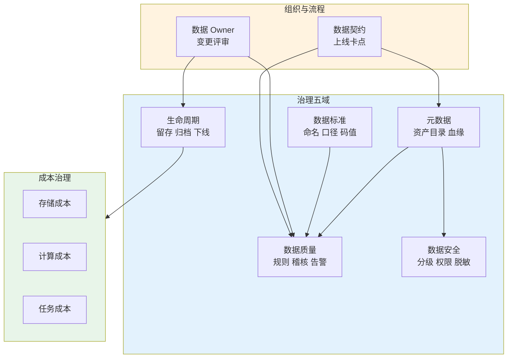
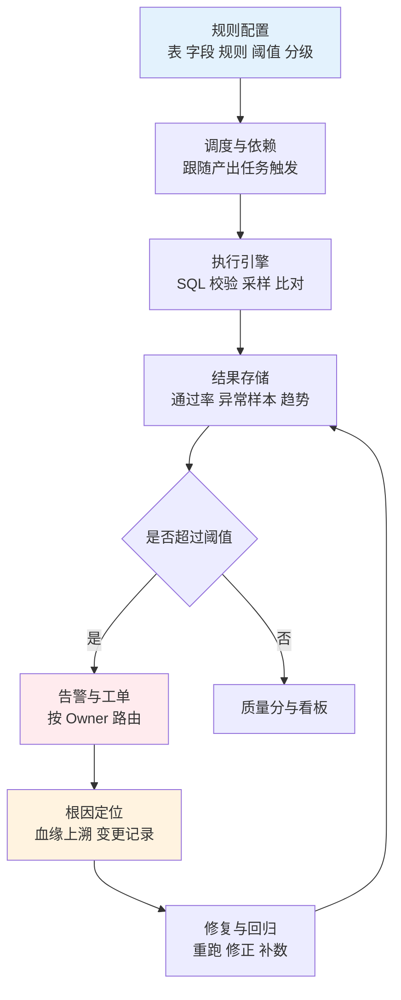
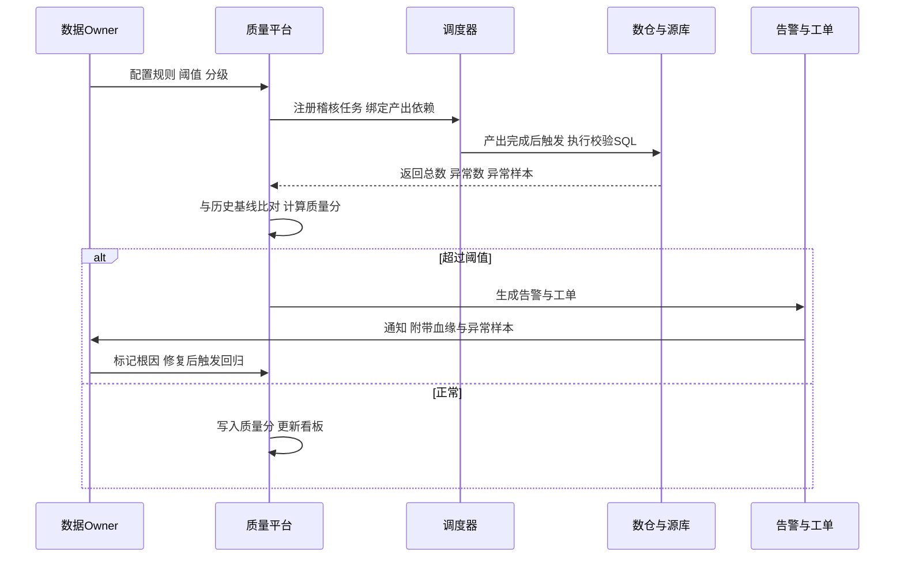

# 数据治理与数据质量

> 定位：当大屏的 GMV 和财务口径差 3%、上游悄悄把金额单位从「元」改成「万元」、或者凌晨三点的空表让下游 40 个任务全部产出空数据时，问题已经不是「哪个引擎快」，而是治理缺失。这篇讲清元数据与血缘、六类质量规则、离线与实时稽核、SLA 与分级、成本治理和组织流程，并给出 Java 侧可落地的质量校验任务写法。

## 一、为什么需要它

数据平台做到一定规模，事故形态会从「任务失败」变成「数据看起来是对的」：

1. **同名指标三个数**：大屏、BI、财务各有一套 GMV SQL，过滤条件、去重键、时间语义都不同，开会先吵半小时用哪个数。
2. **上游静默变更**：订单表 `amount` 从「元」改成「分」，没有任何通知，下游金额放大 100 倍，三天后才发现。
3. **空表静默通过**：上游分区没产出，下游 `LEFT JOIN` 得到全 null，任务成功、报表全零，没人报警。
4. **告警疲劳**：质量规则设了 200 条，每天误报 50 条，最后所有人都把告警群静音。

这四件事的共同点是：**技术链路没报错，但数据不可信**。数据治理解决的正是「可信」问题，它由五块构成：元数据（有什么、从哪来、到哪去）、数据标准（怎么定义、怎么命名）、数据质量（是否符合预期）、数据安全（谁能看、怎么脱敏）、生命周期（存多久、何时下线）。质量只是其中一块，但它是唯一能「用规则自动发现问题」的一块。

一个必须先建立的认知：**治理是组织问题，平台只是放大器**。没有数据 owner、没有口径评审，买再贵的治理平台也只会把混乱自动化。

## 二、核心原理

### 2.1 治理体系：五域加两个支撑



读图要点：**元数据与标准是地基**——没有资产目录，质量规则不知道挂哪；没有统一口径，质量规则判不出对错。**组织与流程是执行器**，没有 owner 的告警等于没告警。

| 领域 | 核心问题 | 交付物 | 缺失时的表现 |
|---|---|---|---|
| 元数据 | 有哪些表、字段含义、上下游是谁 | 资产目录、血缘图、字段注释 | 不敢下线、排障靠问人 |
| 数据标准 | 指标怎么定义、字段怎么命名 | 指标字典、命名规范、码值表 | 同名不同义、同义不同名 |
| 数据质量 | 数据是否符合预期 | 规则库、稽核任务、质量分 | 错误数据静默流入决策 |
| 数据安全 | 谁能看、看什么粒度 | 分级标签、权限矩阵、脱敏策略 | 越权访问、合规风险 |
| 生命周期 | 存多久、何时归档下线 | 分层策略、TTL、下线清单 | 存储成本只涨不降 |

### 2.2 元数据与血缘：治理的入口

元数据分三类：**技术元数据**（表结构、分区、存储量、任务）、**业务元数据**（指标定义、业务域、负责人）、**管理元数据**（权限、分级、SLA）。三者要能通过同一套 ID 关联起来，否则「查一个指标」还是要在三个系统里翻。

血缘的采集有四种方式，准确度依次递增、成本也递增：

| 方式 | 原理 | 优点 | 局限 |
|---|---|---|---|
| 解析 SQL / AST | 解析 ETL 里的 SQL 语句 | 实现简单、覆盖广 | 动态 SQL、存储过程、UDF 解析不出 |
| 引擎 Hook | 在 Spark/Flink/Hive 运行时埋点 | 准确到字段级 | 需要改引擎配置、侵入性强 |
| 日志解析 | 解析执行计划或查询日志 | 不改代码 | 日志格式变化就失效 |
| 人工登记 | 在平台上手工维护 | 简单 | 必然过期 |

**血缘的四个真实用途**：影响分析（改上游字段前知道会打挂谁）、根因定位（报表错了，沿血缘往上游找）、下线评估（没有下游才能下线）、成本归属（算清哪个业务在烧钱）。没有血缘的治理平台，本质只是一个「表清单」。

**血缘的价值在扇出**：一个 ODS 表可能扇出到十几张下游表，所以上游变更的影响面永远比想象大——「只改一个字段」往往意味着停掉半条业务线，这正是变更评审要基于血缘而不是凭记忆的原因。

主流元数据平台对比：

| 平台 | 血缘能力 | 部署成本 | 生态 | 适合 |
|---|---|---|---|---|
| **Apache Atlas** | Hook + 解析，表级/列级 | 重（依赖 HBase/JanusGraph/Kafka） | Hadoop 体系最深 | 已有 Hadoop 集群、要强合规 |
| **DataHub** | Ingestion 拉取 + 实时元数据变更事件 | 中（依赖 Kafka/ES/MySQL） | 连接器丰富、UI 强 | 多源异构、要快速铺开 |
| **OpenMetadata** | 内置血缘与质量、schema-first | 中 | 新，标准统一 | 想「元数据 + 质量 + 术语表」一套搞定 |

选型的现实建议：**已有 Atlas 且稳定就别迁**；新建平台优先 DataHub 或 OpenMetadata，二者都能通过 API 对接自建调度与质量任务，比自研强得多。

### 2.3 数据质量的六性

质量规则不是「想到什么查什么」，而是按维度覆盖。六个维度缺一不可：

| 维度 | 定义 | 典型规则 | 例子 |
|---|---|---|---|
| **完整性** | 该有的不能少 | 非空率、分区是否有数据、行数环比 | `order_id` 为空的行数 |
| **唯一性** | 不该重复的不能重 | 主键重复、业务唯一键重复 | 同一 `order_id` 出现多次 |
| **及时性** | 该到的时候要到 | 分区产出时间、最大事件时间滞后 | 10 点还没产出 9 点分区 |
| **准确性** | 值要符合业务事实 | 值域、枚举、金额非负、勾稽关系 | `amount < 0`、状态不在枚举内 |
| **一致性** | 跨表/跨链路要说得通 | 主外键一致、实时与离线对账、总分核对 | 明细求和 != 汇总表 |
| **有效性** | 格式与类型合法 | 正则、日期格式、长度、类型 | 手机号格式错误 |

规则实现分四类：**单表 SQL 规则**（最常见）、**跨表/跨源比对**（对账）、**趋势规则**（与历史基线比波动）、**自定义脚本**（复杂业务校验）。前两类覆盖 80% 的场景，趋势规则用来发现「规则写不出来但明显不对」的情况。

稽核方式分两条路：

- **离线稽核**：T+1 或小时级跑 SQL，结果落质量结果表，适合全量校验与对账。缺点是发现问题时数据已经被消费。
- **实时稽核**：Flink 作业按窗口统计异常率，或在写入链路旁路采样校验，适合及时性与强约束指标。缺点是要维护流作业，且窗口统计与全量口径可能有差异。

生产上通常「实时做兜底拦截，离线做全量复盘」，两者共用同一套规则定义，避免口径分裂。

### 2.4 质量平台：从规则到根因



读图要点：**告警不是终点，根因才是**。一条「金额异常」告警如果能自动带上「上游 3 小时前有一次字段类型变更 + 影响 7 张下游表」，处理时间会从半天缩短到十分钟。这就是血缘与变更记录要和质量平台打通的原因。

告警要分级，否则必然疲劳：

| 级别 | 判定 | 动作 |
|---|---|---|
| **阻断** | 核心指标错误、主键重复、分区缺失 | 阻断下游任务、电话/IM 升级、拉应急群 |
| **严重** | 非核心指标超阈值、及时性延迟 | 告警到 owner、要求 2 小时内响应 |
| **警告** | 波动类规则、样本异常 | 汇总日报、不单独打扰 |
| **提示** | 质量分下降但未越线 | 只进看板 |

告警通道、分级与降噪的通用方法论，可参考 [可观测性三大支柱](../14-可观测性/01-可观测性三大支柱.md)；数据事故的复盘流程与线上故障一致，见 [线上故障排查与复盘](../13-高可用与稳定性/05-线上故障排查与复盘.md)。

### 2.5 SLA、数据分级与主数据

**数据分级**决定投入多少治理资源，常见四档：

| 级别 | 例子 | 质量要求 | 可用性 | 变更要求 |
|---|---|---|---|---|
| L1 核心 | 交易、资金、财务报表 | 全维度规则 + 实时兜底 | 99.9% 以上 | 双人评审 + 灰度 + 对账 |
| L2 重要 | 用户画像、核心行为 | 关键维度 + 离线稽核 | 99% 以上 | 评审 + 通知下游 |
| L3 一般 | 运营分析、探索数据 | 基础规则 | 尽力而为 | 登记即可 |
| L4 临时 | 一次性分析、实验 | 不强制 | 无 | 无 |

**SLA 要写成可验证的承诺**：产出时间（每天 07:00 前）、数据质量（关键规则通过率 100%）、可用性（查询成功率 99.5%）。没有量化指标的 SLA 只是口号，也无法在复盘时界定责任。

**主数据管理（MDM）** 解决「同一个客户在五个系统里有五个 ID」的问题：确定唯一标识、制定清洗与合并规则、维护 golden record、把映射关系同步给下游。它不是一张表，而是一套「谁有权改、改了怎么同步」的流程。

### 2.6 成本治理：存储、计算、任务

| 层面 | 常见浪费 | 治理手段 |
|---|---|---|
| **存储** | 全量留存多年、无压缩、多副本、小文件 | 冷热分层、TTL、列存压缩、快照过期、合并小文件 |
| **计算** | 全量重跑、重复计算、资源超配、夜间闲置 | 增量计算、结果复用、按量弹性、队列隔离 |
| **任务** | 僵尸任务、空跑任务、失败重试风暴 | 血缘下游为空即下线、运行时长与产出监控、重试上限 |

成本治理最容易犯的错是「一刀切下线」。正确顺序是：**先用血缘确认无下游 → 再观察一个周期无访问 → 最后归档而非直接删除**。没有血缘就做下线，等于蒙眼拆承重墙。

## 三、关键机制与实现

### 3.1 Java 侧质量校验任务

质量平台可以买，但「规则执行器」通常要自己写。核心是一个规则描述 + 一个执行器：SQL 返回 `total_cnt` 与 `bad_cnt`，执行器算通过率、落结果、按 owner 告警。

```java
public record RuleSpec(String name, String tableName, String sql,
                       double threshold, boolean blocking,
                       String owner, int timeoutSeconds) {
}

public record QualityResult(String rule, long total, long bad,
                            double badRate, boolean passed) {
}

public final class QualityChecker {

    private final DataSource dataSource;
    private final QualityRepository repository;
    private final AlertClient alertClient;

    public QualityChecker(DataSource dataSource,
                          QualityRepository repository,
                          AlertClient alertClient) {
        this.dataSource = dataSource;
        this.repository = repository;
        this.alertClient = alertClient;
    }

    public void run(List<RuleSpec> specs) {
        for (RuleSpec spec : specs) {
            long start = System.currentTimeMillis();
            try (Connection conn = dataSource.getConnection()) {
                conn.setReadOnly(true);                 // 只读 防止误写
                QualityResult result = execute(conn, spec);
                repository.save(spec, result, System.currentTimeMillis() - start);
                if (!result.passed()) {
                    alertClient.notifyOwner(spec, result);  // 按 owner 路由 不群发
                }
            } catch (SQLException ex) {
                // 规则自身失败也要留痕 否则会被误判为「通过」
                repository.saveError(spec, ex);
                alertClient.notifyPlatform(spec, ex);
            }
        }
    }

    private QualityResult execute(Connection conn, RuleSpec spec) throws SQLException {
        try (Statement st = conn.createStatement()) {
            st.setQueryTimeout(spec.timeoutSeconds());
            try (ResultSet rs = st.executeQuery(spec.sql())) {
                if (!rs.next()) {
                    throw new SQLException("规则未返回结果: " + spec.name());
                }
                long total = rs.getLong("total_cnt");
                long bad = rs.getLong("bad_cnt");
                double rate = total == 0 ? 0d : (double) bad / total;
                boolean passed = rate <= spec.threshold();
                return new QualityResult(spec.name(), total, bad, rate, passed);
            }
        }
    }
}
```

四个设计取舍：**只读连接 + 查询超时**，防止质量任务把源库拖死；**规则自身失败单独告警**，不能当成「没通过」也不能当成「通过」；**结果落库**，才能做质量分趋势与回溯；**按 owner 路由**，避免告警群变成无人看的广播。

### 3.2 四类稽核 SQL

```sql
-- 完整性 关键字段空值率
SELECT COUNT(*)                                   AS total_cnt,
       SUM(CASE WHEN order_id IS NULL THEN 1 ELSE 0 END) AS bad_cnt
FROM dwd_trade_detail
WHERE dt = DATE '2026-11-23';

-- 唯一性 主键重复（多余行数）
SELECT COUNT(*)                          AS total_cnt,
       COUNT(*) - COUNT(DISTINCT order_id) AS bad_cnt
FROM dwd_trade_detail
WHERE dt = DATE '2026-11-23';

-- 一致性 实时与离线对账 超过 0.5% 视为异常
SELECT o.channel,
       o.gmv  AS offline_gmv,
       r.gmv  AS realtime_gmv,
       ABS(o.gmv - r.gmv) / NULLIF(o.gmv, 0) AS diff_rate
FROM ads_gmv_offline  o
JOIN ads_gmv_realtime r
  ON o.dt = r.dt AND o.channel = r.channel
WHERE o.dt = DATE '2026-11-23'
  AND ABS(o.gmv - r.gmv) / NULLIF(o.gmv, 0) > 0.005;

-- 及时性 最大事件时间是否滞后于 SLA
SELECT COUNT(*) AS total_cnt,
       SUM(CASE WHEN max_event_time < TIMESTAMP '2026-11-23 09:00:00'
                THEN 1 ELSE 0 END) AS bad_cnt
FROM (
    SELECT MAX(event_time) AS max_event_time
    FROM dwd_trade_detail
    WHERE dt = DATE '2026-11-23'
) t;
```

写规则的三条纪律：**必须带分区条件**（否则全表扫描压垮集群）、**必须能返回 `total_cnt`/`bad_cnt` 两个字段**（执行器统一解析）、**阈值要基于历史基线**而不是拍脑袋（先观察两周再定）。

### 3.3 稽核流程



读图要点：**稽核挂在产出依赖之后**，任务没产出就不该判「质量通过」；**异常样本要随告警一起给**，否则排查要从「哪里错了」开始，而不是「为什么错」。

### 3.4 告警降噪

降噪靠五件事：同表同字段的规则去重、用近 7/14 天基线替代固定阈值、及时性规则给 10~30 分钟宽限、上游失败时抑制下游告警、5 分钟内同类告警聚合上报。每条告警必须能被标记「真问题/误报」，误报率高的规则下线重写。

## 四、生产坑点与排查

### 坑点 1：同名指标三个口径

**现象**：大屏 GMV 1200 万、BI 1180 万、财务 1210 万，三方都认为自己对。
**原因**：过滤条件（是否含退款/取消）、去重键（订单号 vs 支付单号）、时间语义（下单时间 vs 支付时间）、币种与含税口径不统一。
**解法**：建指标字典，强制写清「口径公式 + 过滤条件 + 去重键 + 时间字段 + 是否含税」；一个指标只能有一个 owner 和一个权威实现，其他报表引用而不是重写；上线前跑对账，差异超阈值不发布。

### 坑点 2：上游静默变更

**现象**：金额放大 100 倍、枚举值多了一个 `unknown`、字段类型从 `int` 变 `string`，下游全部异常但上游毫无感知。
**原因**：没有数据契约，schema 变更不通知、不评审；不同引擎对类型放宽的容忍度不同，问题延迟暴露。
**解法**：把 schema 变更纳入发布流程（数据契约），变更必须通知下游并附影响面；用 Schema Registry 或元数据平台做兼容性检查；关键字段加值域与量级校验（金额突增 10 倍即告警）；上线前影子跑批对比。

### 坑点 3：规则误报，最后没人看告警

**现象**：200 条规则每天报 50 条，95% 是误报，团队把告警群静音，真正的故障漏掉。
**原因**：阈值拍脑袋、没有基线、没有宽限窗口、大促期间流量本身就异常、规则重复。
**解法**：先用两周数据跑「只观察不告警」，看分布再定阈值；趋势规则用同比/环比与标准差；大促期间走单独的阈值策略；建立告警处置闭环，每条告警必须能被标记为「真问题/误报」，误报率高的规则下线重写。

### 坑点 4：质量任务把源库压垮

**现象**：质量稽核一跑，业务库 CPU 打满，线上接口超时。
**原因**：规则直接连主库、`COUNT(DISTINCT)` 全表扫、无超时、并发跑几十条规则。
**解法**：质量任务连从库或数仓，不连主库；规则必须带分区与时间范围；设置查询超时与并发上限；大批量校验放到数仓侧执行，只把结果回传平台。

### 坑点 5：告警没有 owner，故障无人认领

**现象**：告警发了，群里没人回；追问「这是谁的表」，没人知道。
**原因**：元数据没有负责人字段，或者 owner 早已离职；组织上「平台团队负责一切」。
**解法**：建表即登记 owner（可以是团队而非个人），离职交接纳入流程；告警按 owner 路由到具体人；核心表设置 backup owner；每月统计「无人认领告警」数量作为治理指标。

## 五、落地路线与边界

### 5.1 分阶段落地

| 阶段 | 目标 | 关键动作 | 衡量指标 |
|---|---|---|---|
| **第 1 月** | 能看见 | 接元数据、出资产目录、梳理核心表 owner 与分级 | 核心表 100% 有 owner |
| **第 2~3 月** | 能定位 | 血缘覆盖核心链路、指标字典上线 | 核心指标 100% 有唯一口径 |
| **第 3~4 月** | 能发现 | 核心表质量规则覆盖、稽核进调度、告警分级 | 核心表关键规则通过率 |
| **第 4~6 月** | 能闭环 | 故障工单、根因记录、SLA 与复盘、成本看板 | 平均恢复时间、误报率、成本降幅 |

顺序不能反：**先有元数据和 owner，再谈质量规则**。反过来的结果是规则没人认领、告警没人处理。

### 5.2 组织与流程

- **数据 owner**：每张核心表、每个核心指标都要有明确负责人，负责口径、质量与变更。
- **变更评审**：删字段、改类型、改枚举、改分区策略必须评审，附血缘影响面与回滚方案。
- **数据契约**：上游承诺 schema 与语义，变更走版本；下游按契约消费，不依赖未承诺字段。
- **上线卡点**：核心指标上线必须通过质量规则与对账，否则不允许接入大屏与对外报表。
- **复盘机制**：数据事故与线上故障同等级对待，记录根因、影响面与改进项。

### 5.3 什么情况下不该上重治理

- **数据量小、团队小**：几张表、两三个人，建个表格维护 owner 和口径就够，不必上 Atlas/DataHub。
- **没有跨团队共享**：数据只在业务团队内部用，口头对齐比平台更高效。
- **业务还在验证期**：口径天天变，此时固化标准会拖慢迭代；先保证可回溯，再谈治理。

## 六、面试高频问法

**Q1：数据治理包括哪些方面？先做哪一块？**

**一句话结论**：五域——元数据、标准、质量、安全、生命周期，外加成本与主数据；落地顺序是「元数据与 owner → 标准与血缘 → 质量稽核 → 安全与成本」。

展开：元数据回答「有什么」，标准回答「怎么定义」，质量回答「对不对」，安全回答「谁能看」，生命周期回答「留多久」。没有前两块，质量规则无处挂、判不出对错。

加分点：强调治理是组织问题，平台只是工具；先有 owner 与评审流程，再上系统。

**Q2：血缘怎么采集？有什么用？**

**一句话结论**：SQL/AST 解析、引擎 Hook、日志解析、人工登记四种方式；用途是影响分析、根因定位、下线评估、成本归属。

展开：AST 覆盖广但解析不了动态 SQL；Hook 准确到字段级但要改引擎；生产上通常「解析为主 + Hook 补关键链路 + 人工兜底」。

加分点：举一个真实场景——上游改字段前先用血缘查影响面，避免「改一个字段停半条业务」。

**Q3：数据质量六个维度是什么？各举一个规则。**

**一句话结论**：完整性、唯一性、及时性、准确性、一致性、有效性；分别对应非空率、主键重复、产出延迟、值域校验、跨表对账、格式校验。

展开：完整性看「该有的有没有」，唯一性看「该唯一的有没有重」，及时性看「该到的时候到没到」，准确性看「值是否符合业务」，一致性看「多处是否说得通」，有效性看「格式类型是否合法」。

加分点：指出「准确性」最难自动化，往往需要业务规则或与外部权威源对账。

**Q4：离线稽核和实时稽核怎么选？**

**一句话结论**：实时做兜底与强约束指标拦截，离线做全量校验与对账；两者共用规则定义，避免口径分裂。

展开：实时稽核用 Flink 按窗口统计异常率，延迟低但窗口口径与全量有差异；离线稽核 T+1 跑 SQL，全面但发现问题时数据已被消费。

加分点：说明「实时拦截」需要链路支持阻断（比如写结果表前校验），否则只能事后告警。

**Q5：质量平台怎么设计？**

**一句话结论**：规则配置 → 调度触发 → 执行引擎 → 结果存储 → 分级告警 → 根因与回归，六段闭环；关键是规则可复用、结果可追溯、告警可闭环。

展开：规则统一成「SQL + 阈值 + 分级 + owner」的元数据；执行器只读、带超时、结果落库；告警按 owner 路由并附异常样本与血缘；工单记录根因，修复后自动回归。

加分点：强调「规则自身失败」也要告警，否则会被误判为通过。

**Q6：怎么避免质量规则误报导致的告警疲劳？**

**一句话结论**：阈值来自历史基线而非拍脑袋，配合宽限窗口、依赖抑制、聚合上报和误报标记闭环。

展开：新规则先「只观察不告警」跑两周；趋势规则用同比/环比与标准差；上游失败时抑制下游告警；每条告警必须能被标记真伪，误报率高的规则下线重写。

加分点：把「误报率」作为治理平台自身的 KPI，而不是只考核规则数量。

**Q7：SLA 怎么定？数据分级有什么用？**

**一句话结论**：SLA 必须可验证——产出时间、质量通过率、可用性三个量化指标；分级决定投入多少规则、多少审批、多少可用性资源。

展开：L1 核心表全维度规则 + 双人评审 + 对账；L2 关键维度 + 通知；L3 基础规则；L4 不强制。分级要和故障等级、告警方式、复盘要求对齐。

加分点：指出「没有量化指标的 SLA 只是口号」，复盘时无法界定责任。

**Q8：上游静默变更怎么防？**

**一句话结论**：数据契约 + Schema 兼容性检查 + 值域/量级校验 + 变更通知与影响面分析，四层防护。

展开：契约明确字段语义与变更流程；Schema Registry 拦不兼容变更；质量规则兜住「类型没变但语义变了」（如元改分）；血缘给出影响面。

加分点：说明「兼容性检查只保证能解析，不保证语义正确」，单位与枚举变化必须靠业务校验。

## 小结

- 治理五域：元数据、标准、质量、安全、生命周期；顺序是先有资产与 owner，再谈规则。
- 血缘是治理入口，支撑影响分析、根因定位、下线评估与成本归属，采集以 SQL 解析为主、Hook 补关键链路。
- 质量六性：完整性、唯一性、及时性、准确性、一致性、有效性；规则必须带分区、返回总数与异常数。
- 平台闭环是「配置 → 调度 → 执行 → 结果 → 分级告警 → 根因回归」，告警必须按 owner 路由。
- 误报比漏报更能杀死治理：阈值来自基线，误报率要作为平台 KPI。
