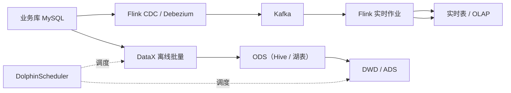
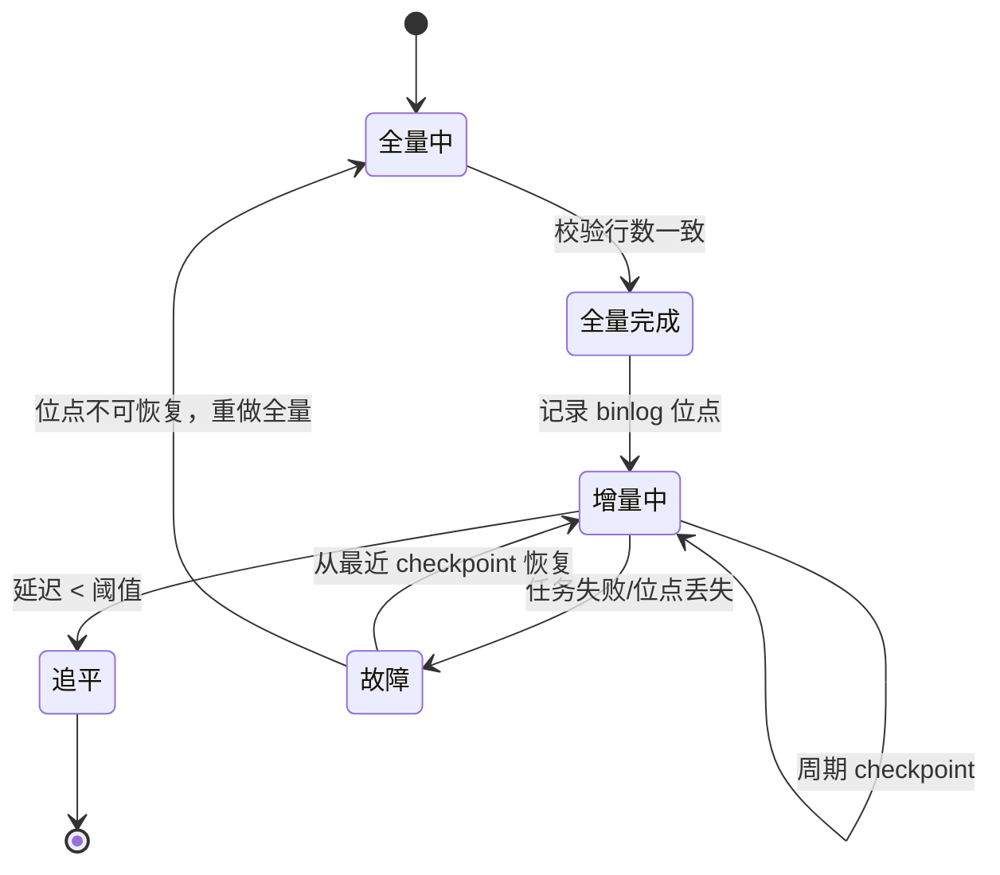

# 数据集成与调度：DataX、Flink CDC 与 DolphinScheduler

> 定位：数据平台最容易「断」的地方不在计算引擎，而在**第一公里**——数据怎么稳定地进来、任务怎么按依赖跑起来。离线同步配错并发把源库拖死、CDC 位点丢了导致重复或漏数、调度集中补数把集群打满，这三类事故比 SQL 写错更常见。这篇讲清离线同步、CDC 与调度三块的原理、参数与生产坑，给出「幂等落表 + 对账」这套保命设计。

> **版本提示（2026-11）**：DataX 3.x、Flink CDC 3.x、DolphinScheduler 3.x 为当前主线；Flink 2.x 的分离式状态与物化表会影响实时链路设计，注意与 1.x 的作业模式差异。

## 一、为什么需要单独设计

一条典型链路：

```
业务库(MySQL) ──离线批量──► Hive/湖仓(ODS) ──► DWD/ADS
      │
      └──CDC 实时──► Kafka ──► Flink ──► OLAP/实时表
```



三个环节各自有硬约束：

- **同步**：源库是生产库，不能锁表、不能被抽干；网络抖动、schema 变更随时发生。
- **CDC**：要保证「不重不丢」，靠的是位点管理与下游幂等。
- **调度**：几百个任务有依赖关系，补数、重跑、告警都要可控，否则一次故障连锁一周。

> 一句话：**同步解决「数据怎么来」，CDC 解决「变化怎么实时来」，调度解决「任务什么时候按什么顺序跑」**。

## 二、核心原理

### 2.1 离线同步：DataX 的插件化模型

DataX 是「Reader 插件 + Framework + Writer 插件」的框架：

```
DataX Job
  ├─ Reader（MySQL/Oracle/HDFS...）→ Record
  ├─ Framework（限速、并发、脏数据、统计）
  └─ Writer（Hive/HDFS/Doris...）← Record
```

关键机制：

- **并发通道（channel）**：一个 Job 切成多个 Task，每个 Task 一个 channel，`channel` 数决定并发；`byte`/`record` 限速控制对源库的压力。
- **切分**：按主键区间或取模切分（`splitPk`），没有主键就只能单通道全表扫——这是「同步慢」的头号原因。
- **脏数据**：`errorLimit` 控制可容忍的错误条数/比例，超了作业失败；脏数据落 `脏数据目录` 便于回捞。
- **类型映射**：Reader 的 `column` 与 Writer 的 `column` 要显式对齐，隐式转换会在时间/Decimal 上出问题。

> Sqoop 已归档（2021 年停止维护），新项目别再用；DataX 的优势是插件生态与限速控制，劣势是无分布式调度（要靠调度系统切分）。

### 2.2 CDC：binlog 到实时表

**原理链**（MySQL 为例）：

1. 源库开 `binlog_format=ROW`、`binlog_row_image=FULL`；
2. CDC 工具伪装成从库，走复制协议拉 binlog；
3. 解析出 `INSERT/UPDATE/DELETE` 的 before/after 镜像；
4. 按主键合并成 upsert/delete，写入下游（Kafka/湖表/OLAP）。

**位点管理**是「不丢不重」的核心：位点（binlog file + position，或 GTID）必须和下游写入**在同一个事务/checkpoint 里提交**，否则崩溃恢复会重复或漏。

**Flink CDC 的关键改进：增量快照（incremental snapshot）**

传统做法是「先全量锁表导一遍，再从某个位点追增量」——全量期间锁表或一致性难保证。Flink CDC 的增量快照算法：

- 先加**轻量锁**记录当前位点，然后**分片并发读全量**（不长时间锁表）；
- 同时消费 binlog 缓冲增量；
- 全量分片完成后，把增量与全量按主键合并（去重/覆盖）；
- 全程 checkpoint 保证断点续传。

**Schema 演进**：加列通常能自动兼容；改类型/删列/改主键要显式配置，否则作业挂或数据错位。

### 2.3 调度：DolphinScheduler 的模型

```
API ──► Master（拆解 DAG、分派）──► Worker（执行任务）──► 告警/日志
              │
         ZooKeeper/DB（选主与状态）
```

核心概念：

- **工作流（Process）**：DAG，由多个 Task 组成，Task 间可配依赖（串行/并行/分支）；
- **任务类型**：Shell、SQL、DataX、Flink、Spark、MR、Procedure；
- **补数（Backfill）**：按日期区间生成多个实例并行跑，可指定并发与优先级；
- **失败策略**：重试次数、失败跳过/阻断、超时告警；
- **SLA**：承诺完成时间，超时告警（比「跑完才发现晚」更有价值）。

与 Airflow 的差别：DolphinScheduler 更偏「可视化 + 多引擎 + 国内生态」，Airflow 更偏「Python 代码定义 DAG + 云原生」。选型看团队习惯，不看功能表。

## 三、关键机制与参数

### 3.1 DataX 参数实践

```json
{
  "job": {
    "setting": {
      "speed": { "channel": 4, "byte": 10485760 },   // 4 并发，限速 10MB/s
      "errorLimit": { "record": 100, "percentage": 0.02 }
    },
    "content": [{
      "reader": { "name": "mysqlreader",
        "parameter": { "splitPk": "id", "fetchSize": 1024 } },
      "writer": { "name": "hdfswriter",
        "parameter": { "writeMode": "append", "fileType": "orc" } }
    }]
  }
}
```

经验值：

| 场景 | channel | 限速 | 备注 |
|---|---|---|---|
| 小表（<100 万） | 1-2 | 不限或 20MB/s | 避免过度并发 |
| 中表（千万级） | 4-8 | 10-20MB/s | 按源库负载调 |
| 大表（亿级） | 8-16 + 分片 | 20-30MB/s | 必须 `splitPk`，按时间分区 |
| 生产库白天 | 1-2 | 5MB/s 以下 | 优先走从库 |

### 3.2 CDC 参数与语义

- **并行度**：MySQL CDC Source 的并行度受 `server-id` 范围与表分片影响；单并行度是常见瓶颈。
- **Checkpoint 间隔**：10-30 秒较常见；太短增加开销，太长故障恢复慢。
- **精确一次**：Flink checkpoint + 下游幂等（主键 upsert）双保险；Kafka 侧要看 `isolation.level=read_committed`。
- **时区**：`server-time-zone` 必须与源库一致，否则时间字段整体偏移 8 小时。

### 3.3 调度参数

- **补数并发**：默认全并行很容易打满集群，按队列容量设上限；
- **依赖**：跨工作流依赖用「上游实例成功」而不是「上游工作流存在」；
- **重跑**：任务必须**幂等**（分区覆盖或 upsert），否则重跑一次就多一份数据；
- **告警分级**：失败告警到人、SLA 告警到 Owner、连续失败升级到值班。

## 四、生产坑点与排查

### 坑点 1：全量同步把生产库拖死

**现象**：白天跑全量，源库 CPU 打满、业务超时。

**原因**：`channel` 过高 + 无限速 + 走主库 + 大表全表扫。

**解法**：走从库/只读实例；限速 + 低并发；按主键/时间分片；大表拆多次；避开业务高峰。

### 坑点 2：位点丢失导致重复或漏数

**现象**：CDC 作业重启后，下游出现重复行或某段时间的数据缺失。

**原因**：位点与下游写入不在同一 checkpoint；或人为重置位点。

**解法**：位点必须由 Flink checkpoint 管理，别手工存 Redis/DB；下游主键 upsert 保证重复可幂等；定期用「源表 count vs 目标 count」对账。

### 坑点 3：Schema 变更把作业打挂

**现象**：源表加了一列，CDC 作业报序列化错误；或改了字段类型，下游写入失败。

**解法**：加列一般兼容；删列/改类型要提前评估；下游表用「宽表 + 可空列」；上线前在预发库演练 DDL。

### 坑点 4：小文件把 NameNode 压垮

**现象**：HDFS 目录下几百万个小文件，NameNode 内存吃紧。

**解法**：Writer 端按时间/大小滚动（`hdfswriter` 的 `maxFileSize`）；调度里加「合并小文件」任务；写入用 ORC/Parquet + 分区。

### 坑点 5：集中补数把集群打满

**现象**：一次故障后补 30 天数据，几百个实例同时跑，把 Yarn/K8s 队列塞满，正常任务全排队。

**解法**：补数按优先级排队 + 并发上限；错峰（夜间）；补数任务单独队列；监控队列等待时间。

### 坑点 6：DataX 进程 OOM

**现象**：同步大字段表时 DataX 容器 OOM。

**原因**：`channel` 过多 × 每 channel 的 fetchSize × 行大小，内存被放大。

**解法**：降 channel、调小 fetchSize、拆分大字段表；JVM 参数按「channel × 批量」估堆。

### 坑点 7：时区/字符集导致数据错乱

**现象**：时间字段差 8 小时；中文变问号。

**解法**：源库/同步工具/目标表三处时区一致；JDBC URL 显式 `serverTimezone`；字符集统一 utf8mb4。

## 五、调优与最佳实践

### 5.1 链路设计原则

1. **ODS 只做「原样落地」**：不做清洗，保留原始字段与变更时间，便于回溯。
2. **DWD 做「幂等加工」**：按分区覆盖写（`INSERT OVERWRITE`）或主键 upsert，保证重跑安全。
3. **实时链路「先保证正确再保证实时」**：宁可延迟，不要重复/丢数。
4. **所有链路上「对账」**：T+1 做行数/金额/主键集合比对，不一致告警。

### 5.2 幂等落表的三种写法

| 写法 | 语义 | 适合 |
|---|---|---|
| 分区覆盖（`INSERT OVERWRITE PARTITION`） | 重跑即覆盖 | 离线 T+1、按天分区 |
| 主键 upsert（`MERGE INTO`/`ON DUPLICATE KEY`） | 重复可幂等 | CDC 实时表、维表 |
| 追加 + 去重视图 | 保留变更历史 | 需要审计、回放 |

### 5.3 调度治理清单

- [ ] 每个任务声明「负责人、SLA、失败策略、重跑是否幂等」
- [ ] 补数并发上限 + 独立队列，避免打满正常任务
- [ ] 跨工作流依赖用「实例成功」事件，不用时间猜测
- [ ] 失败重试有上限，连续失败升级告警
- [ ] 关键链路配「数据量骤降/骤增」告警（比任务失败更早发现）
- [ ] 每月清理僵尸任务（无人负责、长期不跑）

### 5.4 选型速查

| 需求 | 选择 |
|---|---|
| 离线批量、异构源 | DataX（或 SeaTunnel） |
| 实时增量、需要全增量一体 | Flink CDC |
| 只追增量、下游已有 Kafka | Debezium + Kafka Connect |
| 可视化 DAG、多引擎 | DolphinScheduler |
| 代码化 DAG、云原生 | Airflow / Argo Workflows |

## 六、全量与增量：一条链路的完整设计

数据集成最难的不是「跑通一次」，是「每天跑、断了能续、错了能补」。一条完整链路要同时解决三件事：**全量初始化、增量捕获、断点续跑**。

### 7.1 三段的职责边界

| 阶段 | 目标 | 工具 | 关键约束 |
|---|---|---|---|
| 全量初始化 | 把历史数据搬过去 | DataX / Flink CDC 全量阶段 | 限流，避免打爆源库；记录位点 |
| 增量同步 | 持续追平变更 | Flink CDC / binlog 订阅 | 位点可恢复；DDL 变更要同步 |
| 对账校验 | 证明数据一致 | 行数 + 主键 + 汇总 | 差异可定位到行 |

**顺序不能反**：先全量、再增量、最后对账。全量期间产生的变更必须由增量补上，所以「全量开始时间」与「增量起始位点」要严格对齐。

### 7.2 断点续跑的状态机



关键设计：

- **位点要持久化**（Kafka offset / binlog file+pos / Flink checkpoint），不能只放内存；
- **恢复策略要分级**：短暂失败从 checkpoint 续；位点损坏则重做全量，并接受重复消费（下游幂等）；
- **重复是常态**：至少一次语义下，下游必须按主键 upsert，不能盲目 append。

### 7.3 幂等与去重

| 场景 | 做法 |
|---|---|
| 写入 OLAP/数仓表 | 按主键 upsert，或分区覆盖（按天重写） |
| 写入 Kafka | key = 主键，下游按 key 去重 |
| 聚合指标 | 用「可重算」的明细 + 幂等聚合，避免直接累加 |
| 双写期间 | 版本号/时间戳取最大，防旧数据覆盖新数据 |

> 一条铁律：**链路可以重跑，结果必须可重算**。设计时先问「这段逻辑重跑两次会怎样」，答不上来就不要上线。

## 七、调度 SLA 与故障恢复

调度不是「定时触发」，是「有依赖、有 SLA、有补数、有告警」的一整套。

### 8.1 调度分层与依赖

| 层级 | 典型任务 | 触发方式 | SLA |
|---|---|---|---|
| 接入层 | binlog → Kafka、API → ODS | 常驻/准实时 | 延迟 < 1min |
| 明细层 | ODS → DWD 清洗 | 每小时/每天 | 02:00 前完成 |
| 汇总层 | DWD → DWS/ADS | 依赖明细完成 | 07:00 前完成 |
| 导出层 | ADS → 报表/接口 | 依赖汇总完成 | 08:00 前可用 |

依赖要**显式声明**（DAG），不要靠「时间差」碰运气。上游延迟时，下游应「等待 + 告警」，而不是空跑出错误数据。

### 8.2 补数与重跑

- **补数窗口**：按业务日期分区重跑，避免全量重算；
- **补数幂等**：先删目标分区再写，或按主键覆盖；
- **补数限流**：补历史分区会集中打源库，必须限并发；
- **补数审批**：核心报表补数要有人确认口径，避免「补出错数据还发出去」。

### 8.3 常见故障与定位

| 现象 | 可能原因 | 定位动作 | 处理 |
|---|---|---|---|
| 任务一直「运行中」 | 源库连接卡住/无主键大表扫 | 看线程栈、源库会话 | kill 会话，拆批加限流 |
| 延迟持续上涨 | 下游写入慢/反压 | 看 checkpoint、背压指标 | 扩并发、加分区、降数据量 |
| 数据重复 | 重跑未幂等/位点回退 | 比对主键重复数 | 改 upsert，重跑分区 |
| 数据缺失 | 全量与增量位点未对齐 | 比对时间边界 | 重做边界区间 |
| DDL 后任务失败 | 表结构变更未同步 | 看 schema 变更记录 | 同步 DDL，重启任务 |
| 调度大面积失败 | 上游未完成/资源不足 | 看 DAG 根节点 | 修上游，调整并发与队列 |

**告警要分级**：SLA 可能不达标 → 预警；已超 SLA → 电话；数据质量异常 → 阻断下游并通知口径负责人。

## 八、五个高频追问

**Q1：全量和增量怎么衔接？**
先全量并记录起始位点，再从那一位点启动增量；全量期间的变更由增量补齐，最后用对账证明一致。

**Q2：任务断了怎么续？**
位点持久化 + checkpoint；能续则续，位点损坏则重做全量，下游按主键幂等。

**Q3：怎么保证不重复？**
至少一次语义下必然重复，靠下游 upsert/分区覆盖去重，而不是指望「只发一次」。

**Q4：DDL 变更怎么办？**
源库 DDL 要同步到目标库并重启/刷新任务 schema；无主键表变更风险最高，优先补主键。

**Q5：调度延迟怎么降？**
拆小任务、提高并行、按分区补数；但先确认瓶颈在「算」还是在「等上游」。

**值班三问**：今天的 SLA 关键任务是否全部完成？失败任务是「可重试」还是「需人工」？补数是否影响上游？把这三问写进交接班模板，能减少一半的「早上才发现昨晚没跑」。

**选型速答**：

- 只要「批量搬数据、白天跑完就行」→ DataX，简单、插件多、限流好配；
- 要「分钟级追平、全增量一体」→ Flink CDC，位点与 checkpoint 是核心；
- 要「任务依赖、补数、告警、多租户」→ DolphinScheduler，别自己写 crontab；
- 三者不是替代关系：CDC 负责进湖，DataX 负责补历史/对账，调度负责编排。

## 九、面试高频问法

**Q1：离线同步怎么做到不影响生产库？**
一句话结论：走从库 + 限速 + 低并发 + 分片 + 避开高峰。
展开：`splitPk` 按主键切分并发；`byte` 限速控制带宽；大表按时间分区拆批；白天只跑小表。
加分点：能说出「没有主键的表无法切分，只能单通道」，以及「走只读实例」的前提是延迟可接受。

**Q2：CDC 怎么保证不丢不重？**
一句话结论：位点与下游写入在同一 checkpoint 提交 + 下游主键 upsert 幂等 + 定期对账。
展开：Flink checkpoint 管位点；Kafka `read_committed`；目标表用 MERGE/upsert。
加分点：能指出「手工存位点是事故源头」。

**Q3：Flink CDC 的增量快照解决了什么？**
一句话结论：解决了「全量阶段锁表/一致性难保证」的问题，用分片并发读 + 位点缓冲 + 合并实现全增量一体。
展开：轻量锁记录位点 → 分片读全量 → 同时消费增量 → 按主键合并去重。
加分点：能说清「全量期间不长时间锁表」，以及断点续传靠 checkpoint。

**Q4：源表加字段，CDC 作业会怎样？**
一句话结论：通常兼容，但下游表结构要同步演进，否则写入丢字段或报错。
展开：加列可自动带过去；删列/改类型需显式配置；预发先演练 DDL。
加分点：提到「宽表 + 可空列」降低演进成本。

**Q5：任务重跑为什么必须幂等？**
一句话结论：调度重试、补数、故障恢复都会重跑，不幂等就会重复写。
展开：分区覆盖或主键 upsert；追加写必须配去重视图。
加分点：能举「补 30 天数据，重复跑两次金额翻倍」的例子。

**Q6：调度系统怎么防止补数打满集群？**
一句话结论：补数独立队列 + 并发上限 + 错峰 + 队列等待监控。
展开：按优先级排队；夜间执行；与正常任务隔离资源池。
加分点：提到「SLA 告警比失败告警更能提前发现问题」。

**Q7：离线链路和实时链路怎么选？**
一句话结论：按「时效要求 + 成本 + 复杂度」选，多数场景是「离线兜底 + 实时增量」混合。
展开：T+1 报表用离线；实时风控/推荐用 CDC；实时链路成本高、运维复杂。
加分点：能说出「Lambda 架构的双链路对账」与「Kappa 架构的取舍」。

**Q8：数据链路怎么发现「悄悄错」的数据？**
一句话结论：靠对账与数据质量规则，而不是等业务发现。
展开：行数/金额/主键集合比对；空值率、枚举越界、重复率；数据量骤降告警。
加分点：提到「对账任务本身也要幂等、要能自动重跑」。

## 小结

- 同步是「第一公里」：DataX 靠插件 + 并发 + 限速，切分键决定能不能并发。
- CDC 的正确性靠「位点与写入同事务提交」+ 下游幂等，增量快照解决了全量锁表。
- 调度的核心不是「能跑」，是「依赖正确、重跑幂等、补数可控、告警分级」。
- 幂等落表三选一：分区覆盖、主键 upsert、追加 + 去重视图。
- 所有链路必须配对账，否则错误会静默扩散。
- 选型看场景：离线 DataX、实时 Flink CDC、可视化调度 DolphinScheduler。
