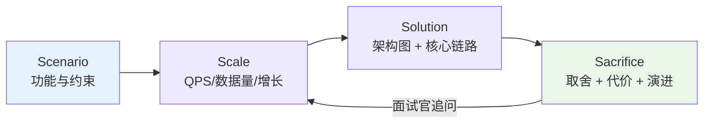
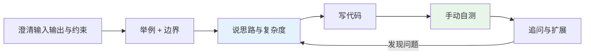
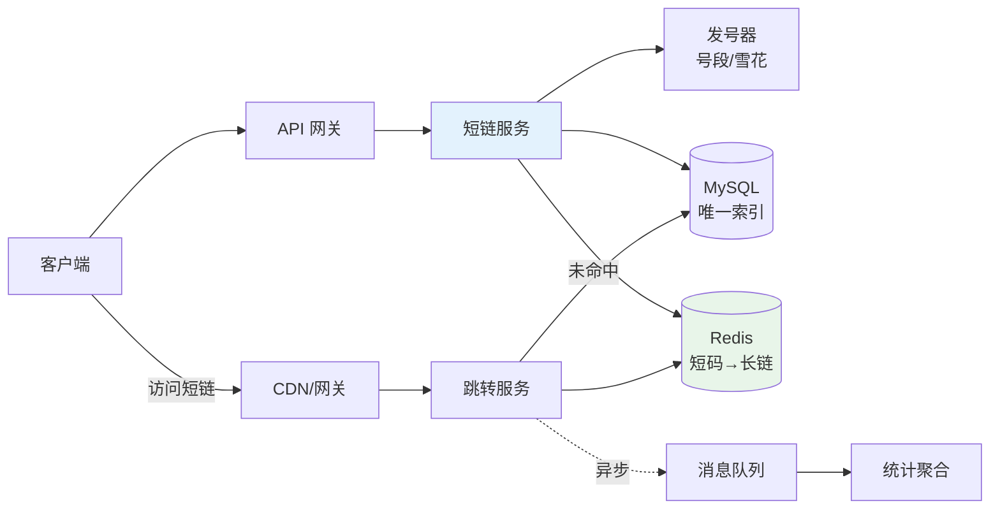

# 白板设计与手写代码场景面试

> 定位：白板环节考的不是「背没背过这道题」，而是「拿到一个模糊问题，能不能先问清楚边界、给出方案、写对代码、讲清取舍」。很多人技术不差却挂在这里：上来就写、不沟通、忽略边界、卡住就沉默。这篇给你一套可复用的答题节奏、系统设计 4S 框架、高频手写题清单，以及 6 道从题目到追问的完整示例。

## 一、白板环节到底在考什么

白板和在线编程通常分两类：

| 类型 | 形式 | 真正考察 |
|---|---|---|
| **手写代码** | 限流器、LRU、并发打印、TopK、SQL | 基本功、边界意识、代码质量、测试习惯 |
| **系统设计白板** | 设计短链、秒杀、IM、Feed | 需求澄清、容量估算、方案取舍、演进能力 |

面试官的观察点很集中：

- **沟通**：会不会先问输入输出、规模、约束，而不是闷头写。
- **拆解**：能不能把大问题拆成可验证的小步骤。
- **正确性**：边界、空值、并发、溢出有没有考虑。
- **代码质量**：命名、分层、可读性，而不是一坨能跑的代码。
- **验证**：写完后会不会自己构造用例走一遍。
- **诚实**：不会时能不能说出思路和卡点，而不是硬编。

> 核心认知：**白板是「协作解题」，不是「闭卷默写」**。面试官希望你边想边说，让他看到你的推理过程；沉默写 20 分钟再抬头，即使代码对了也会丢分。

## 二、系统设计白板：4S 框架

系统设计题没有标准答案，但有标准答题结构。用 **4S**：

| 步骤 | 要回答的问题 | 产出 |
|---|---|---|
| **Scenario 场景** | 给谁用、核心功能是什么、读写比例、一致性要求 | 功能列表 + 非功能约束 |
| **Scale 规模** | QPS、数据量、存储、带宽、增长趋势 | 容量估算数字 |
| **Solution 方案** | 整体架构、核心链路、数据模型、关键组件 | 架构图 + 关键流程 |
| **Sacrifice 取舍** | 为什么选 A 不选 B、代价是什么、怎么演进 | 取舍清单 + 风险 |

**画图顺序**：先画边界（用户、网关、核心服务、存储），再画核心链路（写路径/读路径），然后补数据模型和扩展点，最后才讨论分库分表、缓存、消息队列。**先边界后细节，先主链路后优化**，一上来就纠结 Redis 用哪种数据结构，会让面试官觉得你没有全局观。



读图要点：**4S 不是一次性线性流程**，面试官追问规模或一致性时，要能回到 Scale 重新修正方案。取舍讲得越具体，越像真的做过。

## 三、手写代码的答题节奏

六步，缺一不可：

1. **澄清**：输入是什么、输出是什么、数据范围、是否允许修改原数组、有没有并发。
2. **举例**：用一个小例子确认理解，顺带暴露边界（空、单个、重复、极值）。
3. **说思路**：先讲算法和数据结构，再讲复杂度，得到面试官认可再写。
4. **写代码**：函数拆分、命名清晰、避免炫技；关键边界加注释。
5. **自测**：用刚才的例子手动走一遍，再补一个边界用例。
6. **追问**：主动说「如果数据量变大/要并发/要分布式，我会怎么改」。



读图要点：**说思路发生在写代码之前**。如果面试官不认可你的方案，早改成本最低；写完再推翻，时间和印象都损失。

## 四、高频手写题清单

| 题目 | 核心结构 | 复杂度 | 常见翻车点 |
|---|---|---|---|
| **限流器** | 令牌桶/滑动窗口 | O(1) 时间 | 并发不安全、时间回拨、桶清理 |
| **LRU** | HashMap + 双向链表 | O(1) | 头尾指针、节点删除、容量为 0 |
| **线程安全单例** | 静态内部类/枚举/DCL | O(1) | DCL 忘 `volatile`、反射破坏 |
| **生产者消费者** | 阻塞队列 + 条件变量 | O(1) | `if` 代替 `while`、虚假唤醒 |
| **简易线程池** | 核心/最大线程 + 队列 + 拒绝策略 | — | 队列无界、关闭不优雅 |
| **TopK** | 小顶堆 | O(n log k) | k > n、重复元素、内存 |
| **合并有序链表** | 堆/分治 | O(N log k) | 空链表、dummy 节点 |
| **二叉树遍历** | 递归/栈/队列 | O(n) | 空树、递归深度 |
| **字符串处理** | 双指针/正则/状态机 | O(n) | Unicode、空串、溢出 |
| **SQL** | 窗口函数/自连接 | 视索引 | 并列排名、去重口径、连续日期 |

## 五、并发与 SQL 手写要点

**两个线程交替打印**：核心是「共享状态 + 条件等待」，必须用 `while` 而不是 `if` 防虚假唤醒；用 `ReentrantLock` + 两个 `Condition` 比 `wait/notifyAll` 更可控。

**阻塞队列**：数组 + `head/tail/count` + 两把条件；`put` 在满时等 `notFull`，`take` 在空时等 `notEmpty`；唤醒后要重新检查条件。

**线程安全单例**：静态内部类最简洁；枚举防反射和序列化破坏；DCL 必须 `volatile`，否则可能拿到半初始化对象。

**简易线程池**：核心线程常驻，队列满且未到 `max` 时新建线程，超过 `max` 走拒绝策略；worker 循环取任务，`shutdown` 用毒丸或中断，注意优雅关闭和线程泄漏。

**SQL 三件套**：

```sql
-- 1. 分组 TopN：每个部门薪资前三（MySQL 8 窗口函数）
SELECT * FROM (
  SELECT e.*, ROW_NUMBER() OVER (
           PARTITION BY dept_id ORDER BY salary DESC) AS rn
  FROM employee e
) t WHERE rn <= 3;

-- 2. 去重保留最小 id（先查再删，避免 MySQL 同表更新限制）
DELETE FROM t WHERE id NOT IN (
  SELECT min_id FROM (SELECT MIN(id) AS min_id FROM t GROUP BY biz_key) x
);

-- 3. 连续登录 >= 3 天：日期减去行号，连续段得到同一分组
SELECT user_id, MIN(login_date) AS start_date,
       MAX(login_date) AS end_date, COUNT(*) AS days
FROM (
  SELECT user_id, login_date,
         DATE_SUB(login_date, INTERVAL rn DAY) AS grp
  FROM (
    SELECT user_id, login_date,
           ROW_NUMBER() OVER (PARTITION BY user_id ORDER BY login_date) AS rn
    FROM (SELECT DISTINCT user_id, login_date FROM login_log) d
  ) x
) y
GROUP BY user_id, grp
HAVING COUNT(*) >= 3;
```

并列排名用 `RANK()`/`DENSE_RANK()`，不要用 `ROW_NUMBER()`；连续登录要先按天去重，否则一天多次登录会算错。

## 题 1：手写令牌桶限流器

**题目**：实现一个线程安全的令牌桶，支持 `tryAcquire()`，容量 100，每秒补充 10 个令牌。

**思路**：不用定时任务，惰性补充——每次请求按「距上次的时间 × 速率」补令牌，上限为容量；用锁保护状态。复杂度 O(1)。

```java
public final class TokenBucket {
    private final long capacity;
    private final double refillPerNano;
    private double tokens;
    private long lastNanos;
    private final Object lock = new Object();

    public TokenBucket(long capacity, double refillPerSecond) {
        this.capacity = capacity;
        this.refillPerNano = refillPerSecond / 1_000_000_000.0;
        this.tokens = capacity;
        this.lastNanos = System.nanoTime();
    }

    public boolean tryAcquire() {
        synchronized (lock) {
            long now = System.nanoTime();
            tokens = Math.min(capacity, tokens + (now - lastNanos) * refillPerNano);
            lastNanos = now;
            if (tokens >= 1) {
                tokens -= 1;
                return true;
            }
            return false;
        }
    }
}
```

**追问**：分布式限流怎么做？→ Redis + Lua 原子执行令牌桶/滑动窗口；时钟回拨怎么办？→ 用单调时钟 `nanoTime`，不要用 `currentTimeMillis`；多 key 怎么清理？→ 按 key 分桶 + 过期淘汰。

## 题 2：手写 LRU

**题目**：实现 `get`/`put` 均为 O(1) 的 LRU 缓存。

**思路**：`HashMap` 存 key → 节点，双向链表维护访问顺序；`get` 命中后移到头部，`put` 超容量删尾部。

```java
public final class LRUCache<K, V> {
    private static final class Node<K, V> {
        K key; V value; Node<K, V> prev, next;
        Node(K key, V value) { this.key = key; this.value = value; }
    }

    private final int capacity;
    private final Map<K, Node<K, V>> map = new HashMap<>();
    private final Node<K, V> head = new Node<>(null, null); // dummy
    private final Node<K, V> tail = new Node<>(null, null); // dummy

    public LRUCache(int capacity) {
        if (capacity <= 0) throw new IllegalArgumentException("capacity must be positive");
        this.capacity = capacity;
        head.next = tail;
        tail.prev = head;
    }

    public V get(K key) {
        Node<K, V> node = map.get(key);
        if (node == null) return null;
        moveToHead(node);
        return node.value;
    }

    public void put(K key, V value) {
        Node<K, V> node = map.get(key);
        if (node != null) {
            node.value = value;
            moveToHead(node);
            return;
        }
        if (map.size() == capacity) {
            Node<K, V> last = tail.prev;
            remove(last);
            map.remove(last.key);
        }
        Node<K, V> newNode = new Node<>(key, value);
        map.put(key, newNode);
        addFirst(newNode);
    }

    private void moveToHead(Node<K, V> node) { remove(node); addFirst(node); }

    private void addFirst(Node<K, V> node) {
        node.next = head.next; node.prev = head;
        head.next.prev = node; head.next = node;
    }

    private void remove(Node<K, V> node) {
        node.prev.next = node.next;
        node.next.prev = node.prev;
    }
}
```

**追问**：容量为 0？→ 构造时校验；并发版？→ 加锁或分段 LRU；要过期时间？→ 再加时间轮/惰性过期；为什么不用 `LinkedHashMap`？→ 面试要求手写，工程里 `LinkedHashMap(accessOrder=true)` 更省事。

## 题 3：两个线程交替打印

**题目**：线程 A 打印 1、3、5…，线程 B 打印 2、4、6…，交替输出到 100。

```java
public final class AlternatePrinter {
    private int current = 1;
    private final int max;
    private final Object lock = new Object();

    public AlternatePrinter(int max) { this.max = max; }

    public void printOdd() throws InterruptedException {
        synchronized (lock) {
            while (current <= max) {
                while (current <= max && current % 2 == 0) lock.wait();
                if (current > max) break;
                System.out.println(Thread.currentThread().getName() + ": " + current++);
                lock.notifyAll();
            }
        }
    }

    public void printEven() throws InterruptedException {
        synchronized (lock) {
            while (current <= max) {
                while (current <= max && current % 2 == 1) lock.wait();
                if (current > max) break;
                System.out.println(Thread.currentThread().getName() + ": " + current++);
                lock.notifyAll();
            }
        }
    }
}
```

**追问**：为什么用 `while`？→ 防虚假唤醒和条件被其他线程改变；为什么 `notifyAll`？→ 两个等待条件，`notify` 可能唤醒错线程；用 `Condition` 怎么写？→ 两个 Condition，各自 `signal`，更精确。

## 题 4：TopK

**题目**：从 1 亿个整数中找最大的 K 个，K 远小于 N。

**思路**：维护大小为 K 的小顶堆，堆顶是当前第 K 大；新元素比堆顶大就替换。时间 O(N log K)，空间 O(K)。

```java
public static List<Integer> topK(int[] nums, int k) {
    if (k <= 0) return List.of();
    PriorityQueue<Integer> heap = new PriorityQueue<>(k); // 小顶堆
    for (int x : nums) {
        if (heap.size() < k) {
            heap.offer(x);
        } else if (x > heap.peek()) {
            heap.poll();
            heap.offer(x);
        }
    }
    List<Integer> result = new ArrayList<>(heap);
    result.sort(Comparator.reverseOrder());
    return result;
}
```

**追问**：K 很大接近 N？→ 用快速选择（quickselect）平均 O(N)，但最坏 O(N²)；数据在磁盘？→ 分块 + 每块 TopK 归并；分布式？→ 各分片 TopK 后汇总再取 TopK；重复元素？→ 按「元素」还是「去重后的值」要先确认。

## 题 5：手写阻塞队列

**题目**：用数组实现有界阻塞队列，支持 `put`/`take`。

```java
public final class BoundedQueue<T> {
    private final Object[] items;
    private int head, tail, count;
    private final ReentrantLock lock = new ReentrantLock();
    private final Condition notFull = lock.newCondition();
    private final Condition notEmpty = lock.newCondition();

    public BoundedQueue(int capacity) { items = new Object[capacity]; }

    public void put(T item) throws InterruptedException {
        lock.lockInterruptibly();
        try {
            while (count == items.length) notFull.await();
            items[tail] = item;
            tail = (tail + 1) % items.length;
            count++;
            notEmpty.signal();
        } finally {
            lock.unlock();
        }
    }

    @SuppressWarnings("unchecked")
    public T take() throws InterruptedException {
        lock.lockInterruptibly();
        try {
            while (count == 0) notEmpty.await();
            T item = (T) items[head];
            items[head] = null;
            head = (head + 1) % items.length;
            count--;
            notFull.signal();
            return item;
        } finally {
            lock.unlock();
        }
    }
}
```

**追问**：为什么两个 Condition？→ 生产者和消费者等待条件不同，分开唤醒更精确；`signal` 还是 `signalAll`？→ 这里一个条件只等一类线程，`signal` 够；中断怎么处理？→ `lockInterruptibly` + 向上抛，别吞 `InterruptedException`。

## 题 6：系统设计——短链服务

**题目**：设计一个短链服务，支持创建短链、跳转、统计访问量。

**4S 答题**：

- **Scenario**：核心是「长链转短链 + 302 跳转 + 访问统计」；读写比约 1:100，读多写少；跳转要求低延迟，统计可以异步。
- **Scale**：假设每天新增 1000 万条，5 年约 180 亿条；短码 7 位 Base62 约 3.5 万亿组合，够用；读 QPS 峰值按 10 万估算。
- **Solution**：发号器生成全局 ID → Base62 转短码 → 唯一索引落库；读路径先查 Redis，未命中查 DB 并回填；跳转用 302 便于统计；访问日志异步写消息队列，离线聚合。
- **Sacrifice**：强一致发号器简单但依赖中心服务；多段号段/雪花算法提高可用性但短码不连续；301 省流量但丢失统计；缓存降低延迟但有一致性窗口。



**追问**：短码冲突怎么办？→ 唯一索引 + 重试/重新发号；恶意刷创建怎么防？→ 限流、鉴权、黑名单；自定义短码？→ 单独唯一索引，和系统短码分开命名空间；数据量再大？→ 按短码哈希分库分表，读多写少可加多级缓存。

## 六、翻车点

1. **上来就写代码，不沟通**。题目里的「有序」「不重复」「线程安全」都没确认，写完才发现方向错了。先花 2 分钟澄清，比返工 20 分钟划算。
2. **忽略边界**。空数组、`k > n`、容量为 0、链表为空、整数溢出、重复元素——这些是面试官最容易加用例的地方。
3. **写完不测试**。代码写完就抬头等评价，等于把验证责任交给面试官；主动用一个例子走一遍，再补一个边界。
4. **卡住就沉默**。不会就说「我目前想到 A 方案，但复杂度是 O(n²)，我在想能不能用堆优化到 O(n log k)」——展示思考过程比硬憋答案得分高。
5. **过度设计**。手写 LRU 非要用红黑树，写线程池非要支持动态扩缩容，结果核心逻辑没写完。先把正确版本写出来，再谈优化。
6. **并发细节翻车**。用 `if` 代替 `while` 导致虚假唤醒、DCL 忘 `volatile`、锁顺序不一致导致死锁、吞掉 `InterruptedException`——这些都是「看起来对、跑起来错」的典型。

## 七、沟通与收尾技巧

- **先给结论再展开**：系统设计先说「我会分三层：接入、服务、存储」，再逐层画；手写代码先说「我用小顶堆，时间 O(n log k)」。
- **主动暴露取舍**：说完方案补一句「代价是 XX，如果业务更看重 YY，我会换成 ZZ」。
- **不会的题要拆**：把问题拆成「我确定的部分」和「需要确认的部分」，先做确定的部分。
- **留扩展点**：结尾主动说「如果要支持分布式/高并发/多租户，我会加 XX」，但不要抢跑，等面试官问。
- **代码可读性**：变量名、函数拆分、边界注释；白板代码不要求编译，但要让面试官一眼看懂。

## 小结

- 白板考的是协作解题：澄清、举例、说思路、写代码、自测、追问，六步缺一不可。
- 系统设计用 4S：场景、规模、方案、取舍；先边界后细节，先主链路后优化。
- 高频手写题的核心是「选对数据结构 + 处理边界 + 并发安全」，不是背代码。
- 并发题记住三件事：`while` 防虚假唤醒、锁顺序防死锁、别吞中断。
- SQL 题优先窗口函数；分组 TopN 用 `ROW_NUMBER/RANK`，连续登录用「日期减行号」分组。
- 翻车点集中在「不沟通、忽略边界、不测试、卡住沉默、过度设计、并发细节」。

## 参考资料

- [架构师面试的底层逻辑](01-架构师面试的底层逻辑.md)：STAR-L 与决策链表达
- [高并发场景面试](02-高并发场景面试.md)：限流、缓存、异步的取舍
- [分布式限流](../08-分布式理论与共识/06-分布式限流.md)：令牌桶、滑动窗口、Redis 限流
- [线程池原理与调优](../02-Java底层与并发/08-线程池原理与调优.md)：核心参数与拒绝策略
- [AQS与并发工具](../02-Java底层与并发/07-AQS与并发工具.md)：ReentrantLock、Condition、Semaphore
- Java Concurrency in Practice（Brian Goetz）
