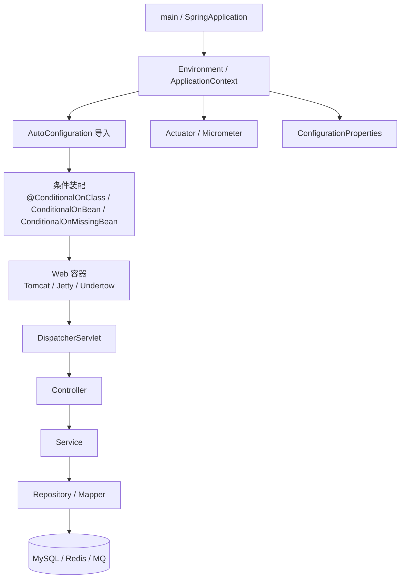

# Spring Boot：Java 应用的事实标准底座

> 定位：Spring Boot 不是一个「业务项目」，而是几乎每个 Java 实战项目都绕不开的底座。把它当项目读，重点不是背注解，而是理解「自动配置怎么把一堆组件装配起来」「内嵌容器怎么启动」「条件装配怎么做到可插拔」「Actuator 怎么暴露运行时」。读透它，你再看 Mall、RuoYi、ThingsBoard 这些项目，才知道它们为什么那样组织模块。

## 一、项目档案

| 项 | 内容 |
|---|---|
| 仓库 | [spring-projects/spring-boot](https://github.com/spring-projects/spring-boot) |
| 定位 | Spring 应用的快速开发底座：自动配置、内嵌容器、生产级监控 |
| 语言/许可 | Java / Apache-2.0 |
| 活跃度 | 截至 2026-11-25，约 8.2 万 Star，最近一次推送 2026-11-24 |
| 官方文档 | [spring.io/projects/spring-boot](https://spring.io/projects/spring-boot) |
| 适合读者 | 已会用 Spring，但没系统读过 Boot 装配机制的人 |

## 二、项目描述：它解决什么问题

传统 Spring 项目要手写大量 XML：数据源、事务管理器、MVC 组件、Jackson、日志、Servlet 容器。Spring Boot 做三件事：

1. **约定优于配置**：starter 依赖 + 自动配置，把常用组件按默认值装配好；
2. **内嵌容器**：把 Tomcat/Jetty/Undertow 打进应用，`main` 方法就能启动；
3. **生产就绪**：Actuator、外部化配置、Profile、健康检查、指标暴露。

它不是「Spring 的替代品」，而是「Spring 的装配层 + 启动层 + 运维层」。

## 三、技术栈

- **核心**：Spring Framework（IOC/AOP/MVC）、Spring Boot 自动配置、条件装配；
- **Web**：Spring MVC、内嵌 Tomcat（默认）、Jackson；
- **数据**：Spring JDBC、事务抽象、连接池（HikariCP 默认）；
- **运行时**：Java 17+（Boot 3.x 基线）、GraalVM Native Image（Boot 3.3+ 支持）；
- **运维**：Actuator、Micrometer、健康检查、外部化配置；
- **测试**：spring-boot-test、MockMvc、Testcontainers 集成。

## 四、核心功能

| 功能 | 说明 |
|---|---|
| Starter | 一组依赖 + 自动配置，如 `spring-boot-starter-web` |
| 自动配置 | `@AutoConfiguration` + `@ConditionalOn*` 按条件装配 |
| 外部化配置 | `application.yml`、环境变量、Profile、`@ConfigurationProperties` |
| 内嵌容器 | Tomcat/Jetty/Undertow 可替换 |
| Actuator | 健康、指标、线程、环境、日志级别 |
| 开发者工具 | DevTools 热重启、LiveReload |
| Native Image | AOT 编译，启动快、内存低，但生态有约束 |

## 五、架构图

关键链路：`SpringApplication.run` 创建 `ApplicationContext`，`AutoConfigurationImportSelector` 读取 `META-INF/spring/...AutoConfiguration.imports`，按条件筛选后注册 Bean；Web 容器根据 `ServletWebServerFactory` 创建，`DispatcherServlet` 接管请求。

## 六、优点与值得学习的设计

项目的核心优点：

- 生态最大：Spring 全家桶的事实标准，招人、找资料、找轮子成本最低。
- 约定优于配置：自动配置 + 起步依赖，把「能跑」和「可维护」的默认路径定好。
- 生产级配套：Actuator、健康检查、外部化配置、可观测性集成齐全。
- 社区与文档成熟：版本演进透明，升级路径与迁移指南可查。

### 6.1 条件装配：可插拔的装配语言

`@ConditionalOnClass`、`@ConditionalOnMissingBean`、`@ConditionalOnProperty` 让「有某个类才装配」「用户自定义了就不装配」成为声明式规则。这是 Spring Boot 生态能容纳大量第三方 starter 的根本。

### 6.2 自动配置的「失败快」

自动配置类如果条件不满足就跳过，不抛异常；但配置错误会在启动时尽早失败。读源码时重点看 `Condition` 的实现和 `AutoConfiguration.imports` 的加载顺序。

### 6.3 外部化配置的优先级

命令行参数 > 环境变量 > `application-{profile}.yml` > `application.yml` > 默认值。理解优先级，才能解释「为什么本地好使、线上不生效」。

### 6.4 Actuator 的运维价值

`/actuator/health`、`/actuator/metrics`、`/actuator/threaddump` 把运行时状态暴露成标准端点，K8s 探针、Prometheus 抓取、人工排查都靠它。生产要限制暴露范围，避免泄漏。

## 七、上手路径

1. 用 `start.spring.io` 生成一个 Web + JDBC + Actuator 项目；
2. 读 `spring-boot-project/spring-boot-autoconfigure` 的 `AutoConfiguration.imports`；
3. 找一个熟悉的 starter（如 `spring-boot-starter-web`），跟一遍自动配置类；
4. 自定义一个 `@ConfigurationProperties`，验证外部化配置优先级；
5. 写一个 `@ConditionalOnMissingBean` 的 starter，理解扩展点；
6. 用 Actuator + Micrometer 接 Prometheus，观察指标。

## 八、边界与风险

- **不是越自动越好**：自动配置隐藏了装配细节，出问题时要能定位到具体 `Condition`；
- **版本升级有破坏性**：Boot 3 的 `javax` → `jakarta`、Boot 4 的模块化调整，升级前看迁移指南；
- **Native Image 不是万能**：反射、动态代理、序列化需要额外配置；
- **Actuator 暴露风险**：生产必须鉴权/限制端点，别把 `/env`、`/heapdump` 暴露公网；
- **启动慢不一定是 Boot 的错**：类加载、Bean 初始化、数据库连接都可能拖慢。

## 九、项目借鉴

- 学它的**模块分层**：`spring-boot-project` 按能力拆分，第三方 starter 只依赖需要的模块；
- 学它的**条件装配**：把「可选能力」做成条件 Bean，而不是到处 `if`；
- 学它的**配置优先级**：线上问题先查「配置从哪来」；
- 学它的**运维端点**：健康检查、指标、线程 dump 是生产标配。

## 小结

- Spring Boot 的核心是「自动配置 + 内嵌容器 + 生产运维」，不是注解集合。
- 条件装配是生态扩展的关键；`@ConditionalOnMissingBean` 是自定义 starter 的入口。
- 配置优先级、Actuator 暴露范围、版本迁移是生产最容易踩的三个坑。
- 读 Boot 的收益不在「会写 Controller」，而在「知道 Bean 从哪来、为什么没装配」。
