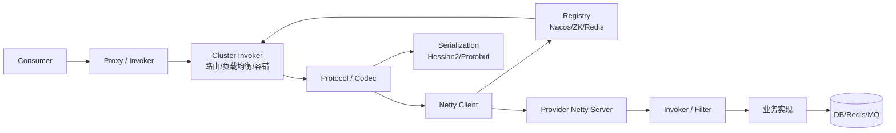

# Apache Dubbo：Java RPC 与微服务通信的教科书

> 定位：Dubbo 是 Java 领域最值得读的 RPC 框架之一：SPI 扩展、协议设计、集群容错、服务治理、泛化调用，几乎覆盖了「服务间通信」的所有核心问题。把它当项目读，重点不是写 Provider/Consumer，而是理解「一次 RPC 从代理到网络再到序列化」的完整链路。

## 一、项目档案

| 项 | 内容 |
|---|---|
| 仓库 | [apache/dubbo](https://github.com/apache/dubbo) |
| 定位 | 高性能 Java RPC 与微服务框架 |
| 语言/许可 | Java / Apache-2.0 |
| 活跃度 | 截至 2026-11-25，约 4.16 万 Star，最近推送 2026-11-20 |
| 官方文档 | [dubbo.apache.org](https://dubbo.apache.org/) |
| 适合读者 | 想理解 RPC、服务治理、SPI、Netty 实战的人 |

## 二、项目描述：它解决什么问题

单体拆成微服务后，服务间调用从「方法调用」变成「网络调用」，要处理：

- 透明代理：让调用方像调本地方法；
- 协议与序列化：跨语言、跨版本、性能；
- 集群容错：失败重试、熔断、负载均衡；
- 服务治理：路由、限流、降级、监控；
- 扩展性：协议、序列化、过滤器、注册中心都可替换。

Dubbo 的核心价值是把这些「通信横切面」做成可扩展的框架，而不是让每个团队重复造轮子。

## 三、技术栈

- **网络**：Netty（默认）、HTTP/2、Triple 协议；
- **协议**：Dubbo 协议、Triple（gRPC 兼容）；
- **序列化**：Hessian2、Fastjson2、Protobuf、JDK；
- **注册中心**：Nacos、ZooKeeper、Redis、Multicast；
- **治理**：路由、负载均衡、集群容错、限流、熔断、Metrics；
- **扩展**：SPI、Filter、Invoker、Protocol、Serialization。

## 四、核心功能

| 功能 | 说明 |
|---|---|
| 透明代理 | 接口 + 注解，调用方无感知 |
| 多协议 | Dubbo/Triple/HTTP，Triple 兼容 gRPC |
| 多序列化 | Hessian2/Protobuf/Fastjson2 等 |
| 注册中心 | Nacos/ZK/Redis，服务发现 |
| 集群容错 | Failover、Failfast、Failsafe、Forking |
| 负载均衡 | Random、RoundRobin、LeastActive、ConsistentHash |
| 服务治理 | 路由、标签、限流、熔断、Metrics |
| 泛化调用 | 无接口依赖，适合网关/测试 |

## 五、架构图

一次调用：Consumer 侧代理 → Cluster Invoker 选 Provider → 编码 → Netty 发送 → Provider 解码 → Filter 链 → 业务方法 → 响应回传。

## 六、优点与值得学习的设计

项目的核心优点：

- 高性能 RPC：长连接 + 自定义协议 + 序列化扩展，延迟与吞吐都适合核心链路。
- 扩展点丰富：SPI、Filter、Cluster、Protocol 都可替换，能按业务定制。
- 服务治理内建：超时、重试、容错、路由、限流有统一模型。
- 多协议与多语言：Triple 兼容 gRPC，跨语言服务可复用同一套治理能力。

### 6.1 SPI：一切可替换

Dubbo 的 `ExtensionLoader` 不是 JDK SPI 的简单封装，而是支持「自适应扩展」「按名激活」「Wrapper 包装」。理解它，你就理解了 Dubbo 为什么能同时支持多种协议、序列化、注册中心。

### 6.2 协议与序列化的解耦

协议负责「怎么传」，序列化负责「怎么编」。两者解耦后，可以在不改协议的情况下换序列化，也可以在不换序列化的情况下支持新协议。

### 6.3 Cluster Invoker 的容错策略

- Failover：失败换下一个；
- Failfast：失败立即抛；
- Failsafe：失败返回空值；
- Forking：并行调用多个，取第一个成功。

策略选择取决于「读多还是写多、能否重复调用、是否允许降级」。

### 6.4 Filter 链

Filter 把「日志、监控、限流、鉴权、异常」从业务代码中剥离，按顺序执行。这是 RPC 框架的 AOP。

### 6.5 Triple 协议

Triple 兼容 gRPC，支持 HTTP/2、流式调用、跨语言。它让 Dubbo 从「Java 内部 RPC」走向「多语言服务通信」。

## 七、上手路径

1. 起一个 Nacos，跑官方 `dubbo-samples` 的 provider/consumer；
2. 跟一次 `ProxyFactory.getProxy` → `Invoker` → `ClusterInvoker` 调用链；
3. 换一种序列化（Hessian2 → Protobuf），观察配置变化；
4. 配一个 Failover 集群，杀掉一个 Provider 看切换；
5. 加一个自定义 Filter，打印耗时；
6. 读 `dubbo-protocol` 的编解码与 `dubbo-remoting-netty` 的 Handler。

## 八、边界与风险

- **RPC 不是越透明越好**：网络调用有超时、重试、幂等、序列化成本，接口设计要显式；
- **重试可能放大故障**：非幂等写接口不能盲目重试；
- **注册中心是单点**：Nacos/ZK 挂了，服务发现会受影响，要做本地缓存；
- **序列化兼容性**：跨版本升级要防字段不兼容；
- **泛化调用性能低**：适合网关/测试，不适合高频核心链路。

## 九、项目借鉴

- 学它的**分层**：proxy / cluster / protocol / remoting / serialization 各司其职；
- 学它的**扩展点**：SPI + Filter + Invoker，把横切能力做成插件；
- 学它的**容错策略**：不同业务选不同 Cluster Invoker；
- 学它的**协议设计**：魔数、版本、序列化 ID、状态、请求 ID、长度字段。

## 小结

- Dubbo 的核心是「透明代理 + 可扩展协议 + 集群容错 + 服务治理」。
- SPI 是它一切可替换的根基；Filter 是它的 AOP。
- 一次 RPC 的完整链路：代理 → 集群选路 → 编码 → Netty → 解码 → Filter → 业务。
- 生产上最需要防的是：重试放大、注册中心单点、序列化兼容、泛化调用滥用。
