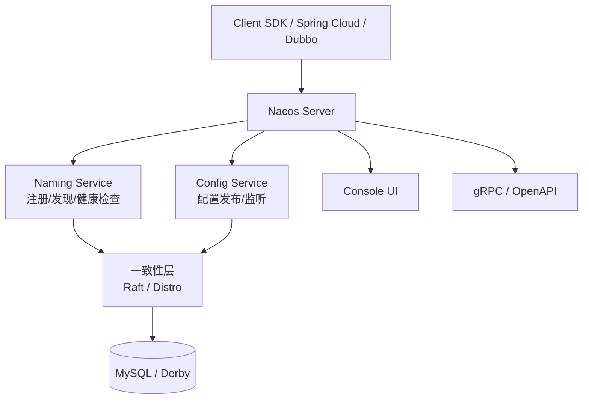

# Nacos：服务发现与配置中心的工程范本

> 定位：Nacos 把「注册中心 + 配置中心」做成一个可独立部署、可集群、可插拔存储的平台。它值得学的不是「怎么启动」，而是「临时节点/持久节点怎么设计」「Raft 与 Distro 怎么保证一致性」「配置变更怎么推送」「AP/CP 怎么切换」。

## 一、项目档案

| 项 | 内容 |
|---|---|
| 仓库 | [alibaba/nacos](https://github.com/alibaba/nacos) |
| 定位 | 动态服务发现、配置管理、服务治理平台 |
| 语言/许可 | Java / Apache-2.0 |
| 活跃度 | 截至 2026-11-25，约 3.35 万 Star，最近推送 2026-11-25 |
| 官方文档 | [nacos.io](https://nacos.io/) |
| 适合读者 | 想理解注册中心、配置中心、Raft、集群一致性的人 |

## 二、项目描述：它解决什么问题

微服务数量一多，就会遇到：

- 服务实例地址变化，调用方怎么发现？
- 配置散落在各服务，改了怎么统一推送、怎么回滚？
- 多环境/多租户配置怎么隔离？
- 注册中心自己怎么高可用？

Nacos 提供：服务注册/发现、健康检查、配置管理、命名空间、集群、持久化。

## 三、技术栈

- **框架**：Spring Boot、Spring Cloud Alibaba；
- **通信**：gRPC（2.x 内部通信）、HTTP OpenAPI；
- **一致性**：Raft（JRaft）、Distro（AP/CP 切换）；
- **存储**：内嵌 Derby、外部 MySQL；
- **客户端**：Java SDK、Spring Cloud、Dubbo、K8s；
- **控制台**：Console UI。

## 四、核心功能

| 功能 | 说明 |
|---|---|
| 服务注册 | 临时实例（心跳）与持久实例 |
| 服务发现 | 按服务名/分组/集群查询 |
| 健康检查 | 心跳、主动探测 |
| 配置管理 | 配置发布、灰度、回滚、监听 |
| 命名空间 | 多租户/多环境隔离 |
| 集群 | Raft（CP）/ Distro（AP） |
| 权限 | 鉴权、命名空间权限 |

## 五、架构图

集群模式下，多个 Nacos 节点通过 Raft（CP）或 Distro（AP）同步；配置写 MySQL 或内嵌存储；客户端通过 gRPC/HTTP 长连接或轮询获取变更。

## 六、优点与值得学习的设计

项目的核心优点：

- 注册与配置一体：服务发现和动态配置一个组件解决，减少一套运维。
- 一致性可选：临时实例走 Distro（AP），持久实例走 Raft（CP），按场景取舍。
- 生态集成好：Spring Cloud、Dubbo、K8s 都有成熟接入方式。
- 控制台与命名空间：多环境/多租户隔离直观，排障成本低。

### 6.1 临时实例与持久实例

- **临时实例**：客户端心跳维持，心跳断了自动摘除，适合动态扩缩容的服务；
- **持久实例**：主动健康检查，不依赖客户端心跳，适合数据库/中间件等固定服务。

这个区分解决了「服务挂了但没注销」和「服务不想改代码上报心跳」两类问题。

### 6.2 AP/CP 切换

Nacos 1.x 用 Distro，2.x 用 Raft。Raft 保证强一致（CP），Distro 允许 AP。选型要问：注册中心能不能短暂不一致？配置能不能丢？答案不同，模式不同。

### 6.3 配置监听与推送

客户端通过长轮询/长连接监听配置变化；Nacos 在配置发布后推送变更，客户端收到后刷新本地缓存。关键是「本地缓存 + 版本号」，避免注册中心不可用时业务完全不可用。

### 6.4 命名空间隔离

用 namespace/group 隔离多环境、多租户，避免测试配置污染生产。权限模型也要跟着隔离。

### 6.5 健康检查

临时实例靠心跳，持久实例靠 TCP/HTTP 探测。健康检查不是「越频繁越好」，要考虑探测成本与误判。

## 七、上手路径

1. 单机模式启动 Nacos，注册一个服务，用 SDK 发现；
2. 发布一个配置，写客户端监听，观察推送；
3. 搭三节点集群，杀掉 leader，观察选举；
4. 切 MySQL 存储，重启验证配置持久化；
5. 读 `nacos-naming` 与 `nacos-config` 模块；
6. 用 namespace 隔离两个环境。

## 八、边界与风险

- **注册中心不是配置中心万能药**：频繁变更的大配置不适合放 Nacos；
- **客户端缓存必须做**：Nacos 挂了，业务不能跟着挂；
- **Raft 有写瓶颈**：写多读少场景要评估；
- **临时实例心跳风暴**：实例多时要控制心跳频率；
- **权限默认配置**：生产必须改默认密码、开鉴权。

## 九、项目借鉴

- 学它的**临时/持久实例模型**：区分「客户端上报」与「服务端探测」；
- 学它的**一致性模式**：AP/CP 不是口号，要落到 Raft/Distro；
- 学它的**配置监听**：长轮询 + 本地缓存 + 版本号；
- 学它的**命名空间**：多环境隔离从第一天就要设计。

## 小结

- Nacos = 注册中心 + 配置中心 + 服务治理，核心是「发现」与「配置」两条链路。
- 临时实例靠心跳，持久实例靠探测；两者不要混用。
- 集群一致性有 Raft（CP）与 Distro（AP）两种模式，按业务容忍度选。
- 客户端必须本地缓存，注册中心不可用时业务要能降级运行。
