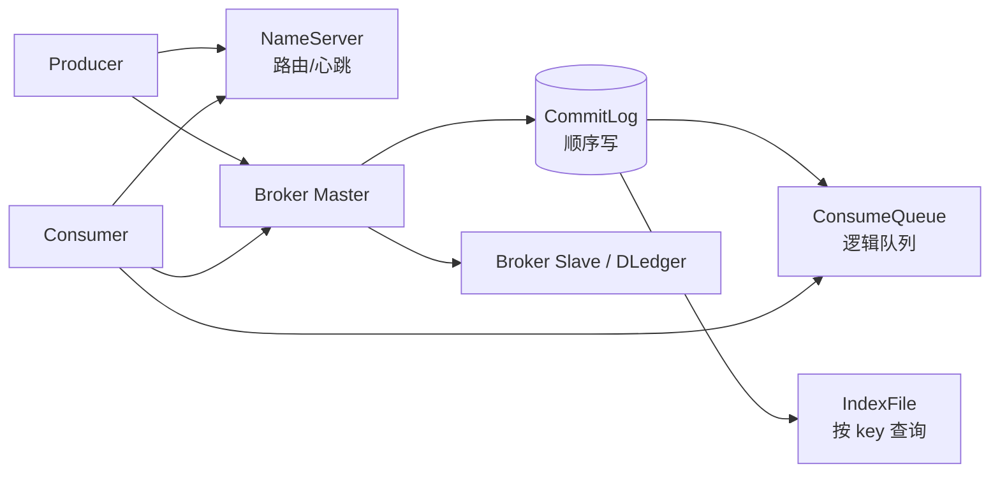

# Apache RocketMQ：消息中间件的存储与事务设计

> 定位：RocketMQ 是学习「消息中间件怎么做到高吞吐、低延迟、可靠投递」的最佳项目之一。它的 CommitLog + ConsumeQueue + IndexFile 存储模型、事务消息、延迟消息、顺序消息，都是面试和架构设计的常客。读它，重点看「一条消息从 Producer 到 Broker 磁盘，再到 Consumer」的完整路径。

## 一、项目档案

| 项 | 内容 |
|---|---|
| 仓库 | [apache/rocketmq](https://github.com/apache/rocketmq) |
| 定位 | 云原生消息与流处理平台 |
| 语言/许可 | Java / Apache-2.0 |
| 活跃度 | 截至 2026-11-25，约 2.27 万 Star，最近推送 2026-11-25 |
| 官方文档 | [rocketmq.apache.org](https://rocketmq.apache.org/) |
| 适合读者 | 想理解 MQ 存储、事务消息、顺序/延迟消息的人 |

## 二、项目描述：它解决什么问题

消息队列要同时满足：

- 高吞吐：百万级 TPS；
- 低延迟：毫秒级；
- 可靠：不丢消息、可重试；
- 有序：同一业务键顺序消费；
- 事务：本地事务与消息发送最终一致；
- 延迟：定时/延时消息。

RocketMQ 用「顺序写 CommitLog + 消费队列 + 索引文件」解决存储，用「半消息 + 回查」解决事务，用「队列锁 + 顺序消费」解决有序。

## 三、技术栈

- **网络**：Netty；
- **存储**：CommitLog、ConsumeQueue、IndexFile、PageCache；
- **高可用**：主从复制、DLedger（Raft）；
- **协议**：Remoting 自定义协议；
- **生态**：Spring、Spring Cloud Stream、Flink、Connector；
- **运维**：Dashboard、MQAdmin。

## 四、核心功能

| 功能 | 说明 |
|---|---|
| 普通消息 | 生产者发送、消费者订阅 |
| 顺序消息 | 按队列/业务键保序 |
| 事务消息 | 半消息 + 本地事务 + 回查 |
| 延迟消息 | 延迟等级/定时消息 |
| 批量消息 | 批量发送降低 RPC 次数 |
| 消息重试 | 消费失败重试 + 死信队列 |
| 消息过滤 | Tag/SQL92 过滤 |
| 主从/DLedger | 高可用与一致性 |

## 五、架构图

NameServer 无状态、可集群；Broker 注册路由与心跳；消息先顺序写 CommitLog，再异步构建 ConsumeQueue/IndexFile；Consumer 按 ConsumeQueue 拉取，按位点消费。

## 六、优点与值得学习的设计

项目的核心优点：

- 高吞吐低延迟：CommitLog 顺序写 + ConsumeQueue 索引，适合交易/订单链路。
- 消息能力完整：事务消息、顺序消息、延迟消息、死信队列都有生产级实现。
- 可靠性强：同步刷盘/异步刷盘、主从/ DLedger 可组合。
- 云原生与治理：Dashboard、运维工具、K8s 部署成熟。

### 6.1 CommitLog 顺序写

所有消息追加到一个 CommitLog，利用磁盘顺序写和 PageCache，避免随机 IO。ConsumeQueue 只是逻辑索引，体量小，可全部加载。

### 6.2 ConsumeQueue 与 IndexFile

- ConsumeQueue：按 Topic + Queue 组织，存消息在 CommitLog 的偏移/大小/Tag hash；
- IndexFile：按消息 key 建倒排索引，支持按 key 查询。

这是「写优化」与「读优化」分离的典型设计。

### 6.3 事务消息

1. Producer 发半消息到 Broker；
2. Broker 存半消息，不投递；
3. Producer 执行本地事务；
4. 提交/回滚；
5. 若未收到提交，Broker 回查 Producer。

解决「本地事务成功、消息发送失败」的最终一致问题。注意消费端仍要幂等。

### 6.4 顺序消息

同一业务键路由到同一队列，消费端用队列锁保证顺序。全局顺序要单队列，吞吐会下降；通常只保证「业务键级顺序」。

### 6.5 延迟消息

RocketMQ 用延迟等级/定时时间轮实现；延迟消息不是「精确到毫秒」，要评估误差。

## 七、上手路径

1. 起 NameServer + Broker，发一条普通消息；
2. 用 `mqadmin` 查 CommitLog/ConsumeQueue 结构；
3. 写一个事务消息 Demo，模拟本地事务失败/回查；
4. 配顺序消息，观察同一队列的消费顺序；
5. 杀 Broker，观察主从切换/DLedger；
6. 读 `store` 模块的 `CommitLog` 与 `ConsumeQueue`。

## 八、边界与风险

- **消息不丢需要端到端设计**：生产确认、Broker 刷盘、消费确认、重试/死信；
- **重复消费不可避免**：消费端必须幂等；
- **顺序消息有代价**：单队列吞吐受限，别滥用全局顺序；
- **延迟消息有精度限制**：不同版本能力不同；
- **积压会打爆磁盘**：监控堆积、限流、扩容。

## 九、项目借鉴

- 学它的**存储分层**：CommitLog 写、ConsumeQueue 读、IndexFile 查询；
- 学它的**事务消息**：半消息 + 回查 + 幂等；
- 学它的**顺序设计**：业务键路由 + 队列锁；
- 学它的**高可用**：主从/DLedger， NameServer 无状态。

## 小结

- RocketMQ 的核心是「顺序写 CommitLog + 逻辑 ConsumeQueue + 索引 IndexFile」。
- 事务消息解决「本地事务与消息发送」的最终一致，消费端仍要幂等。
- 顺序消息按业务键路由，全局顺序代价高。
- 生产可靠性要端到端设计：确认、刷盘、重试、死信、监控。
