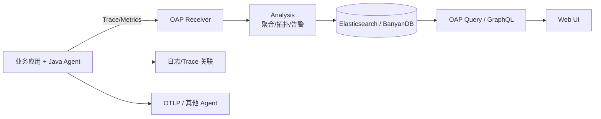

# Apache SkyWalking：可观测性的完整落地

> 定位：SkyWalking 是 Java 生态最完整的 APM 项目之一：Java Agent 无侵入埋点、分布式追踪、服务拓扑、指标聚合、告警、日志关联。读它，重点理解「一次请求的 Trace 怎么跨线程/跨服务传播」「Agent 怎么做到低开销」「OAP 怎么接收、聚合、存储、查询」。

## 一、项目档案

| 项 | 内容 |
|---|---|
| 仓库 | [apache/skywalking](https://github.com/apache/skywalking) |
| 定位 | APM / 分布式追踪 / 可观测性平台 |
| 语言/许可 | Java / Apache-2.0 |
| 活跃度 | 截至 2026-11-25，约 2.5 万 Star，最近推送 2026-11-25 |
| 官方文档 | [skywalking.apache.org](https://skywalking.apache.org/) |
| 适合读者 | 想理解链路追踪、Agent 埋点、可观测性后端的人 |

## 二、项目描述：它解决什么问题

微服务出问题时，日志、指标、链路分散在不同服务：

- 一次请求经过哪些服务？哪一段慢？
- 跨线程/异步/消息队列后，Trace 怎么延续？
- 服务依赖拓扑是什么？
- 指标怎么聚合、告警？

SkyWalking 用 Agent + OAP + Storage + UI 四层解决。

## 三、技术栈

- **Agent**：Java Agent（ByteBuddy 字节码增强）、OpenTelemetry 协议；
- **后端 OAP**：Spring Boot、gRPC/HTTP、GraphQL；
- **存储**：Elasticsearch、BanyanDB、H2/MySQL（轻量）；
- **UI**：React；
- **协议**：SkyWalking 原生协议、OTLP；
- **生态**：Spring Cloud、Dubbo、Kafka、gRPC、Service Mesh。

## 四、核心功能

| 功能 | 说明 |
|---|---|
| 分布式追踪 | TraceId/SpanId 跨服务传播 |
| 服务拓扑 | 自动发现服务依赖 |
| 指标 | 响应时间、QPS、错误率、JVM |
| 告警 | 阈值/规则告警 |
| 日志关联 | Trace 与日志绑定 |
| Profiling | 线程/方法级采样 |
| 多语言 | Java、Go、Python、Node、.NET |

## 五、架构图

Agent 通过字节码增强拦截框架入口（Spring MVC、Dubbo、Kafka、JDBC），生成 Span 并通过 gRPC/HTTP 上报；OAP 接收、聚合、写入存储；UI 查询展示。

## 六、优点与值得学习的设计

项目的核心优点：

- 无侵入接入：Java Agent 字节码增强，业务代码基本不用改。
- 多语言覆盖：Java、Go、Python、Node、.NET 等 Agent 体系完整。
- 三类信号统一：Trace、Metrics、Logs 在 OAP 侧关联，排障不用来回切工具。
- 可扩展：OAP 模块化，存储可选 ES/BanyanDB，采样与告警可配。

### 6.1 无侵入埋点

Agent 用 ByteBuddy 在类加载时增强，不改业务代码；通过插件识别框架（Spring、Dubbo、gRPC），自动创建 Span。关键是「只增强关键入口」，避免全量方法插桩。

### 6.2 Trace 上下文传播

跨线程用 `TraceContext`/`ContextSnapshot` 传递；跨服务用 HTTP Header（`sw8`）或 MQ Header 传播；异步/线程池要显式快照，否则 Trace 断链。

### 6.3 采样与开销

全量采集会拖垮应用；SkyWalking 支持采样率、慢请求优先、Agent 本地缓冲/批量上报。可观测性本身也要算成本。

### 6.4 存储与查询分离

OAP 接收/分析/查询分离，存储可换 ES/BanyanDB；BanyanDB 是自研时序存储，针对 Trace/Metric 优化。

### 6.5 服务拓扑

通过 Span 的上下游关系自动构建服务依赖图，不需要额外维护架构图。这对存量系统治理非常有价值。

## 七、上手路径

1. 起 OAP + ES（或 H2 轻量模式）+ UI；
2. 给一个 Spring Boot 应用挂 Java Agent；
3. 访问接口，看 Trace、拓扑、指标；
4. 用线程池/异步调用，观察 Trace 是否断链；
5. 接一个 Dubbo/Kafka 调用，看跨服务传播；
6. 读 `skywalking-agent` 的插件与 `oap-server` 的 receiver/analysis。

## 八、边界与风险

- **Agent 有开销**：字节码增强、Span 创建、上报都占 CPU/内存，生产要采样；
- **Trace 断链**：线程池、异步、MQ 消费都要显式传播上下文；
- **存储成本**：全量 Trace 很贵，要保留策略/采样；
- **版本兼容**：Agent 与 OAP 版本要匹配；
- **安全**：Agent 上报端口、UI 权限要隔离。

## 九、项目借鉴

- 学它的**插件化 Agent**：按框架识别，不要全量插桩；
- 学它的**上下文传播**：TraceId 跨线程/跨服务；
- 学它的**采样策略**：慢请求优先，控制开销；
- 学它的**拓扑自动发现**：从调用关系反推架构。

## 小结

- SkyWalking = Agent + OAP + Storage + UI，核心是「追踪 + 指标 + 拓扑」。
- Agent 用字节码增强做到无侵入，但要控制插桩范围与采样。
- Trace 跨线程/跨服务传播是可观测性的难点，异步场景必须显式传递。
- 可观测性有成本，生产要采样、保留策略、权限隔离。
