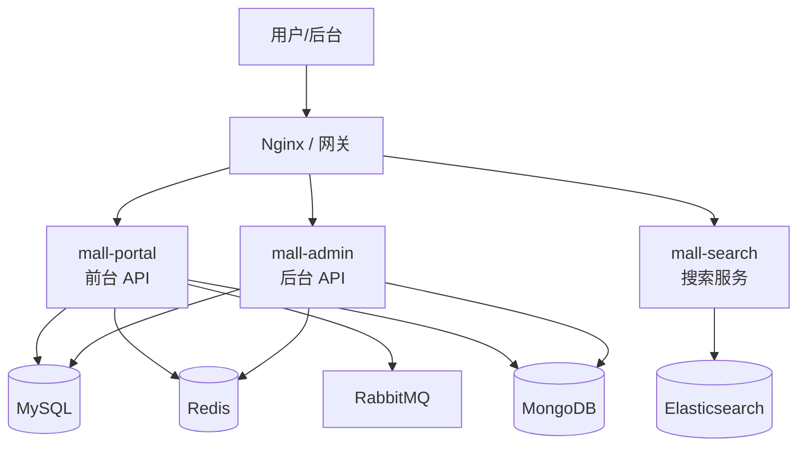

# Mall：一套完整的电商系统，适合拆着读

> 定位：Mall 是「业务闭环最完整」的 Java 开源项目之一：商品、SKU、购物车、订单、支付、优惠券、会员、搜索、后台权限都有。它不适合当「架构最先进」的范本，但非常适合当「一个电商系统到底有哪些模块、表怎么设计、链路怎么串」的实战教材。

## 一、项目档案

| 项 | 内容 |
|---|---|
| 仓库 | [macrozheng/mall](https://github.com/macrozheng/mall) |
| 定位 | 前台商城 + 后台管理系统的完整电商项目 |
| 语言/许可 | Java / Apache-2.0 |
| 活跃度 | 截至 2026-11-25，约 8.5 万 Star，最近推送 2026-09-15 |
| 官方文档 | [macrozheng.github.io/mall](https://macrozheng.github.io/mall/) |
| 适合读者 | 想完整走一遍电商业务链路、学模块拆分与表设计的人 |

## 二、项目描述：它解决什么问题

电商系统不是「商品 + 订单」两张表，而是：

- 商品与 SKU 的多规格、库存、上下架；
- 购物车、下单、支付、发货、售后状态机；
- 优惠券、促销、会员积分；
- 搜索、推荐、首页展示；
- 后台权限、运营、报表。

Mall 把这些模块做成可运行的多模块项目，适合按业务域拆读。

## 三、技术栈

- **后端**：Spring Boot、MyBatis、Spring Security（后台权限）；
- **前端**：Vue + Element UI（后台）、React/Vue（前台，按仓库为准）；
- **存储**：MySQL、Redis（缓存/购物车）、MongoDB（商品详情/日志）；
- **搜索**：Elasticsearch；
- **消息**：RabbitMQ（订单延迟取消/异步）；
- **部署**：Docker、Nginx。

## 四、核心功能

| 域 | 功能 |
|---|---|
| 商品 | 商品、SKU、属性、分类、品牌、库存 |
| 交易 | 购物车、下单、订单状态、支付回调、退款 |
| 营销 | 优惠券、促销、会员、积分 |
| 搜索 | ES 商品搜索、筛选项、排序 |
| 后台 | 权限、菜单、运营、报表 |
| 内容 | 首页推荐、广告、专题 |

## 五、架构图

按仓库实际模块为准，常见拆分是 `mall-admin`、`mall-portal`、`mall-search`，共享 MySQL/Redis/MongoDB/ES；搜索走 ES，订单延迟/异步走 RabbitMQ。

## 六、优点与值得学习的设计

项目的核心优点：

- 电商闭环完整：商品、订单、购物车、支付、后台、权限一条链路齐全。
- 业务建模真实：SPU/SKU、订单状态机、库存与优惠的边界贴近生产。
- 技术栈主流：Spring Boot + MyBatis + Redis + ES + RabbitMQ，适合作为综合案例。
- 教学友好：文档、接口、后台界面完整，容易跑通并二次改造。

### 6.1 商品与 SKU 模型

SPU（标准产品单位）+ SKU（库存量单位）是电商的核心建模：SPU 描述「是什么」，SKU 描述「具体规格 + 库存 + 价格」。属性、图片、分类都挂在 SPU/SKU 上。

### 6.2 订单状态机

待支付 → 已支付 → 待发货 → 已发货 → 已完成/已取消/退款。每个状态有超时、补偿、幂等。订单表不要用「一个 status 字段打天下」，要配状态机与操作日志。

### 6.3 缓存与搜索的边界

- Redis 缓存热点商品/购物车，不缓存强一致订单；
- ES 承担搜索与筛选，MySQL 是事实源；
- 商品详情用 MongoDB 存富文本/规格，降低 MySQL 压力。

### 6.4 后台权限

菜单、角色、资源、数据权限分离；后台接口必须做鉴权，不能只靠前端隐藏按钮。

### 6.5 订单延迟取消

用 RabbitMQ 延迟队列/死信队列实现「30 分钟未支付取消」，配合状态机与库存回补。

## 七、上手路径

1. 用 Docker Compose 起 MySQL/Redis/ES/MongoDB/RabbitMQ；
2. 先跑 `mall-admin`，看商品/SKU/订单表；
3. 跟一次「加购 → 下单 → 支付回调 → 发货」链路；
4. 看搜索模块如何把 MySQL 数据同步到 ES；
5. 读订单状态机与延迟取消；
6. 选一个域（商品/订单/优惠券）画表关系图。

## 八、边界与风险

- **不是微服务架构范本**：它更偏多模块单体，别把它当 Spring Cloud 标准答案；
- **秒杀/高并发能力有限**：适合学习业务闭环，不是大促压测范本；
- **数据一致性**：ES/Redis/Mongo 与 MySQL 的同步要有时延与补偿；
- **权限**：后台管理系统的默认配置要改成生产安全配置；
- **表数量多**：不要一上来全读，按业务域拆。

## 九、项目借鉴

- 学它的**电商建模**：SPU/SKU、订单状态机、优惠券规则；
- 学它的**模块拆分**：admin/portal/search 按端拆，不是按技术分层拆；
- 学它的**多存储选型**：MySQL 事实源、Redis 缓存、ES 搜索、Mongo 富文档；
- 学它的**业务闭环**：从商品到售后的完整链路。

## 小结

- Mall 的价值是「完整电商业务闭环」，不是「最先进架构」。
- SPU/SKU、订单状态机、优惠券、搜索同步是四个最值得读的点。
- MySQL/Redis/ES/MongoDB/RabbitMQ 各有边界，别互相替代。
- 读法：按业务域拆，不要按代码目录从头读到尾。
