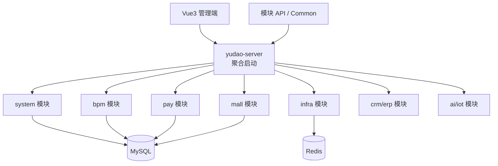

# RuoYi-Vue-Pro：模块化单体与多租户的实战范本

> 定位：RuoYi-Vue-Pro（芋道源码）是国内 Star 数最高的 Java 后台管理系统之一。它的价值不在「界面好看」，而在「一个大型后台系统怎么用模块化单体组织：系统、基础设施、工作流、支付、商城、CRM、ERP、IoT、AI 全部拆成模块，又能一起部署」。

## 一、项目档案

| 项 | 内容 |
|---|---|
| 仓库 | [YunaiV/ruoyi-vue-pro](https://github.com/YunaiV/ruoyi-vue-pro) |
| 定位 | 后台管理系统 + 多租户 SaaS + 业务模块基座 |
| 语言/许可 | Java / MIT |
| 活跃度 | 截至 2026-11-25，约 4.06 万 Star，最近推送 2026-11-23 |
| 官方文档 | [doc.iocoder.cn](https://doc.iocoder.cn/) |
| 适合读者 | 想学模块化单体、多租户、数据权限、工作流的人 |

## 二、项目描述：它解决什么问题

中后台系统通常从「用户/角色/菜单」起步，随后不断加：

- 多租户/SaaS；
- 数据权限（部门/角色/租户）；
- 工作流、审批；
- 支付、商城、CRM、ERP；
- 代码生成、API 日志、监控。

如果一开始不按模块拆，最后会变成「一个 service 包几千个类」。RuoYi-Vue-Pro 用 Maven 多模块 + 模块 API 解决。

## 三、技术栈

- **后端**：Spring Boot、MyBatis Plus、Spring Security/Sa-Token（按版本）、Flowable；
- **前端**：Vue 3 + Element Plus / Ant Design Vue；
- **存储**：MySQL、Redis；
- **能力**：多租户、数据权限、工作流、支付、商城、CRM、ERP、IoT、AI；
- **部署**：单体聚合 `yudao-server`，模块可按需拆分。

## 四、核心功能

| 模块 | 功能 |
|---|---|
| system | 用户、角色、菜单、部门、数据权限 |
| infra | 代码生成、API 日志、文件、定时任务、监控 |
| bpm | Flowable 工作流、审批 |
| pay | 支付渠道、退款、对账 |
| mall | 商品、订单、促销 |
| crm/erp | 客户、合同、进销存 |
| iot | 设备、物模型 |
| ai | 大模型接入、知识库 |

## 五、架构图

模块之间通过 API 接口/事件通信，不直接依赖实现；`yudao-server` 只做聚合启动。这样既能单体部署，也能按模块拆成服务。

## 六、优点与值得学习的设计

项目的核心优点：

- 开箱即用：权限、菜单、租户、代码生成、工作流、支付等企业后台常用能力齐全。
- 模块化单体：模块边界清晰，既能单体部署，也能按需拆服务。
- 多租户与数据权限：SaaS 场景的隔离模型有完整实现，不是 Demo 级。
- 代码生成与低代码：能快速把表结构变成可用页面，降低重复劳动。

### 6.1 模块化单体

每个业务域一个 Maven 模块，模块内 controller/service/dal 自洽，模块间通过 `api` 包暴露接口。比「一上来微服务」更适合中小团队：部署简单、事务本地化、排障容易。

### 6.2 多租户

租户隔离通常在「租户 ID + 拦截器/MyBatis 插件」层实现；要区分：

- 共享库共享表（加 tenant_id）；
- 共享库独立表；
- 独立库。

选型看隔离强度、运维成本、数据量。

### 6.3 数据权限

数据权限不是「角色能看哪些菜单」，而是「能查哪些数据」：按部门、按租户、按自定义规则。实现上常用 MyBatis 拦截器拼接 SQL 条件，注意 SQL 注入与性能。

### 6.4 代码生成

从表结构生成 controller/service/mapper/Vue 页面，降低重复劳动；但生成代码要可维护，不能生成完就没人敢改。

### 6.5 工作流

Flowable 集成要处理：业务表单与流程变量、审批人规则、驳回/撤回、并行网关。工作流不是「画个图」就完了。

## 七、上手路径

1. 起 MySQL/Redis，跑 `yudao-server` 与 Vue 管理端；
2. 看 `system` 模块的用户/角色/菜单/数据权限；
3. 新建一个租户，验证多租户隔离；
4. 用代码生成器生成一个 CRUD 模块；
5. 跑一个 Flowable 审批流；
6. 读模块 `api` 包，理解模块间契约。

## 八、边界与风险

- **模块化单体不是微服务**：模块间仍是本地调用，别宣传成分布式；
- **多租户改造要前置**：后期再加 tenant_id，改动面巨大；
- **数据权限 SQL 拼接有风险**：参数化、索引、越权测试；
- **模块边界容易腐化**：直接依赖别的模块的 service/mapper 就会退化成大泥球；
- **功能太多**：不要全量照搬，按团队需要裁剪。

## 九、项目借鉴

- 学它的**模块化单体**：按业务域拆模块，模块间只走 API；
- 学它的**多租户**：tenant_id + 拦截器 + 权限；
- 学它的**数据权限**：菜单权限与数据权限分开；
- 学它的**代码生成**：把重复 CRUD 自动化。

## 小结

- RuoYi-Vue-Pro 的核心价值是「模块化单体 + 多租户 + 数据权限 + 工作流」。
- 模块间通过 API 契约通信，避免直接依赖实现。
- 多租户要前置设计，数据权限要防越权与 SQL 注入。
- 功能多不等于都要用，按团队规模裁剪。
