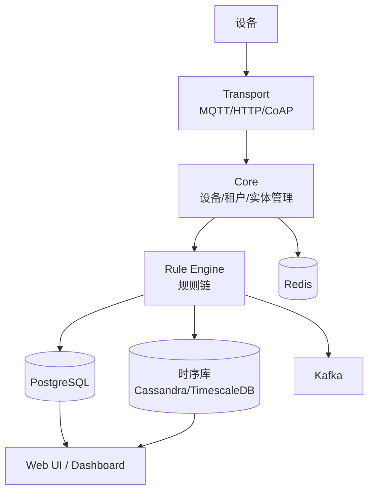

# ThingsBoard：IoT 平台的设备、规则引擎与时序数据

> 定位：ThingsBoard 是 Java 生态最完整的开源 IoT 平台：设备接入、遥测数据、规则引擎、告警、仪表盘、多租户。它的架构对「高写入、时序数据、设备状态、规则编排」有很强的参考价值，尤其适合做物联网/车联网/工业互联网的后端。

## 一、项目档案

| 项 | 内容 |
|---|---|
| 仓库 | [thingsboard/thingsboard](https://github.com/thingsboard/thingsboard) |
| 定位 | 一体化 IoT 平台：设备管理、数据采集、处理、可视化 |
| 语言/许可 | Java / Apache-2.0（以仓库 LICENSE 为准） |
| 活跃度 | 截至 2026-11-25，约 2.27 万 Star，最近推送 2026-11-24 |
| 官方文档 | [thingsboard.io](https://thingsboard.io/) |
| 适合读者 | 想做 IoT/时序数据/规则引擎/多租户平台的人 |

## 二、项目描述：它解决什么问题

IoT 平台要处理：

- 海量设备接入（MQTT/HTTP/CoAP）；
- 高频遥测写入（时序数据）；
- 设备状态/属性/关系管理；
- 规则引擎：告警、转发、入库、调用外部 API；
- 多租户与设备隔离；
- 可视化大屏。

ThingsBoard 把这些做成「Transport → Core → Rule Engine → Storage → UI」的分层。

## 三、技术栈

- **后端**：Spring Boot、Actor 模型（Akka/自研）；
- **接入**：MQTT、HTTP、CoAP、Kafka；
- **存储**：PostgreSQL（关系）、Cassandra/TimescaleDB（时序）、Redis（缓存）；
- **规则引擎**：消息节点、过滤、变换、外部节点；
- **前端**：Angular；
- **部署**：Docker/K8s，单体/微服务两种模式。

## 四、核心功能

| 功能 | 说明 |
|---|---|
| 设备管理 | 设备、资产、实体关系、分组 |
| 遥测 | 时间序列数据写入/查询 |
| 属性 | 客户端/服务端/共享属性 |
| 规则引擎 | 消息路由、告警、Telemetry 入库 |
| 告警 | 规则触发、确认、清除 |
| 仪表盘 | 可视化、Widget |
| 多租户 | 租户/客户/用户隔离 |
| RPC | 平台到设备下发命令 |

## 五、架构图

Transport 负责协议接入与会话；Core 管理实体与租户；Rule Engine 按规则链处理消息（过滤、变换、告警、入库、转发）；时序库承担高写入，PostgreSQL 存关系数据。

## 六、优点与值得学习的设计

项目的核心优点：

- 协议覆盖全：MQTT、HTTP、CoAP、Kafka 接入，设备侧选择自由。
- 规则引擎强：告警、转发、入库、外部调用可编排，运营可配置。
- 多租户内建：租户/客户/设备层级隔离，适合做 SaaS 化 IoT。
- 可视化完整：Dashboard、Widget、时序查询一体，落地成本低。

### 6.1 Actor 模型隔离设备会话

每个设备/租户的会话用 Actor 隔离，避免共享状态锁竞争；消息处理串行化，降低并发复杂度。这是 IoT 高并发接入的关键。

### 6.2 规则引擎的消息模型

规则链由节点组成：消息类型、节点入/出边、失败链。它把「设备数据怎么处理」从代码里抽出来，运营可配置。学习重点是「消息不可变、节点可组合、失败可路由」。

### 6.3 时序数据与关系数据分离

遥测写 Cassandra/TimescaleDB，设备/租户/规则存 PostgreSQL。不要用一张 MySQL 表扛所有遥测。

### 6.4 多租户隔离

租户 → 客户 → 设备层级隔离；API 层做租户校验，数据层按租户分区。SaaS 平台要前置设计。

### 6.5 设备 RPC

平台向设备下发命令，需要处理离线、超时、重试、响应关联。不是「发个 MQTT 就完了」。

## 七、上手路径

1. 用 Docker Compose 起 ThingsBoard（PostgreSQL）；
2. 创建一个设备，用 MQTT 上报遥测；
3. 建规则链：遥测入库 + 阈值告警；
4. 配仪表盘展示时序数据；
5. 创建第二个租户，验证隔离；
6. 读 `application` 的 transport/core/rule-engine 模块。

## 八、边界与风险

- **时序库选型**：Cassandra 写入强、查询弱；TimescaleDB SQL 友好；按查询模式选；
- **规则引擎不是万能**：复杂业务逻辑仍要写服务端节点；
- **设备接入安全**：MQTT 鉴权、TLS、租户隔离；
- **消息积压**：Kafka/规则链要监控；
- **单体与微服务**：ThingsBoard 支持两种部署，别默认上微服务。

## 九、项目借鉴

- 学它的**接入/核心/规则/存储分层**；
- 学它的**Actor 隔离**：设备会话不共享状态；
- 学它的**规则链**：把可配置逻辑从代码抽出；
- 学它的**时序/关系分离**：不要一张表打天下。

## 小结

- ThingsBoard 的核心是「Transport + Core + Rule Engine + 时序存储」。
- 设备会话用 Actor 隔离，适合高并发接入。
- 规则引擎把告警/转发/入库做成可配置链。
- 时序数据与关系数据必须分库/分表，按查询模式选存储。
