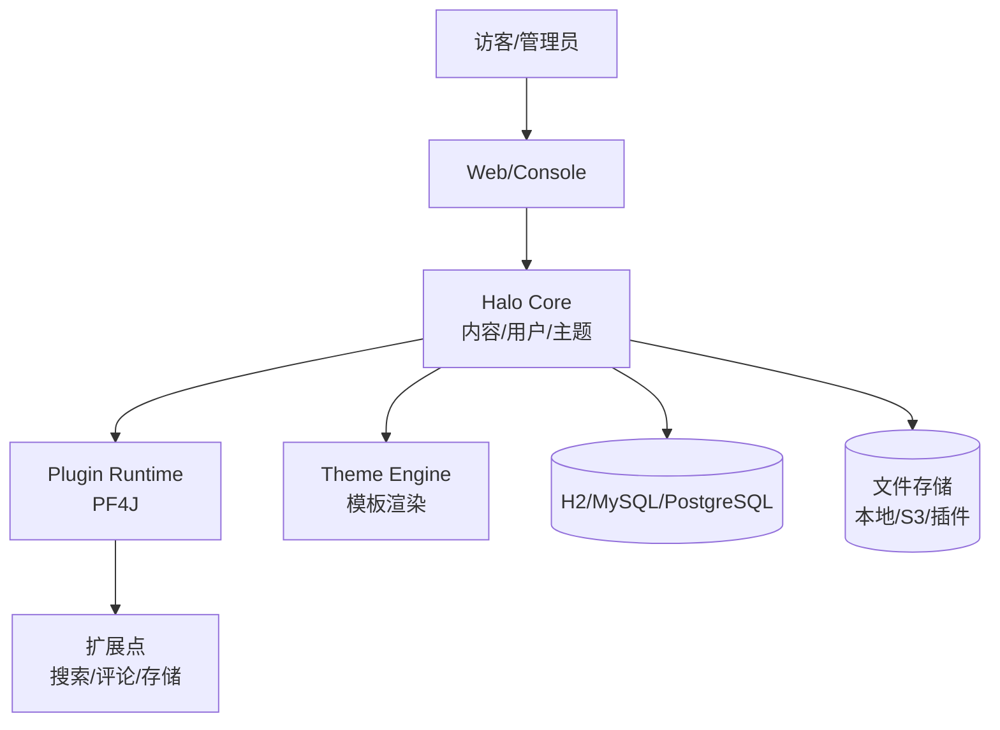

# Halo：插件化内容系统的工程实践

> 定位：Halo 是一个用 Java 做的开源建站/博客/CMS 系统。它值得学的不是「怎么写文章」，而是「一个内容系统怎么做插件、主题、多存储适配、升级迁移」。对想学 Spring Boot 中大型应用、插件架构、内容建模的人很有参考价值。

## 一、项目档案

| 项 | 内容 |
|---|---|
| 仓库 | [halo-dev/halo](https://github.com/halo-dev/halo) |
| 定位 | 开源建站工具：博客、知识库、企业官网、在线商城 |
| 语言/许可 | Java / GPL-3.0 |
| 活跃度 | 截至 2026-11-25，约 4.04 万 Star，最近推送 2026-11-25 |
| 官方文档 | [halo.run](https://halo.run/) |
| 适合读者 | 想学插件化、主题系统、内容建模、Spring Boot 大型应用的人 |

## 二、项目描述：它解决什么问题

内容系统看似简单，实际要处理：

- 文章/页面/分类/标签/评论的内容模型；
- 主题切换与模板渲染；
- 插件扩展（搜索、评论、对象存储、统计）；
- 多存储（H2/MySQL/PostgreSQL）；
- 升级迁移与数据兼容；
- SEO、站点地图、Feed。

Halo 用「核心 + 插件 + 主题」三层解决扩展性问题。

## 三、技术栈

- **后端**：Spring Boot、Spring Data JPA/R2DBC（按版本）、Spring Security；
- **前端**：Vue 3（Console）、主题模板；
- **存储**：H2（默认）、MySQL、PostgreSQL；
- **插件**：PF4J 插件框架；
- **搜索**：内置搜索/插件扩展；
- **部署**：Docker、K8s。

## 四、核心功能

| 功能 | 说明 |
|---|---|
| 内容 | 文章、页面、分类、标签、评论 |
| 主题 | 主题安装、切换、模板渲染 |
| 插件 | 插件安装/启用/卸载，扩展点 |
| 多存储 | H2/MySQL/PostgreSQL |
| 用户 | 管理员、角色、权限 |
| SEO | 站点地图、Feed、Meta |
| 迁移 | 版本升级、数据迁移 |

## 五、架构图

Core 负责内容模型、权限、主题；Plugin Runtime 通过扩展点加载插件；Theme Engine 渲染模板；存储可切换。

## 六、优点与值得学习的设计

项目的核心优点：

- 插件化彻底：核心稳定、插件可插拔，扩展点设计清晰。
- 主题生态成熟：主题与核心分离，建站/换肤成本低。
- 多存储适配：H2/MySQL/PostgreSQL 可切换，部署门槛低。
- 工程完整：权限、评论、SEO、迁移、升级都有考虑，不是玩具 CMS。

### 6.1 插件化扩展

PF4J 把插件做成独立 jar，通过扩展点与核心交互。关键是「核心不依赖插件」：插件只能通过公开扩展点接入，避免核心被插件反向耦合。

### 6.2 主题与核心分离

主题只负责展示，不直接操作数据库；核心提供模板变量/API。这样主题可以独立安装/切换，升级核心不破坏主题。

### 6.3 多存储适配

H2 适合单机/体验，MySQL/PostgreSQL 适合生产。用 JPA/Repository 抽象，屏蔽差异；但要注意不同数据库的 SQL 方言、索引、迁移脚本。

### 6.4 内容模型

文章/页面/分类/标签/评论的关系要清晰；内容状态（草稿/发布/回收站）、版本、定时发布都要设计。

### 6.5 升级迁移

版本升级要处理数据库 schema、插件兼容、主题兼容。Halo 的迁移脚本/版本号管理值得学。

## 七、上手路径

1. 用 Docker 起 Halo，建一篇文章；
2. 装一个主题，观察模板变量；
3. 装一个插件，看扩展点；
4. 切 MySQL，跑迁移；
5. 读 `core` 与 `plugin` 模块；
6. 写一个最小插件（自定义扩展点）。

## 八、边界与风险

- **GPL-3.0**：商用/二次分发要注意许可证；
- **插件质量参差**：插件能直接接触核心能力，安全/性能要评估；
- **主题兼容**：核心升级可能破坏旧主题；
- **多存储差异**：H2 与 MySQL/PostgreSQL 的 SQL/索引行为不同；
- **内容规模**：大量文章/评论时，搜索与分页要优化。

## 九、项目借鉴

- 学它的**插件扩展点**：核心稳定、插件可插拔；
- 学它的**主题分离**：展示与业务解耦；
- 学它的**多存储适配**：Repository 抽象 + 迁移脚本；
- 学它的**内容状态/版本**：发布、草稿、回收站。

## 小结

- Halo 的核心是「内容模型 + 主题 + 插件」三层。
- 插件通过扩展点接入，核心不反向依赖插件。
- 主题只负责展示，核心提供数据/API。
- 多存储要处理方言与迁移；许可证要提前确认。
