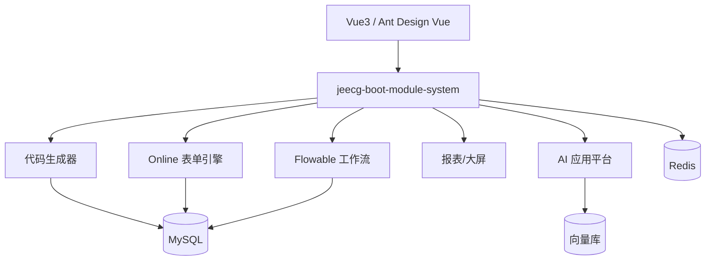

# JeecgBoot：低代码平台的代码生成与 AI 工程化

> 定位：JeecgBoot 是国内 Star 数最高的低代码平台之一。它值得学的不是「拖拽页面」，而是「从表结构到前后端代码、菜单权限、流程、报表的自动化链路」，以及「低代码平台怎么把 AI 能力接进来」。适合想学代码生成器、元数据驱动、复杂后台系统的人。

## 一、项目档案

| 项 | 内容 |
|---|---|
| 仓库 | [jeecgboot/JeecgBoot](https://github.com/jeecgboot/JeecgBoot) |
| 定位 | AI 低代码平台 / 企业级应用基座 |
| 语言/许可 | Java / Apache-2.0 |
| 活跃度 | 截至 2026-11-25，约 4.86 万 Star，最近推送 2026-11-11 |
| 官方文档 | [jeecg.com](https://www.jeecg.com/) |
| 适合读者 | 想学低代码、代码生成、元数据驱动、工作流、AI 接入的人 |

## 二、项目描述：它解决什么问题

企业后台系统大量是 CRUD + 权限 + 流程 + 报表。手写的问题：

- 重复代码多，表一多就失控；
- 菜单/权限/接口要手动配；
- 流程/报表/大屏要另找工具；
-  AI 能力接入缺统一入口。

JeecgBoot 用「元数据 + 代码生成 + 低代码渲染 + AI」把这些重复工作自动化。

## 三、技术栈

- **后端**：Spring Boot、MyBatis Plus、Shiro/Sa-Token（按版本）、Flowable；
- **前端**：Vue 3、Ant Design Vue；
- **数据库**：MySQL、Redis；
- **低代码**：Online 表单、代码生成器、报表/大屏；
- **AI**：大模型接入、知识库、流程编排、MCP；
- **部署**：单体多模块，支持微服务版本。

## 四、核心功能

| 功能 | 说明 |
|---|---|
| 代码生成 | 表 → Entity/Mapper/Service/Controller/Vue |
| Online 表单 | 在线配置表单、列表、权限 |
| 工作流 | Flowable 审批、流程设计 |
| 报表/大屏 | 数据源、图表、看板 |
| 权限 | 菜单、按钮、数据权限、多租户 |
| AI | 聊天、知识库、流程编排、MCP |

## 五、架构图

前端通过菜单/权限访问后端模块；代码生成器读取表元数据生成前后端代码；Online 表单/工作流/报表由元数据驱动；AI 平台独立接入模型与知识库。

## 六、优点与值得学习的设计

项目的核心优点：

- 代码生成效率高：表结构到前后端 CRUD、菜单、权限一条龙。
- 低代码能力全：Online 表单、报表、大屏、工作流覆盖常见企业场景。
- 权限体系完整：菜单/按钮/接口/数据权限四层，适合复杂后台。
- AI 接入早：大模型、知识库、流程编排、MCP 有工程化尝试。

### 6.1 元数据驱动

低代码的核心不是「拖拽」，而是「用元数据描述表、字段、表单、列表、权限、流程」。元数据存库，渲染层根据元数据生成页面/接口。

### 6.2 代码生成器

从表结构生成 Entity/Mapper/Service/Controller/Vue，减少重复；关键是「生成代码可维护」：模板要支持自定义、生成后能二次开发，而不是黑盒。

### 6.3 Online 表单

在线表单适合简单业务；复杂业务仍要写代码。低代码平台的边界是「80% 标准场景自动化，20% 复杂场景可扩展」。

### 6.4 权限体系

菜单/按钮/接口/数据权限四层；低代码生成页面时自动注册权限，避免「生成了页面但忘了配权限」。

### 6.5 AI 与低代码结合

AI 生成表结构/代码/表单/流程，前提是「元数据 + 模板 + 校验」可靠；否则生成的东西不可维护。AI 是加速器，不是替代品。

## 七、上手路径

1. 起 MySQL/Redis，跑后端与 Vue 前端；
2. 建一张表，用代码生成器生成 CRUD；
3. 配菜单/角色/权限；
4. 用 Online 表单做一个简单业务；
5. 跑一个 Flowable 流程；
6. 接一个大模型，试 AI 生成代码/知识库问答。

## 八、边界与风险

- **低代码不是零代码**：复杂业务仍要写代码，别承诺「全都拖拽」；
- **生成代码质量**：模板不好会生成一堆难维护的代码；
- **元数据耦合**：表结构/元数据变更要迁移；
- **AI 生成不可盲信**：必须有人审核、测试、权限校验；
- **性能**：Online 表单/报表的动态 SQL 要防慢查询。

## 九、项目借鉴

- 学它的**元数据驱动**：表/字段/表单/权限统一描述；
- 学它的**代码生成**：模板化 + 可二次开发；
- 学它的**权限四层**：菜单/按钮/接口/数据；
- 学它的**AI 接入**：生成 + 校验 + 人工审核。

## 小结

- JeecgBoot 的核心是「元数据 + 代码生成 + 低代码渲染 + AI」。
- 低代码的边界是标准 CRUD 自动化，复杂业务仍要写代码。
- 代码生成要可维护，模板要可定制。
- AI 生成必须配校验与人工审核，否则会制造技术债。
