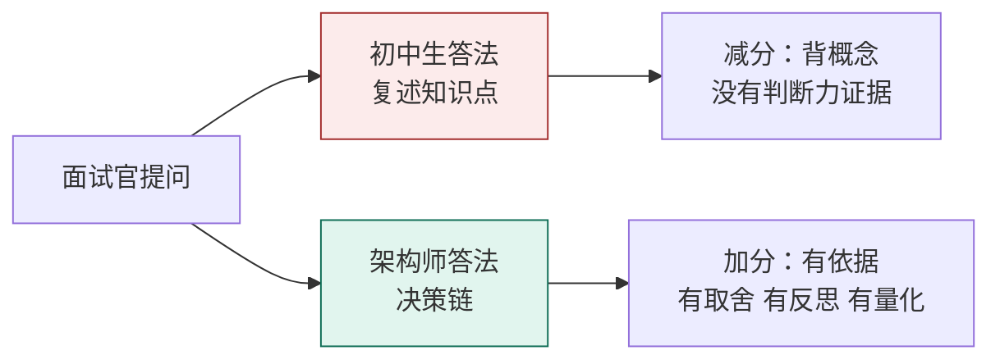
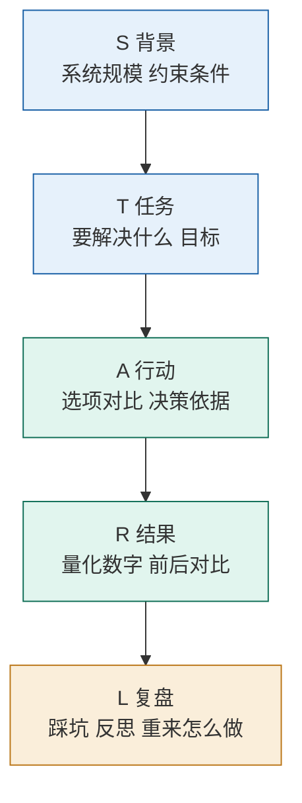
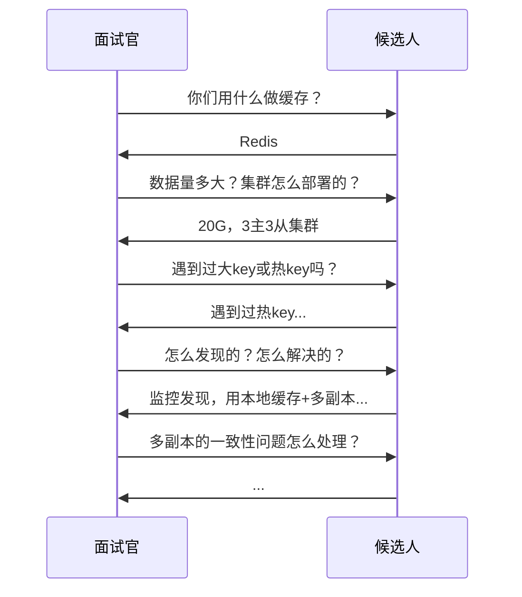
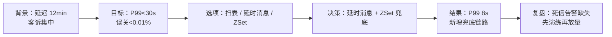

# 架构师面试的底层逻辑

> 定位：这一篇不教你任何技术知识点，它教的是**架构师面试的应答方式**。为什么很多人技术不差却过不了高级/架构面试？因为他还在用初中级的方式答题——背概念、复述原理。架构师面试考的是另一套东西：决策、权衡、取舍、复盘、量化。读懂这一篇，后面所有场景题才有意义。

## 一、先看清一个残酷事实

初中级面试和架构师面试，**是两种完全不同的考试**。

| 维度 | 初中级面试 | 架构师 / 高级面试 |
|---|---|---|
| 问法 | "什么是 CAP？" | "你们系统遇到过 AP 和 CP 的取舍吗？怎么选的？" |
| 考点 | 知识有没有记住 | 决策有没有依据、坑有没有踩过 |
| 理想答案 | 准确复述定义 | 讲清背景→约束→选项→取舍→结果→反思 |
| 减分项 | 答错概念 | 只会背概念、答"看场景"却说不出场景 |
| 面试官心理 | "这人基础行不行" | "这人能不能独立扛事、能不能信" |

看个真实例子。同样是问 Redis 分布式锁：

- **初中级答法**："用 SETNX 加锁，设过期时间，用 Lua 脚本保证原子性删除就够了。"
- **架构师面试期待的答法**："我们没直接用 SETNX——它没法优雅处理锁续期和主从切换时的锁丢失。评估过三种方案：Redlock 争议大、ZK 锁性能低、Redisson 的看门狗续期 + Redlock 多实例相对稳。最后选了 Redisson，但加了一层兜底：关键业务在DB层面用唯一索引再做一道幂等，防止锁失效导致的重复执行。代价是多一次DB写入，用性能换 correctness。上线后确实遇到过一次主从切换，锁重复了，幂等兜底救了回来——复盘后把锁的过期时间从 30s 调到 10s 并强化了续期。"

第二个答案里有六个要素：**背景、约束、选项对比、明确取舍、真实结果、复盘改进**。面试官招架构师，招的就是能给出这种答案的人。

## 二、架构师面试到底在考什么

面试官不是真的想知道"你会不会用 Redis"，他在用技术问题做载体，考察五件事：

### 2.1 决策能力：能不能在信息不全时做判断

架构的本质是取舍。面试官最爱问"为什么选 A 不选 B"。答不出取舍理由，说明你只是照搬了别人的方案，没有自己的判断。

**考察信号**：你能不能说出"当时有几个选项、各自的代价、我为什么这么选"。

### 2.2 权衡意识：知不知道天下没有免费午餐

初级工程师说"我用 Redis 缓存，性能就好了"。架构师知道缓存带来了一致性问题、穿透击穿雪崩、运维成本。**每个技术选择都有代价，说不出代价就是没真正用过。**

**考察信号**：你讲完方案，会不会主动说"这个方案的代价是什么、什么情况下我不推荐它"。

### 2.3 量化意识：有没有数字感

"性能提升了""QPS 很高""数据量很大"——这些是废话。架构师的表达里应该有数字：QPS 从多少到多少、P99 从 200ms 降到 50ms、数据量 3 亿、缓存命中率 98.7%。**数字是经验密度的证明。**

**考察信号**：你能否给出具体的、前后对比的、可验证的数字。

### 2.4 复盘能力：踩过坑没有，学到了什么

没踩过坑的架构师不可信。面试官会追"遇到过什么问题吗""出过事故吗"。关键不是"没出过事"，而是出了事你怎么定位、怎么止血、怎么防止再次发生。

**考察信号**：你能不能讲出一个完整的"事故 → 定位 → 止血 → 根因 → 改进"闭环。

### 2.5 影响力与推动：能不能让方案落地

架构师不是画图纸的人，是要推动团队把方案落地的人。面试官会问"你怎么说服业务方/团队接受你的方案"。这考的是沟通、权衡业务与技术、处理分歧。

**考察信号**：你能否讲清"方案不是技术上最优就行，还要考虑业务节奏、团队能力、迁移成本"。

## 三、万能应答框架：STAR-L

把上面五点浓缩成一个可复用的答题结构，我叫它 **STAR-L**（在经典 STAR 基础上加了 L——Lessons & Numbers）：

| 字母 | 含义 | 你要回答的问题 | 常见缺失 |
|---|---|---|---|
| **S** | Situation 背景 | 什么系统、什么规模、什么约束 | 上来就讲方案，没有背景 |
| **T** | Task 任务 | 你要解决什么问题、目标是什么 | 目标模糊，不知道要解决啥 |
| **A** | Action 行动 | 有哪些选项、你选了什么、为什么 | 只讲选了什么，不讲为什么 |
| **R** | Result 结果 | 效果如何、有数字吗 | 没有量化，"效果挺好" |
| **L** | Lessons 复盘 | 踩了什么坑、学到了什么、重来怎么做 | 完全没有反思 |

一个架构师级别的回答，五段都要有。缺任何一段，面试官都会追问出来。

## 四、最重要的一节：如何诚实地回答"你做过吗"

这里必须讲清楚一个原则，因为它决定了你怎么用这套题库。

**不要虚构你没有的经历。** 如果面试官问"你做过秒杀系统吗"，你没做过却硬编，一个有经验的面试官三个追问就能把你问穿：

- "峰值 QPS 多少？"（你答不出具体数字）
- "库存扣减怎么保证不超卖？"（你只能背 Redis + Lua）
- "Redis 挂了怎么办？"（你开始含糊）
- "压测是怎么做的？瓶颈在哪？"（彻底露馅）

**正确的做法是分层表达**：

1. **做过就直接讲**（背景、数字、决策、坑），这是你的真实弹药。
2. **没做过但懂原理**，就说"我没有直接做过，但我系统研究过，如果让我设计我会这么做……"，然后展示你的决策链和权衡意识。坦诚 + 清晰的思路，比心虚的编造强一百倍。
3. **把知识库的原理变成你的思考素材**。这套知识库 77 篇的原理、坑点、选型对比，就是让你在第 2 种情况下也能答得有深度——你没做过，但你知道所有关键决策点在哪、坑在哪、业界怎么解的。

> 这套题库的正确用法：**不是背答案去糊弄面试官，而是用它训练你的决策思维**。每道场景题，你都问自己"如果这是我真实负责的项目，我会怎么做、我需要考虑什么"。想清楚了，面试时才能把真实经历讲得有条理、有深度。

## 五、面试官的追问链：为什么你总觉得"问不完"

架构师面试很少一问一答就结束。面试官会用**剥洋葱式追问**层层深入：

每一层追问都在验证：**你是真的做过，还是只背了第一层**。

应对方法：
1. **主动把话往深了说**。讲完方案，主动说代价和坑，把面试官想追问的先说了——这叫"抢占追问权"，反而显得你经验足。
2. **准备三层深度**。任何知识点，你都要准备"是什么→怎么用→坑和调优"三层。面试官问第一层，你答到第三层，他通常会满意地跳过。
3. **不知道就说不知道，但给出思路**。"这个我没实操过，但我的判断是……因为……"。诚实 + 推理，远好于编造被戳穿。

## 六、翻车信号：这些回答会当场减分

| 翻车回答 | 为什么减分 | 应该怎么说 |
|---|---|---|
| "看场景" | 万能废话，没有判断力 | 说出具体场景和对应的选择 |
| "用缓存就好了" | 只说方案不说代价 | 说清一致性、穿透、雪崩怎么处理 |
| "效果挺好的" | 没有数字 | "P99 从 200ms 降到 50ms" |
| "我们用的 XX，挺好的" | 没有为什么 | 说出选型对比和取舍 |
| "没出过什么问题" | 不可信，或没深入用 | 讲一个真实的坑和复盘 |
| "这个我不会" | 直接放弃 | "没做过，但我的思路是……" |

## 七、这套题库怎么用

后面的场景题都按统一结构组织：

- **题目**：真实的高阶面试问法
- **考察什么**：面试官想验证的能力
- **答题结构**：STAR-L 各段该填什么
- **追问链**：可能被怎么层层追问
- **翻车点**：哪里容易减分
- **调用知识**：回扣本知识库哪些篇目做原理支撑

**不要背答案**。每一题都问自己："如果我真的负责过这个项目，我会怎么答？"——用真实项目去套框架，把框架内化成你的思维习惯。

## 八、一个小提醒

面试官也是人。除了技术，他们还在评估：**这个人靠不靠谱、能不能合作、遇到分歧怎么处理**。所以答题时：

- 承认别人的方案也有优点，不踩一捧一
- 讲失败时担责，不甩锅
- 讲成绩时说清团队贡献和你自己的贡献
- 遇到不会的，态度坦诚、思路清晰

技术上到了架构师水平，这些"软性"细节往往才是最后的胜负手。

## 九、五条能力的自检清单与训练动作

「知道要考决策、权衡、量化」不等于「答得出」。下面这张表把五种能力拆成可自检的问题和可执行的训练动作——**答不上左三列，就是面试会被追问穿的地方**。

| 能力 | 面试官真正在验证 | 自检问题（答不上就是短板） | 每周可做的训练 |
|---|---|---|---|
| 决策 | 信息不全时能不能拍板 | 上季度你**否掉**了哪个方案？为什么否？ | 写一页选型对比：3 个选项 × 成本/风险/收益 |
| 权衡 | 知不知道方案的代价 | 你的方案**最坏**会怎样？什么条件下不成立？ | 给现有系统列「代价清单」：一致性、运维、成本 |
| 量化 | 数字是不是自己的 | 这个接口 P99 多少？怎么测的？样本多大？ | 压测一个接口，记录 P50/P95/P99 与错误率 |
| 复盘 | 事故闭环是否完整 | 最近一次故障的根因和**改了什么**？ | 对一次线上问题写 5-Why + 行动项 + 验收方式 |
| 影响力 | 推不推得动 | 方案被业务方否了，你后来怎么推进？ | 主持一次跨团队评审，记录分歧与收敛过程 |

三个使用要点：

1. **先补最弱的一项**。五项里只要有一项完全空白，面试官就会围绕它追问——因为那是「没扛过事」的信号。
2. **训练动作要留下证据**。选型对比文档、压测报告、复盘邮件都是面试时的素材，比临场回忆可靠。
3. **数字允许模糊，但不许编**。记不清就说「大概 3 万 QPS，量级是万级」，别说一个精确到个位却经不起追问的数。

## 十、一页纸项目卡片：把经历压成可追问的结构

临场组织语言容易漏段。更稳的做法是**面试前给每个项目写一张卡片**，把 STAR-L 五段压在一页里，面试时按卡片讲，追问时按卡片翻。

| 栏目 | 写什么 | 反例 |
|---|---|---|
| 背景与规模 | 业务、QPS/数据量/团队规模、硬约束（预算、合规、交付期） | 「一个电商系统」 |
| 目标 | 可验证的目标（延迟、成本、可用性），带基线值 | 「提升性能」 |
| 选项 | 至少 2 个备选 + 各自代价 | 只写最终方案 |
| 决策依据 | 哪个约束起了决定作用，谁拍的板 | 「领导决定的」 |
| 结果 | 前后对比数字 + 副作用 | 「效果很好」 |
| 复盘 | 一个坑 + 一条改进 + 是否已验证 | 「总体顺利」 |

一个填好的示例（订单超时关闭）：

- **背景**：日订单 200 万，超时未支付占 8%，原定时任务 5 分钟扫一次，峰值延迟 12 分钟，客诉集中在「已付款却被关单」。
- **目标**：关单延迟 P99 < 30s，误关率 < 0.01%，不改订单主库写入路径。
- **选项**：① 缩短扫描间隔——数据库压力翻倍；② RocketMQ 延时消息——依赖 MQ 可靠性，需处理消息丢失；③ Redis ZSet + 到期扫描——实现简单，但多实例要分片。
- **决策**：选 ②，因为已有 RocketMQ 集群与死信补偿；代价是要补「消息丢失兜底扫描」，用 ③ 做兜底。
- **结果**：P99 从 12min 降到 8s，误关率 0.003%，主库 QPS 未上升；代价是新增一条兜底链路与死信告警。
- **复盘**：上线首周死信堆积没告警，补了堆积阈值告警；重来会先做死信演练再放量。

**三条写作规则**：每段都要有数字或边界；每个方案都要写代价；复盘要写「验证了什么」，而不是「下次注意」。

## 十一、十类高频追问的应答骨架

面试官的追问看似随机，其实反复在问十类问题。把骨架记熟，临场只换事实：

| 追问 | 陷阱 | 应答骨架 |
|---|---|---|
| 为什么不用 X？ | 只贬低 X，显得没调研 | 「X 的问题是…；我们的约束是…；所以选了 Y，代价是…」 |
| 数据量再涨 10 倍怎么办？ | 答「加机器」 | 先说瓶颈在哪（存储/连接/热点），再说分区、拆分、降级的顺序 |
| 出过事故吗？ | 说「没有」 | 背景 → 影响面 → 止血 → 根因 → 改进 → 验证 |
| 为什么不留扩展性？ | 答「当时没想」 | 「交付期 6 周，过度设计会拖慢；留了接口边界，第二次迭代补的」 |
| 团队不认同怎么办？ | 答「说服他们」 | 用数据做小范围验证 → 把分歧变成可比较的实验 → 再推广 |
| 成本怎么算的？ | 只算服务器 | 人力 + 机器 + 带宽 + 运维 + 故障损失，给出年度口径 |
| 上线怎么保证不出事？ | 答「测试过了」 | 灰度比例、回滚判据、监控指标、值班安排 |
| 数据怎么迁？ | 只讲工具 | 盘点 → 双跑 → 对账 → 灰度 → 回滚，讲清每一步的退出条件 |
| 业务方要 3 天上线怎么办？ | 硬扛或硬拒 | 拆最小可用范围 + 明确不做什么 + 风险书面确认 |
| 重来你会怎么做？ | 答「一样」 | 指出一个具体改动 + 预期收益 + 为什么当时没做到 |

最后一个问题最能拉开差距：**它考的是你有没有从结果里提炼出可复用的判断**。答「一样」等于承认这一年没有长进。

## 十二、一段完整的模拟追问（带批注）

下面是一段虚构但典型的架构师面试对话，用来示范「怎么把话往深了说」。注意候选人的每次回答都主动交代了代价和边界。

**面试官**：你简历上写负责过订单系统，日均多少单？

**候选人**：日均 200 万单，峰值 1200 单/秒，大促能到 3000。订单主库 MySQL，分 16 库 64 表，热点是按买家 ID 查。

【批注】开头给规模、峰值、存储形态、访问模式——四个信息让面试官知道「这人真管过」。

**面试官**：为什么按买家 ID 分，而不是按订单号？

**候选人**：按订单号分能均匀打散写入，但 90% 的查询是「我的订单」，按订单号分会导致每次查询扫全部分片。我们评估过：按买家分，写入有热点（大卖家），但查询能定位单库；热点用「大卖家单独分片 + 异步写」缓解。代价是跨卖家查询（如客服查单）要落 ES。

【批注】先说「另一个选项更好在哪」，再说「为什么仍选这个」，最后交代代价与补救。这是标准的权衡表达。

**面试官**：分库之后事务怎么办？下单要扣库存、写订单、加积分。

**候选人**：不用跨库事务。库存扣减做成「预占 + 确认」，订单落库和预占在同一个库的本地事务里；积分是异步消息，允许最终一致，失败进补偿队列。跨库的部分只有「买家库」和「商品库」，用本地消息表 + 定时对账兜底，不追求强一致。

【批注】主动说出「我们不追求强一致」比被追问「数据不一致怎么办」要好——边界是自己划的。

**面试官**：本地消息表失败了怎么发现？

**候选人**：三处：消息表状态扫描（超过 30s 未确认重发）、消费端幂等 + 落库校验、T+1 对账（订单与积分流水按单号比对）。上线后确实出现过一次消费端反序列化失败导致积分漏发，是 T+1 对账发现的；复盘后加了消费失败告警和死信重放。

【批注】有监控、有对账、有真实故障、有改进——四件套齐全，面试官很难再追。

**面试官**：如果流量再涨 5 倍，你先动哪里？

**候选人**：先看瓶颈在哪。按现在的压测，瓶颈依次是库存行锁、订单库写入、ES 同步延迟。顺序是：库存按商品分段扣减（减少单行热点）→ 订单库再加一层分片 → ES 改异步批量。不会先加机器，因为锁竞争加机器没用。

【批注】「先定位瓶颈再动手」+「加机器对锁无效」是加分点，说明懂容量模型。

**面试官**：这个方案你重来会怎么改？

**候选人**：两处。一是分片键早期按「卖家」而不是「买家」，能少一次 ES 兜底；二是本地消息表一开始就带「重试次数 + 死信」字段，后来加字段做了两次 DDL。第一处是设计取舍失误，第二处是低估了运维复杂度。

【批注】能具体指出「哪一步错了、为什么错」，比「总体顺利」强得多。

这段对话的通用结构：**规模 → 关键取舍 → 一致性边界 → 故障与发现手段 → 容量下一步 → 复盘**。把这六步套到你自己负责的系统上，就是一份可用的面试脚本。

## 十三、面试前 48 小时检查清单

临场发挥的上限，很大程度由准备清单决定。下面这份清单按时间倒排，每项都可勾选。

### T-48h：素材

- [ ] 选 3 个项目，各写一张「一页纸项目卡片」（背景/目标/选项/决策/结果/复盘）
- [ ] 每个项目准备 2 个数字：规模数字（QPS/数据量）+ 效果数字（延迟/成本/可用性）
- [ ] 每个项目准备 1 个真实故障：现象 → 止血 → 根因 → 改进 → 验证
- [ ] 找出 1 个「我否掉的方案」，写清为什么否

### T-24h：预演

- [ ] 用手机录音讲一遍「自我介绍 + 一个项目」，回听删掉空话
- [ ] 让同事按第十一节的十类追问随机提问 20 分钟
- [ ] 把答不上的问题记下来，只补「判断思路」，不背细节
- [ ] 确认岗位 JD 里的三个关键词，各准备一个对应案例

### T-2h：状态

- [ ] 简历、项目卡片、纸笔（白板题要用）
- [ ] 视频面试：网络、摄像头、麦克风、共享屏幕权限
- [ ] 提前 10 分钟进入，静音喝水，不看新知识

### 当天：开场与收尾

**30 秒自我介绍模板**：

> 「我做了 X 年后端，最近 3 年主要负责 A 系统（规模数字），主导过 B 改造（结果数字）。我的特点是遇到问题先定位瓶颈再动手，也习惯把决策和代价写下来。今天想聊聊 C 方向，因为……」

**反问环节准备 3 个问题**（体现你在选团队，不是只被选）：

1. 这个岗位当前最急的一件事是什么？
2. 团队做技术决策时，谁拍板、怎么复盘？
3. 上线流程里，开发对稳定性的责任边界在哪？

**结束后的 24 小时内**发一封短邮件：感谢 + 补充一个面试中没答好的点的思路（不超过 5 行）。这既是礼貌，也是一次「复盘能力」的展示。

**最后一条**：面试前一晚不要再刷八股。把三张项目卡片读一遍、把「最坏情况怎么答」想一遍，比多背 20 道题有效——架构师面试考的是判断，不是记忆量。

## 十四、面试当天的时间盒

| 时段 | 动作 | 目的 |
|---|---|---|
| 开场 1 分钟 | 30 秒自我介绍 + 一句「今天想重点聊 X」 | 定主线，避免漫谈 |
| 前 20 分钟 | 讲 1 个最熟的项目，主动抛代价与坑 | 抢占追问权 |
| 中段 20 分钟 | 按面试官追问走，每答先给结论再展开 | 控制信息密度 |
| 最后 10 分钟 | 反问 2–3 个问题 + 补一个没答好的点 | 展示判断与复盘 |
| 结束后 | 24 小时内发感谢邮件 | 留印象 |

**时间盒的意义**：避免「一个项目讲 40 分钟、其他没机会」，也避免「每个问题都浅尝辄止」。

**面试后的复盘三问**：哪一段被打断最多？哪个数字没答上来？哪个追问暴露了知识空白？把答案写进下一版项目卡片，三次面试后你会明显感到「问题变少」。

## 小结

- 架构师面试考的不是知识，是决策、权衡、量化、复盘、影响力五件事。
- 用 STAR-L 框架组织回答：背景→任务→行动→结果→复盘，缺一段就会被追问。
- 没做过就坦诚说没做过，但用清晰的决策链证明你有判断力——不要编造经历。
- 准备三层深度，主动说代价和坑，抢占追问权。
- "看场景""效果挺好""用缓存就好"是三大翻车回答。
- 这套题库是训练思维的，不是背答案的——用真实项目去套框架。
