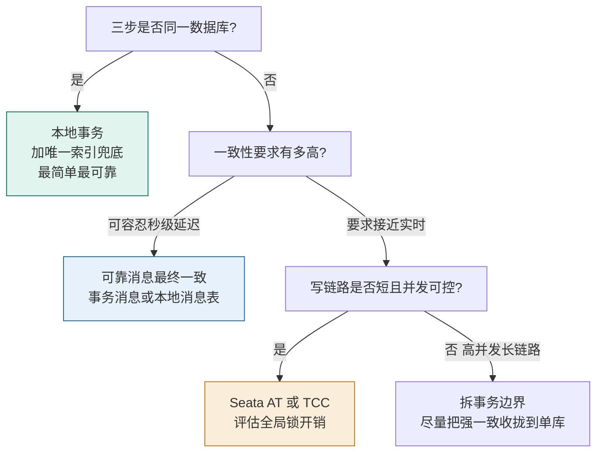
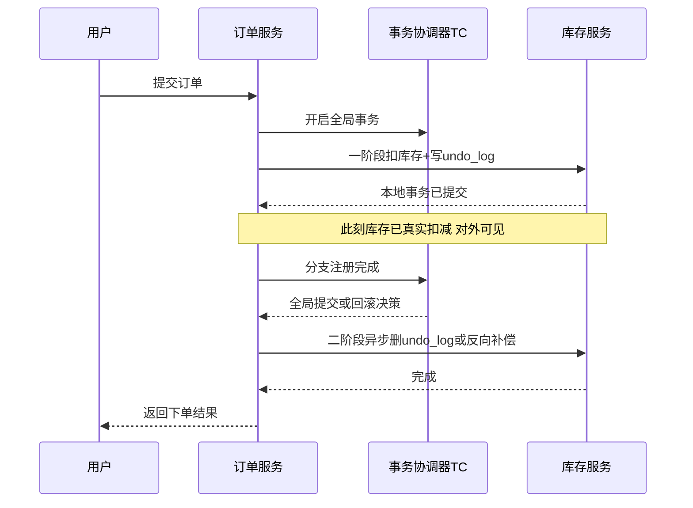
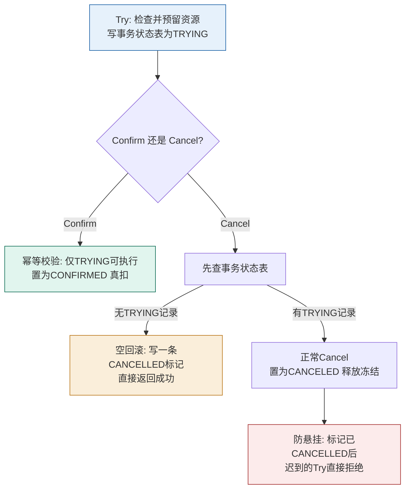
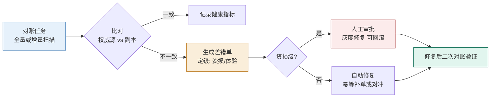
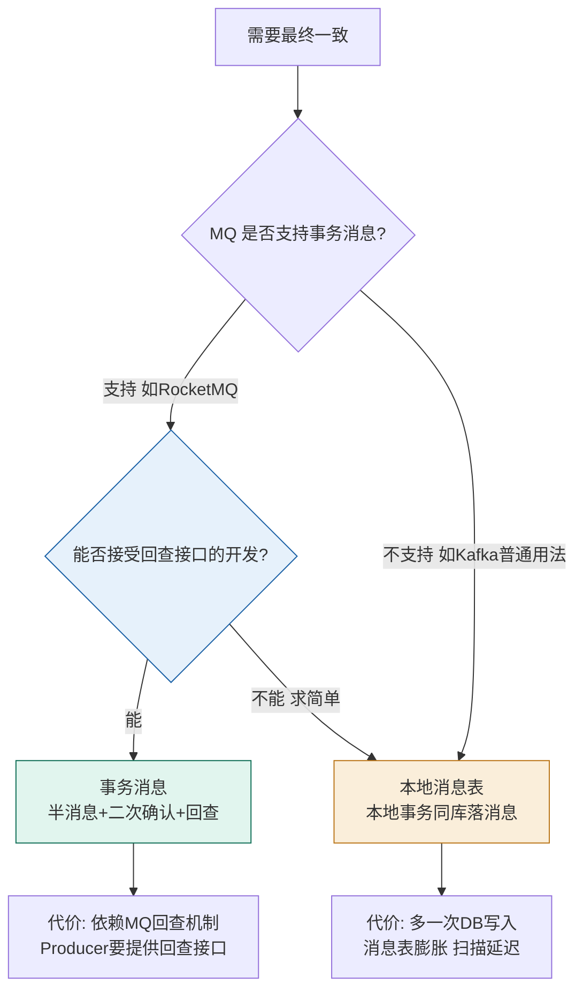

# 分布式事务场景面试

> 定位：分布式事务是架构师面试的「深水区」——所有人都会背 2PC、TCC、SAGA，但面试官要听的是你在真实业务里怎么权衡一致性、可用性、复杂度和成本。这一篇用 5 道场景题，示范怎么把「最终一致」四个字答出决策链、中间态处理、对账闭环和踩坑复盘。**常见露馅点**：一被追问中间态就含糊、对账只会说「补一下」、分不清事务消息和本地消息表的代价。文末的「坑点」清单是面试高频翻车区，建议先自己答一遍再对照。

## 题 1：跨服务扣库存 + 下单怎么保证一致？要不要引入 Seata？

### 题目

"你们订单系统，下单要扣库存、创建订单、扣优惠券，这三步在三个不同微服务里。用户点提交时你怎么保证三步一致？要不要引入 Seata？先把决策依据说清楚，再讲怎么落地。"

### 考察什么

- **决策力**：考的不是「会不会用 Seata」，而是「该不该用」。面试官想听的是你有没有判断标准，而不是背框架名字。
- **代价意识**：能不能说清每种方案是用复杂度、性能还是运维成本换来了一致性。
- **业务理解**：一致性要求到底有多高？是不是所有数据都值得用分布式事务保护？

### 答题骨架

**S（背景）**：先反问四个约束——

1. 这三步是否**真的**跨了数据库或服务边界？很多所谓「跨服务」只是代码分层，实际共用一个库，本地事务就够了。
2. 能接受多长的**不一致窗口**？100 毫秒、1 秒，还是必须实时可见？
3. 写峰值 QPS 和 RT 要求是多少？（填入你项目的真实 QPS 和 P99）——这直接决定你能不能承受全局锁的开销。
4. 数据重要性分级：库存扣错会超卖（资损），优惠券扣错只是体验问题。**不是所有数据一个待遇**。

面试官想听的是：**先问清约束再选方案**。上来就说「用 Seata」的人，说明他手里只有一个锤子，看什么都像钉子。

**A（行动）**：先给决策树，再给方案对比表。

方案对比表（这张表要能背下来，它就是你取舍的弹药）：

| 方案 | 一致性 | 性能 | 业务侵入 | 代价 | 适用 |
|---|---|---|---|---|---|
| 本地事务 | 强一致 | 最高 | 无 | 无法跨库 | 同一库内 |
| Seata AT | 强一致倾向 | 中 | 低（加注解） | 全局锁竞争、undo_log 存储 | 短链路、并发可控 |
| TCC | 强一致 | 较高 | 高（写三个方法） | 开发量大、三防复杂 | 资金/库存等核心资源 |
| SAGA | 最终一致 | 高 | 中 | 补偿链长、中间态明显 | 长流程、跨组织 |
| 可靠消息 | 最终一致 | 高 | 中 | 有延迟、要处理重复消费 | 可接受秒级延迟 |

关键话术：**"我的原则是能不用分布式事务就不用。分布式事务不是银弹，它是用复杂度和性能换一致性的最后手段。只有在本地事务解决不了、且业务确实要求接近实时一致时才上。"**

落到这个具体场景，我会这么分层：库存是核心（超卖是资损），订单是核心，优惠券可以降级。所以**把库存和订单收拢到同一个服务同一个库，用本地事务保证强一致**；优惠券走可靠消息异步扣，扣失败就的发补偿或人工处理。这样既守住资损底线，又避免了全局锁拖垮下单链路。

**R（结果）**：引导填入你的真实结果——"改造后，下单主链路 RT 从（填入原 P99）降到（填入现 P99），超卖客诉从（填入原数量）降到 0；优惠券的最终一致延迟在（填入秒数）秒内，业务方可接受。"

**L（复盘）**：主动说你考虑过的坑——

- "如果优惠券扣减失败导致用户用了不该用的券，怎么办？"→ 记一笔应收款或下次下单拦截，而不是让主流程回滚。
- "Seata TC（事务协调器）挂了怎么办？"→ TC 是单点，必须集群化 + 持久化事务日志；挂了期间新事务要降级成可靠消息。
- "全局锁等待超时怎么办？"→ 设合理超时并快速失败，不要让线程堆积拖垮连接池。

#### 公开案例

据 **Seata 官方文档对 AT 模式的定义**：一阶段业务数据和 `undo_log` 在同一个本地事务中提交并释放本地锁；二阶段全局提交时异步删除 `undo_log`，全局回滚时按 `undo_log` 生成反向 SQL 补偿。这套机制的「轻」是建立在**全局锁**和 **`undo_log`** 两个重机制之上的——一阶段提前释放本地锁能提高吞吐，但跨库并发写同一行时仍要靠 TC 的全局锁串行化。**可借鉴点**：评估 AT 模式时，一定要压测热点行的全局锁竞争，别只看「一个注解就搞定」的宣传。

### 追问链

| 面试官追问 | 你要接住的点 |
|---|---|
| Seata AT 的一阶段已经提交了，为什么还要全局锁？ | 防止另一全局事务在二阶段前改同一行，导致 undo_log 反向补偿覆盖新值 |
| 全局锁 wait 超时了会怎样？ | 分支回滚、释放锁，业务侧收到失败要重试或补偿 |
| 你刚才说把库存和订单收拢到一个库，怎么拆的服务？ | 按「一致性边界」而非「功能模块」拆服务，这是 DDD 限界上下文的实操 |
| TC 单点怎么解决？ | 集群部署 + 事务日志持久化（db 模式），客户端配置多个 TC 地址 |
| 如果业务方就是要求优惠券也必须强一致呢？ | 那就把优惠券也纳入同一 AT 全局事务，但要当面说出全局锁和 RT 的代价 |

### 翻车点

- ❌ "用 Seata 就行了" —— 没有决策过程，面试官会立刻追「为什么不用本地事务」，答不上就露馅。
- ❌ "三步都加 @GlobalTransactional" —— 把强一致范围放到最大，说明没有按数据重要性分级。
- ❌ "最终一致就是不管了" —— 没有补偿、对账、监控，等于放任资损。
- ❌ 说不出全局锁的代价 —— 说明只读过入门文档，没做过压测。

### 调用知识

- [Seata AT 模式](../10-微服务体系/04-Seata-AT模式.md)：一阶段/二阶段、全局锁、undo_log 的完整机制
- [Seata 其他模式与生产问题](../10-微服务体系/05-Seata其他模式与生产问题.md)：TCC/SAGA/XA 与 TC 高可用
- [可靠消息与分布式事务](../09-分布式理论与共识/05-可靠消息与分布式事务.md)：可靠消息最终一致的落地方式
- [CAP、BASE 与一致性](../09-分布式理论与共识/01-CAP-BASE与一致性.md)：为什么大部分业务只能选 AP + 最终一致

## 题 2：AT 模式二阶段异步补偿期间，用户看到什么？业务上怎么接受这个中间态？

### 题目

"你说用 Seata AT，一阶段本地事务就提交了，二阶段才做全局提交或回滚。那这一阶段到二阶段之间，用户刷新页面看到的数据是提交了的还是没提交的？如果二阶段要回滚，用户已经看到『下单成功』了你怎么圆？这个中间态业务上怎么接受？"

### 考察什么

- **对中间态的清醒认知**：知不知道 AT 一阶段提交后，数据是**真实对外可见**的，这是这题的核心陷阱。
- **业务妥协能力**：能不能把技术问题翻译成业务能接受的产品方案（状态机、前端提示）。
- **读一致性设计**：知不知道 Seata 的 `@GlobalLock` 和全局事务内查询的机制。

### 答题骨架

**S（背景）**：先厘清一个事实——AT 一阶段结束后，本地事务**已经提交**，业务表的改动对外可见。二阶段只是在「删 undo_log（提交）」或「按 undo_log 反向补偿（回滚）」。所以从一阶段提交到二阶段完成这段时间，存在一个**真实的不一致窗口**，窗口内的数据可能被别的请求读到。这个窗口通常很短（毫秒到几秒），但**不是零**。

面试官问这题，是想确认你不是把 AT 当成「完全无感」的黑盒。

**A（行动）**：用时序图讲清窗口，再讲三层处理。

处理中间态的三层手段：

1. **写操作端：状态机延迟对外「成功」**。一阶段只把订单置为 `PENDING`（处理中），二阶段全局提交成功后才置为 `SUCCESS`。用户看到的「下单成功」以最终状态为准，中间态显示「订单处理中，请稍候」——这是产品层面的接受方式。
2. **读操作端：关键查询加 `@GlobalLock` 或走全局事务内查询**。如果你的查询必须读到「全局一致」的视图，用 Seata 的 `@GlobalLock` 让查询等全局锁释放后再读；代价是查询 RT 增加。普通查询不需要，接受短暂脏读。
3. **补偿端：给反向补偿留好业务语义**。库存回滚时如果商品已下架/活动已结束，反向补库存可能导致「库存比初始还多」或「已售罄又冒出来」。要在业务层定义补偿规则：活动结束后的回滚库存直接作废，或转入「待处理池」。

关键话术：**"中间态消灭不了，只能管理。架构师要做的是把中间态显式化成一个业务状态（PENDING），让产品和用户都能接受，而不是假装它不存在。"**

**R（结果）**：填入你的真实数字——"我们测下来二阶段窗口 P99 在（填入毫秒数）毫秒；把订单状态机拆成 PENDING/SUCCESS 后，因中间态导致的客诉从（填入数量）降到 0；加 `@GlobalLock` 的查询只占（填入比例）%，对整体 RT 影响可忽略。"

**L（复盘）**：主动说——

- "如果二阶段回滚时用户已经收到了成功短信？"→ 短信要在全局提交成功后发，或者发「处理中」通知，成功后二次通知。
- "异步补偿失败怎么办？"→ Seata 的 TC 会重试；超过重试次数要告警 + 人工介入，并且必须有对账兜底（见题 4）。
- "PENDING 状态订单一直不结束怎么办？"→ 超时任务扫描，主动查 TC 状态并推进，防止悬挂。

#### 公开案例

据 **Seata 官方文档与社区源码分析**（如腾讯云开发者社区《Seata AT 模式分布式事务源码分析》一文所述）：二阶段全局提交是**异步删除 `undo_log`**，全局回滚才是同步生成反向 SQL。这意味着**正常提交路径的中间态极短**，而回滚路径因为要执行补偿 SQL，窗口更长、风险更高。**可借鉴点**：压测要重点覆盖「高比例回滚」场景（比如库存不足频繁触发回滚），而不是只测全成功的 happy path。

### 追问链

| 面试官追问 | 你要接住的点 |
|---|---|
| `@GlobalLock` 的原理是什么？ | 查询前先检查全局锁是否冲突，有冲突就等待或失败，避免读到将被回滚的数据 |
| PENDING 订单超时了怎么办？ | 定时扫描 + 主动查 TC 事务状态 + 超时关单释放资源 |
| 二阶段回滚失败了，undo_log 会不会越积越多？ | 会，TC 重试有上限，超限要告警；定期对账清理是必须的 |
| 用户看到成功后又收到失败通知，怎么补？ | 状态机后置通知 + 补偿话术 + 优惠券/积分回滚要同步告知 |
| 能不能做到二阶段之前完全不可见？ | 不能，除非用 XA 或 TCC 的 Try 预留（不真正提交），但那要付出性能/开发代价 |

### 翻车点

- ❌ "AT 对用户是无感的，没问题" —— 暴露你没想过一阶段已提交这个事实，这是本题最大的坑点。
- ❌ "回滚了就给用户说失败呗" —— 用户已经看到成功，这是资损级体验事故。
- ❌ "加个分布式锁就能保证读一致" —— 读一致性要靠状态机和 `@GlobalLock`，不是随便加锁。
- ❌ 不提补偿失败和 undo_log 堆积 —— 说明你没想过异常路径。

### 调用知识

- [Seata AT 模式](../10-微服务体系/04-Seata-AT模式.md)：二阶段提交与回滚、全局锁、undo_log 删除时机
- [Seata 其他模式与生产问题](../10-微服务体系/05-Seata其他模式与生产问题.md)：异步补偿失败的重试与告警
- [事务隔离与 MVCC](../07-数据库体系/02-事务隔离与MVCC.md)：为什么本地已提交对其他事务可见

## 题 3：TCC 的 Try/Confirm/Cancel 你怎么设计？空回滚、幂等、悬挂怎么防？

### 题目

"让你用 TCC 做资金账户扣减，Try/Confirm/Cancel 三个方法具体怎么设计？说清楚 Try 阶段预留了什么、Confirm 和 Cancel 分别做什么。然后回答三个必问题：空回滚怎么防、幂等怎么防、悬挂怎么防？"

### 考察什么

- **TCC 三阶段建模能力**：能不能把业务操作拆成「预留 + 确认/取消」，而不是把 Try 当普通扣减。
- **三大经典问题的实操解**：空回滚、幂等、悬挂是 TCC 的试金石，背概念没用，要说清状态表怎么设计。
- **正确性边界**：知不知道哪些业务适合 TCC（资金、库存），哪些不适合。

### 答题骨架

**S（背景）**：先明确 TCC 的适用前提——**资源可预留**。资金账户可以「冻结」一部分余额，库存可以「预占」，这类业务适合 TCC。像「发短信」「记日志」这种无法预留的操作，不该硬套 TCC。

面试官想听你先判断「这个业务能不能做 TCC」，而不是直接开写三个方法。

**A（行动）**：先讲三阶段语义，再讲三防。

**三阶段语义**（以扣 100 元为例）：

| 阶段 | 动作 | 资金账户表现 |
|---|---|---|
| Try | 预留资源，**不真正扣** | 可用余额 -100，冻结余额 +100，总额不变 |
| Confirm | 真正扣减冻结 | 冻结余额 -100，总额 -100 |
| Cancel | 释放预留 | 冻结余额 -100，可用余额 +100 |

关键话术：**"Try 阶段必须是『预留』而不是『扣减』。如果 Try 就把钱扣了，Cancel 就没东西可退——这是很多人把 TCC 做成四不像的根源。"**

**三大问题的解法**（这是本题的重头戏，建议画状态机图）：

1. **空回滚**：Try 因为网络超时实际没执行，但 Cancel 先到了。解法是**独立事务状态表**（如 `tcc_transaction`），Cancel 时先查：没有 TRYING 记录就说明 Try 没执行，写一条 `CANCELLED` 标记后直接返回成功，不做任何业务回滚。**关键是这张状态表必须和 Try 的业务操作在同一个本地事务里写入**，否则还是会出现「查不到但其实执行了」的竞态。
2. **幂等**：Confirm/Cancel 可能被 TC 重复调用。解法是**状态机约束**：只有 `TRYING` 状态才能执行 Confirm/Cancel，执行后立刻置为 `CONFIRMED`/`CANCELED`；重复调用时发现状态不对就直接返回成功（幂等）。再叠加一个**唯一键**（全局事务 ID + 分支 ID）兜底。
3. **悬挂**：Cancel 比 Try 先到（空回滚写了 CANCELLED 标记），随后迟到的 Try 才到，结果预留了资源却永远没人 Confirm/Cancel，资金被永久冻结。解法是**Try 时也先查状态表**：发现已有 `CANCELLED` 标记就拒绝执行预留（或执行后立即自回滚），这样就不会留下悬挂的冻结。

关键话术：**"三防的本质都是同一件事——用一张独立的事务状态表 + 状态机，把 Try/Confirm/Cancel 的先后顺序和次数约束住。没有这张表，三防都是空谈。"**

**R（结果）**：填入真实数字——"这套 TCC 上线后，资金差错从（填入原来每月笔数）降到 0；三防相关的异常注入测试覆盖了（填入场景数）个用例；Try 预留的平均耗时（填入毫秒数）毫秒。"

**L（复盘）**：主动说——

- "Try 阶段预留失败（余额不足）怎么办？"→ 直接返回失败，TC 不会发 Confirm，但可能发 Cancel（要能正确处理空回滚）。
- "Confirm 失败了怎么办？"→ TC 会重试 Confirm，所以 Confirm 必须幂等；如果重试一直失败，要告警人工介入，因为 TCC 不允许业务回滚到 Try 之前。
- "状态表数据要不要清理？"→ 要，确认完成后异步归档，但要保留足够长的窗口（比如 7 天）以防迟到调用，这正是悬挂防范依赖的数据。

#### 公开案例

**蚂蚁集团开源的 SOFAStack 分布式事务组件 DTX** 公开提供了 TCC 模式的实现，其设计强调「业务方自定义 Try/Confirm/Cancel，框架负责事务状态持久化和异常重试」；业界公开实践中常见的做法是：**用独立的事务状态表 + 状态机来防空回滚、幂等和悬挂**，并要求 Confirm/Cancel 业务方法自行保证幂等。**可借鉴点**：TCC 的正确性有一半在框架（状态持久化、重试），另一半在业务代码（幂等、预留语义）——选型时别只看框架，要评估团队能不能写对那一半业务代码。

### 追问链

| 面试官追问 | 你要接住的点 |
|---|---|
| Try 里要不要加分布式锁？ | 不需要，TCC 靠本地事务 + 状态机保证，加锁反而引入死锁和性能问题 |
| 空回滚标记会不会一直占着状态表？ | 会，要设置保留期并异步归档，但归档窗口要大于最大迟到时间 |
| Confirm 一直失败怎么办？ | TC 重试有上限，超限告警人工介入；Confirm 必须幂等 |
| TCC 和 AT 怎么选？ | TCC 性能高但要写三方法、业务侵入大；AT 侵入小但全局锁有开销。核心资金用 TCC，普通业务用 AT |
| Try 预留的冻结金额怎么和账务对账？ | 冻结/可用/总额三账平衡校验，纳入题 4 的对账体系 |

### 翻车点

- ❌ "Try 阶段直接把钱扣了" —— 这是把 TCC 做成普通扣减，Cancel 无东西可退，致命设计错误。
- ❌ "幂等用 Redis set 一下就行" —— 状态机才是根本，Redis 方案有失效风险且无法解决悬挂。
- ❌ 说不出空回滚和悬挂的区别 —— 一个是 Cancel 先到、一个是 Try 后到，分不清说明没真做过。
- ❌ 不考虑状态表归档 —— 表无限膨胀，且归档窗口太短会导致迟到 Try 触发悬挂。

### 调用知识

- [Seata 其他模式与生产问题](../10-微服务体系/05-Seata其他模式与生产问题.md)：TCC 模式实现与三防机制
- [幂等设计](../09-分布式理论与共识/04-幂等设计.md)：唯一键 + 状态机保证重复调用安全
- [InnoDB 与索引](../07-数据库体系/01-InnoDB与索引.md)：事务状态表的设计与唯一索引

## 题 4：最终一致出了问题怎么对账？对账发现不一致怎么修？

### 题目

"你说靠最终一致 + 补偿就完事了。我问你：怎么知道系统到底不一致了？对账任务怎么设计？发现不一致之后，你敢直接跑个 SQL 改库吗？修复过程中业务还在写，你怎么保证不把对的改成错的？"

### 考察什么

- **可观测性思维**：能不能接受「最终一致一定会出错」这个前提，并设计出发现机制。
- **数据修复的工程规范**：资损类修复的审批、幂等、灰度、回滚意识。
- **闭环能力**：从发现到修复到验证，形成完整闭环，而不是「补一下就好了」。

### 答题骨架

**S（背景）**：先立观点——**最终一致不是「一致」，是「迟早一致」，中间一定会出错**。MQ 丢消息、补偿失败、消费幂等失效、网络分区……都会造成不一致。架构师的责任不是保证永不出错，而是**让错误可发现、可定位、可安全修复**。

面试官问这题，考的是你有没有「运维视角」——很多开发只在乎功能跑通，不在乎出错后怎么收拾。

**A（行动）**：分「对账设计」和「修复规范」两块讲。

**对账设计（三层）**：

| 层级 | 频率 | 数据源 | 用途 |
|---|---|---|---|
| 实时对账 | 每次写操作 | 业务双写校验 | 立即发现，拦截错误 |
| 准实时对账 | 分钟级 | binlog / MQ 消息比对 | 快速发现，自动修复 |
| 离线全量对账 | T+1 | 数仓 / Hive | 兜底，发现隐蔽差错 |

对账的核心原则：**以权威源为准**。订单以订单库为准、账务以账务系统为准，缓存和消息都是「副本」，副本和权威源不一致时信权威源。

**修复规范**（这段是面试官最想听的，直接体现你靠不靠谱）：

1. **不直接改生产库**。先生成「差错单」，写明不一致的键、差异值、影响范围、修复方案。
2. **资损级必须人工审批 + 灰度**。先修一小批，观察没问题再全量；修复脚本必须可回滚（记录修复前快照）。
3. **修复要幂等**。修复脚本本身可能被重复执行，要用「修复流水表」或唯一键防止重复补单——很多二次资损就是修复脚本跑了两遍造成的。
4. **注意业务还在写**。修复时如果原记录正在被改，你的「修正」可能覆盖新值。解法是**加版本号/乐观锁条件更新**（`where version = 旧值`），或先冻结相关记录再修。
5. **修复后必须二次对账验证**，形成闭环。

**R（结果）**：填入真实数字——"对账覆盖（填入比例）%的核心表，准实时对账延迟（填入分钟数）分钟；上线后自动修复率（填入比例）%，资损级差错从（填入数字）降到 0，平均修复时长（填入时长）。"

**L（复盘）**：主动说——

- "对账任务本身挂了怎么办？"→ 对账任务要有监控和告警，且要记录「上次对账水位」，挂了能续跑。
- "对账误报（业务正在处理中）怎么办？"→ 设「稳定窗口」，只比对超过 N 分钟未变更的记录，避免把中间态当差错。
- "修复脚本误操作怎么防？"→ 预演环境验证 + 审批 + 灰度 + 可回滚快照，缺一不可。

#### 公开案例

据 **阿里开源的 Canal 项目文档**，Canal 通过订阅 MySQL binlog 实现数据变更捕获，业界公开实践中常见的做法是：**利用这类 CDC 能力构建准实时对账链路**，把业务库的变更流同步到对账系统做增量比对，相比 T+1 全量对账能把差错发现时间从「天级」压缩到「分钟级」。另据公开分享，金融类系统普遍采用**「实时风控拦截 + T+1 全量对账 + 差错处理平台」**的三层体系。**可借鉴点**：别把对账做成夜晚跑的一个 SQL 脚本，要把它做成有水位、有告警、有差错平台的常态化系统。

### 追问链

| 面试官追问 | 你要接住的点 |
|---|---|
| 对账发现不一致，你能直接改库吗？ | 不能，要先生成差错单、定级、审批、灰度、可回滚 |
| 修复时业务正在写，怎么防止覆盖新值？ | 乐观锁条件更新或先冻结记录，修复后二次对账 |
| 对账任务扫全表会不会拖垮数据库？ | 走从库、增量水位、分批限流、避开业务高峰 |
| 怎么避免把中间态误判成不一致？ | 设稳定窗口，只比对超过阈值时间未变更的记录 |
| 谁是权威源？怎么定义？ | 按业务归属定义，账务以账务系统为准，缓存/消息都是副本 |

### 翻车点

- ❌ "发现不一致就补一手" —— 没有定级、审批、灰度，是资损高风险操作。
- ❌ "直接 update 生产库" —— 不可回滚、不幂等、可能覆盖并发写入，面试官会直接否定。
- ❌ "对账跑定时任务就行了" —— 没有水位、监控、误报处理，说明没真运维过。
- ❌ 只说修复不说验证 —— 没有二次对账闭环，等于没做完。

### 调用知识

- [可靠消息与分布式事务](../09-分布式理论与共识/05-可靠消息与分布式事务.md)：不一致产生的根源
- [MQ 生产问题](../08-缓存与中间件/06-MQ生产问题.md)：消息丢失、重复消费导致的差错
- [监控告警 Prometheus-Grafana](../14-可观测性/03-监控告警Prometheus-Grafana.md)：对账任务的监控与告警

## 题 5：事务消息 vs 本地消息表，你选哪个，代价是什么？

### 题目

"两个服务要保证最终一致，你可以用 RocketMQ 的事务消息，也可以自己建一张本地消息表 + 定时扫描。你选哪个？把两者的代价说清楚——对 MQ 的要求、业务侵入、延迟、吞吐量、运维成本分别差在哪？"

### 考察什么

- **方案对比的深度**：不是「都行」，而是能逐维度说出差异和适用条件。
- **代价意识**：能不能说出「事务消息把一致性锚在 MQ，本地消息表把一致性锚在数据库」这个本质区别。
- **简化思维**：有没有勇气说「团队小、MQ 普通，我宁愿用本地消息表」。

### 答题骨架

**S（背景）**：先明确两者的共同目标——**保证「本地事务成功」和「消息发出去」这两个动作要么都成功、要么都不生效**，避免「库改了消息没发」或「消息发了库没改」。区别只在于**把一致性的锚点放在哪里**。

**A（行动）**：逐维度对比，再给选择建议。

| 维度 | 事务消息 | 本地消息表 |
|---|---|---|
| 一致性锚点 | MQ（半消息 + 回查） | 数据库本地事务 |
| 对 MQ 要求 | 必须支持事务消息（RocketMQ） | 普通 MQ 即可 |
| 业务侵入 | 要实现事务回查接口 | 要建消息表 + 扫描任务 |
| 消息发送延迟 | 低（二阶段确认即投） | 取决于扫描间隔（秒级） |
| 吞吐 | 高 | 受限于消息表扫描和 DB 写入 |
| 存储成本 | MQ 侧半消息存储 | DB 侧消息表存储与清理 |
| 失败处理 | MQ 回查兜底 | 定时重试 + 死亡队列 |
| 运维复杂度 | 中（MQ 要稳定） | 中高（消息表膨胀、扫描任务） |

关键话术：**"事务消息把一致性托管给 MQ，你的代码轻了但 MQ 重了；本地消息表把一致性握在自己手里，可控但要自己维护消息表的生命周期。没有绝对优劣，看你的 MQ 能力和团队愿意维护什么。"**

我的选择倾向：

- **用 RocketMQ 且团队能维护回查接口** → 选事务消息，省掉消息表，延迟更低。
- **MQ 不支持事务消息（如 Kafka 常规用法）、或团队小想少一个中间件强依赖** → 选本地消息表，逻辑直白、可控。
- **无论选哪个**，消费端都必须幂等（题 3 的状态机思路在这里同样适用），都要有对账兜底（题 4）。

**R（结果）**：填入真实数字——"我们选了（填入选择），消息投递延迟 P99（填入毫秒数）毫秒，本地消息表每日新增（填入行数）行、通过（填入清理策略）控制膨胀；最终一致差错率（填入比例）。"

**L（复盘）**：主动说——

- "本地消息表膨胀怎么办？"→ 发送成功的消息定期归档/删除，按状态分区，扫描只查待发送状态。
- "事务消息的回查接口写不好会怎样？"→ 回查要能准确判断本地事务状态（查本地事务日志），不能简单返回 COMMIT，否则消息发了库没改。
- "两种方案都要防重复消费"→ 消费端幂等是底线，和选哪个方案无关。

#### 公开案例

据 **腾讯云《消息队列 RocketMQ 版 事务消息》官方文档**及 **Apache RocketMQ 官方原理说明**：事务消息通过「半消息（half message）+ 二次确认 + 事务状态回查」保障消息生产与本地事务的最终一致—— producers 先发送暂不可投递的半消息，执行本地事务后再提交或回滚，Broker 对长时间未确认的消息主动发起回查。**可借鉴点**：事务消息的可靠性强依赖「回查接口能准确反映本地事务状态」，所以本地事务的执行结果必须持久化（而非放在内存），否则 Broker 回查时判断失误就破坏了一致性。

### 追问链

| 面试官追问 | 你要接住的点 |
|---|---|
| 事务消息的半消息为什么对消费者不可见？ | 存在专门的 HALF_TOPIC，二阶段 COMMIT 后才转到真实 Topic 生成消费索引 |
| 回查接口怎么知道本地事务成没成功？ | 查本地事务状态表，不能靠内存标志，要持久化 |
| 本地消息表扫描怎么不影响业务库？ | 走从库扫描、按状态建索引、批量限流、避开高峰 |
| Kafka 支持事务消息吗？ | Kafka 有事务机制但语义不同（exactly-once），常规做法是用本地消息表或 CDC |
| 消费端重复了怎么办？ | 唯一键 + 状态机幂等，和方案选择无关，必须有 |

### 翻车点

- ❌ "两个都行，看场景" —— 送命题，必须逐维度对比并给出倾向。
- ❌ "事务消息一定能保证一致" —— 回查接口写错照样不一致，别把框架当银弹。
- ❌ "本地消息表落后就落后呗，不用管" —— 不提消息表膨胀和扫描延迟，说明没运维过。
- ❌ 不提消费端幂等 —— 两种方案都会重复投递，这是底线问题。

### 调用知识

- [可靠消息与分布式事务](../09-分布式理论与共识/05-可靠消息与分布式事务.md)：事务消息与本地消息表的完整原理
- [RocketMQ 架构与原理](../08-缓存与中间件/04-RocketMQ架构与原理.md)：半消息存储与事务回查机制
- [MQ 生产问题](../08-缓存与中间件/06-MQ生产问题.md)：重复消费、消息堆积与幂等
- [幂等设计](../09-分布式理论与共识/04-幂等设计.md)：消费端幂等的实现方式

## 小结

- 分布式事务的第一原则是**能不用就不用**：先问清是否真跨库、不一致窗口能接受多久、数据是否值得强一致，再谈框架。
- AT 的中间态消灭不了，只能**显式化管理**：用状态机把 PENDING 暴露给业务，用 `@GlobalLock` 管关键读，用补偿和重试兜底异常。
- TCC 的三防（空回滚、幂等、悬挂）本质是同一招：**独立事务状态表 + 状态机**约束顺序与次数；Try 必须是「预留」不是「扣减」。
- 最终一致一定会出错，架构师的价值在于**让错误可发现、可安全修复**：三层对账 + 差错单 + 审批灰度 + 幂等修复 + 二次验证闭环。
- 事务消息 vs 本地消息表是「锚在 MQ」还是「锚在 DB」的取舍，说清代价才有说服力；两者都绕不开消费端幂等和对账兜底。
- 面试官追的是**决策依据和异常路径**，不是框架名字。把「我选了什么、放弃了什么、代价是什么、出事怎么办」讲清楚，才是架构级的回答。
