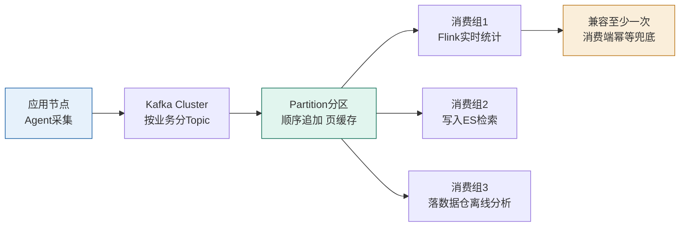
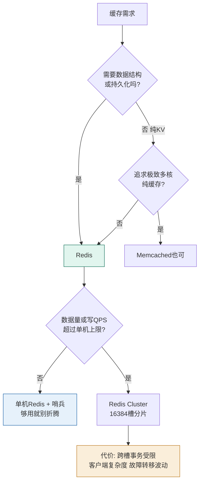
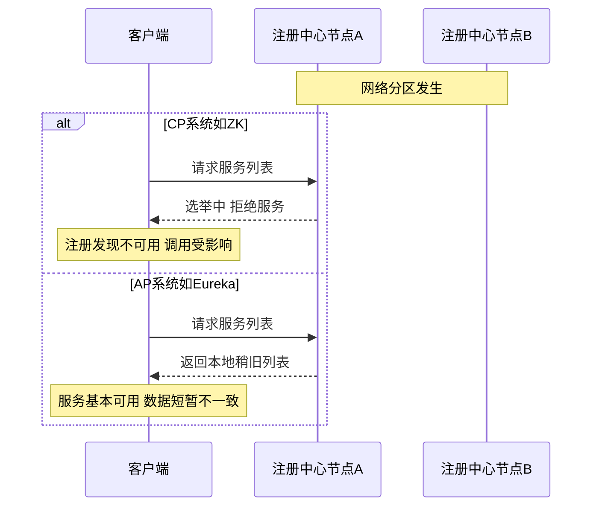
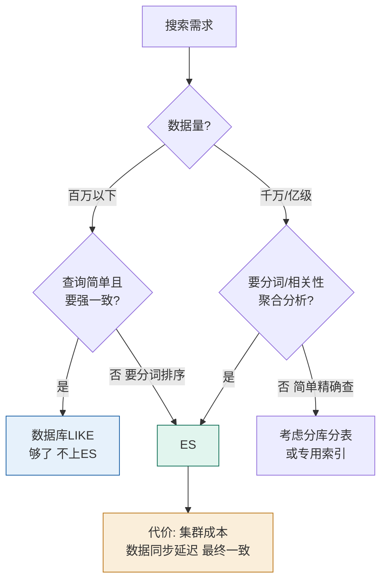

# 中间件选型场景面试

> 定位：中间件选型是架构师面试的「照妖镜」。面试官不问「Kafka 是什么」，他问「日均 20 亿条日志你为什么选 Kafka 不选 RocketMQ」——考的是你有没有**基于约束做取舍**的能力，而不是背过多少张选型对比表。本篇 5 道题，全部按真实面试现场拆：真实问法 → 考察什么 → STAR-L 骨架 → 剥洋葱追问 → 翻车点 → 回扣知识库原理与公开案例。**常见露馅点**：张口「看场景」却说不出什么场景；只会背「Kafka 吞吐高」却讲不出它为什么高、代价在哪；踩一捧一贬低竞品暴露格局。记住一条铁律——**说不出代价的方案，等于没真正用过**。面试高频的选型题，考的从来不是「哪个更好」，而是「在你的约束下哪个更合适，你凭什么这么判断」。

## 题 1：日志采集场景，50 万条/秒写入，你选 Kafka 还是 RocketMQ？

> **面试官问法**：「我们要重建日志平台，峰值 50 万条/秒，日志保留 7 天供检索和离线分析，还要接 Flink 做实时统计。为什么选 Kafka 不选 RocketMQ？说出理由和代价，别跟我背『Kafka 吞吐高』这句话。」

### 考察什么

这题看着像 MQ 选型，实际考四件事：

- **设计目标的敏感度**：能不能说出两者诞生场景的根本差异——Kafka 为日志流/数据管道而生，RocketMQ 为业务消息/事务一致性而生。这是所有论证的地基。
- **吞吐背后的机理**：知不知道 Kafka 的高吞吐来自「顺序追加 + 页缓存 + 零拷贝 + 批量」这套组合拳，而不是一句「它写得快」。
- **代价意识**：选了 Kafka，运维复杂度、分区重平衡、语义只有「至少一次」这些代价能不能主动说出来。
- **证据意识**：能不能引用公开 benchmark 或官方文档支撑判断，而不是凭印象。

### 答题骨架

**S（背景）——先把约束问清楚**：面试官给的数字是起点不是终点。先反问：「这 50 万是峰值还是均值？日志平均多大（几百字节还是几 KB）？消费者有几个.group、各自要不要全量？日志是只做离线分析，还是要实时检索、要精确不丢？团队以前运维过 Kafka 吗？」——**这几个反问本身就加分**，因为它证明你不拿到约束就不下结论。

**A（行动）——用对比表把取舍摊开**：

| 维度 | Kafka | RocketMQ | 对日志场景的影响 |
|---|---|---|---|
| 设计目标 | 日志流、数据管道、流处理 | 业务消息、事务消息、顺序消息 | 日志是「只追加、少查询、大吞吐」，Kafka 天生对口 |
| 单机吞吐 | 极高，依赖顺序写+页缓存+零拷贝 | 高，但更侧重可靠投递与功能丰富 | 50 万条/秒量级 Kafka 更从容 |
| 模型 | Topic→Partition，分区内有序 | Topic→Queue，队列内有序 | 两者都能水平扩展，日志无需全局有序 |
| 消费语义 | 至少一次，偏移量由消费端管理 | 至少一次，支持事务消息 | 日志场景「至少一次」够用，重复可接受 |
| 生态 | Flink/Spark/ES/数仓连接器最全 | 与阿里系、Spring 生态集成好 | 要接 Flink 实时分析，Kafka 生态是决定性的 |
| 运维成本 | 依赖 ZooKeeper 或 KRaft，较重 | NameServer 轻量，部署简单 | 团队能力弱时 RocketMQ 更省心 |

**关键话术**：「如果这 50 万条/秒只是要把日志管道接进 Flink 和数仓、允许极少量重复、不要求事务消息——我选 Kafka，因为它的吞吐机理和生态都是为这个场景生的。但如果这是一个业务消息平台、强依赖事务消息和精确顺序，我会毫不犹豫选 RocketMQ。选型不是选强弱，是选场景匹配度。」

用一张图讲清日志链路里 Kafka 的位置和它解决的核心矛盾：

**R（结果）——引导填真实数字**：「（填入你项目真实的峰值写入量、消息平均大小、分区数、消费者组数量）在这套设计下，我们单集群扛住了 x 万条/秒，分区数从 y 扩到 z，端到端延迟 P99 控制在 N 秒内。」——数字一定要前后对比、可验证，**这是经验密度的证明**。

**L（复盘）——主动说代价，这是拉开差距的地方**：

- 「Kafka 不是免费的。第一，分区数不是越多越好——分区过多会导致文件句柄暴涨、故障恢复变慢，业界公开实践中常见的做法是控制单 broker 分区数在几千量级，并结合目标吞吐反推。」
- 「第二，消费组的重平衡是隐藏杀手。消费者扩缩容时会触发 Rebalance，期间消费暂停；要合理设置 `max.poll.interval.ms`，避免处理慢被误判踢出组。」
- 「第三，语义是『至少一次』，重复不可避免。下游必须做幂等——ES 用过 `业务ID` 做文档 ID 覆盖写，数仓按消息主键去重。」

**公开案例（标注来源）**：Apache Kafka 官方站点的 benchmark 文档曾给出一组广为引用的测试结论——在合适的硬件与配置下，Kafka 单 broker 可实现每秒数百万条消息的写入吞吐，其高吞吐的三件套正是「顺序磁盘写、操作系统页缓存、sendfile 零拷贝」；这一数据来源可参考 Apache Kafka 官方 benchmark 说明。另有 LinkedIn 工程博客公开介绍过 Kafka 最初就是为解决 LinkedIn 的活动流与运营指标数据管道而设计的，天然面向「海量、可重放、多消费者」的日志场景。反观 RocketMQ，据 Apache RocketMQ 官方文档，它的差异化能力集中在事务消息、定时消息、顺序消息等**业务消息语义**上，并在阿里双十一场景下大规模验证——这是它在业务域的强项，而非日志管道的卖点。可借鉴点：**先认清组件的出生场景，再谈选型，论证就有了根**。

### 追问链

| 面试官追问 | 你要接住的点 |
|---|---|
| 分区数怎么定？越多越好吗？ | 按目标吞吐和消费者并行度反推；分区过多拖慢故障恢复、增加句柄 |
| Kafka 怎么保证消息不丢？ | 副本机制 acks=all + ISR + 生产者重试；但仍有边界，日志场景可接受少量丢失 |
| 为什么接 Flink 就倾向 Kafka？ | Connector 生态成熟、偏移量管理、流批一体对接成本最低 |
| 日志重复了怎么办？ | 消费端幂等，用业务 ID 做唯一键覆盖或去重 |
| 如果团队从没运维过 Kafka 呢？ | 评估托管方案或改用 RocketMQ，运维成本也是选型的硬约束 |
| KRaft 了解吗，为什么去掉 ZooKeeper？ | 降低运维复杂度、提升元数据扩展性，是 Kafka 自身的演进方向 |

### 翻车点

- ❌ 「Kafka 吞吐高所以选它」——只给结论不给机理，面试官立刻追「高在哪、凭什么」，答不上就穿。常见坑点就在这里。
- ❌ 「RocketMQ 不行」——踩一捧一大忌。正确姿态是承认它在事务消息、顺序消息上更强，只是不 match 日志场景。
- ❌ 「Kafka 保证不丢消息」——过度承诺。它提供的是可配置的可靠性，日志场景通常接受「至少一次」，别把话说满。
- ❌ 不讲消费端幂等——说明你没真做过多消费者日志管道，重复消费是必然发生的。

### 调用知识

- [Kafka 架构与原理](../08-缓存与中间件/05-Kafka架构与原理.md)：分区模型、零拷贝、ISR 副本机制
- [消息队列选型](../08-缓存与中间件/09-消息队列选型.md)：MQ 选型的系统对比框架
- [RocketMQ 架构与原理](../08-缓存与中间件/04-RocketMQ架构与原理.md)：事务消息、顺序消息的设计目标

## 题 2：Redis 还是 Memcached？既然用了 Redis，为什么还要上 Cluster？

> **面试官问法**：「我们有个缓存层，同事说 Memcached 多线程更快，我说用 Redis。你怎么选？另外单实例 Redis 明明够用，为什么很多公司最后都上了 Redis Cluster——不是为了炫技吧？说说 Cluster 到底解决了什么，又引入了什么新问题。」

### 考察什么

- **能力边界的认知**：能不能一眼看出 Memcached 是「纯内存 KV」，Redis 是「数据结构服务器」——这是选型的第一分水岭。
- **扩展动机的量化**：知不知道上 Cluster 不是为了「看起来分布式」，而是被单机内存上限和写并发瓶颈逼出来的。
- **代价与取舍**：能不能讲出 Cluster 带来的跨槽事务受限、客户端复杂度、故障转移期间的可用性波动。
- **反常识的诚实**：敢不敢承认「很多时候单机 Redis 就够了，过早分布式是过度设计」。

### 答题骨架

**S（背景）——先问清数据特征**：「缓存的数据是简单 KV 还是要存 list/set/zset 这类结构？要不要持久化？数据量多大、预计增长多快？读写 QPS 分别多少？热点 key 集中吗？」——**数据结构和持久化需求，基本就决定了 Redis 还是 Memcached**。

**A（行动）——对比表 + 上 Cluster 的真实动机**：

| 维度 | Redis | Memcached | 判断 |
|---|---|---|---|
| 数据类型 | string/hash/list/set/zset/stream 等 | 仅简单 KV | 需要结构就选 Redis |
| 持久化 | RDB + AOF，可落盘 | 纯内存，重启即丢 | 需要恢复能力选 Redis |
| 线程模型 | 执行命令单线程，6.0+ 引入多线程 IO | 多线程 | Memcached 多线程在纯 KV 多核场景有优势，但别神话 |
| 集群 | 官方 Cluster，主从+哨兵 | 依赖客户端分片 | Redis 生态更完整 |
| 适用场景 | 缓存+数据结构+轻量计算 | 简单高速缓存 | 简单 KV 高并发两者皆可 |

**上 Cluster 的真实动机**（这才是面试官想听的）：「单机 Redis 够不够，是两个数字说了算——**内存容量**和**写 QPS**。第一，单机内存受物理机限制，数据量超过机器内存（比如几十 GB 到上百 GB），就必须分片，Cluster 用 16384 个哈希槽把数据分散到多主节点，线性扩展容量。第二，单实例写并发有上限，Cluster 多主可以同时承担写。所以上 Cluster 是数据量/并发逼出来的，不是为了让简历好看。」

**R（结果）——引导填真实数字**：「（填入你的真实数据量、单实例内存上限、峰值写 QPS）我们数据量从 x GB 涨到 y GB 后，单机内存水位到 z%，于是上了 3 主 3 从 Cluster，每个主节点分片约 y/3 GB，写入能力线性提升。」

**L（复盘）——把 Cluster 的坑讲出来**：

- 「跨槽（cross-slot）操作受限：多 key 不在同一槽就不能用 mget/事务，得用 `{}` hashtag 把相关 key 钉到同一个槽——这是设计约束，得提前规划 key。」
- 「客户端必须支持 Cluster 协议（如 JedisCluster/Lettuce），要能识别 MOVED/ASK 重定向，否则扩容迁移时会报错。」
- 「故障转移不是无感的：主节点宕机后从节点选举上位，这段时间部分槽不可用，客户端要配合理的超时和重试。」

**公开案例（标注来源）**：Redis 官方文档（redis.io）对 Redis Cluster 的设计有明确说明——它使用 16384 个哈希槽进行数据分片，通过 Gossip 协议在节点间交换状态，不支持跨槽的多键操作，这些是官方定义的边界。另一个常被引用的案例来自 Instagram 工程博客公开的文章《Instagram and Redis》，文中介绍了 Instagram 如何使用 Redis 支撑其大规模 feed 场景（包括用 Redis 存储社交图谱与媒体 ID 映射），并提到对 Redis 做分片以突破单机容量限制——这是「业务增长倒逼分片」的真实写照。可借鉴点：**分片是被容量和并发逼出来的工程决策，不是技术炫耀；上之前先算清楚单机还剩多少余量。**

### 追问链

| 面试官追问 | 你要接住的点 |
|---|---|
| 为什么 Redis 单线程还这么快？ | 纯内存 + 高效数据结构 + 单线程避免锁竞争和上下文切换；6.0 多线程只做网络 IO |
| 16384 个槽为什么是这个数？ | 官方权衡：槽太少不利于均匀分布，太多心跳消息过大，16384 是折中 |
| Cluster 和哨兵有什么区别？ | 哨兵做高可用主从切换，Cluster 做分片+高可用，解决的是不同问题 |
| 缓存持久化要不要开？ | 看场景：纯缓存可不开，需要快速恢复则开 AOF；持久化会影响性能 |
| Memcached 就完全不考虑吗？ | 简单 KV、极致多核、无需持久化的纯缓存场景仍有优势，不踩一捧一 |
| 热点 key 在 Cluster 里怎么解决？ | 多副本打散 + 本地缓存，或 hashtag 控制分布后针对热点做特殊处理 |

### 翻车点

- ❌ 「Redis 比 Memcached 快所以选 Redis」——错误前提。纯 KV 场景 Memcached 多线程未必慢，选型理由是数据结构/持久化/生态，不是速度。
- ❌ 「上 Cluster 是为了高可用」——张冠李戴。高可用主要靠主从+哨兵，Cluster 首要解决的是分片扩展。
- ❌ 「Cluster 随便加机器就行」——不懂槽迁移和客户端重定向，暴露没实操过。
- ❌ 「单机够用也先上 Cluster 以后好扩展」——过度设计，面试官反感这种「为分布式而分布式」。

### 调用知识

- [Redis 数据结构与底层](../08-缓存与中间件/01-Redis数据结构与底层.md)：Redis 丰富数据结构与单线程模型
- [Redis 持久化与集群](../08-缓存与中间件/02-Redis持久化与集群.md)：RDB/AOF、哨兵、Cluster 槽机制
- [缓存三大问题与一致性](../08-缓存与中间件/03-缓存三大问题与一致性.md)：分片之前先解决穿透击穿雪崩

## 题 3：注册中心 Nacos / Eureka / ZooKeeper / Consul，你怎么选？AP 还是 CP？

> **面试官问法**：「我们要选注册中心，团队在 Nacos、Eureka、ZooKeeper、Consul 之间吵起来了。你从 CAP 角度讲清楚它们分别属于 AP 还是 CP，然后告诉我：注册中心这个场景，到底该选 AP 还是 CP？别只给我背定义，说清楚为什么。」

### 考察什么

这题是**CAP 理论落地的经典试金石**，考三点：

- **理论不混淆**：能不能准确说清四个组件的 CAP 定位及其协议根基（Eureka 的 AP、ZK 的 CP、Consul 的 CP、Nacos 双模式）。
- **场景判断力**：能不能说出「注册中心更要 AP」的本质原因——短暂的数据不一致，比「为了强一致而整体不可用」危害小得多。
- **不迷信权威**：敢不敢质疑「ZK 做注册中心」这个历史上的流行做法，并讲清它的问题。

### 答题骨架

**S（背景）——先定场景**：「注册中心的核心诉求是什么？服务实例数量级多大？是否已经有 ZK 等基础设施？团队更看重『永不中断的注册发现』还是『强一致的服务列表』？」——**先把场景诉求定性，CAP 的选择才有依据**。

**A（行动）——先定位，再决策**：

| 组件 | CAP 定位 | 一致性协议 | 核心特点 |
|---|---|---|---|
| Eureka | **AP** | 自定义，去中心化 | 优先可用性，网络分区时各节点仍可注册/发现 |
| ZooKeeper | **CP** | Zab | 选举期间不可用，强一致，但分区时可能拒绝写 |
| Consul | **CP** | Raft | 强一致 + 服务发现 + 健康检查，牺牲部分可用性 |
| Nacos | **AP/CP 可切换** | Distro(AP) / Raft(CP) | 灵活，默认 AP，可按场景切换 |

**核心判断——注册中心为什么偏 AP**：「注册中心的第一使命是**服务能互相找到**。CAP 里，P（分区容错）是分布式系统的必选，剩下在 C 和 A 之间取舍。对注册中心来说：如果选 CP（像 ZK），网络分区或 leader 选举期间，整个注册中心不可用或拒绝写，新实例无法注册、客户端拿不到列表——**这会导致大面积调用失败，灾难是即时且放大的**。如果选 AP（像 Eureka），分区时每个节点用自己的本地数据继续服务，可能拿到稍微过时的列表，但**服务间调用绝大多数仍能进行**——一小段时间的不一致，比整体瘫痪可接受得多。所以我的结论是：**注册中心通常选 AP**。」

**公开案例（标注来源）**：Netflix 开源的 Eureka 在其官方 GitHub Wiki 中明确将自身定位为 AP 系统，设计哲学正是「宁可返回可能稍旧的服务列表，也要保证注册发现不可用时间最短」；这一取舍在 Spring Cloud 生态的官方文档中也被反复阐述。与此对照，Apache ZooKeeper 官方文档将其定位为 CP 协调服务，基于 Zab 协议保证顺序一致性——它在分布式锁、配置中心等强一致场景表现出色，但作为注册中心时会因 leader 选举出现短暂不可用，这是业界公开讨论过多次的「ZK 做注册中心」争议点（可结合 CAP 理论与 Zab 协议相关公开资料）。Nacos 官方文档则明确说明其支持 AP 与 CP 模式切换（默认 AP），这也是它近年在国内被广泛采用的原因之一。可借鉴点：**没有绝对好的组件，只有与场景诉求匹配的 CAP 取舍**。

用时序图看 AP 与 CP 在网络分区时的行为差异：

**R（结果）——引导填真实结论**：「（写下你项目最终选了哪个、为什么）我们最终选了 X，核心原因是 Y；上线后注册发现可用性达到 Z，遇到的主要问题是 W。」

**L（复盘）——主动补一句成熟的话**：「我会补一句：CAP 不是非黑即白。选 AP 就要接受短暂不一致，并通过客户端缓存 + 失败重试 + 本地故障转移来兜底；选 CP 就要评估选举期间的不可用是不是业务能承受。真正专业的回答，是说出『我选了什么、放弃了什么、怎么补偿被放弃的那一半』。」

### 追问链

| 面试官追问 | 你要接住的点 |
|---|---|
| 注册中心一定要 AP 吗？ | 绝大多数场景偏 AP；但金融强一致极端场景可讨论 CP，关键是讲清代价 |
| ZK 做注册中心有什么问题？ | 选举期间不可用、脑裂风险、watch 一次性的惊群效应 |
| Eureka 已经停止维护了还能用吗？ | 2.x 已进入维护模式，新项目多转向 Nacos/Consul，这是现实约束 |
| Nacos 的 AP/CP 怎么切？ | 通过配置选择，底层分别用 Distro 协议和 Raft 协议 |
| 客户端缓存服务列表有必要吗？ | 有必要，注册中心整体挂掉时客户端可用本地缓存继续调用 |
| CP 系统就完全不适合服务发现吗？ | 适合对一致性极敏感、规模可控的场景，仍要权衡可用性代价 |

### 翻车点

- ❌ 背 CAP 定义却不说注册中心场景——「AP 是可用性 CP 是一致性」这种话面试官听腻了，要落到场景。
- ❌ 「ZK 是 CP 所以更好」——迷信强一致，没意识到注册中心选举期间不可用的致命性。
- ❌ 「Nacos 是 AP」——不准确。Nacos 支持 AP/CP 切换，说死一端暴露认知粗糙。
- ❌ 不提客户端兜底——以为选了 AP 就高枕无忧，忽略短暂不一致需要工程补偿。

### 调用知识

- [Nacos 原理](../10-微服务体系/01-Nacos原理.md)：Nacos 的 AP/CP 双模式、Distro 与 Raft
- [Zookeeper 原理](../08-缓存与中间件/08-Zookeeper原理.md)：Zab 协议、CP 特性、watch 机制
- [CAP、BASE 与一致性](../09-分布式理论与共识/01-CAP-BASE与一致性.md)：CAP 取舍的理论根基
- [微服务痛点治理](../10-微服务体系/07-微服务痛点治理.md)：注册发现故障的治理手段

## 题 4：什么场景该用 Elasticsearch，什么场景用数据库 LIKE 就够了？

> **面试官问法**：「我们的商品搜索现在是数据库 `LIKE '%关键词%'`，有人提议上 Elasticsearch。你怎么判断该不该上？给我一条清晰的边界线——什么情况 LIKE 就够，什么情况必须 ES？别告诉我『数据量大就用 ES』，这话太空。」

### 考察什么

- **检索机理的理解**：知不知道 ES 的倒排索引为什么比 LIKE 快，以及 LIKE 慢在哪（前导通配符导致索引失效）。
- **边界的量化**：能不能给出「多大量级、多复杂查询」的分界线，而不是含糊的「看情况」。
- **成本意识**：ES 不是免费的——集群成本、数据同步、一致性延迟，能不能说清。
- **反例思维**：敢不敢说「这个场景我就不上 ES」。

### 答题骨架

**S（背景）——把查询需求问清楚**：「数据量多少（十万级还是亿级）？查询是精确匹配还是分词模糊搜索？要不要相关性排序、多字段组合、聚合统计？关键词是中文需要分词吗？更新频率和实时性要求多高？」——**查询复杂度 + 数据量，是决策的两条主轴**。

**A（行动）——给出清晰边界线**：

| 场景特征 | 数据库 LIKE | Elasticsearch | 判断依据 |
|---|---|---|---|
| 数据量 < 百万、简单前缀/包含匹配 | ✅ 够用 | 杀鸡用牛刀 | LIKE 全表扫描在小数据量下可接受 |
| 前导通配 `%词` | ❌ 索引失效、全表扫 | ✅ 倒排索引天然支持 | 这是 LIKE 的性能死穴 |
| 中文分词 + 相关性排序 | ❌ 做不到 | ✅ 核心能力 | ES 基于 Lucene 的分词与打分 |
| 多字段组合 + 聚合分析 | 勉强 | ✅ 强项 | ES 的 aggregation 高效 |
| 要求强一致、更新即查 | ✅ 天然一致 | ⚠️ 有同步延迟 | ES 最终一致，索引刷新有间隔 |

**一句话边界**：「**数据量小、查询简单、要强一致 → LIKE 就够；数据量大、要分词/相关性/多字段聚合、能接受秒级延迟 → 上 ES。** 中间地带用 `like` 还是 `ES`，取决于这两条主轴哪条先越线。」

**为什么 LIKE 会慢**：`LIKE '%关键词%'` 的前置通配符让 B+ 树索引完全失效，只能全表扫描 + 逐行字符串匹配，数据量一大就是灾难；而 ES 用倒排索引，把「词→文档列表」预先建好，查询时直接词查找，复杂度与文档总量关系不大。

**R（结果）——引导填真实数字**：「（填入你的真实数据量、LIKE 查询的响应时间）我们商品表 x 万条，`LIKE '%词%'` 的 P99 到了 y 毫秒；上 ES 后降到 z 毫秒，并支持了以前做不到的中文分词和相关性排序。」

**L（复盘）——把 ES 的代价讲清楚**：

- 「数据同步是核心复杂点：通常用 Canal 订阅 binlog 或 MQ 异步写入 ES，这带来**秒级延迟和最终一致**——用户刚发的商品可能搜不到，要有产品层面的预期管理。」
- 「ES 不是数据库，别用它做主存储：更新频繁、强事务的场景仍以 DB 为准，ES 只做检索副本。」
- 「深分页（from+size）会拖垮 ES，用 search_after 或滚动查询。」

**公开案例（标注来源）**：Elastic 官方客户案例与技术文档显示，Wikipedia 的全文搜索（CirrusSearch 项目）正是基于 Elasticsearch 构建的，支撑海量百科词条的分词检索与相关性排序——这是「大数据量 + 复杂检索 → ES」的标杆。相对地，许多中小系统在数据量有限时用数据库 `LIKE` 或全文索引（`FULLTEXT`）就能满足需求，这是业界公开实践中常见的做法。可借鉴点：**先量化和查询复杂度，再决定要不要付 ES 的成本；别把 ES 当搜索的万能默认值。**

### 追问链

| 面试官追问 | 你要接住的点 |
|---|---|
| 倒排索引原理是什么？ | 词项到文档列表的映射，查询时先分词再按词取文档求交集/并集 |
| 数据库 FULLTEXT 不行吗？ | 可做简单全文检索，但分词、相关性、扩展性、聚合能力远不如 ES |
| ES 数据怎么和数据库同步？ | Canal 订阅 binlog / MQ 异步双写，接受最终一致并处理失败重试 |
| ES 索引设计要注意什么？ | mapping 设计、分词器选择、分片数规划、避免深分页 |
| 数据量刚好卡在边界怎么办？ | 先用 LIKE + 索引优化，压测拐点；确实扛不住再迁 ES，避免过度设计 |
| ES 一致性怎么保证？ | 它是最终一致，refresh 间隔控制可见延迟；强一致场景以 DB 为准 |

### 翻车点

- ❌ 「数据量大就用 ES」——空话，没有给出可操作的边界线。
- ❌ 不知道 LIKE 为什么慢——讲不出「前导通配符导致索引失效」，说明机理没吃透。
- ❌ 只讲 ES 好处不讲同步延迟和成本——面试官会追「数据一致性怎么保证」。
- ❌ 把 ES 当数据库用——暴露对组件定位的误解。

### 调用知识

- [Elasticsearch 原理与调优](../08-缓存与中间件/07-Elasticsearch原理与调优.md)：倒排索引、分词、聚合、调优
- [技术选型方法论](../11-架构设计能力/05-技术选型方法论.md)：如何划清选型边界线
- [SQL 优化与执行计划](../07-数据库体系/04-SQL优化与执行计划.md)：LIKE 与索引失效的关系

## 题 5：面试官问「为什么不用 XX」，怎么答才不像踩一捧一？

> **面试官问法**：「你前面说了为什么选 Kafka、选 Redis、选 Nacos。那我反过来问：这些组件都有替代者，你为什么不用 RabbitMQ、不用 Memcached、不用 Consul？——注意，我想听的是你真实的判断，不是让我听你贬低别人来抬高自己。」

### 考察什么

这题表面在问技术，实际在考**格局和思维方式**——这道题答好了，前面所有选型题的可信度都会被放大：

- **成熟度信号**：能不能承认「替代方案也有优点」，而不是非黑即白。
- **思维结构**：有没有一套稳定的「为什么不用」回答框架，而不是临场编理由。
- **诚实与边界**：敢不敢说「这个场景其实用 XX 也行，我们选 A 是因为团队/成本/历史原因」。

### 答题骨架

**S（背景）——先破题**：「面试官问『为什么不用 XX』，不是真要我证明 XX 一无是处，而是在验证三件事：我有没有真正评估过替代方案、我的判断有没有依据、我会不会客观看待技术。所以第一步永远不是贬低 XX，而是先承认它的合理场景。」

**A（行动）——一套可复用的回答框架**，我用一张图把它固化下来：

**这套框架的示范应用**（用前面的真实场景）：

- 「**为什么不用 RabbitMQ**？RabbitMQ 在复杂路由、灵活的 exchange 机制上很强，中小 systems 的业务消息用它是很好的选择；但我们这是日志管道，需要的是大吞吐和 Flink 生态对接，Kafka 的分区模型和 connector 更贴。如果以后做一个需要复杂路由的业务消息系统，我会认真考虑 RabbitMQ。」
- 「**为什么不用 Memcached**？纯 KV 缓存场景它多线程、简单高效，我们没选它不是因为它不好，而是我们的数据有 hash/list 结构需求且要持久化，Redis 的数据结构更合适。如果没有这些需求，纯缓存用 Memcached 完全合理。」
- 「**为什么不用 Consul**？Consul 的 CP + 强一致 + 健康检查在需要强一致的场景很有价值；我们注册中心更看重可用性，选了 AP 倾向的 Nacos。如果哪天业务对服务列表一致性有强要求，Consul 会进入我的候选。」

**关键话术**：「我做选型从不问『哪个最好』，只问『在我的约束下哪个最合适』。**每个主流组件能活下来都有它的道理，说不出替代方案优点的人，恰恰说明他没真正比较过。**」

**R（结果）——引导填真实的取舍**：「（填入你真实的选型经历里，被你放弃的那个方案的优点）我当时也认真评估了 XX，它的 Y 优势很突出，但因为我们Z约束，最终选了 A。这个判断到现在我认为是对的，因为……」

**L（复盘）——给成熟收尾**：「我会主动补一句：选型不是一锤子买卖。技术会演进、团队会成长、业务会变，今天不合适的方案明年可能合适。所以我的选型结论都会写清楚『前提假设』和『什么条件下重新评估』——这叫留余地，也叫专业。」

**公开案例（标注来源）**：这套「先承认替代方案优点、再回到约束、最后留重评条件」的表达方式，与多篇业界公开的选型实践分享精神一致——例如阿里技术博客与 QCon/ArchSummit 上多位架构师在分享中间件选型时，普遍强调「没有银弹、只有场景匹配」的原则（可参考阿里技术博客、美团技术团队博客中关于技术选型与中间件对比的公开文章）。可借鉴点：**把「为什么不用」从防守题变成展示你思维广度的进攻题。**

### 追问链

| 面试官追问 | 你要接住的点 |
|---|---|
| 那你觉得 XX 什么时候比你现在选的好？ | 直接说出替代方案占优的具体场景，证明你客观 |
| 如果团队更熟悉 XX 呢？ | 团队能力是硬约束，熟悉度可能推翻纯技术最优解 |
| 你现在选的方案有什么缺点是 XX 没有的？ | 坦诚说出所选方案的短板，这才是真比较过 |
| 会不会是你当时没调研清楚？ | 承认认知局限，给出「基于当时信息」的限定 |
| 什么情况下你会推翻今天的决定？ | 给出可触发重评的具体条件，体现留余地 |

### 翻车点

- ❌ 「XX 不行/太老了」——纯贬低，暴露格局和调研深度都不足。
- ❌ 「没用过 XX 所以不用」——等于承认没比较过，这题白送。
- ❌ 把「为什么不用」答成「为什么选 A」的重复——没正面回应替代方案。
- ❌ 说死「永远不用 XX」——技术观僵化，架构师要看演进。

### 调用知识

- [技术选型方法论](../11-架构设计能力/05-技术选型方法论.md)：选型决策的系统框架与记录方式
- [架构师面试的底层逻辑](./01-架构师面试的底层逻辑.md)：诚实表达与不踩一捧一的原则
- [消息队列选型](../08-缓存与中间件/09-消息队列选型.md)：各类 MQ 的适用边界

## 小结

- 选型题的铁律：**先讲约束，再讲取舍，最后主动讲代价**——说不出代价等于没用过。
- 日志选 Kafka：设计目标 + 吞吐机理 + Flink 生态是理由，运维复杂度 + 重平衡 + 至少一次语义是代价。
- Redis vs Memcached 看数据结构与持久化需求；上 Cluster 是被单机内存和写 QPS 逼出来的，不是炫技。
- 注册中心通常偏 **AP**——短暂不一致比整体不可用可接受；选 AP 要用客户端缓存和重试补偿。
- ES vs LIKE 的分界线：**数据量 × 查询复杂度**，上 ES 就要接受同步延迟和最终一致的代价。
- 「为什么不用 XX」是展示格局的进攻题：**先承认替代方案优点，回到约束，留重评条件**，绝不踩一捧一。
