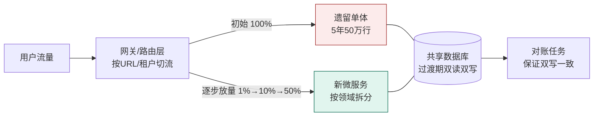
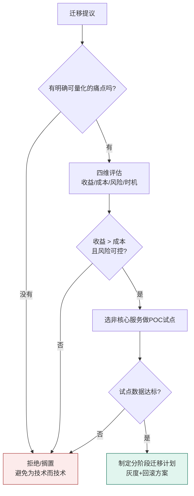
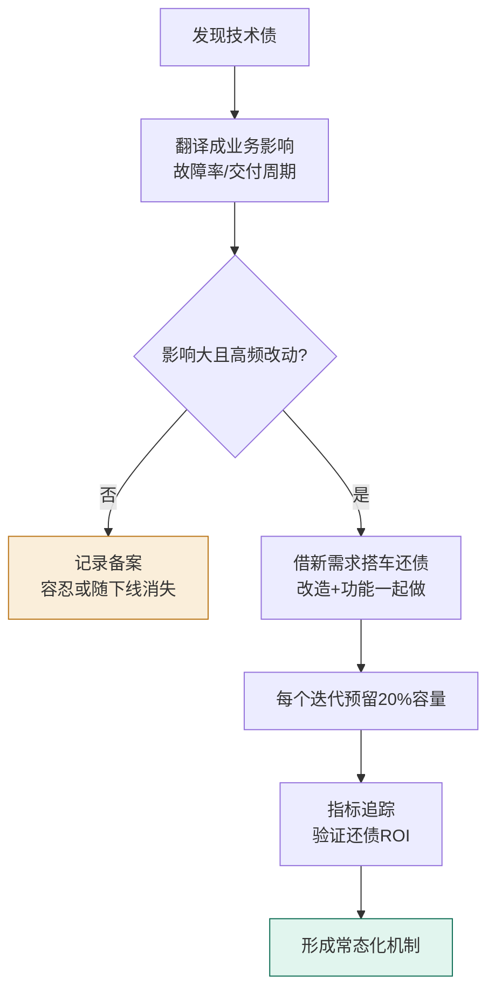
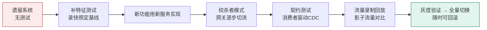
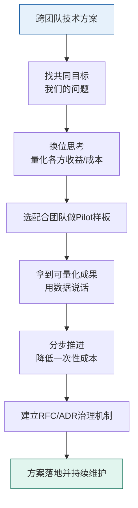

# 架构演进与技术改造场景面试

> 定位：架构师和中高级工程师的分水岭，不在于会不会写新系统，而在于敢不敢动旧系统。这一篇的 5 道题全部围绕"改造"——单体拆微服务、技术栈迁移、还技术债、无测试系统重构、跨团队推动。面试官考的不是你背过多少模式名词，而是你有没有在**约束重重、不能停机、业务不配合、团队有分歧**的真实条件下做成过事。常见露馅点：张口就是"推倒重来""全量重写""上 K8s 就好了"，一问代价、一问灰度、一问怎么回滚就哑火。
>
> 面试高频：以下是架构师面试反复出现的高频场景，本系列按真实面试现场拆题——不复述定义，只讲决策链、取舍与踩过的坑点。

---

## 题 1：一个跑了 5 年的单体系统，让你拆成微服务，怎么定拆分顺序、怎么保证不停机？

### 题目

"我们有个Java 单体，5 年历史，50 万行代码，每天还有几十笔订单在跑。老板让你把它拆成微服务，要求业务不能停。你怎么拆？先拆哪个？怎么保证拆的过程中线上不出事？"

### 考察什么

- **拆分依据**：是按业务边界拆，还是按代码目录拆？能不能讲清"为什么先拆这个、后拆那个"。
- **迁移策略**：有没有"渐进式替换"的意识，还是只知道"停机重写"。
- **风险意识**：数据怎么切、流量怎么切、出问题怎么回滚、双写怎么对账。
- **配套认知**：知不知道拆分会引入分布式问题，团队和组织要不要跟着变（康威定律）。

### 答题骨架

**S（背景）**：别上来就画微服务图。先问清约束——"(填入你的真实系统：代码量、模块数、日订单量、峰值 QPS)"；当前最大的痛点是什么（发布慢？耦合严重？某个模块拖垮全局？）；团队几个人、什么能力；数据库是单库还是已经分库；是否真的要求 7×24 不停机。

> 面试官想听的第一句话，是你先把问题问清楚，而不是急着给方案。**"5 年、50 万行、不能停机"这三个约束，决定了你绝不可能停机重写。**

**A（行动）**：讲清"按什么拆"和"按什么顺序拆"两件事。

**第一，拆分依据——按领域边界，不按技术分层。** 用 DDD 的限界上下文思路，按业务能力聚合，而不是按 controller/service/dao 拆成一堆"微服务"。判断标准：**数据归属是否独立、变更频率是否相近、是否能独立发布**。

**第二，拆分顺序——先边缘后核心、先读后写、先独立后耦合。** 给一张优先级判断表：

| 候选模块 | 依赖关系 | 读写特征 | 变更频率 | 拆分优先级 |
|---|---|---|---|---|
| 消息通知、报表等外围模块 | 几乎无人依赖 | 读多写少 | 中 | 高（先拿它练手） |
| 商品/类目等读多写少模块 | 被多处依赖 | 读多写少 | 中 | 中 |
| 交易/订单等核心写模块 | 强依赖、强事务 | 写多、强一致 | 高 | 低（最后拆、最谨慎） |
| 共享的配置/工具代码 | 人人依赖 | — | — | 不拆，抽公共库 |

**第三，迁移策略——绞杀者模式（Strangler Fig），渐进替换，不停机。** 核心动作：在单体前面加一层**网关/路由**，把特定流量逐步从单体切到新服务，切一块、验一块、稳一块，最后单体被"绞杀"殆尽。

**关键话术**："切换永远是小步快跑——先 1% 灰度，看监控没问题再加到 10%、50%。任何一步出问题，路由一改就把流量切回单体，**回滚是秒级的**。绝不搞'某天凌晨一刀切'。"

**数据切分**是最难的部分，要主动说清：过渡期采用双写 + 对账，以旧库为准；确认一致后再切读、最后切写；核心数据迁移要停机窗口的，选业务低峰、提前公告、准备回滚脚本。

**R（结果）**：引导读者填真实数字——"我主导/参与的拆分，最终拆出（填数字）个服务，历时（填时间），全程零停机，切换期通过路由回退过（填次数）次。发布频率从（填）提升到（填）。"

**L（复盘）**：主动说坑，这是加分项——
- **分布式事务**：单体里一个本地事务搞定，拆完变成跨服务，要么引入 Seata/TCC，要么用最终一致 + 补偿，**别指望事务能无缝带过去**。
- **共享数据库**：过渡期多个服务读写同一个库，是技术债，要设明确的"拆解截止日期"，否则永远拆不干净。
- **康威定律**：系统架构会趋同于组织结构。服务拆了但团队没拆、还是一拨人管所有服务，边界守不住。
- **过度拆分**：拆得太细，运维、调用链、排障成本爆炸。"能在一个服务里解决的，别拆。"

> **公开案例**：Martin Fowler 在其网站 martinfowler.com 的 Bliki 中提出的 **Strangler Fig Application（绞杀者模式）**，是业界处理遗留系统改造最经典的公开模式——核心就是围绕旧系统逐步建新系统、逐步切流，直到旧系统可下线。Netflix 向云原生微服务的演进也是公开披露的长期渐进过程（见其技术博客关于云迁移的文章），驱动力是具体的可用性/扩展痛点，而非"为微服务而微服务"。**可借鉴点**：拆分是渐进工程，不是大爆炸重写；每一小步都要可验证、可回滚。

### 追问链

| 面试官追问 | 你要接住的点 |
|---|---|
| 双写时新库写失败、旧库成功了怎么办？ | 以旧库为准 + 失败重试 + 定时任务对账补偿 |
| 切换过程中用户正在下单，数据不一致怎么防？ | 幂等 + 状态机 + 切换窗口选低峰 + 回退脚本 |
| 怎么判断某个模块该不该拆？ | 数据是否独立、变更频率、是否被强依赖、收益是否大于成本 |
| 拆完调用链变长、性能下降怎么办？ | 合并不必要的拆分、加缓存、异步化、治理RPC开销 |
| 团队就几个人，也适合拆微服务吗？ | 不适合。人少时单体+模块化更优，别为架构而架构 |
| 怎么保证拆分后接口兼容？ | 消费者驱动契约测试 + 版本化 + 灰度流量验证 |

### 翻车点

- ❌ "停机重写一遍" —— 5 年系统、50 万行、业务不停机，重写是最危险最不现实的选择，一句话暴露没做过改造。
- ❌ "按 controller/service/dao 分层拆成三个服务" —— 这是分布式三层，不是微服务，暴露对领域拆分一无所知。
- ❌ "直接全量切流" —— 没有灰度、没有回滚方案，生产事故制造机。
- ❌ 只谈技术不谈数据和组织 —— 拆分最难的是数据切分和团队配套，想不到说明没真正落地过。

### 调用知识

- [DDD 领域驱动设计](../11-架构设计能力/01-DDD领域驱动设计.md)：限界上下文、聚合——拆分的理论依据
- [架构模式](../11-架构设计能力/03-架构模式.md)：绞杀者模式、单体与微服务取舍
- [微服务痛点治理](../10-微服务体系/07-微服务痛点治理.md)：拆完后的分布式治理成本
- [分库分表](../07-数据库体系/05-分库分表.md)：数据切分与迁移

---

## 题 2：团队想把 Dubbo 迁到 Spring Cloud / 上 K8s，你怎么评估要不要做？

### 题目

"团队最近很热闹，有人说 Dubbo 老旧了要迁 Spring Cloud，有人说要上 K8s 云原生。你作为架构师，怎么判断这件事该不该做？你会怎么评估？"

### 考察什么

- **动机判断**：能不能区分"解决真实痛点"和"跟风赶时髦"。
- **成本收益量化**：迁移成本、风险、收益有没有算过账。
- **说不的勇气**：架构师敢不敢在理由不充分时叫停，而不是迎合团队情绪。
- **决策方法**：有没有一套可复用的评估框架，而非凭感觉。

### 答题骨架

**S（背景）**：先问清——"现在系统真实的痛点是什么？是 Dubbo 撑不住了，还是有人觉得它土？规模多大、QPS 多少、服务多少个？团队对新技术的学习成本有多高？业务近期有没有大促、大版本要发？"

> 关键判断：**"迁移的起点是 pain（痛点），不是 trend（潮流）。"** 没有明确痛点支撑的迁移，本质是团队的技术冲动。

**A（行动）**：给一套评估框架，别直接表态。

**第一步：把痛点翻译成可量化的问题。** 不能说"Dubbo 老了"，要说"服务治理能力不够，缺少统一的限流熔断、灰度能力，最近三次故障都和这个问题相关"。**没有量化痛点的迁移，一律先搁置。**

**第二步：成本收益四维评估。** 用一张表把账算清：

| 维度 | 要回答的问题 |
|---|---|
| 收益 | 迁移后具体解决什么痛点？能带来多少可量化收益（故障率↓、交付速度↑）？ |
| 成本 | 改造工作量（人月）、学习成本、双轨运行成本、机器/云资源成本 |
| 风险 | 迁移期稳定性风险、回滚难度、团队能力短板 |
| 时机 | 业务节奏允许吗？有没有更紧迫的事（大促、合规）？ |

**第三步：小步试点，用数据说话。** 别一上来全量迁。选一个非核心服务做 POC，跑一段时间，验证"收益是否真如预期、坑是否可控"，再决定是否推广。

**关键话术**："我的结论可能不是'迁'也不是'不迁'，而是'先迁一个非核心服务试试'。架构师的价值不是追新，是**用最小代价把问题解决了**。如果现有 Dubbo 加个 Sentinel 就能解决治理痛点，为什么要花半年全量迁？"

**R（结果）**：填真实经历——"我评估过一个（填）迁移提案，结论是（填：暂缓/试点/全量迁），依据是（填数据），最终节省/避免了（填）成本。"

**L（复盘）**：主动说——
- **别贬低现有技术**：Dubbo 本身很成熟，"老旧"不等于"不好"。承认它的优点，再谈新方案解决什么问题，才不显得技术自负。
- **迁移要有终点**：双轨长期并存是最坏结果，要设明确的"旧栈下线时间表"。
- **团队能力是硬约束**：再好的技术，团队hold不住就是灾难。评估里必须包含学习曲线。

> **公开案例**：Amazon 从单体向服务化演进，是业界公开讨论最多的转型案例之一。据公开披露（如 Bezos 广为流传的 2002 年"API 强制令"——要求团队间必须通过服务接口通信，以及 AWS 技术负责人的多次公开分享），Amazon 的服务化是**伴随着明确的业务规模诉求和信息接口标准自上而下推动的**，而非单纯追新。**可借鉴点**：重大技术转型要有清晰的业务驱动力和统一标准，并用机制保障落地；同时它是一个多年持续投入的过程，不是一次"迁移运动"。

### 追问链

| 面试官追问 | 你要接住的点 |
|---|---|
| Dubbo 和 Spring Cloud 你怎么选？ | 看团队栈、治理需求、生态；Dubbo 性能强、Java 生态深，Spring Cloud 生态全，没有绝对优劣 |
| 上 K8s 一定能降本增效吗？ | 不一定。小规模、无弹性需求时 K8s 增加运维复杂度，别神化 |
| 团队都想迁，你拦得住吗？ | 用数据和试点说话，而非权威压制；让反对者也看到成本 |
| 迁移中新旧共存怎么治理？ | 明确边界、双轨成本计入预算、设旧栈下线 deadline |
| 试点失败了怎么办？ | 及时止损，沉淀经验，不硬推——试点就是用来证伪的 |

### 翻车点

- ❌ "Dubbo 太老了必须迁" —— 没有任何量化痛点，纯情绪驱动，架构师大忌。
- ❌ "上 K8s 是趋势，我们也要上" —— 跟风，说不出自己的场景收益。
- ❌ 只讲技术不讲成本和团队能力 —— 迁移本质是项目，要算人月和风险。
- ❌ "我决定全量迁，三个月搞定" —— 没有试点、没有灰度、没有回滚，盲目自信。

### 调用知识

- [技术选型方法论](../11-架构设计能力/05-技术选型方法论.md)：如何系统评估一项技术
- [Dubbo 原理](../10-微服务体系/06-Dubbo原理.md)：Dubbo 的能力边界
- [Kubernetes 核心](../15-容器与云原生/02-Kubernetes核心.md)：K8s 解决什么问题、代价是什么
- [架构模式](../11-架构设计能力/03-架构模式.md)：演进式架构思路

---

## 题 3：技术债一大堆，业务又不给你时间还，你怎么办？

### 题目

"你们系统技术债堆积如山——代码乱、架构腐化、没文档。产品天天催新需求，根本不给你时间还债。作为架构师，你怎么处理这种局面？"

### 考察什么

- **翻译能力**：能不能把技术债"翻译"成业务能听懂的语言（故障风险、交付变慢）。
- **优先级判断**：债也分轻重缓急，能不能区分"必须马上还"和"可以忍"。
- **博弈与沟通**：怎么在不耽误业务的前提下，把还债塞进节奏里。
- **量化意识**：有没有指标证明"还债是有回报的"。

### 答题骨架

**S（背景）**：先问清——"技术债主要是哪一类（架构债/代码债/测试债/文档债）？它已经造成了什么实际影响（最近故障率、需求交付周期、线上问题数）？业务方的 KPI 是什么？"

> 面试官重点：**"技术债不是你和业务方争论的筹码，是会影响业务的东西。"** 你要证明它还值得还，就得先证明它已经在伤业务。

**A（行动）**：四步走。

**第一步：分类 + 量化，把技术债翻译成业务语言。** 不要说"代码太乱"，要说"因为这个模块耦合，近三个月 5 次故障有 3 次出在它，平均每次交付要多花 2 天"。**用故障率、交付周期、变更失败率说话。**

**第二步：分优先级——不是所有债都值得还。** 参考 Martin Fowler 的技术债象限（按"有意/无意 × 谨慎/鲁莽"分类），务实版的判断是：

| 债的类型 | 特征 | 处理策略 |
|---|---|---|
| 高频改动区的债 | 经常改、经常出错 | **优先还**：ROI 最高 |
| 稳定不动的模块的债 | 几年没改、不出事 | 容忍，别浪费时间 |
| 阻碍新需求的债 | 挡住了业务要做的东西 | 借需求还：改造和新功能一起做 |
| 马上要下线的模块的债 | 即将废弃 | 不还 |

**第三步：搭车式还债，别单独要时间。** 业务不给"专门还债的时间"是正常的。架构师的做法是：**把还债藏进业务需求里**——"这个新需求正好要动这个模块，我顺便把它的结构理顺，只多花 20% 时间，但以后这类需求能快 50%"。这叫 **Boy Scout Rule（营地法则）：离开时比来时更干净一点**。

**第四步：建立机制，让还债常态化。** 比如每个迭代预留 20% 容量处理技术债；Code Review 卡住新增的坏味道；关键指标（变更失败率、交付周期）纳入团队看板持续追踪。

**R（结果）**：填真实数字——"我把（填模块）的技术债量化成（填影响数据），说服产品在每个迭代预留 20% 容量，半年后交付周期从（填）降到（填），变更失败率下降（填）。"

**L（复盘）**：主动说——
- **别搞"大爆炸式重构"**：停下来三个月专门还债，业务会跟你拼命，而且风险极高。渐进式还债才是正解。
- **别隐瞒技术债**：不告诉业务方风险，出事时责任全在你。透明沟通才是保护自己。
- **预防胜于治疗**：还完债要建机制（评审、规范、测试），否则很快又积累回来。

> **公开案例**：**技术债（Technical Debt）**概念由 Ward Cunningham 在 1992 年的 OOPSLA 会议上提出，用金融债务比喻"走捷径的代码"——短期提速，但要持续付出"利息"（维护成本）。Martin Fowler 在 martinfowler.com 上提出**技术债象限**，按"有意/无意 × 谨慎/鲁莽"两个维度把技术债分为四类，帮助团队决定哪些债可以有意承担、哪些必须尽快偿还。**可借鉴点**：技术债不是道德问题，是可以通过分类和量化来管理的工程决策；关键是让债务"可见、可量化"。

### 追问链

| 面试官追问 | 你要接住的点 |
|---|---|
| 业务就是不给时间，一分都不给呢？ | 那就搭车还、小步还，并把风险书面化（技术风险清单），出事有据可查 |
| 怎么说服非技术的产品/老板？ | 用钱和时间说话："这个债导致每次交付多 2 人天、故障率 X%" |
| 技术债能量化吗？怎么量化？ | 用故障率、MTTR、交付周期、变更失败率、代码坏味道数等代理指标 |
| 还债还出了新 Bug 怎么办？ | 测试覆盖 + 灰度 + 小步提交 + 可回滚，还债也要工程化 |
| 你怎么防止团队又欠新债？ | Code Review、规范、自动化测试、架构守护（ArchUnit 等） |

### 翻车点

- ❌ "停下来重构三个月" —— 脱离业务，现实里不可能获批，显得不懂权衡。
- ❌ "技术债是业务不懂，懒得跟他们解释" —— 沟通缺失，架构师不是躲在象牙塔里。
- ❌ "所有债都要还" —— 没有优先级，分不清哪些债其实可以忍受。
- ❌ "还完就好了" —— 没有预防机制，债会很快卷土重来。

### 调用知识

- [架构文档与技术风险](../17-项目治理/04-架构文档与技术风险.md)：技术风险识别与记录
- [测试体系](../17-项目治理/02-测试体系.md)：还债的安全网
- [代码规范与评审](../17-项目治理/01-代码规范与评审.md)：防止新增债务
- [DDD 领域驱动设计](../11-架构设计能力/01-DDD领域驱动设计.md)：从根上治理架构腐化

---

## 题 4：一个没有测试的遗留系统要改造，你怎么保证不出错？

### 题目

"有套老系统跑了 6 年，几乎没有单元测试，文档也缺失。现在要改造它加新功能，你怎么保证改造过程不把线上搞崩？"

### 考察什么

- **安全网意识**：没有测试时，动手前的第一件事该做什么（先补"特征测试"）。
- **渐进式手法**：绞杀者模式、流量回放、影子对比是否会用。
- **契约测试**：服务改造时如何保证接口兼容、不破坏调用方。
- **风险控制**：灰度、回滚、验证的具体手段。

### 答题骨架

**S（背景）**：先问清——"系统规模多大、改造范围多大？有没有任何形式的测试或文档？改动点在核心链路还是边缘？能不能灰度、能不能接影子流量？历史上改这系统会出什么问题？"

> 关键原则：**"没有安全网，就先织安全网，再动刀。"** 上来就改代码是莽夫。

**A（行动）**：分四层建立保障。

**第一层：补"特征测试"（Characterization Test）——先记录现状行为。** 没测试代码时，不要先想着"测试应该是什么样"，而是**先把现有系统的真实行为录下来当基线**。做法是：对关键路径写测试，输入固定、把当前输出"快照"下来作为期望值。它不判断对错，只保证"改造前后行为一致"。

**第二层：绞杀者模式 + 契约测试。** 新功能用新服务实现，通过契约测试保证新旧实现的接口对调用方一致。**消费者驱动契约（CDC）**：由调用方定义"我期望的接口长什么样"，提供方（新老服务）都要通过这份契约的验证，这样新服务替换老服务时调用方无感。

**第三层：流量录制与回放（影子流量）。** 把线上真实流量录下来，导入新系统回放，对比新旧系统的输出差异。这比手写测试用例覆盖率高得多。业界常用类似 jvm-sandbox-repeater 的工具做 JVM 流量录制回放。

**第四层：灰度 + 可回滚。** 任何切换都走灰度，新版本出问题立即切回。**"改造方案里如果没有回滚开关，就不允许上线。"**

**R（结果）**：填真实数字——"改造前先补了（填）个特征测试覆盖核心路径，用流量回放验证了（填）条真实请求，新旧结果一致率（填）%，灰度期间发现并修复了（填）个差异，最终零故障切换。"

**L（复盘）**：主动说——
- **特征测试不是银弹**：它只保证"和旧系统一样"，如果旧系统本身有 bug，会连 bug 一起固化——所以要在改造中逐步补真正的单元测试。
- **契约测试有维护成本**：契约会随需求变化，需要专人维护，别建完就扔。
- **流量回放的坑**：涉及外部调用、时间、随机数的请求回放要特殊处理（mock 掉），否则对比无意义。

> **公开案例**：**消费者驱动契约（Consumer-Driven Contracts, CDC）**是业界公开的测试实践，**Pact** 是其知名开源实现（官方文档 pact.io），核心是由消费者定义契约、提供者验证契约，从而让服务能独立演进又保证兼容；JVM 生态还有 **Spring Cloud Contract**。前面提到的 **Strangler Fig（绞杀者模式，Martin Fowler 提出）**同样是遗留系统改造的经典公开模式。**可借鉴点**：改造无测试系统，先建立"行为基线"和"兼容性契约"，再渐进替换，每一步都用真实流量验证。

### 追问链

| 面试官追问 | 你要接住的点 |
|---|---|
| 特征测试和单元测试区别？ | 特征测试记录现状行为不判对错，单元测试验证预期逻辑；前者用于无测试的遗留系统 |
| 契约测试谁来维护？ | 消费者定义、提供者验证，契约随需求演进，纳入 CI 持续校验 |
| 流量回放涉及写操作怎么办？ | 影子库/影子表隔离，绝不能污染线上真实数据 |
| 旧系统的 bug 被特征测试固化了怎么办？ | 识别并显式标注已知 bug，改造中修正并更新基线 |
| 改造中发现新旧行为不一致，怎么定位？ | 流量对比 diff → 二分缩小范围 → 定位具体分支差异 |

### 翻车点

- ❌ "先直接改，边改边补测试" —— 没有安全网就动刀，核心链路改造等于赌博。
- ❌ "把旧系统代码全读一遍就懂了" —— 6 年系统的隐性行为读代码读不出来，必须靠测试/流量锁定。
- ❌ "写完单元测试覆盖率 100% 再改" —— 脱离现实，时间成本极高；应先保核心路径。
- ❌ "改造完直接全量切" —— 没有灰度、没有回滚，是对线上不负责任。

### 调用知识

- [测试体系](../17-项目治理/02-测试体系.md)：单元测试、契约测试、测试金字塔
- [架构模式](../11-架构设计能力/03-架构模式.md)：绞杀者模式
- [微服务痛点治理](../10-微服务体系/07-微服务痛点治理.md)：服务间兼容性治理
- [线上故障排查与复盘](../13-高可用与稳定性/05-线上故障排查与复盘.md)：灰度与回滚

---

## 题 5：作为架构师，你怎么推动一个跨团队的技术方案落地？

### 题目

"你要推一个技术方案，涉及 5 个团队，但有几个团队不配合——他们觉得增加了他们的工作量，还有人觉得你的方案不必要。你没有直接管辖权，你怎么把这事推动下去？"

### 考察什么

- **非职权影响力**：没有行政权力时怎么让人配合（这是架构师的核心软技能）。
- **利益对齐**：能不能找到各方利益的共同点，而不是只讲"技术上应该"。
- **推进策略**：是先说服所有人，还是先做出样板、用事实说话。
- **处理分歧**：面对反对意见是压制还是吸收，能不能体现格局。

### 答题骨架

**S（背景）**：先问清——"这 5 个团队各自的 KPI 是什么？谁反对、为什么反对？是怕增加工作量、还是方案真的动了他的利益？决策机制是什么——谁拍板？有没有上层支持？"

> 面试官重点：**"技术方案落地失败，几乎从来不是因为技术不对，而是因为人的问题没解决。"** 架构师要先把"人"和"利益"想清楚。

**A（行动）**：五步推动法。

**第一步：找到共同目标（Common Ground）。** 别从"我的方案多先进"讲起，要从"我们共同的问题"讲起——"大家现在都被 X 问题困扰，这个方案是为了解决它"。**把"我的方案"变成"我们的问题"。**

**第二步：换位思考，量化各方的收益和成本。** 对每个团队回答："这个方案给你带来什么好处、让你多做多少事？"如果某团队纯付出无收益，要么调整方案让他获益，要么争取上层资源补偿，**不能指望别人无偿配合**。

**第三步：先做样板（Pilot），用数据说话。** 别指望靠 PPT 说服所有人。找一个配合度高的团队先落地，拿到可量化的成果（如交付提速 40%），**事实比雄辩有力**。反对者看到好处，态度自然会松动。

**第四步：分步推进，降低一次性成本。** 把大方案拆成小阶段，每个阶段交付可见价值、风险可控。**"没人喜欢大变革，但大家能接受一步步来。"**

**第五步：建立治理机制，用流程代替人情。** 通过架构评审委员会、RFC（Request for Comments）文档、技术决策记录（ADR）等机制，让决策有章可循、有据可查，而不是靠个人面子推动。

**关键话术**："我不会一上来就要求所有人按我的方案做。我会先承认对方方案也有合理性，找到大家的共同痛点，然后做一个样板让数据说话。**推动不是'说服'，是'让别人看到好处'。**"

**R（结果）**：填真实经历——"我推动过一个涉及（填）个团队的方案，初期有（填）个团队反对。我通过（填方法）对齐了利益，先在一个团队做出样板（填成果），最终（填结果）。"

**L（复盘）**：主动说——
- **别技术自负**："我的是最优的，照做就行"是最招人烦的架构师。承认别人方案的合理之处，反而更有说服力。
- **别忽视对方 KPI**：对方反对往往是因为他的考核没变、工作量却增加了。帮他想清楚"这事对他有什么好处"。
- **争取上层支持要克制**：能靠样板和数据推动的，别动不动搬出老板压人——那会树立敌人，后患无穷。

> **公开案例**：**康威定律（Conway's Law）**由 Melvin Conway 在 1967 年提出——"设计系统的组织，其产生的设计等同于组织间的沟通结构"，这是公开且广泛引用的观察，说明技术架构与组织结构必须协同。前面提到的 Amazon **服务化转型**，据公开披露正是通过 Bezos 的"API 强制令"这样的**顶层机制**配合多年持续投入推动的，而非单点英雄主义。**可借鉴点**：跨团队技术改造既要靠样板和数据赢得人心，也要靠机制（标准、RFC、治理组织）固化成果，二者缺一不可。

### 追问链

| 面试官追问 | 你要接住的点 |
|---|---|
| 有人就是不同意，死活不配合呢？ | 找上层对齐目标、调整方案让他获益，或把风险书面化；不硬压 |
| 你方案真有漏洞，别人指出来了呢？ | 诚恳吸收，公开修正——承认错误反而提升信任 |
| 样板团队凭什么配合你？ | 先帮他解决他自己的痛点，让他成为受益者和同盟 |
| 没有决策机制、谁都能否决怎么推？ | 推动建立RFC/ADR机制，让决策有规则可循 |
| 怎么衡量推动是否成功？ | 落地范围、采用率、各方满意度、目标指标是否达成 |

### 翻车点

- ❌ "我技术最强，听我的就行" —— 技术自负，非职权场景下寸步难行。
- ❌ "我找老板压他们" —— 靠权威压人，表面服从、暗中抵制，埋雷。
- ❌ "写个漂亮 PPT 挨个讲" —— 没有样板和数据，说服力强不了。
- ❌ "不配合就算了，我自己搞" —— 回避推动责任，不是架构师该有的担当。

### 调用知识

- [架构模式](../11-架构设计能力/03-架构模式.md)：演进式架构、组织架构与系统架构
- [技术选型方法论](../11-架构设计能力/05-技术选型方法论.md)：方案论证与达成共识
- [架构文档与技术风险](../17-项目治理/04-架构文档与技术风险.md)：RFC/ADR 技术决策记录
- [DDD 领域驱动设计](../11-架构设计能力/01-DDD领域驱动设计.md)：通过统一语言对齐团队认知

---

## 小结

- 架构演进类问题的第一原则是**别停机重写**：用绞杀者模式渐进替换，每一步可灰度、可回滚。
- 拆分依据是**领域边界**（数据独立、变更频率、依赖强弱），顺序是"先边缘后核心、先读后写"，别按技术分层拆。
- 技术迁移的起点是**可量化的痛点**，不是潮流；架构师要有叫停"为技术而技术"的勇气，并用试点数据说话。
- 技术债要**翻译成业务语言**、分优先级、搭车式偿还，并建立机制防止再积累——不是道德问题，是工程管理问题。
- 无测试系统改造先织安全网：**特征测试定基线 + 契约测试保兼容 + 流量回放验差异 + 灰度回滚兜底**。
- 跨团队推动靠的是**利益对齐 + 样板数据 + 机制固化**，不是技术自负或行政命令；架构师的核心是非职权影响力。
