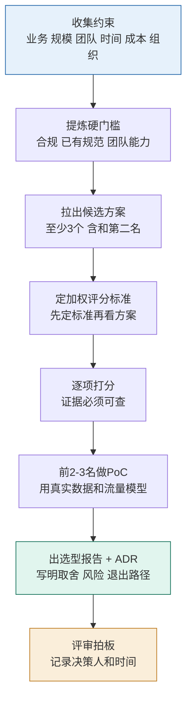
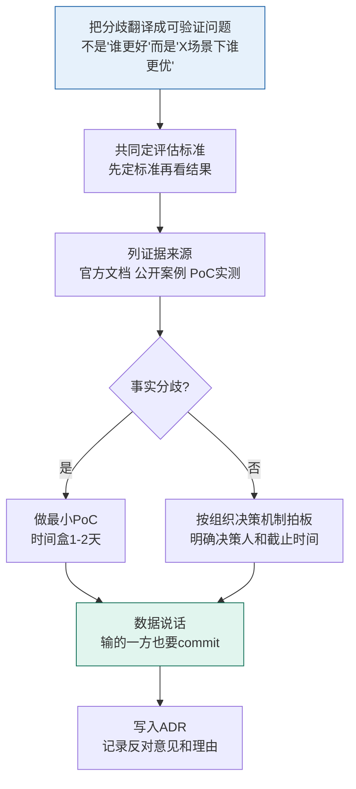
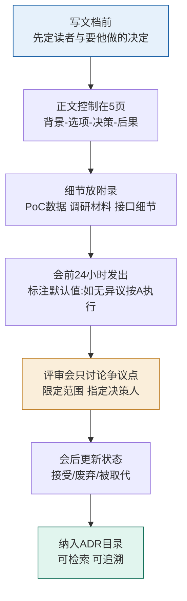
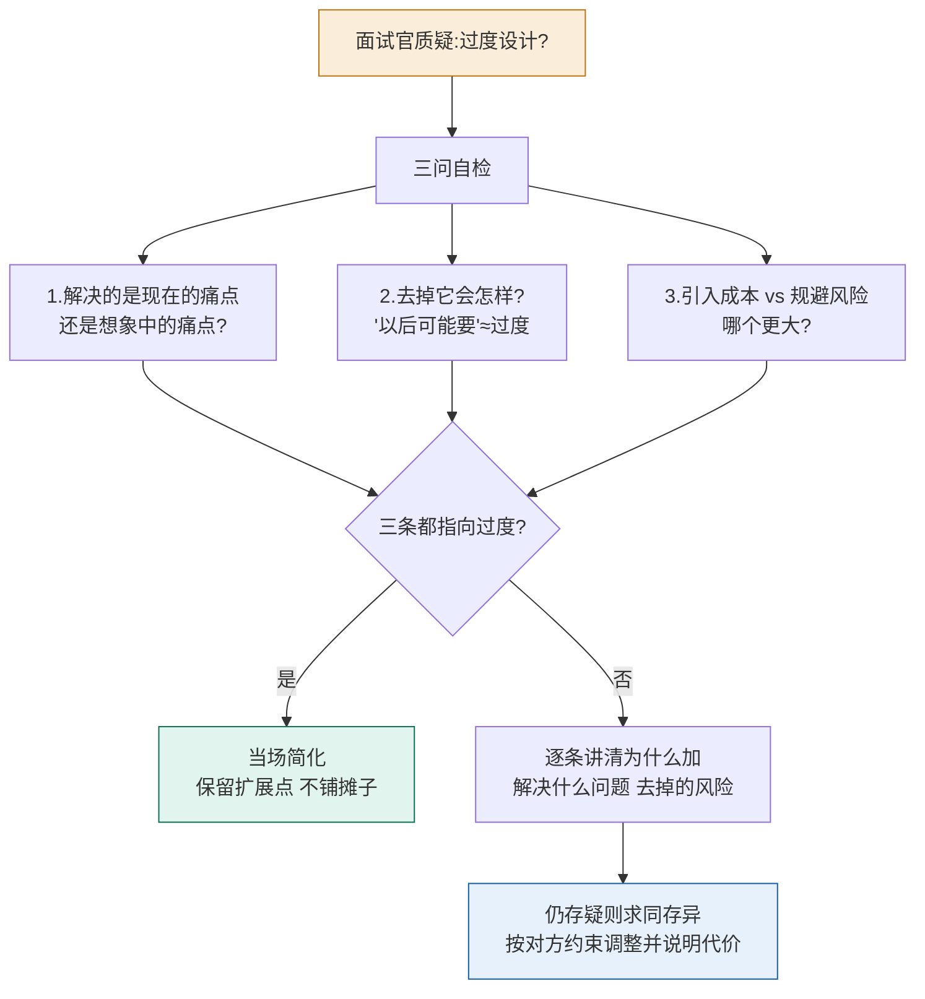

# 技术选型与方案设计场景面试

> 定位：技术选型和方案设计是架构师面试的"照妖镜"——初中级工程师背技术名词，架构师讲约束、评分、取舍、退出成本。这一板块的题还有个隐藏考点：你如何面对不完美的现实（2 周工期、团队吵架、老板拍板、被质疑过度设计）。面试官真正在问的是：**你能不能在不理想的条件里，做出能被追溯、被落地、被复盘的决策**。露馅点通常是三个：只会说"看场景"、只会说"大家都这么用"、方案写得像技术博客而不是决策文档。

## 题 1：让你给一个新项目做技术选型，你从哪几个维度评估？怎么产出一份方案？

### 题目

"公司要新起一条业务线，预估日活 50 万、峰值 QPS 2 万，团队 8 个人——3 个 Java、2 个 Go、其余偏前端。两周后技术委员会评审，让你牵头做技术选型。你从哪几个维度评估？最后交出什么东西才算'方案'？"

### 考察什么

- **维度完整性**：不是"我会用 Spring Boot + MySQL + Redis"，而是有没有一套覆盖业务、团队、成熟度、成本、可运维、退出风险的评估框架。
- **决策可追溯**：能不能讲清"为什么是它、为什么不是另一个"，用证据而非直觉。
- **产出物意识**：会不会用 PoC 和 ADR 把决策固化下来，还是口头说完就算数。
- **诚实边界**：知不知道没验证过的东西不能当结论写进方案。

### 答题骨架

**S（背景）**：先问清约束，别上来就列技术栈。至少问清这六件事，并让对方确认：

| 约束维度 | 必须问清的问题 | 为什么关键 |
|---|---|---|
| 业务形态 | 读写比、一致性要求、峰值/均值比、数据生命周期 | 决定存储与一致性方案，比"流行什么"重要得多 |
| 规模量级 | 日活、峰值 QPS、数据量、增长率 | 决定要不要分片、要不要异步 |
| 团队画像 | 语言栈、经验分布、人员流动率 | 团队不会的技术，等于项目自带交付风险 |
| 时间预算 | 上线窗口、里程碑、是否可分期 | 决定能不能做基础设施类投入 |
| 成本边界 | 机器预算、License、云厂商约束 | 决定自建还是托管 |
| 组织约束 | 已有规范、中台能力、合规要求 | 不满足就是一票否决，不需要评分 |

**A（行动）**：核心话术是——**"选型不是选最牛的技术，是在约束下选综合代价最小的方案。"** 我会先把不可协商的约束变成"硬门槛"（一票否决），剩下的选项再做加权评分，最后用 PoC 验证排名靠前的两三个，而不是直接拍板。

评分维度给一张示范表（权重按项目调，**先定权重再看候选**，否则一定会各自找证据）：

| 维度 | 关键问题 | 示范权重 | 证据来源 |
|---|---|---|---|
| 业务匹配度 | 数据模型、一致性、查询模式是否天然契合 | 25% | 需求文档、领域模型 |
| 团队与组织 | 团队现有技能、招聘难度、组织边界 | 20% | 团队技能盘点 |
| 成熟度与生态 | 版本稳定性、社区活跃度、可获得的外部经验 | 15% | 官方发布节奏、公开案例 |
| 性能与容量 | 在目标量级下的实测表现 | 15% | PoC 实测数据 |
| 总体拥有成本 | 机器、License、运维人力、培训 | 10% | 报价、人力估算 |
| 可运维与可观测 | 监控、排障、扩容、升级是否顺手 | 10% | 官方文档、运维手册 |
| 风险与退出成本 | 锁定程度、迁移难度、失败后的回退路径 | 5% | 抽象层设计、迁移成本估算 |

**PoC 必须回答的四个问题**（别写 hello world）：① 用真实数据的 10% 和 100% 各跑一次，指标怎么变？② 故障注入（杀节点、断网）时表现如何？③ 团队从零到能独立排障要多久？④ 退出时数据怎么迁走？——**PoC 不是证明你选的对，是证明你没漏掉致命缺陷。**

**公开案例（标注来源）**：AWS 公开发布的 **Well-Architected Framework** 把架构评估拆成六个支柱——运营卓越、安全、可靠性、性能效率、成本优化、可持续性，并配套大量可自评的问题清单（来源：AWS 官方架构中心，公开文档）。这个框架的启发不在于照搬它的权重，而在于**它把"好架构"拆成了可逐项检查的维度**，而不是一句"高可用高性能"。另一个公开参考是 **ThoughtWorks 技术雷达**（持续发布的公开出版物），它对每项技术标注"采用 / 试验 / 评估 / 暂缓"，并给出采用理由——这提示我们选型结论应该附带"为什么现在不推荐"的判断，而不是只给一个名字。**借鉴点：把模糊的技术偏好，变成有维度、有等级、有理由的决策记录。**

**R（结果）**：引导填自己的真实产出——"最终选了 X，评分 X 分、第二名 X 分，PoC 在 2 万 QPS 下 P99 是 __ ms，评审一次通过 / 补充了 __ 条件后通过"。同时交代**产出物清单**：选型报告（含评分表与 PoC 数据）、1 份 ADR、评审纪要、退出预案。数字要填你自己的，不要套用示例。

**L（复盘）**：主动把话往深了说——"选型没有一次就对的。我会写下三个'后悔信号'：__（例如运维人力超出预算 30%、PoC 之外的场景频繁出问题、团队两个月还无法独立排障）。一旦触发就重新评估，而不是硬着头皮走下去。另外我会刻意保留一层抽象/防腐层，让将来替换的成本可控——**选型的最后一步是设计好退出路径**。"

### 追问链

| 面试官追问 | 你要接住的点 |
|---|---|
| 权重怎么定？会不会你自己拍？ | 权重由业务约束推导，评审前公示；关键维度变更要重新评分 |
| 如果第二名只差 1 分呢？ | 分数接近说明两者都可行，此时用团队熟悉度/退出成本做决胜 |
| PoC 和真实环境的差异怎么弥补？ | 明确 PoC 未覆盖的场景，上线后灰度 + 监控验证，承认不确定性 |
| 团队不会这项技术怎么办？ | 这是硬门槛或高权重项：培训成本、招人周期、是否有外部支持都要算进去 |
| 你说的退出路径具体是什么？ | 接口抽象、数据双写/可迁移格式、不绑死私有 API，给出可执行的迁移步骤 |
| 选型做错了谁负责？ | 决策人要写明；架构师负责提供完整信息和选项，决策是组织行为 |

### 翻车点

- ❌ "我们当时用了 Spring Cloud，因为大家都这么用" —— 这是从众，不是选型，面试官会立刻追"那你们评估过别的吗"。
- ❌ "性能最好所以选它" —— 只算性能一本账，漏了成本、团队、可运维、退出四本账。
- ❌ "先上了再说，不行再换" —— 没有 PoC、没有退出路径的"试点"等于把风险甩给生产环境。
- ❌ 评分区分不出来（每项都打 8 分） —— 说明你没有真正比较，评分表成了走过场。

### 调用知识

- [技术选型方法论](../11-架构设计能力/05-技术选型方法论.md)：选型的评估框架、评分与决策流程
- [架构模式](../11-架构设计能力/03-架构模式.md)：候选方案背后的模式权衡
- [架构文档与技术风险](../17-项目治理/04-架构文档与技术风险.md)：选型决策如何文档化、技术风险如何登记

## 题 2：业务方要 2 周上线，你觉得至少要 1 个月，你怎么沟通？

### 题目

"产品经理拍着桌子说活动 2 周后必须上线，老板也点了头。你评估下来，光核心链路开发加测试就要 3 周，压测和灰度还没算。你会怎么说？直接回一句'做不了'吗？"

### 考察什么

- **翻译能力**：能不能把技术风险翻译成业务语言（损失多少单、多少用户、多少赔偿），而不是讲"线程不够"这种业务听不懂的话。
- **拆解能力**：能不能把 1 个月的工作拆出 2 周可上的最小版本，而不是整体拒绝。
- **谈判姿态**：给选项而不是给拒绝——把决策权交回业务方，同时把代价明码标价。
- **底线意识**：什么情况下必须说"这个不能上"，而不是一味妥协。

### 答题骨架

**S（背景）**：先问四件事再表态——① 2 周是"硬截止"（合同、大促档期）还是"期望"？② 活动失败的业务代价是什么（收入、赔偿、口碑）？③ 业务真正要的结果是什么（是"活动上线"还是"当天 GMV 达标"）？④ 谁承担风险、谁有权拍板？**"先问清目标，再谈工期"——这是这个项目里你能做的第一个正确决策。**

**A（行动）**：我会走一条"对齐目标 → 拆范围 → 谈风险 → 给选项 → 设契约"的路径，而不是在会上直接硬刚。

具体动作：

1. **对齐目标而非捍卫方案**。业务说"2 周上线"，真正要的可能是"赶上大促流量"。那么问一句："如果核心链路稳、但排行榜晚一周，你能接受吗？"——很多时候目标可以换一条路径达成。
2. **用 MoSCoW 拆范围**，把需求分成 Must（核心下单支付）、Should（优惠券叠加）、Could（排行榜）、Won't（这次不做）。2 周只做 Must，把 Should/Could 排到二期。
3. **风险量化**。不要说"没时间压测风险大"，要说"按我们现有容量模型，不压测直接上，峰值时预计 __% 的请求超时，按历史客单价估算相当于 __ 万元/小时的损失"。数字可以估，但要有来源和口径。
4. **给选择题而不是判断题**。示范话术："我给你三个选项——A：2 周上核心链路 + 准备降级预案，排行榜砍掉，我建议这个；B：3 周全量上，风险最低；C：2 周全上，但我要提前说明，峰值大概率出问题，出问题后的止血预案是 __。你选哪个，我都全力执行。"
5. **设质量红线**。有些东西不因工期妥协：资金安全、数据不丢、合规、回滚能力。明确说"这几条踩了，我会坚决拒绝上线——这是职业底线，不是跟你对着干"。

**公开案例（标注来源）**：Google 公开出版的 **《Site Reliability Engineering》（SRE Book，sre.google 在线全文）** 中提出 **Error Budget（错误预算）** 机制：可靠性不追求 100%，而是先用 SLO 约定"允许多少不可用"，把这个额度当作可与业务谈判的货币——预算充足就加速发布，预算耗尽就冻结发布、先补稳定性（来源：Google SRE Book 第 3、4 章，公开）。这对本题的启发是：**把"我觉得风险大"变成"我们这个季度的错误预算还剩多少、这次上线要花掉多少"**，谈判就从情绪之争变成数字之争。另一个公开实践是亚马逊的 **Working Backwards / PR-FAQ**（贝索斯在致股东信中多次阐述）：先写一份"未来的新闻稿"描述用户价值，再倒推要做什么。这提示我们：先确认业务的真正目标，再谈技术实现和工期。

**R（结果）**：引导填真实结局——"最后选了 A，2 周上了核心链路，活动峰值 QPS __，实际超时率 __，排行榜第三周补上"。如果最后真的按时全上了，也如实写"哪几个环节是靠加班/压缩测试补出来的、有没有留下隐患"——**别把侥幸包装成方法论**。

**L（复盘）**：主动说——"回头看，我评估 1 个月是被'完美方案'绑架了：我把所有优化都塞进了首版。下次我会先问：哪些是上线后补也来得及的？另外，这次我采用的是'当场给选项'，下次我会**更早介入**——等活动定档再来谈，就已经输了。提前两周参与排期，才是架构师该做的位置。"

### 追问链

| 面试官追问 | 你要接住的点 |
|---|---|
| 如果业务方坚持 C（2 周全上）呢？ | 执行，但书面留痕风险提示 + 备好降级预案；踩红线则行使否决权 |
| 你说砍需求，谁来决定砍哪个？ | 业务方决定业务优先级，你提供技术依赖和风险清单，不替业务做价值判断 |
| 压缩测试怎么保证质量？ | 自动化回归 + 核心链路人工验证 + 灰度放量，明确哪些测试不能省 |
| 上线真出问题了怎么办？ | 提前写好回滚脚本和降级开关，演练过才算预案 |
| 你怎么让下次不再这样？ | 把架构评审嵌入需求排期流程，提前介入容量和依赖评估 |

### 翻车点

- ❌ "做不了，至少要一个月" —— 只给拒绝不给选项，把矛盾顶回去了，问题还在。
- ❌ "那我加班试试" —— 用个人牺牲掩盖范围问题，风险没消失，只是延后爆发。
- ❌ "好好好，2 周就 2 周" —— 没有底线的妥协，出事时第一个被问责的是你。
- ❌ 全程讲技术术语，不谈业务损失 —— 业务方听不懂，自然也不会重视你的风险提示。

### 调用知识

- [技术选型方法论](../11-架构设计能力/05-技术选型方法论.md)：在时间与成本约束下做取舍
- [高可用架构设计](../13-高可用与稳定性/01-高可用架构设计.md)：降级预案与核心链路保障
- [容量规划与压测](../13-高可用与稳定性/04-容量规划与压测.md)：用容量数据支撑风险量化

## 题 3：团队对方案有分歧，有人坚持用另一个框架，你怎么处理？

### 题目

"方案评审会上，一个资深同事坚持用 Kafka，你认为这个场景 RocketMQ 更合适，两边争了一个小时，会还开不下去。老板说'你是架构师，你拍板'。你怎么处理这个场面？"

### 考察什么

- **对事不对人**：能不能把"谁对"之争转成"哪个假设可验证"之争。
- **定标准的能力**：会不会先定评估标准再看数据，避免各说各话。
- **决策机制意识**：知道"谁在什么时间用 What 方式拍板"比"谁赢"更重要。
- **组织成熟度**：能不能让反对的人也愿意执行（disagree and commit）。

### 答题骨架

**S（背景）**：先判断分歧的性质，三种处理方式完全不同：

| 分歧性质 | 特征 | 处理方式 |
|---|---|---|
| 事实分歧 | 有客观答案，可测量/可查证 | 用 PoC 和公开数据验证，用数据结束争论 |
| 偏好分歧 | 两者都行，凭经验习惯 | 定标准、限时讨论、决策人拍板 |
| 原则分歧 | 涉及团队边界、长期方向 | 上升到架构委员会，写入 ADR 留痕 |

**A（行动）**：**"我不会在评审会上跟他吵。会前我会先拉他一起把评估标准定下来——最怕的是两个人用不同的标准，各找各的证据，吵到天黑也没有结论。"** 然后按这条路径走：

关键动作拆开说：

1. **把口号变成问题**。"Kafka 更好"是不可验证的；"在我们这个每天 2000 万条消息、要求事务消息、团队无人有 Kafka 运维经验的场景下，谁的端到端延迟、运维人力、故障恢复时间更优"——这是可以验证的。**问题怎么定义，就已经决定了争论的质量。**
2. **先定标准，再看证据**。标准应包含：功能匹配（事务消息、顺序性）、团队熟练度、运维成本、生态、退出成本。标准一经定下，双方都按它打分。
3. **证据分级**：官方文档 > 公开可查的大厂实践 > 第三方 benchmark > "我以前用过感觉不错"。**注意厂商 benchmark 要标注来源，不能拿来做定论**——测试条件往往对自家有利。
4. **时间盒与决策人**。讨论设上限（比如"今天下班前定"），到点由明确的决策人拍板。架构师负责把选项和证据摆全，但**未必永远是最终决策人**——搞清楚这一点能避免很多内耗。
5. **决策后全力执行**。反对意见记录进 ADR，但不成为执行的阻力。如果最后证明选错了，那是组织的决策，复盘时改进的是决策机制，而不是翻旧账打脸。

**公开案例（标注来源）**：亚马逊在 2016 年致股东信（公开）中明确描述了 **"Disagree and Commit"** 文化——"Carefully disagree, then commit"：决策前鼓励直率表达不同意见，一旦决策做出，即使不同意也要全力执行；贝索斯还提到用这种方式避免"为了达成一致而进行的无休止讨论"。另一个公开且相关的概念是 **Conway's Law（康威定律）**，由 Melvin Conway 于 1967 年提出（公开论文《How Do Committees Invent?》）：系统设计倾向于复制组织的沟通结构——这提醒我们，团队分歧有时不是技术问题，而是团队边界的反映，换框架解决不了。**借鉴点：让分歧在决策前充分暴露，决策后坚决收敛；同时看清分歧背后有没有组织问题。**

**R（结果）**：引导填真实结局——"最后我们选了 X，理由是 __；反对的同事负责 __ 模块，落地后效果 __；三个月后回头看，这个选择 __（对/需要调整）"。**要诚实写"如果当时听他的会不会更好"**——面试官欣赏这种坦荡。

**L（复盘）**：主动说——"我最大的收获是：技术争论里没有恶意，只有不同的信息和不同的风险偏好。以后我会做两件事：一是把'分歧'提前到方案初稿阶段暴露，不要等评审会；二是把每次重大分歧的评估标准沉淀成选型模板，下次不用重新吵。"

### 追问链

| 面试官追问 | 你要接住的点 |
|---|---|
| 如果你错了呢？ | 决策前写明"后悔信号"和回退方案；错了就按预案切换，不嘴硬 |
| 对方资历比你深，你怎么坚持？ | 用证据和机制说话，不靠职级压人；同时尊重其经验，把他纳入标准制定 |
| PoC 成本太高，没时间做呢？ | 那就明确标注"基于公开资料判断，存在不确定性"，并保留上线后的验证点 |
| 老板让你拍板，你却说要开会前定标准，是不是推诿？ | 不是推诿，是把"拍板"变成"有依据的拍板"；同时给出明确的时间节点，不无限拖延 |
| 怎么防止以后再吵同样的架？ | 沉淀 ADR 和选型模板，把决策标准前置 |

### 翻车点

- ❌ "我是架构师，听我的" —— 靠职级压人，输了人心，方案落地时会被消极执行。
- ❌ "你来定吧" —— 把决策权全推给老板，说明你没有判断力，也没有担当。
- ❌ 在会上逐条反驳对方、以辩赢为目的 —— 赢了辩论，输了协作，面试官会担心你的团队适配性。
- ❌ "两种都行，看场景" —— 典型的万能废话，等于没回答。

### 调用知识

- [技术选型方法论](../11-架构设计能力/05-技术选型方法论.md)：用统一标准比较候选方案
- [消息队列选型](../08-缓存与中间件/09-消息队列选型.md)：MQ 对比维度、事务消息与运维成本差异
- [架构文档与技术风险](../17-项目治理/04-架构文档与技术风险.md)：用 ADR 固化决策与反对意见

## 题 4：怎么写一份让评审会通过的技术方案（ADR）？

### 题目

"你写了 30 页技术方案，评审会上三分之一的人没看完，剩下的人抓着两个细节争论了 3 小时，还是没结论。你怎么改你的方案文档和评审流程？一份合格的架构决策记录（ADR）应该长什么样？"

### 考察什么

- **写作能力**：能不能把复杂决策写成别人愿意读、能据此拍板的文档。
- **结构意识**：背景、约束、选项、取舍、后果、回滚是否齐全。
- **流程设计**：会不会做"会前对齐"，而不是把评审会当第一次沟通。
- **可追溯性**：半年后新人看到这份文档，能不能明白当时为什么这么定。

### 答题骨架

**S（背景）**：先确立一个判断——**技术方案不是技术展示，是"请求授权与共识"的文书**。写之前先问："谁要读它？要他做什么决定？他最关心什么？"评审者最关心的永远是三件事：你要决定什么、为什么这么定、代价和退路是什么。

**A（行动）**：分两层——文档结构 + 评审流程。

先给 ADR 的标准骨架（示范表，可按团队规范裁剪）：

| 段落 | 写什么 | 常见错误 |
|---|---|---|
| 标题与状态 | 决策主题；状态：提议/已接受/已废弃/被取代 | 没有状态，半年后不知道还作不作数 |
| 背景与约束 | 问题、业务目标、不可协商的约束 | 只写技术背景，不写业务 why |
| 备选方案 | 至少 2-3 个，含"什么都不做" | 只写自己选的，假装没别的选项 |
| 决策 | 明确选了什么，一句话说清 | 含糊其辞，"倾向于" |
| 理由与取舍 | 为什么选它、放弃了什么、关键权衡 | 不写代价，像广告软文 |
| 后果 | 正面 + 负面后果，包括新增的运维负担 | 只写好处 |
| 验证与回滚 | 怎么验证决策有效，失败了怎么退 | 没有退路，上线后硬扛 |
| 复审日期/责任人 | 何时回看，谁负责 | 决策无人维护 |

**评审流程的三个关键设计**：

1. **会前发出 + 默认值**。文档提前 24 小时发，写明"若无重大异议，按方案 A 执行"。这样沉默的人默认是同意，评审会只处理真正有异议的点——**把 3 小时的漫谈，压缩成 45 分钟的争议裁决**。
2. **正文短、附录全**。正文只放决策所需信息，PoC 数据、接口细节、调研材料全放附录，谁需要谁翻。30 页没人看，5 页正文 + 3 个附录反而会被读完。
3. **明确决策人**。评审会不是民主投票，也不是人人有否决权。会前说清谁是决策人、决策规则是什么（共识 / 多数 / 负责人裁决）。**"谁都能提意见、但只有一个人拍板"，这是评审会不失控的前提。**

**公开案例（标注来源）**：**Architecture Decision Record（ADR）** 这一轻量实践由 **Michael Nygard 于 2011 年在其博客文章《Documenting Architecture Decisions》中提出**（公开可查），核心就是用一个短文档记录"背景—决策—后果"，鼓励团队把架构决策及其理由写下来，而不是留在邮件和会议纪要里。此后 **ThoughtWorks 技术雷达**（公开出版物）多期将 ADR 列为推荐实践。另一个理论支撑来自 **《Software Architecture in Practice》（SEI，Bass / Clements / Kazman 著，公开出版）**：书中强调架构决策文档是架构评估（如 ATAM）和管理技术债务的基础。**借鉴点：文档的价值不在篇幅，而在"决策可追溯"——你能回答"当初为什么这么定"。**

**R（结果）**：引导填真实数据——"改造后评审时长从 3 小时降到 45 分钟，一次通过率从 __ 提高到 __，半年内累计沉淀 __ 份 ADR，其中 __ 份被后续决策引用 / 取代"。如果你们团队还没这么做，就诚实写"我打算这样改，并在下一个项目试行"——**面试官接受'我知道该怎么做但还没机会做'。**

**L（复盘）**：主动说——"我以前写的方案确实犯过'堆信息'的毛病，把知道的全写进去，结果没人看。现在我会在文首放一段 200 字的 TL;DR，把'要决定什么、建议是什么、代价是什么'讲清。另外，**决策是有保质期的**：我会给每份 ADR 设复审日期，到期重新验证——半年后业务量变了，当初的正确选择可能就不对了。"

### 追问链

| 面试官追问 | 你要接住的点 |
|---|---|
| 方案写多长合适？ | 正文控制 5 页内，细节进附录；以"评审者能据此决策"为标准 |
| 评审会吵起来了怎么办？ | 拉回决策标准，限定争议范围；到时间由决策人拍板，会后补 ADR |
| ADR 和详细设计文档有什么区别？ | ADR 记录"为什么这么决策"，详细设计记录"怎么实现"，两者互补 |
| 决策后来被推翻了，文档怎么处理？ | 标记"被 X 取代"，保留原决策与推翻理由，形成决策演进链 |
| 怎么让团队真的写 ADR？ | 模板化 + 纳入 definition of done + 在评审流程里强制引用 |

### 翻车点

- ❌ 方案里只写"我选了 X"，不写备选方案和放弃理由 —— 评审者无法判断你有没有认真比较。
- ❌ 把风险藏在附录或不写 —— 评审通过后风险全暴露，大家会觉得被坑了。
- ❌ 评审会当第一次沟通 —— 没有会前对齐，会议必然跑偏。
- ❌ 文档越写越长以显示"工作量" —— 这是学生心态，工程文档的价值是可决策性。

### 调用知识

- [架构文档与技术风险](../17-项目治理/04-架构文档与技术风险.md)：ADR 写作、技术风险登记与跟踪
- [DDD领域驱动设计](../11-架构设计能力/01-DDD领域驱动设计.md)：如何在方案中表达领域边界与限界上下文
- [架构模式](../11-架构设计能力/03-架构模式.md)：备选方案背后的模式与取舍

## 题 5：面试官说你的方案"过度设计"，你怎么回应？

### 题目

"你讲完方案，面试官皱眉：'就这么个小系统，你又是 DDD、又是 CQRS、又是消息队列，是不是过度设计？'你怎么回应？是当场改口说'那我简化一下'，还是坚持？"

### 考察什么

- **概念清晰度**：能不能区分"简单"与"简陋"、"复杂"与"过度设计"。
- **判断标准**：有没有一套判断复杂度该不该加的标准，而不是凭感觉。
- **主见与开放度**：既不被面试官带着走，也不死犟——这是高级工程师和架构师的分水岭。
- **演进思维**：懂不懂 YAGNI、渐进式设计、什么时候该为未来买单。

### 答题骨架

**S（背景）**：先承认前提——**"过度设计是真实存在的失败模式，不是面试官刁难"**。然后把它定义清楚：当一套机制的**成本（认知负担、运维负担、故障面、交付时间）大于它解决的问题**时，才是过度设计。所以判断是否过度，不能只看"用了几个高大上的词"，要看成本收益比。

**A（行动）**：给出判断三问，再给"什么时候值得复杂"的清单，最后给回应面试官的话术。

**什么时候该接受"复杂"**（值得为未来买单的四类情况）：

| 情况 | 为什么值得 | 举例 |
|---|---|---|
| 不可逆决策 | 改起来代价极高，前期多花值得 | 核心数据模型、对外 API 契约 |
| 风险与合规硬要求 | 不做过不了审核或出不起事 | 资金对账、审计日志、权限隔离 |
| 已验证的非功能需求 | 有明确数字支撑，不是想象 | 压测证明单库扛不住，必须分库分表 |
| 复杂度可收敛 | 用成熟框架/中间件封装，不是自研 | 用 MQ 解耦而非自研消息中间件 |

**回应话术（重点，别当场改口）**：**"'过度设计'我理解您指的是 X 这部分，我逐条说：第一，我加它是因为 __（真实痛点/已验证的约束）；第二，如果去掉，风险是 __；第三，它的成本是 __。如果讲完您仍然觉得不值，我接受——架构没有绝对对错，只有约束下的适配，您提出的新约束我会重新算这笔账。'** ——这段话既不是软弱的让步，也不是嘴硬的坚持，而是"用成本收益说话，并承认对方可能掌握我不知道的约束"。

**公开案例（标注来源）**：**Martin Fowler 在 2003 年提出的 "Design Stamina Hypothesis"（设计耐力假设，公开文章）** 指出：前期适度投入良好设计，能让团队在后期保持较高的开发速度；但这条曲线存在拐点，越过之后额外设计的边际收益递减甚至为负——**这正是"过度设计"的经济学解释**。与之对应的是极限编程（XP）的 **YAGNI（You Aren't Gonna Need It）原则**：不要为假想的未来需求提前实现功能。Fowler 在《重构》（Refactoring，公开出版）等著作中也反复强调"先让代码能工作、再重构到合适结构"的演进式思路。**借鉴点：复杂度不是越少越好也不是越多越好，要画累计成本曲线，找到拐点——而拐点取决于你真实的约束。**

**R（结果）**：引导填真实结局——"最后我们保留了 __、砍掉了 __，砍掉的理由是 __；上线后 __ 个月后，证明保留的部分 __（确实有必要/其实可以不要）"。**如果面试官是对的、你确实过度了，就如实写**——承认判断被修正，比硬撑更有说服力。

**L（复盘）**：主动说——"这件事让我形成一条习惯：**先做最简单的能跑的版本，再按真实出现的痛点加机制**。我以前会为了防止'以后可能出现的性能问题'提前引入缓存和 MQ，后来发现很多系统根本没到那个量级。现在我会在方案里专门写一节'刻意不做什么'，把克制也当成设计的一部分。"

### 追问链

| 面试官追问 | 你要接住的点 |
|---|---|
| 你怎么判断"以后可能要"是不是真的？ | 看是否有明确的业务roadmap、合同或已验证的数据，没有就是猜测 |
| 如果业务半年后真的爆发了怎么办？ | 保留扩展点（接口/抽象），但不在今天铺全量实现；爆发时再加 |
| DDD 在小系统里是不是一定过度？ | 不一定。用它的战略部分（语言、边界）成本低，战术部分（聚合、CQRS）才重 |
| 你这是不是看了些概念就往上套？ | 用具体痛点逐条回应，证明每一项都有来源和目的，而不是概念堆砌 |
| 怎么跟团队解释你砍掉了某些设计？ | 写进 ADR 的"备选方案与取舍"，说明是主动克制而非考虑不周 |

### 翻车点

- ❌ 面试官一质疑就当场改口"那我简化" —— 说明你没有主见，只是背了一套话术。
- ❌ "这是行业最佳实践" —— 用权威代替论证，面试官会追"它解决了你什么问题"。
- ❌ 死犟到底，一条不让 —— 暴露你不会根据新信息修正判断，协作风险高。
- ❌ 把"简单"理解成"不做设计" —— 简陋不是简单，真正的简单需要更高的设计能力。

### 调用知识

- [技术选型方法论](../11-架构设计能力/05-技术选型方法论.md)：权衡与成本收益分析
- [DDD领域驱动设计](../11-架构设计能力/01-DDD领域驱动设计.md)：战略设计与战术设计的成本差异
- [架构模式](../11-架构设计能力/03-架构模式.md)：模式适用的上下文与代价
- [架构文档与技术风险](../17-项目治理/04-架构文档与技术风险.md)：用 ADR 记录"刻意不做什么"

## 小结

- 技术选型不是选最流行的，是在约束下选综合代价最小的：先定硬门槛，再加权评分，最后用 PoC 验证排名靠前的两三个。
- 评估至少覆盖业务匹配、团队、成熟度、性能、成本、可运维、退出风险七项；**退出路径是选型的最后一步，不是可选项**。
- 面对 2 周工期，别答"做不了"——对齐目标、拆 MoSCoW、量化风险、给三个选项、设质量红线，把决策权交回业务方。
- 处理方案分歧：把口号翻译成可验证问题，先定标准再看证据，时间盒 + 决策人拍板，决策后 disagree and commit。
- 好方案的标准是"评审者能据此决策"：正文 5 页、细节进附录、会前发出设默认值、ADR 固化决策与代价。
- 面对"过度设计"的质疑，用三问和成本收益回应，既不当场改口也不死犟；把"刻意不做什么"也写进方案。
