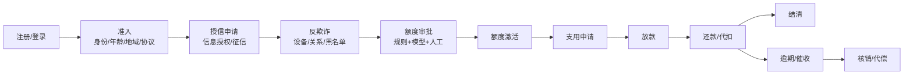
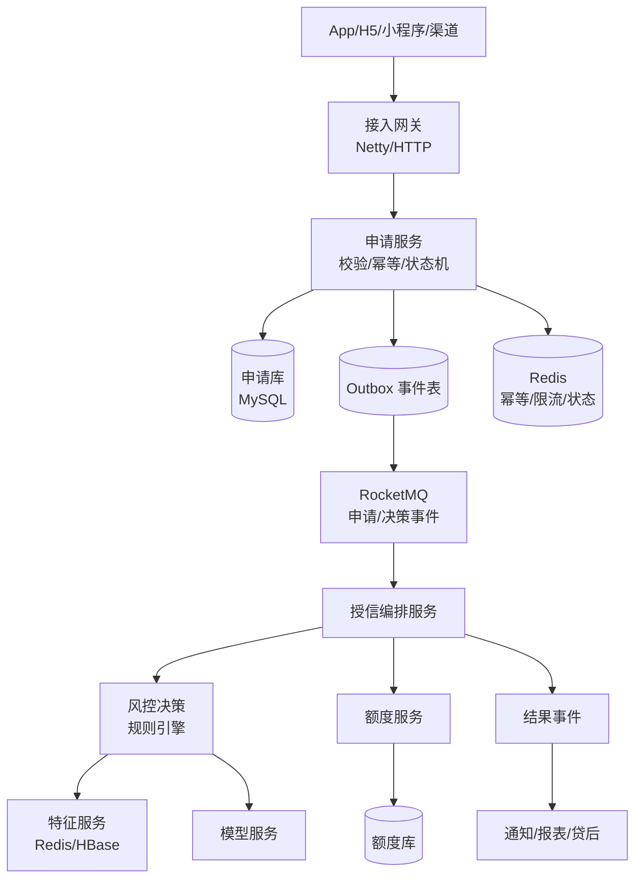
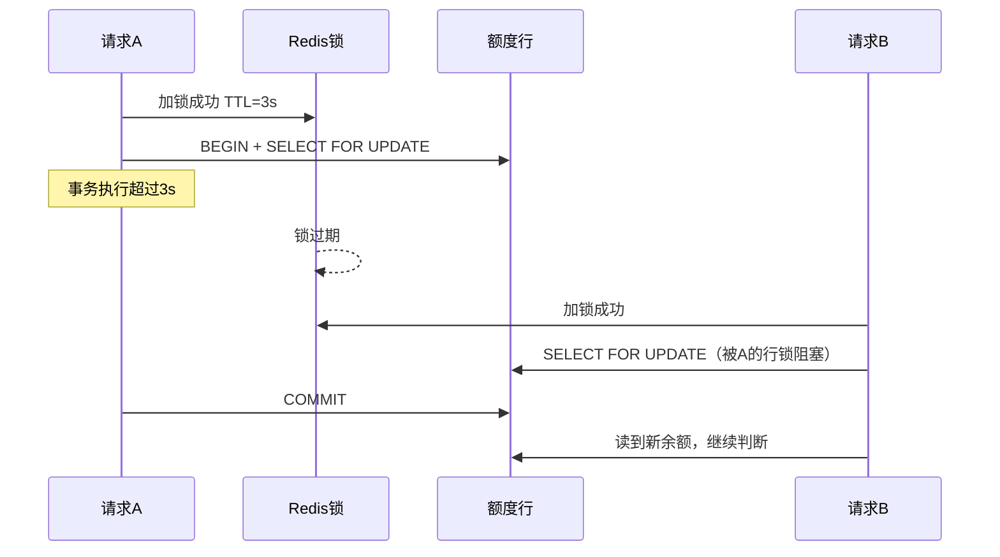

# 哈啰普惠信贷面经：授信、额度与风控的真实答法

> 定位：这是一篇按真实面经还原的深度答题文，不是“八股清单”。围绕哈啰普惠信贷岗的三轮技术面，把“信贷申请平台怎么设计”“额度怎么防超授信”“三面怎么讲业务架构”拆到业务链路、表结构、时序、容量与追问。文中的 QPS、延迟、额度是示例假设，用于训练估算；架构是按公开面经与通用信贷实践做的推演，不代表哈啰内部实现。

## 一、先看懂业务：普惠信贷的钱是怎么转的

很多人一上来就画“网关 + MQ + Redis”，面试官立刻会追问：“你这个平台到底授的是什么信？谁放款？逾期谁承担？”不先把业务讲清楚，后面的技术方案就是悬空的。

### 1.1 参与方

| 角色 | 在链路里做什么 | 架构上关心什么 |
|---|---|---|
| 借款人 | 申请、签约、支用、还款 | 体验、额度、利率透明度 |
| 平台/助贷方 | 获客、准入、风控、贷后运营 | 转化率、风险成本、合规 |
| 资金方 | 放款、收息、承担或部分承担风险 | 资金成本、资产质量、对账 |
| 增信/担保方 | 兜底、代偿 | 风险敞口、追偿 |
| 征信/数据源 | 身份、征信、行为、设备数据 | 可用性、延迟、成本、授权 |
| 支付通道 | 放款、还款、代扣 | 成功率、幂等、资金安全 |

哈啰的信贷岗位通常落在“场景 + 助贷/联合贷”这一类：平台有出行、换电、酒旅等场景，能把借款需求前置到用户真实消费场景里；但资金不一定由平台自己出，风控、签约、放款、还款、对账要跨多个机构完成。

### 1.2 一笔贷款的完整生命周期



这条链路里，**授信**和**支用**是两个不同的动作：授信决定“你能借多少”，支用决定“这次借多少”。很多防超授信的事故，出在支用阶段把额度扣减和放款没做成一个可对账的整体。

### 1.3 架构师必须关注的五个指标

| 指标 | 含义 | 架构影响 |
|---|---|---|
| 授信通过率 | 申请到授信的转化 | 规则太严损失客户，太松抬升坏账 |
| 支用转化率 | 有额度的人真正借款 | 额度、利率、入口、体验 |
| 首逾率/坏账率 | 风险成本 | 风控精度、额度策略 |
| 放款成功率 | 支付/资金方链路健康 | 幂等、重试、对账 |
| p99 延迟 | 申请/风控响应 | 同步/异步边界、超时预算 |

普惠信贷的特点不是“单笔大”，而是**小额、高频、长尾、强合规**。这决定了架构不能只追求吞吐，还要保证“每一笔都能追溯、能对账、能解释”。

## 二、一面：设计信贷申请平台

### 2.1 先把题目拆成需求

面试题说“数据不丢失、低延迟、支持实时风控”，这三句要拆成可验证的需求：

1. **接入**：App/H5/小程序/渠道方，协议不同，峰值高。
2. **申请状态机**：提交、风控、审批、激活、拒绝、失效，状态不可乱跳。
3. **实时风控**：核心规则同步，模型/三方数据可异步。
4. **数据不丢**：申请、决策、额度变更都要有落库与补偿。
5. **低延迟**：p99 可控，不能把三方数据串行等待。
6. **合规**：授权、加密、审计、可解释、可回溯。

### 2.2 总体架构



关键点不是组件多，而是**同步链路只做必须同步的事**：

- 同步：身份校验、协议确认、核心反欺诈规则、额度预占。
- 异步：征信报告拉取、深度模型、短信通知、报表、贷后标签。

### 2.3 为什么用 Netty

面试官问“为什么 Netty 接入”，不是想听“Netty 高性能”，而是想听**接入层到底承担什么**。

- 渠道方可能是长连接、私有协议、二进制报文，HTTP 网关不一定合适；
- 接入层要做连接管理、编解码、心跳、限流、黑白名单，不能把这些塞进业务服务；
- Netty 的 Reactor 模型适合大量连接、低延迟转发；业务线程池要与 IO 线程池隔离，避免慢业务拖垮 IO。

但也要说边界：**如果只是普通 HTTP API，Spring MVC/WebFlux + 网关就够了，不要为了“显得高深”硬上 Netty**。Netty 适合做接入层，不适合承载复杂业务事务。

### 2.4 RocketMQ 在这里的角色

用 MQ 不是为了“解耦”两个字，而是为了三件事：

1. **削峰**：申请高峰把同步写扩散成异步处理，保护风控和额度服务。
2. **可靠**：消息持久化、重试、死信，配合本地消息表实现最终一致。
3. **可编排**：申请、风控、额度、通知各自消费，按事件驱动状态机。

为什么不用 Kafka？Kafka 吞吐更强，但事务消息、延迟消息、消息回溯在 RocketMQ 里更贴近“金融业务事件”的需求；如果团队已有 Kafka 且只需要日志/流处理，Kafka 也完全可以。**选型要看业务语义，不要背“Kafka 一定比 RocketMQ 快”**。

### 2.5 规则引擎怎么落地

规则引擎不是“把 if-else 搬到页面”，要有：

- **规则 DSL**：条件、阈值、权重、命中动作；
- **版本与灰度**：规则集有版本，按用户/渠道/比例灰度；
- **决策流**：规则集 → 模型 → 人工 → 拒绝/通过；
- **可解释**：每次决策记录命中规则、分数、模型版本、输入特征快照；
- **热更新**：不能每次改规则都发版，但要有审核与回滚。

一条决策记录至少要能回答：**用了哪个版本、看了哪些特征、命中了哪条规则、为什么给这个额度**。否则出了问题无法复盘，也不合规。

### 2.6 数据不丢：把“可靠”拆成五层

| 层 | 做法 | 失败时 |
|---|---|---|
| 请求 | `request_id` + 幂等键，重复提交返回原结果 | 用户重试不产生两笔申请 |
| 事务 | 申请记录与 Outbox 事件同一本地事务 | 不会“状态改了、事件没发” |
| 投递 | Outbox 轮询/事务消息投递，至少一次 | 失败重投，消息可重复 |
| 消费 | 唯一键/状态 CAS 做幂等 | 重复消费不重复扣额度 |
| 兜底 | 状态机扫描 + 定时补偿 + 日终对账 | 卡在中间态的单子被修复 |

一个可用的状态机：

```text
INIT → ACCEPTED → RISK_PENDING → APPROVED / REJECTED → LIMIT_ACTIVE → USED
                     ↘ MANUAL_REVIEW ↗
```

每次状态变更用 `update ... where status = ? and version = ?`，影响行数为 0 就说明被并发改过，重新读取再决策。**状态机是防并发错乱的第一道锁，不要只靠代码里的 if**。

### 2.7 低延迟：先做预算，再谈优化

假设目标 p99 ≤ 800ms，可以这样分预算：

| 环节 | 预算 | 手段 |
|---|---:|---|
| 网关/鉴权 | 30ms | 本地缓存 token、异步日志 |
| 申请校验/落库 | 80ms | 单表/分表、短事务、批量 |
| 核心风控 | 300ms | 特征缓存、规则前置、并行取数 |
| 额度预占 | 80ms | 行锁短事务、条件更新 |
| 序列化/网络 | 50ms | 连接池、压缩、就近部署 |
| 缓冲 | 260ms | 超时、降级、重试预算 |

优化顺序：**先砍串行调用，再砍无效查询，最后才加机器**。把 5 个三方接口串行调用，每个 200ms，p99 必然 1s 以上；能并行的并行，能预取的前置，能异步的异步。

### 2.8 追问：流量突增，风控变慢，怎么保授信主流程

这是整场一面最关键的追问。面试官要听的不是“加机器”，而是**隔离、分级、降级、补偿**。

#### 第一层：规则分级

| 级别 | 内容 | 执行方式 | 延迟目标 |
|---|---|---|---|
| L0 硬规则 | 黑名单、年龄、地域、设备异常、重复申请 | 同步，本地/缓存 | < 20ms |
| L1 核心规则 | 多头借贷、收入负债比、历史逾期 | 同步，特征服务 | 100–200ms |
| L2 深度模型 | 复杂模型、三方报告、关系网络 | 异步 | 秒级–分钟级 |
| L3 人工 | 高风险/边缘案例 | 异步工单 | 小时级 |

L0/L1 决定“能不能继续”，L2 决定“额度调不调”。这样风控变慢时，主流程仍能给出一个**有条件的授信结果**，而不是整条链路卡死。

#### 第二层：舱壁隔离

- 风控、额度、通知各自独立线程池/集群，不能共用池；
- 每个下游设置并发上限、超时、熔断；
- 授信申请与贷后/报表走不同队列，避免报表把风控挤死；
- 按渠道/产品做租户级限流，防止单一渠道打爆全局。

#### 第三层：超时与降级

```text
核心规则超时 200ms → 只用 L0 + 缓存特征给“预授信”
深度模型超时 800ms → 先给临时额度，异步回填后调整
三方数据超时 → 标记“待补”，不直接拒绝，除非硬规则命中
```

降级不是“返回失败”，而是**返回一个风险可控的次优结果**：额度低一点、需要补充材料、进入人工复核。前提是业务能接受，并且有标记与后续补偿。

#### 第四层：延迟消息补偿

异步结果回来后，用延迟消息/事件驱动额度调整：

- 异步风控通过 → 提升额度/激活；
- 异步风控拒绝 → 冻结额度/转人工；
- 补偿要幂等，按 `apply_no + decision_version` 去重；
- 已经放款的单子不能“事后拒绝”，只能走贷后策略。

#### 一个可讲的容量账

假设申请峰值 5,000 QPS，风控决策平均 50ms，单实例 8 线程可承载约 160 QPS（按 50ms 算），考虑 CPU/GC 与冗余，需要约 40–50 个决策实例；如果只给 10 个，必然排队。**先算清“每个请求要多少次决策、每次决策多少毫秒”，再谈扩容**。

### 2.9 这一面可能继续追的问题

- 为什么不用同步调用风控？——可以同步，但要有超时、舱壁、降级；纯同步会把可用性绑在一起。
- MQ 消息重复怎么办？——消费幂等 + 唯一键 + 状态 CAS，不假设“消息只来一次”。
- 用户重复提交怎么办？——幂等键 + 唯一索引 + 返回原结果。
- 申请状态卡住怎么办？——状态机扫描 + 补偿任务 + 告警。
- 规则误杀怎么办？——灰度、白名单、人工复核、可解释记录。

## 三、二面：贷款额度怎么防超授信

### 3.1 先把额度模型说清楚

很多人的答案是“加锁”，但面试官会问：“锁的是什么？锁住哪一行？可用额度怎么算？”先把模型讲明白：

```text
总额度 total_limit
已用额度 used_amount
冻结额度 frozen_amount
可用额度 available_amount = total_limit - used_amount - frozen_amount
```

表结构示例（简化）：

```sql
CREATE TABLE credit_limit (
  id            BIGINT PRIMARY KEY,
  user_id       BIGINT NOT NULL,
  product_code  VARCHAR(32) NOT NULL,
  total_limit   DECIMAL(18,2) NOT NULL,
  used_amount   DECIMAL(18,2) NOT NULL,
  frozen_amount DECIMAL(18,2) NOT NULL,
  available_amount DECIMAL(18,2) NOT NULL,
  version       INT NOT NULL,
  status        TINYINT NOT NULL,
  updated_at    DATETIME NOT NULL,
  UNIQUE KEY uk_user_product (user_id, product_code)
);

CREATE TABLE limit_ledger (
  id          BIGINT PRIMARY KEY,
  biz_no      VARCHAR(64) NOT NULL,
  user_id     BIGINT NOT NULL,
  amount      DECIMAL(18,2) NOT NULL,
  biz_type    VARCHAR(16) NOT NULL COMMENT 'RESERVE/CONFIRM/RELEASE/ADJUST',
  status      TINYINT NOT NULL,
  created_at  DATETIME NOT NULL,
  UNIQUE KEY uk_biz_no (biz_no)
);
```

**额度表不是账本，账本才是事实来源。** 额度表可以重建，账本不能丢；对账就是“账本汇总 = 额度表余额”。

### 3.2 为什么“悲观锁 + Redis 锁”要双重

| 锁 | 作用 | 不能做什么 |
|---|---|---|
| Redis 分布式锁 | 把同一用户的并发请求收拢，减少 DB 竞争 | 不能保证绝对互斥（超时、主从切换、续期失败） |
| DB 悲观锁 `SELECT ... FOR UPDATE` | 事务内锁住额度行，保证 ACID | 锁持有时间长会拖垮热点账户 |
| DB 条件更新/版本号 | 最终的正确性兜底 | 需要处理失败重试 |

正确顺序：

1. 先拿 Redis 锁（短 TTL，value 为 requestId，Lua 解锁）；
2. 开启本地事务，`SELECT ... FOR UPDATE` 锁额度行；
3. 校验可用额度，写冻结/扣减，写账本；
4. 提交事务，释放 Redis 锁。

**Redis 锁是“减压阀”，DB 行锁/条件更新才是“安全阀”。** 只靠 Redis 锁，锁一过期就可能超发；只靠 DB 行锁，热点账户会把连接池打满。

### 3.3 事务边界与伪代码

```java
@Transactional(timeout = 3)
public ReserveResult reserve(long userId, String product, BigDecimal amount, String bizNo) {
    // 1. 幂等：账本唯一键，先查后插
    LimitLedger old = ledgerMapper.selectByBizNo(bizNo);
    if (old != null) return ReserveResult.duplicate(old);

    // 2. 行锁，短事务
    CreditLimit limit = limitMapper.selectForUpdate(userId, product);
    if (limit.getAvailable().compareTo(amount) < 0) {
        return ReserveResult.reject("LIMIT_NOT_ENOUGH");
    }

    // 3. 冻结 + 账本，同一事务
    limitMapper.freeze(userId, product, amount, limit.getVersion());
    ledgerMapper.insert(bizNo, userId, amount, "RESERVE");
    return ReserveResult.ok();
}
```

事务里不要调用三方、不要发短信、不要跑模型。**事务只包住数据库写**，否则锁持有时间不可控。

### 3.4 追问：锁超时了，事务还没提交，怎么避免重复发放

这是二面的“杀招”。面试官想看你是不是只会“加锁”。

#### 先说清楚危险在哪



如果 B 在 A 提交后才读到数据，DB 行锁会保证它看到新余额，这层是安全的。真正危险的是：

- 代码在锁过期后**不再校验 DB 余额**，直接用缓存里的旧可用额度；
- 用“先查可用、再更新”的两条 SQL，中间没有行锁/条件更新；
- Redis 锁过期后，A 的事务回滚，B 已经基于旧值做了扣减；
- 同一 `bizNo` 被重复消费，账本没有唯一约束。

#### 正确做法：四道防线

1. **条件更新**：`update credit_limit set used_amount = used_amount + ?, available_amount = available_amount - ?, version = version + 1 where user_id = ? and product_code = ? and available_amount >= ? and version = ?`。影响行数为 0 就重试或拒绝。
2. **账本唯一键**：`biz_no` 唯一索引，重复请求插不进去；先插账本再改额度，或同一事务。
3. **状态机**：冻结、确认、释放各有状态，不能从“已释放”再扣一次。
4. **对账**：定时汇总账本与额度表，差异告警；日终全量对账。

#### 关键回答

> 锁超时不等于失去正确性。Redis 锁只负责减少并发，正确性由数据库行锁、条件更新、账本唯一键和对账保证。即使锁提前过期，第二个请求也会被 DB 行锁阻塞；它提交后必须重新读余额、用 `available >= amount` 的条件更新，失败就重试。重复请求由 `biz_no` 唯一键挡住。事务要短，三方调用要移出事务；锁 TTL 要覆盖事务上限，并有续期/监控，但不能把续期当作唯一保障。

### 3.5 高并发额度优化

- **额度分片**：按用户哈希分库分表，热点用户单独隔离；
- **预占 + 确认**：支用先冻结，放款成功再确认，失败释放；
- **批量/异步**：非核心额度调整走消息，核心支用同步；
- **热点账户**：单用户串行化，避免多行锁竞争；
- **缓存**：只缓存“展示额度”，扣减以 DB 为准；
- **降级**：额度服务不可用时，支用失败而不是“先放款后扣额度”。

### 3.6 失败模式清单

| 失败 | 现象 | 兜底 |
|---|---|---|
| 锁超时 | 并发进入 | DB 条件更新 + 版本号 |
| 事务回滚 | 额度未扣、账本已写 | 同事务，或补偿释放 |
| 重复请求 | 多扣/多放 | 幂等键 + 唯一索引 |
| 部分提交 | 扣了额度没放款 | 预占 + 确认 + 补偿 |
| 热点账户 | 连接池打满 | 单用户串行、分片、限流 |
| 主从切换 | 读到旧值 | 强制走主/条件更新 |
| 对账差异 | 账实不符 | 日终对账 + 差异工单 |

## 四、三面：业务架构沟通

三面通常不再考代码，而是考“你为什么这么设计、能不能推动落地”。面试官可能问：“你怎么看哈啰做普惠金融？”“你的高并发风控经验怎么用到信贷链路？”

### 4.1 先讲业务，再讲技术

哈啰的生态是“出行 + 换电 + 本地生活”等高频场景。普惠信贷的价值在于：

- **场景前置**：用户在骑行、换电、酒旅消费时产生资金需求，转化路径短；
- **数据闭环**：出行频次、履约、设备、地理位置可以作为辅助特征；
- **普惠定位**：小额、短周期、长尾用户，传统金融机构覆盖不足；
- **协同风险**：场景方与资金方分工，平台输出获客、风控、贷后能力。

但也要讲风险：**场景数据不等于信贷数据**，出行行为不能直接推断还款能力；过度授信、共债、欺诈、隐私合规都是硬约束。

### 4.2 业务架构的回答框架

```text
业务目标 → 用户分层 → 产品形态 → 风控策略 → 资金与合规 → 技术能力 → 指标闭环
```

| 层 | 要回答的问题 |
|---|---|
| 业务目标 | 要规模、要利润、还是要风险更低？ |
| 用户分层 | 新客、老客、高价值、长尾，策略不同 |
| 产品形态 | 现金贷、场景分期、循环额度、联合贷 |
| 风控策略 | 准入、反欺诈、额度、定价、贷后 |
| 资金合规 | 自营/助贷/联合贷，牌照、利率、征信、数据授权 |
| 技术能力 | 实时决策、特征平台、额度中心、对账、可观测 |
| 指标闭环 | 通过率、支用率、首逾、坏账、p99、成本 |

### 4.3 高并发风控经验怎么迁移

可以讲四点，每点都要落到信贷：

1. **实时特征**：把出行/换电/设备行为做成特征，进特征平台，离线回填 + 在线服务；
2. **规则分级**：硬规则同步、深度模型异步，保证授信主流程；
3. **舱壁与降级**：风控、额度、支付隔离，风控慢时给“预授信/人工复核”；
4. **可观测与对账**：每次决策可追溯，额度账实一致，异常可补偿。

### 4.4 三面的加分与扣分

加分：

- 先问“资金方是谁、风险谁承担、监管口径是什么”，再谈架构；
- 用指标说话：通过率、首逾、p99、单笔决策成本；
- 承认取舍：额度高一点转化好，但坏账高；自动化快，但误杀与合规风险。

扣分：

- 一上来讲“Spring Cloud + Redis + MQ”；
- 把“普惠”讲成“低门槛放款”，忽略共债与合规；
- 只会说“加机器”，没有业务指标和风险边界。

## 五、三轮复盘：面试官到底在考什么

| 轮次 | 表面题目 | 实际考察 | 答题主线 |
|---|---|---|---|
| 一面 | 设计信贷申请平台 | 高并发接入、异步解耦、实时风控、可靠性 | 先拆需求，再画链路，最后讲不丢/低延迟/降级 |
| 二面 | 防超授信 | 并发正确性、事务边界、锁与对账 | 额度模型 → 双锁 → 条件更新 → 账本 → 对账 |
| 三面 | 业务架构沟通 | 业务理解、取舍、推动力 | 业务目标 → 能力地图 → 指标 → 风险合规 |

## 六、可直接套用的答题模板

遇到信贷场景题，按这五步答：

1. **业务定性**：这是授信、支用、还款还是贷后？谁承担风险？
2. **关键约束**：数据不能丢、额度不能超、延迟多少、合规要求。
3. **链路设计**：同步做什么、异步做什么、状态机怎么流转。
4. **正确性兜底**：幂等、唯一约束、条件更新、账本、对账、补偿。
5. **容量与降级**：QPS、p99、超时预算、舱壁、降级策略。

## 面试高频问法

- **问**：为什么授信和支用要分开？
  **答**：授信是“给不给、给多少”，支用是“这次借多少、放不放款”。两者状态、并发、资金动作不同，混在一起会导致额度与放款不一致。
- **问**：MQ 消息丢了怎么办？
  **答**：本地消息表/Outbox + 至少一次投递 + 消费幂等 + 状态机补偿 + 日终对账；不假设消息只来一次。
- **问**：Redis 锁过期了怎么办？
  **答**：DB 行锁/条件更新保证正确性，Redis 锁只减压；账本唯一键防重；锁 TTL 覆盖事务上限并监控续期。
- **问**：额度热点账户怎么优化？
  **答**：单用户串行、额度分片、预占确认、异步结算、限流；不要用全局锁。
- **问**：风控模型慢，怎么保授信？
  **答**：规则分级、核心同步/深度异步、舱壁隔离、超时降级、延迟消息补偿。
- **问**：怎么保证不超授信？
  **答**：`available >= amount` 条件更新 + 版本号 + 账本唯一 + 事务短 + 对账；锁只是辅助。

## 小结

- 信贷场景题要先讲业务链路：授信、支用、放款、还款、对账，谁承担风险。
- 一面的核心是“同步链路最小化 + 异步可靠 + 风控分级 + 降级补偿”。
- 二面的核心是“额度模型 + 双锁 + 条件更新 + 账本 + 对账”，锁不是正确性的唯一来源。
- 三面要讲业务目标、用户分层、资金合规、指标闭环，技术只是支撑。
- 所有“数据不丢/不超发”的答案，最终都要落到幂等、唯一约束、状态机、对账。
