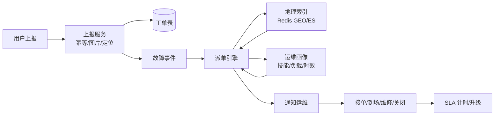
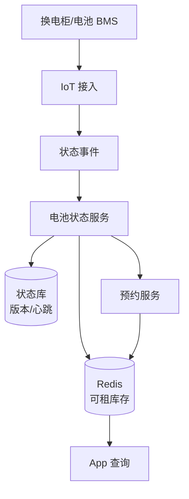
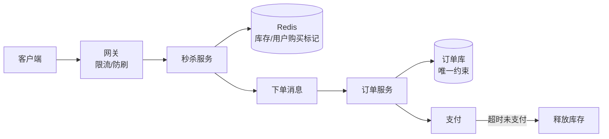
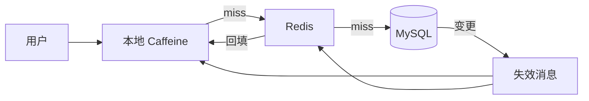
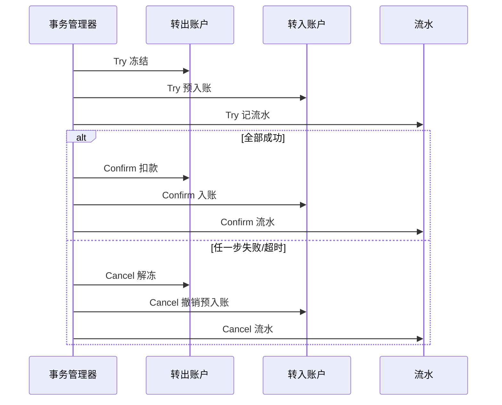
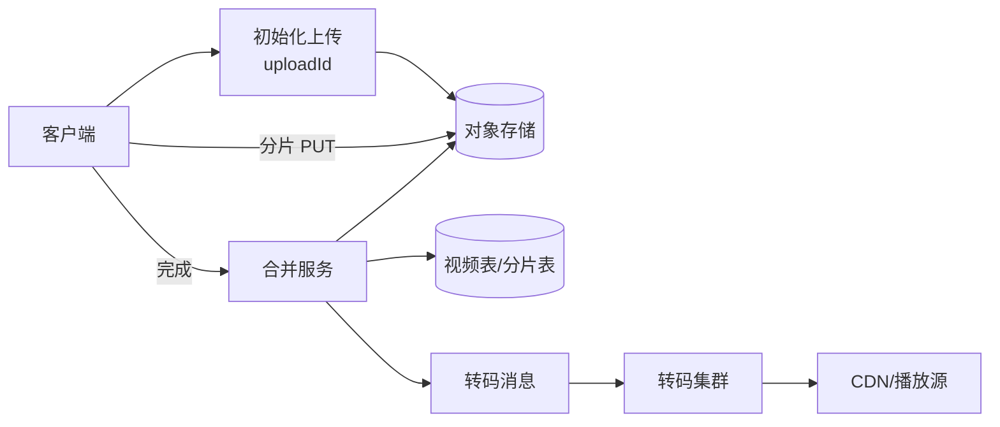
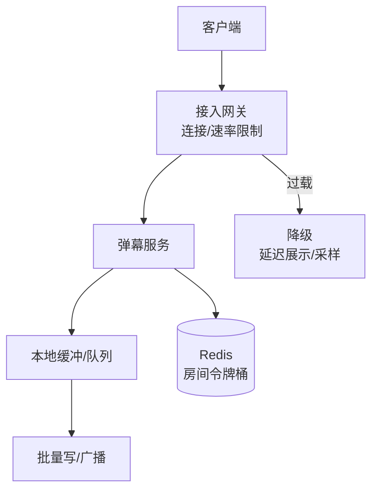

# 真实业务场景真题拆解：哈啰、喜茶、蚂蚁、B 站

> 定位：这篇不是“题目清单”，而是把公开面经里的真实问法还原成业务方案。每道题按“业务约束 → 链路设计 → 数据模型 → 正确性兜底 → 追问边界”拆开，重点训练你在面试现场把场景题答成可落地的架构，而不是背组件名。题目来自公开面经截图与求职者复盘，不代表公司官方题库；数字为示例假设。

## 一、场景题怎么答才不像背模板

真实公司的场景题有一个共同点：**面试官会给业务约束，然后一路追问到异常**。答题时按五步走：

1. **定目标**：这笔业务最怕什么？超卖、丢单、延迟、资损、体验？
2. **拆约束**：QPS、数据量、延迟、一致性、成本、合规。
3. **画链路**：同步做什么、异步做什么、状态怎么流转。
4. **保正确**：幂等、唯一约束、状态机、对账、补偿。
5. **说边界**：什么时候降级、什么时候人工、什么情况方案不适用。

下面七道题都按这个框架拆。

这批公开面经一共 85 道：哈啰 20 道、喜茶 31 道、蚂蚁 18 道、B 站 16 道。本文不平均用力，挑 7 道最能代表业务链路的题深拆；其余题可以用同一套五步框架自己练，重点不是“答出组件”，而是“答出约束与兜底”。

| 来源 | 题量 | 本文深拆 | 其余题怎么用 |
|---|---:|---|---|
| 哈啰 | 20 | 故障派单、换电柜状态 | 调度、计费、分账、跨端同步按同一“状态机 + 对账”思路练 |
| 喜茶 | 31 | 秒杀防超卖、热点菜单缓存 | 订单、库存、会员、门店调度按“读多写少/写热点”分类练 |
| 蚂蚁 | 18 | TCC 转账 | 限流、风控、账务、补偿按“资金正确性优先”练 |
| B 站 | 16 | 20GB 上传、弹幕降级 | 投稿、审核、推荐、播放按“大文件/高并发读”练 |

## 二、哈啰：车辆故障上报与 2 小时派单

### 2.1 真实问法

> 用户骑行中反馈单车刹车失灵、助力车断电，如何设计故障上报流程，同时快速匹配运维人员上门维修，确保故障车辆 2 小时内完成处理？

### 2.2 业务约束

- 安全优先：刹车/电池故障可能伤人，必须优先处理；
- 位置分散：车辆在路边、小区、地铁站，运维人员按区域网格作业；
- SLA 硬约束：2 小时不是“派单时间”，而是“到场 + 处理完成”；
- 供给有限：运维人数远少于车辆数，必须排优先级；
- 误报/重复上报：同一辆车可能被多个用户上报。

### 2.3 方案



**上报**：用户提交车辆编号、故障类型、照片、定位；用 `report_id` 或“车辆编号 + 时间窗”做幂等，避免重复工单。

**工单状态机**：

```text
REPORTED → SCREENED → DISPATCHED → ACCEPTED → ARRIVED → REPAIRED → CLOSED
                ↘ REJECTED（误报/重复）     ↘ TIMEOUT → ESCALATED
```

**派单**：先按地理网格召回候选运维，再按评分排序：

```text
score = w1 * 距离 + w2 * 当前负载 + w3 * 技能匹配 + w4 * 历史接单率 + w5 * SLA 紧急度
```

刹车/电池故障给更高紧急度；2 小时 SLA 的工单进入优先队列。运维接单后开始 SLA 计时，超时前 30 分钟升级到区域主管。

**SLA 计时**：用延迟消息/时间轮，不用全表轮询；到期检查状态，未完成则升级/改派。延迟消息可能重复，处理要幂等。

### 2.4 数据模型

| 表 | 关键字段 |
|---|---|
| `fault_ticket` | ticket_id、bike_no、type、location、status、priority、sla_deadline |
| `dispatch_record` | ticket_id、worker_id、score、dispatch_at、accept_at、arrive_at |
| `worker_profile` | worker_id、grid、skills、load、accept_rate |

### 2.5 追问与边界

- **没人接单怎么办？** 扩大召回半径、提高补贴、升级到区域主管、改派；不是无限重发。
- **用户误报怎么办？** 照片/车辆自检/历史故障辅助判定；误报不占用 2 小时 SLA，但要有申诉。
- **2 小时从什么时候算？** 从“上报确认”还是“派单成功”？业务要定义清楚，技术才能算 SLA。
- **运维到了但修不了？** 转拖车/回收，工单状态要支持“无法现场修复”，不能强行关闭。

## 三、哈啰：换电柜电池状态同步

### 3.1 真实问法

> 用户查询换电柜显示有满电电池，到现场却发现无可用电池，如何设计电池状态实时同步机制降低信息不一致率？

### 3.2 业务本质

这不是“缓存一致性”这么简单，而是**库存承诺**问题：App 展示“有满电”相当于对用户做了一个短期承诺，但电池会被别人换走、故障、离线、被预约。要区分三种状态：

- **物理状态**：在柜、满电、健康、离线；
- **可租状态**：在柜 + 满电 + 健康 + 未被预约；
- **展示状态**：App 看到的“预计可用”，允许短时间误差，但不能长期骗人。

### 3.3 方案



1. **设备上报**：柜机/BMS 上报电池在位、SOC、健康、故障、柜门状态；带 `seq` 与时间戳，乱序丢弃。
2. **状态服务**：以设备事件为准更新 DB，写 Redis 可租库存；Redis 用 Hash/Set 按柜维度组织，避免大 key。
3. **查询**：读 Redis，返回“可用数量 + 最近更新时间 + 预计可用”；不要返回绝对承诺。
4. **预约**：用户点“预约换电”时，Redis Lua 原子占用一个电池位，生成短 TTL 预约；到店核销或超时释放。
5. **对账**：定时比对 DB 物理状态与 Redis 可租状态，差异告警；设备离线标记不可租。

### 3.4 降低不一致率的关键

| 手段 | 作用 |
|---|---|
| 事件版本号 | 防止旧心跳覆盖新状态 |
| 预约占用 | 把“看到有”变成“给你留着” |
| 短 TTL | 预约超时自动释放，不永久占坑 |
| 心跳超时 | 柜机离线超过阈值，整柜降级为“不可用” |
| 展示分级 | “充足/紧张/暂无”比“精确到个数”更稳 |
| 对账补偿 | 差异工单，人工/自动修正 |

### 3.5 追问

- **Redis 和 DB 不一致怎么办？** DB 是事实，Redis 是可查询视图；以 DB 对账修正 Redis，不反向覆盖。
- **用户到了发现电池坏了？** 预约时只锁“可租”，到店核销前做一次健康校验；失败则换柜/退预约。
- **高并发预约同一块电池？** Lua 原子扣减 + 预约唯一键；DB 侧预约记录唯一约束兜底。

## 四、喜茶：秒杀特惠饮品，怎么防超卖

### 4.1 真实问法

> 如何设计一个防止超卖的秒杀系统？对比 Redis + Lua 脚本和分布式锁方案。

### 4.2 业务约束

- 库存粒度：门店 + SKU + 时段（取餐时间），不是全国一个库存；
- 用户限购：每人每天/每单限几杯；
- 峰值极高：活动开始瞬间 QPS 可能是日常几十倍；
- 不能超卖，但也不能“少卖”太多；
- 下单后未支付要释放库存。

### 4.3 方案



**Redis + Lua** 是主方案：

```lua
-- KEYS[1]=库存, KEYS[2]=用户已购集合
-- ARGV[1]=userId, ARGV[2]=购买数量
if redis.call('SISMEMBER', KEYS[2], ARGV[1]) == 1 then
  return -1  -- 已购买
end
local stock = tonumber(redis.call('GET', KEYS[1]) or '0')
if stock < tonumber(ARGV[2]) then
  return -2  -- 库存不足
end
redis.call('DECRBY', KEYS[1], ARGV[2])
redis.call('SADD', KEYS[2], ARGV[1])
return 1
```

Lua 把“查库存 + 查限购 + 扣减 + 标记用户”做成一个原子操作，避免锁的等待与超时问题。

**分布式锁方案**：先 `SET NX` 拿锁，再查库存、扣减、释放。问题是：

| 维度 | Redis + Lua | 分布式锁 |
|---|---|---|
| 原子性 | 脚本内原子 | 依赖锁范围，锁外操作仍可能并发 |
| 性能 | 单次往返，无等待 | 竞争时排队/自旋，尾延迟高 |
| 超时风险 | 无锁超时 | 锁超时可能误入 |
| 复杂度 | 脚本要可读、可测试 | 续期、释放、重入都要处理 |
| 适用 | 高并发短临界区 | 临界区长、需要互斥的业务 |

**结论**：秒杀扣库存用 Lua；分布式锁更适合“临界区长、需要跨资源互斥”的场景，不要用它硬扛秒杀。

### 4.4 正确性兜底

- Redis 扣成功不等于订单成功：MQ 异步下单，失败要回补；
- DB 订单表 `(user_id, activity_id, sku_id)` 唯一索引，防重复；
- DB 库存扣减用 `stock >= ?` 条件更新，防 Redis 与 DB 不一致时超卖；
- 未支付超时取消，延迟消息触发，释放 Redis + DB 库存；
- 日终对账：Redis 扣减、订单、支付、库存变动四方核对。

### 4.5 追问

- **Redis 挂了怎么办？** 活动降级/排队/停售；不能直接透传 DB。
- **Lua 脚本太长怎么办？** 拆成“预校验 + 原子扣减”，脚本只做必要原子操作；复杂逻辑放服务层。
- **少卖怎么处理？** 支付超时释放、失败回补、活动结束盘点；少卖通常比超卖可接受。

## 五、喜茶：新品上线，单店菜单查询 QPS 暴增

### 5.1 真实问法

> 某新品上线导致单店菜单查询 QPS 暴增，如何解决缓存击穿？

### 5.2 业务特点

菜单是**读多写少、按门店维度、强热点**：一个爆品可能让单店 QPS 从几百冲到几万；菜单变更不频繁，但价格/售罄状态要准。

### 5.3 多级缓存



- L1：Caffeine 本地缓存，按门店 + 菜单版本，TTL 短（如 5–30 秒）；
- L2：Redis，key 按 `storeId:menuVersion`，避免大 key；
- DB：菜单主表 + 售罄状态表；
- 变更：先更新 DB，再删 Redis，再发 MQ 让各实例失效本地缓存。

### 5.4 击穿怎么防

| 问题 | 方案 |
|---|---|
| 热点 key 失效瞬间打 DB | 互斥重建（本地锁/Redis 锁）或逻辑过期 |
| 大量 key 同时失效 | TTL 加随机、分批预热 |
| 缓存穿透（不存在的门店） | 空值缓存 + 参数校验 |
| 本地缓存与 Redis 不一致 | 版本号 + 失效消息 + 短 TTL |

**互斥重建**适合菜单这种“能等几十毫秒”的读；**逻辑过期**适合“绝对不能等”的读，先返回旧菜单，异步重建。

### 5.5 追问

- **价格改了，用户看到旧价怎么办？** 下单时服务端重新校验价格，前端缓存只做展示；价格以结算页为准。
- **本地缓存怎么失效？** MQ 广播 + 版本号；实例消费后清本地 key，未消费到的靠短 TTL 兜底。
- **Redis 热 key 怎么办？** 本地缓存挡主流、key 分片、读副本；不要只加 Redis 机器。

## 六、蚂蚁：TCC 转账，网络超时导致部分提交

### 6.1 真实问法

> 蚂蚁转账场景中，需跨账户服务、资金流水、风控系统完成扣款，如何用 TCC 模式实现分布式事务，处理网络超时导致的部分提交问题，确保资金数据一致？

### 6.2 TCC 的三个动作

- **Try**：检查并预留资源（冻结转出金额、预占额度），不真正扣款；
- **Confirm**：确认扣款/入账，使用 Try 的预留；
- **Cancel**：释放预留，回滚。



### 6.3 网络超时的三种情况

| 情况 | 状态 | 处理 |
|---|---|---|
| Try 超时，未执行 | 无预留 | 重试 Try；仍失败则 Cancel 空回滚 |
| Try 成功，响应丢失 | 已预留 | 事务管理器查事务状态，按结果 Confirm/Cancel |
| Confirm 超时 | 可能已扣 | 重试 Confirm，接口必须幂等；查账确认 |
| Cancel 超时 | 可能已释放 | 重试 Cancel，幂等；对账确认 |

### 6.4 关键设计

1. **事务状态表**：`tx_id`、分支状态、重试次数、最后错误；状态机驱动补偿。
2. **幂等**：Confirm/Cancel 带 `tx_id + branch_id`，唯一键防重复；已 Confirm 再 Cancel 要拒绝。
3. **空回滚**：Try 没执行，Cancel 也要能成功返回，不能报错卡住。
4. **悬挂**：Cancel 先到、Try 后到，要有防悬挂标记，后到的 Try 直接失败。
5. **对账**：TCC 不是“绝对不丢”，最终靠账户余额、流水、事务表三方对账。

### 6.5 追问

- **为什么不用 2PC？** 2PC 同步阻塞、协调者单点、数据库层锁持有时间长；TCC 是业务层预留，适合跨服务资金。
- **TCC 和 SAGA 怎么选？** 需要资源预留、隔离性强用 TCC；长流程、每步有补偿用 SAGA。
- **Confirm 失败怎么办？** 重试 + 人工/对账；不能假设一次成功。

## 七、B 站：20GB 视频分片上传与断点续传

### 7.1 真实问法

> UP 主上传 20GB 高清视频时，如何设计分片上传 + 断点续传方案，且支持视频校验和自动转码的高可用处理？

### 7.2 链路



### 7.3 关键设计

1. **初始化**：服务端创建 `uploadId`，记录文件大小、分片大小、hash、用户、标题；返回分片上传地址（预签名 URL）。
2. **分片**：20GB 按 8–64MB 分片，客户端并发 3–5 片；每片带 `partNumber`、`etag`、CRC/ MD5。
3. **断点续传**：客户端记录已完成分片；重新上传时先查服务端分片列表，只补缺失片。
4. **合并**：全部分片完成后调用合并；合并要幂等，重复请求返回同一结果。
5. **校验**：整文件 MD5/CRC 校验；不匹配则拒绝合并，要求重传坏片。
6. **转码**：合并成功后发 MQ，异步转码多码率；转码失败重试/告警，不阻塞上传成功。
7. **清理**：未完成上传按 TTL 清理分片，避免存储泄漏。

### 7.4 数据模型

| 表 | 关键字段 |
|---|---|
| `video_upload` | upload_id、user_id、file_size、part_size、status、hash、created_at |
| `video_part` | upload_id、part_number、etag、size、status |
| `video` | video_id、upload_id、play_url、transcode_status |

### 7.5 追问

- **20GB 一次算 MD5 很慢怎么办？** 分片校验 + 整文件校验结合；客户端算分片 hash，服务端合并后算整文件。
- **分片乱序/重复怎么办？** `partNumber` 唯一键，重复覆盖；合并按编号排序。
- **上传中断后怎么续？** 服务端保存分片列表，客户端按缺失分片续传；不要重新传整个文件。
- **转码失败用户能看吗？** 不能，状态要明确；可先提供原片/低码率，视业务而定。

## 八、B 站：弹幕量突增 100 倍，怎么限流降级

### 8.1 真实问法

> 拜年祭直播弹幕量突增 100 倍，如何设计网关 + 服务端多级限流策略，在弹幕服务过载时自动降级为“延迟展示”模式？

### 8.2 业务特点

- 弹幕是**高写入、低价值密度、可丢弃/可延迟**；
- 房间维度热点明显，单一直播间可能占全局大部分流量；
- 用户对“延迟几秒”可接受，对“全站卡死”不可接受；
- 还要防刷屏、敏感词、重复内容。

### 8.3 多级限流



- **连接级**：单 IP/单用户连接数、发送频率；
- **房间级**：每房间令牌桶，按热度动态分配配额；
- **全局级**：服务端总 QPS 上限，超过则排队/采样；
- **业务级**：重复内容、敏感词、刷屏直接丢弃。

### 8.4 降级策略

| 级别 | 策略 | 用户体验 |
|---|---|---|
| 正常 | 实时广播 | 即时 |
| 一级 | 本地缓冲，批量发送 | 几百毫秒延迟 |
| 二级 | 采样展示（如每 10 条取 1 条） | 弹幕变少 |
| 三级 | 延迟展示/只显示热门弹幕 | 明显延迟 |
| 四级 | 关闭弹幕写入，保留播放 | 可看视频 |

关键是**降级要自动、可恢复、可观测**：过载触发，指标回落逐步恢复；不能一刀切永久关闭。

### 8.5 追问

- **弹幕丢了用户会投诉吗？** 弹幕是可降级业务，先保播放；重要弹幕（主播/管理员）可优先。
- **Redis 热 key 怎么办？** 房间分片、本地令牌桶、网关粗粒度限流。
- **怎么防刷？** 设备指纹、频率、内容相似度、黑名单；限流不是唯一手段。

## 九、七道题的共同套路

| 题型 | 第一优先级 | 关键兜底 |
|---|---|---|
| 派单/SLA | 状态机 + 地理召回 + 优先级 | 超时升级、改派、幂等 |
| 库存展示 | 事实源 vs 可租视图 | 预约、TTL、心跳、对账 |
| 秒杀 | 原子扣减 | 唯一约束、回补、对账 |
| 热点读 | 多级缓存 | 互斥重建、版本、失效广播 |
| 资金事务 | 预留/确认/取消 | 幂等、空回滚、防悬挂、对账 |
| 大文件 | 分片 + 断点 | 校验、合并幂等、清理 |
| 流量突增 | 多级限流 | 降级分级、恢复、可观测 |

## 面试高频问法

- **问**：场景题要不要一上来画架构？
  **答**：先问业务目标和约束，再画链路；否则架构图只是组件堆砌。
- **问**：怎么证明方案可靠？
  **答**：给出幂等键、状态机、唯一约束、补偿任务、对账口径，而不是只说“MQ 保证不丢”。
- **问**：缓存和 DB 不一致怎么办？
  **答**：明确事实源，缓存只做视图；用版本/失效/对账修正，不反向覆盖。
- **问**：流量突增先做什么？
  **答**：先限流保命，再隔离/降级，最后扩容；扩容前先看 DB、Redis、下游配额。
- **问**：TCC 超时怎么处理？
  **答**：事务状态表 + 查询/重试 + 幂等 + 空回滚 + 防悬挂 + 对账。

## 小结

- 真实场景题考的是“业务约束下的取舍”，不是组件背诵。
- 哈啰类调度题先做状态机与 SLA，再做地理召回与评分。
- 库存类题目要区分“物理库存、可租库存、展示库存”，预约与对账是核心。
- 秒杀用 Lua 原子扣减，分布式锁不适合短临界区高并发。
- 资金类用 TCC，重点在幂等、空回滚、防悬挂、对账。
- 大文件用分片/断点/校验/异步转码，弹幕用多级限流与分级降级。
